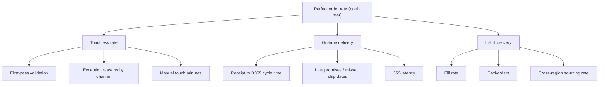
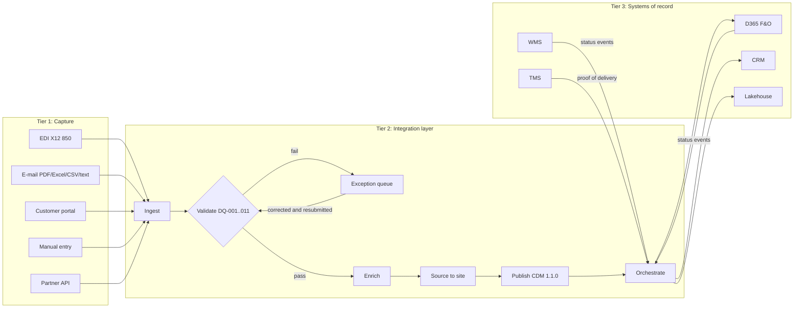

# Sales Order Data Product: Business and System Requirements Specification

Taylor Farms · Sales Order data product · Order Status API · Regional operations · Data marketplace

---

## Document control

| Item | Value |
|---|---|
| Document | Business and System Requirements Specification (BRS/SRS) |
| Version | 2.0 |
| Date | 2026-11-14 |
| Status | Draft for review |
| Owner | Sales Order data product owner (to be named, decision D-1) |
| Authors | Solution architecture, Sales Order data product team |
| Related documents | [00 Solution blueprint](00-solution-blueprint.md) · [02 Technical design](02-technical-design.md) · [03 Canonical data model](03-canonical-data-model.md) · [04 Azure reference architecture](04-azure-reference-architecture.md) · [05 Product strategy](05-product-strategy.md) · [06 One-click Azure deployment](06-azure-one-click-deployment.md) |
| Source material | *Taylor Farms Sales Order Data Product* deck (slides 1–14) and the working solution in this repository |

### Revision history

| Version | Date | Summary |
|---|---|---|
| 1.0 | 2026-11-13 | Original requirements for the three-tier Sales Order data product. Covered channel capture (EDI, email, portal, manual, partner API), validation DQ-001..011, enrichment, the canonical model, orchestration to D365/WMS/TMS/CRM/Lakehouse, exception management, the Order Status API with order and order-group history, acknowledgements (997/855/856/810), analytics feeds, the operations console and `deploy.sh`. |
| 2.0 | 2026-11-14 | Restated against the built solution. Added: <ul><li>the regional and national operating model (regions, sites, demand region, national/regional accounts) and network-aware sourcing (CDM 1.1.0 `fulfillment`);</li><li>scope filters across the Order Status API;</li><li>service-level metrics (OTIF, fill rate, revenue, perfect order rate) and the national command center;</li><li>orders at risk;</li><li>the data marketplace (15 governed datasets with preview, export, access governance and audit);</li><li>the API explorer with an input/output call log and scenario runner;</li><li>demo data;</li><li>Windows support;</li><li>one-click Azure deployment (GitHub Actions with OIDC, Template Spec, Deploy-to-Azure button) with automatic resource provider registration.</li></ul>Every requirement now carries a **Status** (Built / Partial / Planned), and traceability points to real tests. |

### Approvals

| Role | Name | Decision | Date |
|---|---|---|---|
| Executive sponsor | | | |
| Sales Order data product owner | | | |
| Customer Service director | | | |
| Regional operations representative | | | |
| Finance (order to cash) | | | |
| IT Integration lead | | | |
| D365 platform lead | | | |
| Data platform lead | | | |
| Information Security | | | |

### Conventions

- **Priority** (MoSCoW): **M** Must, **S** Should, **C** Could, **W** Won't (this phase).
- **Status:**
  - **Built**: implemented in this repository and covered by automated tests or the smoke test.
  - **Partial**: implemented with a documented gap.
  - **Planned**: specified, not yet built.
- **Requirement IDs:** FR = functional, NFR = non-functional, BR = business rule, US = user story, D = decision, R = risk, A = assumption, C = constraint, DEP = dependency.
- **API paths** are written as seen through the gateway: `/exp/...` (Experience), `/process/...` (Process, including the Order Status API) and `/system/...` (System). Locally the gateway prefixes `/api`; in Azure, API Management serves them at its gateway URL.
- **Terms** are defined in the [Glossary](#19-glossary).

---

## 1. Purpose and scope

### 1.1 Purpose

This document specifies what the Sales Order data product must do for Taylor Farms. It covers:

- capturing every sales order from any channel;
- validating it once against shared rules and enriching it from master data;
- sourcing it from the right facility in the regional network;
- publishing it as one canonical record;
- orchestrating fulfilment in D365, WMS and TMS;
- giving every consumer one status and one complete lifecycle history.

It also specifies the consumption experiences built around the data product:

- the Order Status API;
- the national and regional command center;
- orders at risk;
- the data marketplace;
- the operations console;
- deployment to Azure with one click.

It is the basis for acceptance testing, pilot planning and change control.

### 1.2 In scope

| Area | Scope |
|---|---|
| Tier 1, Capture | EDI X12 850; e-mail (body, CSV, Excel, PDF); customer portal; customer-service manual entry; partner REST API |
| Tier 2, Integrate | Experience, Process and System APIs:<ul><li>ingest, validate (DQ-001..011), enrich;</li><li>regional sourcing;</li><li>canonicalize and publish (CDM 1.1.0);</li><li>orchestrate;</li><li>exception management;</li><li>Order Status API, webhooks, KPIs, orders at risk;</li><li>data marketplace API.</li></ul> |
| Tier 3, Fulfil | D365 F&O (live OData adapter plus a functional simulator), WMS and TMS status events, CRM timeline, Lakehouse (bronze landing; Databricks bronze/silver/gold pipeline) |
| Customer communication | EDI 997, 855, 856, 810; e-mail/portal notifications; signed status webhooks |
| Regional operations | Regions, processing sites and per-site inventory as reference data; national vs regional accounts; scope filters (National / region / site / account scope) across APIs and UI |
| Consumers | Operations console, data marketplace (catalog, preview, export, access requests), API explorer, Databricks gold marts |
| Platform | Local (Windows/Linux/macOS), Docker, Azure (Bicep); one-click Azure deployment via GitHub Actions, Template Spec or the Deploy-to-Azure button |

### 1.3 Out of scope (this phase)

| Item | Reason / where handled |
|---|---|
| Pricing engine, credit decisions, inventory allocation logic | Mastered in D365. The data product consumes the outcomes |
| Warehouse execution and transport planning | WMS/TMS. The System API only adapts their events |
| X12 860/865 change orders | Roadmap, "Next" in [05 Product strategy](05-product-strategy.md) |
| Freight-cost and shelf-life-optimised sourcing | Roadmap, "Next" |
| Demand sensing / ML forecasting | Roadmap, "Later" |
| Consumer (B2C) ordering and payments | Not a Taylor Farms channel for this product |
| AS2 transport and M365 mailbox monitoring as code | Configured in Logic Apps in Azure (FR-011, FR-017); the repository provides the HTTP contract they call |

### 1.4 Pilot recommendation

Pilot **EDI** with 2–3 national accounts in **one region**, with that region's command center live. EDI carries the highest volume and the highest chargeback exposure (855/856 timeliness), has fully deterministic input, and exercises the whole lifecycle. National accounts let the pilot prove the regional view against the national roll-up. Email follows, once the confidence threshold (DQ-011) is tuned on real mail.

---

## 2. Business context and problem statement

### 2.1 Current state: "interface thinking" (deck slide 3)

- Each channel is wired separately to the ERP, so validation rules are duplicated and drift apart.
- Nobody owns order quality, and problems are found by customers.
- Order status is scattered across D365, WMS, TMS, CRM, e-mail and spreadsheets. Customer service rebuilds the picture for each enquiry.
- Management sees one national number that hides regional reality: a site short on inventory, a region whose exception queue is growing, a national account served well in one region and badly in another.
- Perishable product leaves no time to correct after shipment. Late or wrong 855/856 documents cause retailer chargebacks.

### 2.2 Target state: "data product thinking"

- **One canonical order**, whatever the channel, published under a versioned contract.
- **Rules defined once** and applied to every order before it reaches D365.
- **A named owner** accountable for quality, contract and service levels, with a data steward per region.
- **One place to see status**, for one order, a group of orders, a region or the whole country.
- **Self-service, governed access to the data** through a marketplace, with lineage, freshness and audit.

### 2.3 Problem statement

> Taylor Farms receives sales orders through five channels, each integrated separately with D365. Validation is inconsistent, exceptions are found late, fulfilment sourcing ignores where stock actually is, and status is fragmented across systems and invisible by region. This drives rework, credits and reshipments, chargebacks, slow order to cash and a high cost to serve. The business needs one governed Sales Order data product that validates and sources every order, tracks it from receipt to invoice, measures service by region and nationally, and makes the data available to every team under governance.

---

## 3. Vision, objectives, KPIs and ROI

### 3.1 Product vision and north-star metric

> Every Taylor Farms order is captured once, sourced from the right facility, and delivered on time and in full. Any team can see and use the same trusted order data for its own scope, from the whole country down to one site.

**North-star metric: Perfect Order Rate.** A perfect order is a delivered order that was **touchless** (no manual correction) **and on time** (delivered on or before the requested delivery date) **and in full** (every line delivered complete). It improves only when cost to serve and the customer promise both improve.

Guardrails: revenue, orders and value at risk, chargeback-risk flags, data freshness.

### 3.2 Business objectives

| ID | Objective | Business outcome |
|---|---|---|
| BO-1 | Increase the share of orders that reach D365 with no manual correction | Lower cost to serve |
| BO-2 | Shorten receipt-to-D365 and receipt-to-invoice cycle times | Faster order to cash |
| BO-3 | Catch bad orders before they ship | Fewer errors, credits and reshipments |
| BO-4 | Send acknowledgements and ship notices on time | Fewer chargebacks |
| BO-5 | Source each order from the facility that can fill it | Higher in-full delivery, less backorder |
| BO-6 | Measure and manage service by region, site and account type | Accountable regional operations; better national-account service |
| BO-7 | Act on at-risk orders before the customer notices | Service recovery, not reporting |
| BO-8 | Give every team governed, self-service access to order data | Reuse instead of new interfaces; faster analytics |
| BO-9 | Onboard a new customer or channel through existing ports | Faster onboarding |

### 3.3 KPIs

All KPIs are computed live by `GET /process/v1/metrics/kpis` for any scope (National, `region`, `site`, `accountScope`) and broken down `byChannel`, `byRegion`, `bySite` and `byAccountScope`. They are reproducible from the Databricks gold marts. **Targets are set with the product owner after a one-quarter baseline** (decision D-6). The formulas are fixed now so that baseline and post-go-live figures are comparable.

| KPI | Definition / formula | Source (CDM) | Indicative target (to confirm) |
|---|---|---|---|
| **Perfect order rate** | delivered orders that are touchless ∧ on time ∧ in full ÷ delivered orders | `roi.touchless`, `roi.stageTimestamps.delivered`, `dates.requestedDeliveryDate`, `lines[].quantities` | TBD after baseline |
| Touchless order rate | orders reaching D365 with `roi.touchless = true` ÷ orders reaching D365 | `roi.touchless`, `roi.stageTimestamps.erpCreated` | EDI ≥ 85 %, portal ≥ 90 %, e-mail ≥ 60 % |
| First-pass validation rate | orders whose first validation passed ÷ orders validated | `dataQuality.firstPass` | ≥ 90 % |
| Receipt → D365 cycle time | mean (gold: median, p90) of `erpCreated − received` in minutes, by channel | `roi.stageTimestamps` | EDI p90 < 15 min |
| Receipt → ship | mean of `shipped − received` in hours | `roi.stageTimestamps` | TBD |
| OTIF rate | delivered orders on time ∧ in full ÷ delivered orders | as above | ≥ 95 % |
| On-time delivery rate | delivered on or before the requested date ÷ delivered | `stageTimestamps.delivered`, `dates.requestedDeliveryDate` | ≥ 97 % |
| In-full rate | delivered with every line `delivered ≥ ordered` ÷ delivered | `lines[].quantities` | ≥ 97 % |
| Fill rate | Σ shipped ÷ Σ ordered quantity, over orders that shipped | `lines[].quantities` | ≥ 98 % |
| Orders / value at risk | count and order value of open orders matching at least one at-risk rule (FR-150) | `GET /process/v1/orders/at-risk` | Downward trend |
| Cross-region sourcing rate | orders fulfilled outside the ship-to's region ÷ sourced orders | `fulfillment.crossRegion` | Monitored; planning signal |
| Data freshness | lag between source event time and data product record time, events from D365/WMS/TMS (future-dated events excluded) | `orderHistory[].occurredAt/recordedAt` | p95 < 60 s |
| Acknowledgement timeliness | EDI orders with 855 within partner SLA; 856 latency after ship | `roi.acknowledgmentTimestamps`, `roi.cycleTimes.shipToAsnMinutes`, `roi.chargebackRisk` | ≥ 99 % |
| Revenue / average order value | Σ order total (excl. cancelled and rejected) ÷ orders | `totals.grandTotal` | n/a (guardrail) |

### 3.4 ROI model (deck slide 4)

Every order carries the tags needed to compute benefit, so benefit can be reported by channel, customer, region and site directly from the data product.

| Value driver | Tag carried on each order | Conversion to dollars |
|---|---|---|
| Labour saved | `roi.touchless`, `roi.touchCount`, `roi.manualTouches[].minutes`, `source.channel` | Touches avoided × minutes per touch × loaded labour rate |
| Errors avoided | `roi.exceptionReasonCodes[]` (caught before D365) | Errors avoided × average cost of a credit or reshipment |
| Chargebacks avoided | `roi.acknowledgmentTimestamps.{functionalAck997, poAck855, shipNotice856, invoice810}`, `roi.chargebackRisk[]` | Reduction in customer fines for late or incorrect documents |
| Cash sooner | `roi.stageTimestamps.{received … invoiced}`, `roi.cycleTimes` | Days saved × average daily revenue × cost of capital |
| In-full / sourcing | `fulfillment.sourcing`, `lines[].quantities.backordered` | Backorders avoided × margin at risk |
| Reuse | Marketplace consumers and exports, webhook subscriptions, APIM subscriptions | Interfaces not built × average cost of an interface |

**ROI = (annual benefit − annual run cost) ÷ investment.**

- The KPI API exposes `estimatedLaborSavedHours` and `estimatedLaborSavedUsd`. Assumptions (8 baseline manual minutes per order, labour rate parameter `laborRatePerHour`) are returned under `assumptions`.
- Run cost is taken from Azure Cost Management, using the resource-group tags `data-product = sales-order` and `environment`.
- Drivers are baselined for one quarter before go-live (BR-20).

---

## 4. Stakeholders, RACI and personas

### 4.1 Stakeholders

| Stakeholder | Interest |
|---|---|
| Executive team | One page that says whether the business is winning: perfect order rate, OTIF, value at risk, by region |
| Sales Order data product owner | Contract, quality rules, service levels, ROI evidence, marketplace governance |
| Regional general managers / operations leads | Service in their region, site performance, exception and at-risk lists |
| National account managers | How each national account is served across all regions |
| Customer service (regional) | Answer "where is my order", fix exceptions, enter phone and fax orders |
| Supply planning | Where demand lands, where stock is short, cross-region sourcing |
| Finance (order to cash, credit) | Receipt to invoice, credit holds, revenue by region, audited exports |
| Analytics / data science | Governed, documented datasets with lineage and freshness SLAs |
| Data owners / stewards | Approve access to confidential data; own reference data per region |
| IT Integration (EAI) | Build and run Experience/Process/System APIs, messaging, monitoring |
| D365 platform team | Data entities, business events, warehouses, credit configuration |
| Platform / DevOps | Azure subscription, deployment pipelines, identity, cost |
| Information Security | Identity, secrets, PII, audit |
| Trading partners and customers | Timely 997/855/856/810, accurate status, fewer chargebacks |

### 4.2 RACI

Key: R = Responsible, A = Accountable, C = Consulted, I = Informed.

| Activity | Product owner | Regional ops | Customer service | Finance | IT Integration | D365 team | Data platform | DevOps | InfoSec |
|---|---|---|---|---|---|---|---|---|---|
| Canonical model and versioning | A | C | C | C | R | C | C | I | I |
| Data quality rules DQ-001..011 | A | C | R | C | R | C | I | I | I |
| Regions, sites, inventory reference data | C | A | I | I | R | R | I | I | I |
| Sourcing rules | A | R | I | I | R | C | I | I | I |
| Exception queue operation | A | C | R | I | C | I | I | I | I |
| D365 sales order mapping and events | C | I | I | C | R | A | I | I | I |
| Order Status API, KPIs, SLAs | A | C | C | C | R | I | C | I | C |
| Marketplace catalog and access approvals | A | C | I | C | R | I | R | I | C |
| Lakehouse feeds and gold marts | C | C | I | C | C | I | A/R | I | I |
| One-click deployment and environments | I | I | I | I | C | I | I | A/R | C |
| Security, identity, secrets | C | I | I | I | R | C | C | R | A |
| ROI baseline and reporting | A | C | C | R | C | I | R | I | I |

### 4.3 Personas

| Persona | Role | Goals | Pain today | Primary touchpoints |
|---|---|---|---|---|
| **Carla, CS representative (West)** | Calls, phone/fax entry, fixes problems | Status in one screen; fix an order in minutes; see only her region's queue | Searches four systems per enquiry | Console scoped to West, exception queue, orders at risk |
| **Omar, CS lead** | Queue health and SLAs | Exceptions by reason and age; first-pass trend | No queue | Exceptions, dashboard |
| **Rosa, Regional GM (Central)** | Runs regional operations | OTIF, fill rate, revenue and at-risk value for her region; which site is struggling | Only national numbers | Regional command center, site drill-down |
| **Nate, National account manager** | Owns FreshMart and Sunrise | How a national account is served in every region | No cross-region view | Account scope "National accounts", byRegion table |
| **Priya, Supply planner** | Plans processing and inventory | Where demand lands; where stock is short; cross-region orders | Learns of shortages from backorders | Sourcing card, Sites & Inventory dataset, cross-region rate |
| **Frank, Finance / credit** | Order to cash | Receipt to invoice; credit holds; audited data extracts | Manual extracts | Invoices dataset (approved access), KPIs |
| **Dana, Data analyst** | Analytics and AI | Find trusted data, understand it, get it quickly | Rebuilds history from extracts | Data marketplace, Databricks gold |
| **Owen, Data owner / steward** | Governs a domain | Approve access with a purpose; see who exported what | Uncontrolled spreadsheets | Marketplace access tab, export audit |
| **Ian, Integration engineer** | Builds and runs integrations | One pattern, observable, replayable | Point-to-point interfaces | All APIs, API explorer, App Insights |
| **Devi, Platform engineer** | Azure environments | Deploy dev/test/prod reliably, no secrets | Hand-built environments | GitHub "Deploy to Azure", Template Spec |
| **Raj, Retail buyer (external)** | Orders via EDI or portal | Timely 855/856/810; self-service status | Calls CS | EDI acks, portal status, webhooks |
| **Nina, Partner developer (external)** | System-to-system ordering | Stable, documented API and signed webhooks | Bespoke interfaces | Partner API, Status API, webhooks |
| **Exec team** | Leadership | One page with the north star and drill-down | Monthly decks | National command center |

---

## 5. End-to-end business process

### 5.1 Lifecycle stages

| # | Stage | Tier | Description | Order statuses | Key history events |
|---|---|---|---|---|---|
| 1 | Capture | 1 | Order arrives by EDI, e-mail, portal, manual entry or partner API | RECEIVED | ORDER_RECEIVED, DOCUMENT_SENT (997), ORDER_LINKED |
| 2 | Ingest | 2 | Translated into the working format; `orderId` assigned | INGESTED | ORDER_INGESTED |
| 3a | Validate | 2 | DQ-001..011 evaluated. The demand region is set as soon as the ship-to is resolved | VALIDATED or EXCEPTION | VALIDATION_PASSED / VALIDATION_FAILED, ORDER_CORRECTED, ORDER_RESUBMITTED |
| 3b | Enrich | 2 | Customer, ship-to, item and pricing master data applied | ENRICHED | ORDER_ENRICHED |
| 3c | Source | 2 | Network-aware sourcing chooses the processing site; decision recorded | (ENRICHED) | ORDER_SOURCED |
| 4 | Publish | 2 | Canonical order (CDM 1.1.0) published under the contract | PUBLISHED | ORDER_PUBLISHED |
| 5 | Create in D365 | 3 | Sales order created against the sourced warehouse; credit and inventory checked | SUBMITTED_TO_ERP → ACCEPTED / CREDIT_HOLD / ERP_REJECTED | SUBMITTED_TO_ERP, ERP_ACCEPTED, INVENTORY_RESERVED, LINE_BACKORDERED, CREDIT_HOLD_PLACED, DOCUMENT_SENT (855) / NOTIFICATION_SENT |
| 6 | Fulfil | 3 | Released, picked, packed, shipped (full or partial), delivered | RELEASED → PICKED → PACKED → PARTIALLY_SHIPPED / SHIPPED → DELIVERED | RELEASED_TO_WAREHOUSE, PICKED, PACKED, SHIPPED, DELIVERED, DOCUMENT_SENT (856) |
| 7 | Invoice and analyse | 3 | Invoice posted; history feeds analytics | INVOICED → CLOSED | INVOICED, DOCUMENT_SENT (810), CLOSED |

Exception paths at any point: EXCEPTION, ERP_REJECTED, CREDIT_HOLD and ON_HOLD (category ACTION_REQUIRED); CANCELLED and REJECTED (terminal).

### 5.2 What the customer hears back

| Document / message | When | Channel |
|---|---|---|
| 997 Functional Acknowledgement | Synchronously on receipt of each 850 interchange (accept / reject per transaction set) | EDI |
| 855 PO Acknowledgement | On D365 acceptance (accepted, or accepted with changes when lines are backordered) | EDI |
| 856 Advance Ship Notice | On each shipment, with SSCC, lot numbers and carrier | EDI |
| 810 Invoice | On invoice posting | EDI |
| Order confirmation, shipment notice, invoice notice | Same milestones | E-mail / portal |
| Status webhook (CloudEvent, HMAC signed) | Every matching lifecycle event | Partners / any subscriber |

### 5.3 Process flow

### 5.4 Exception principle (deck slide 8)

No order is dropped. Each is tracked by `orderId` from receipt to resolution:

1. An order that fails a rule is held in the exception queue, visible to its region.
2. Customer service corrects it.
3. It re-enters at validation.

Orders whose master data is temporarily unavailable stay INGESTED and are retried automatically.

---

## 6. Functional requirements

Each table lists the requirement, its priority (Pri), its status (Sts) and its acceptance criteria. Key requirements also have Given/When/Then scenarios.

### 6.1 Channel capture: common (FR-001 … FR-004)

| ID | Requirement | Pri | Sts | Acceptance criteria |
|---|---|---|---|---|
| FR-001 | Every channel shall submit through its own Experience API over the shared Process intake (`POST /process/v1/orders/intake`). No channel writes to D365 directly. | M | Built | Every order has `source.channel`; D365 is only called by the System API. |
| FR-002 | Each order receives an immutable `orderId` (`SO-YYYYMMDD-XXXXXXXX`, 8 upper-case hex) and an `orderGroupId` (`OG-YYYYMMDD-XXXXXXXX`), returned synchronously. | M | Built | 202 response contains `orderId`, `orderGroupId`, `status`, `statusCategory`, `exceptions[]`, `warnings[]`, `statusUrl`, `historyUrl`, `correlationId`. |
| FR-003 | Order-creating POSTs honour `Idempotency-Key`: a repeated key returns the original response and creates no second order. EDI uses the key `edi:<ISA06>:<ISA13>:<ST02>` and e-mail uses `email:<messageId>`. | M | Built | Replay returns the same `orderId` with `idempotentReplay = true`. Keys are kept until purged (retention job **Planned**). |
| FR-004 | Validation problems are returned with the 202 so the submitter can act immediately; the order is still created and tracked. | M | Built | Bad price → 202 with status EXCEPTION and `exceptions[].code = PRICE_MISMATCH`. |

### 6.2 Capture: EDI (FR-005 … FR-011)

| ID | Requirement | Pri | Sts | Acceptance criteria |
|---|---|---|---|---|
| FR-005 | Accept raw X12 850 interchanges at `POST /exp/edi/v1/x12/850` (`text/plain`), and return a 997 in the response (`ack997`), stored as an outbound document. | M | Built | The 997 has AK1 with the GS control number, AK2/AK5 per ST, and AK9 with counts. |
| FR-006 | One interchange with several ST/SE sets creates one order per set; all share an `orderGroupId`. | M | Built | Two ST loops → two orders, same group; the group history merges both. |
| FR-007 | The sender (ISA06) resolves to a trading partner and customer. An unknown sender returns 422 and creates no order. If `x-partner-id` is present and does not match ISA06, the response is 403. Malformed X12 returns 400. | M | Built | `test_unknown_partner_and_bad_x12`. |
| FR-008 | The mapping covers: <ul><li>header: BEG (purpose, type, PO, release, date), CUR, REF (DP/CT/PD), PER, FOB, ITD;</li><li>dates and transport: DTM (002, 010, 001, 037, 063, 064), TD5, SAC (header or line);</li><li>notes: MSG/NTE;</li><li>parties: N1/N3/N4 (ST/BT/BY/SF/SO with qualifiers 92/UL/1);</li><li>lines: PO1 (qty, UOM, price, IN/BP/VN/VP/UP/UK/EN), PID, CTT.</li></ul> | M | Built | `test_parse_850`. |
| FR-009 | Buyer item numbers, UPC and GTIN resolve to Taylor Farms items through the cross-reference. N1*ST location codes and GLNs resolve to ship-tos. | M | Built | FM-55012 → TF-10001; FM-DC12 → ST-1001-01. |
| FR-010 | SE segment count or control mismatches mark the set rejected (AK5 R) without creating an order for it. | M | Built | `test_segment_count_error_yields_rejection`. |
| FR-011 | In Azure, AS2/VAN receipt and envelope decoding are performed by Logic Apps (Integration Account) before calling the Experience API. | S | Planned | Logic App run history shows decode, then the APIM call. |

### 6.3 Capture: e-mail (FR-012 … FR-017)

| ID | Requirement | Pri | Sts | Acceptance criteria |
|---|---|---|---|---|
| FR-012 | Accept e-mail orders at `POST /exp/email/v1/orders` (`{messageId, from, to, subject, receivedAt, body, attachments[{fileName, contentType, contentBase64}]}`). | M | Built | E-mail with a CSV attachment creates an order. |
| FR-013 | Extraction supports CSV, XLSX, plain text (body or attachment) and PDF. PDF uses Azure AI Document Intelligence when configured (`TFSO_DOCINTEL_ENDPOINT`), otherwise local text extraction. | M | Built | `test_email_csv_attachment_and_low_confidence`, `test_email_text_and_table_parsing`. |
| FR-014 | Header fields (PO, customer, ship-to, delivery date) are read from the body or the attachment. When the customer is absent, it is matched from the sender's e-mail domain against customer contacts. | M | Built | Order from `@greenleafcafe.example` resolves to C-1003. |
| FR-015 | Each extraction has a confidence score (0..1) and a list of low-confidence fields. Below 0.80 the order fails DQ-011. | M | Built | A vague e-mail → EXCEPTION, `EXTRACTION_LOW_CONFIDENCE`. |
| FR-016 | The original message (metadata, body, attachment names) is retained as an inbound document. | M | Built | Documents list shows the inbound JSON. |
| FR-017 | In Azure, a Logic App monitors the shared M365 inbox and posts messages to the Experience API. | S | Planned | New mail → order within 2 minutes. |

### 6.4 Capture: portal and manual entry (FR-018 … FR-022)

| ID | Requirement | Pri | Sts | Acceptance criteria |
|---|---|---|---|---|
| FR-018 | Portal and manual orders use `POST /exp/portal/v1/orders` (`PortalOrderRequest`) with `channel` = `PORTAL` or `MANUAL`. | M | Built | Both accepted; `source.channel` reflects the value. |
| FR-019 | Manual entry uses the same form and rules as the portal (deck slide 7). The `enteredBy` user is the actor; manual orders are not touchless and record an 8-minute manual touch. | M | Built | History actor type USER; `roi.touchless = false`. |
| FR-020 | Pickers for customers (with account scope and regions), ship-tos (with region), items with the customer's contract price, and regions/sites come from `/exp/portal/v1/catalog/*`. | M | Built | `/catalog/items?customerId=` returns `contractPrice`; `/catalog/regions` lists regions with sites. |
| FR-021 | When a token carries a customer claim (`extension_customerId`), the customer can access only their own orders; any other customer's order returns 403. | M | Partial | Enforced in code; Entra External ID tenant and claims mapping are **Planned**. |
| FR-022 | Customers see a customer-facing status view (`GET /exp/portal/v1/orders/{id}`) with no ROI or internal exception detail. | M | Built | `roi` absent, `openIssues` present. |

### 6.5 Capture: partner API (FR-023 … FR-026)

| ID | Requirement | Pri | Sts | Acceptance criteria |
|---|---|---|---|---|
| FR-023 | Partners submit in the canonical draft format (`POST /exp/partner/v1/orders`), identified by `x-partner-id`. Missing `lines[]` returns 422. | M | Built | `test_partner_order_prices_from_agreement`. |
| FR-024 | Lines without a price are priced from the customer agreement (source `CUSTOMER_AGREEMENT`, `agreementId` recorded). | M | Built | TF-30001 for C-1005 → 17.95, `TA-BMK-2026`. |
| FR-025 | Partner payloads are validated against the published JSON Schema subset, with field-level errors. | S | Planned | Schema-invalid payload → 422 with `errors[].field`. |
| FR-026 | Partner traffic is authenticated (APIM subscription key; Entra client credentials in target state) and rate limited per subscription. | M | Partial | APIM product policies (`infra/apim/policies`) include rate limiting on non-Consumption SKUs; Entra client credentials **Planned**. |

### 6.6 Ingest (FR-030 … FR-034)

| ID | Requirement | Pri | Sts | Acceptance criteria |
|---|---|---|---|---|
| FR-030 | Intake translates every payload into the canonical working format before any rule runs; it records ORDER_RECEIVED (tier 1, channel source system, receipt time) and ORDER_INGESTED. | M | Built | Sequence 1 = ORDER_RECEIVED; ORDER_INGESTED follows. |
| FR-031 | Raw inbound content is stored as an inbound document linked to the order, with control numbers. | M | Built | `X12_850 INBOUND` listed. |
| FR-032 | Orders in an existing group are linked (`relatedOrders` SAME_INTERCHANGE, event ORDER_LINKED). | M | Built | The second ST order lists the first. |
| FR-033 | When master data is unavailable, the order stays INGESTED and a background sweeper retries every 30 s; no order is lost. | M | Built | Order completes once the System API recovers. |
| FR-034 | `x-correlation-id` propagates end to end: gateway → Experience → Process → bus → System → history entries. | M | Built | The same correlation id appears on all history entries of one request. |

### 6.7 Validation (FR-040 … FR-052)

Rules are defined once and applied to every order. All rules run on every pass, with no fail-fast, and the results are written to `dataQuality.results[]`, which records the attempt number, first-pass flag and score. Every failing ERROR rule opens an exception; a passing re-validation resolves previously open DQ exceptions.

| ID | Rule | Logic (as built) | Severity | Pri | Sts |
|---|---|---|---|---|---|
| FR-040 | DQ-001 Sold-to customer exists and is active | Not found → CUSTOMER_NOT_FOUND. Inactive → CUSTOMER_INACTIVE, with the blocked reason when known | ERROR | M | Built |
| FR-041 | DQ-002 Ship-to exists, belongs to the customer, is active | Resolved by id, EDI location code, GLN or name. Codes: SHIPTO_NOT_FOUND, SHIPTO_CUSTOMER_MISMATCH, SHIPTO_INACTIVE | ERROR | M | Built |
| FR-042 | DQ-003 Item exists and is active | Resolved by item number, buyer item, GTIN, UPC or vendor item. Codes: ITEM_NOT_FOUND, ITEM_INACTIVE | ERROR | M | Built |
| FR-043 | DQ-004 UOM valid for the item | UOM must be in the item's `salesUoms`. Code UOM_INVALID | ERROR | M | Built |
| FR-044 | DQ-005 Price matches the agreement | Only when a price is sent: within ±0.5 % (minimum $0.01) of the agreement price, or the list price when there is no agreement. EA prices are derived from the case price. Code PRICE_MISMATCH | ERROR | M | Built |
| FR-045 | DQ-006 No duplicate open order | Same customer and PO on another open, non-exception order. Skipped for CHANGE/CANCELLATION purposes. Code DUPLICATE_ORDER | ERROR | M | Built |
| FR-046 | DQ-007 Requested date achievable | Past date → DATE_IN_PAST. Ship-by date (delivery − transit days) earlier than the earliest ship date (today + max lead time − 1, +1 day after the 22:00 UTC cut-off) → DATE_NOT_ACHIEVABLE. A non-receiving weekday at the ship-to → NON_RECEIVING_DAY (WARNING) | ERROR / WARNING | M | Built |
| FR-047 | DQ-008 Quantity valid | > 0 (QUANTITY_INVALID); ≥ minimum and a multiple of the order increment (QUANTITY_INCREMENT) | ERROR | M | Built |
| FR-048 | DQ-009 Required elements | PO number, sold-to, a ship-to reference, ≥ 1 line, requested delivery date, an item reference and quantity per line. Code MISSING_REQUIRED_DATA | ERROR | M | Built |
| FR-049 | DQ-010 Shelf life and temperature | Item shelf life − transit < the line's minimum remaining shelf life → SHELF_LIFE_RISK. Frozen item to a non-frozen ship-to → TEMPERATURE_MISMATCH | WARNING | S | Built |
| FR-050 | DQ-011 Extraction confidence | E-mail/OCR confidence < 0.80 → EXTRACTION_LOW_CONFIDENCE, listing the low-confidence fields | ERROR | M | Built |
| FR-051 | Contract conformance | After enrichment the order is validated against the Pydantic CDM; a failure → CONTRACT_VIOLATION exception | ERROR | M | Built |
| FR-052 | Rule thresholds (tolerance, confidence, cut-off) are configuration rather than code constants | — | — | S | Planned |

**Scenario: validation failure**

> **Given** a manual order for C-1001 at a unit price of 9.99 where the agreement price is 24.50
> **When** it is submitted
> **Then** the 202 shows status `EXCEPTION`, category `ACTION_REQUIRED` and `exceptions[0].code = PRICE_MISMATCH`, history has `VALIDATION_FAILED` with reason code `PRICE_MISMATCH`, the order appears in `GET /process/v1/exceptions` (and in its region's queue), and no command is sent to D365.

### 6.8 Enrichment (FR-055 … FR-060)

| ID | Requirement | Pri | Sts | Acceptance criteria |
|---|---|---|---|---|
| FR-055 | From the customer master: name, D365 account, DUNS/GLN, contacts, bill-to (invoice account), currency, payment terms, price group, sales responsible. | M | Built | `parties.billTo.erpAccount`, `commercial.paymentTerms` populated. |
| FR-056 | From the ship-to: name, D365 location id, GLN and EDI code, address, receiving days and hours, delivery mode, appointment flag, temperature requirement (default 0.5–4.0 °C refrigerated). | M | Built | `shipping.temperature.zone`. |
| FR-057 | From the item master: description (canonical), GTIN, UPC, pack size, brand, temperature zone, shelf life, case weight, commodity code. | M | Built | `lines[].item.gtin`. |
| FR-058 | Price lines without a price from the agreement, or else the list price, recording `source`, `agreementId`, `agreementPrice` and `listPrice`; compute line amounts and totals (subtotal, allowances, charges, grand total, quantity, weight). | M | Built | Totals equal the sum of the lines. |
| FR-059 | Derive the requested ship date as requested delivery − transit days when not supplied. | M | Built | `dates.requestedShipDate` set. |
| FR-060 | Enrichment changes are recorded as a JSON-Patch diff on ORDER_ENRICHED. | M | Built | `changes[]` lists the paths added. |

### 6.9 Regional operating model (FR-061 … FR-066)

| ID | Requirement | Pri | Sts | Acceptance criteria |
|---|---|---|---|---|
| FR-061 | Operating regions and their processing sites (with D365 warehouse, city and state, a primary-site flag and adjacent regions) are reference data at `GET /system/v1/masterdata/regions` and `/sites`, and to clients at `/exp/portal/v1/catalog/regions`. | M | Built | Five regions returned: WEST, SOUTHWEST, CENTRAL, SOUTHEAST, NORTHEAST. |
| FR-062 | Every ship-to belongs to a region and has a primary site. | M | Built | Ship-to API returns `region`. |
| FR-063 | Customers are classified as **NATIONAL** accounts (active ship-tos in more than one region) or **REGIONAL** accounts (one region); the classification is exposed on customer master data and on each order (`fulfillment.accountScope`). | M | Built | FreshMart NATIONAL; Metro Fresh REGIONAL. |
| FR-064 | **Demand region:** as soon as DQ-002 resolves the ship-to, the order is tagged with the ship-to's region, before sourcing, so orders that fail later rules still appear in their region's views. | M | Built | `test_exception_orders_carry_their_demand_region`. |
| FR-065 | On-hand inventory by warehouse and item is available at `GET /system/v1/masterdata/inventory?warehouse=&region=&itemNumber=`. D365 reservations reduce it. | M | Built | `test_regions_reference_and_inventory`. |
| FR-066 | Regions, sites and inventory in the repository are **illustrative seed data** and shall be replaced by the actual Taylor Farms facility network and D365 warehouse codes before the pilot (decision D-7). | M | Planned | Sign-off of reference data by regional operations. |

### 6.10 Network-aware sourcing (FR-067 … FR-071)

| ID | Requirement | Pri | Sts | Acceptance criteria |
|---|---|---|---|---|
| FR-067 | After enrichment, each order is sourced to one processing site. Candidates are evaluated in order: <ol><li>the primary site of the ship-to's region;</li><li>other sites in that region;</li><li>adjacent regions (primary site first);</li><li>the rest of the network.</li></ol> | M | Built | Candidate list in `fulfillment.sourcing.candidates[]`. |
| FR-068 | The first site that can fill **every line** from on-hand stock is chosen. The rule is **HOME_SITE** (home primary site), **ALTERNATE_SITE_IN_REGION** (another site in the region) or **CROSS_REGION** (another region). If no site can fill the order, the site with the best fill rate wins, with the home site preferred on ties; the rule is **BEST_AVAILABLE** and the remainder is backordered by D365. | M | Built | `test_home_site_sourcing_by_region`, `test_alternate_and_cross_region_sourcing`. |
| FR-069 | The decision is recorded on the order (`fulfillment`: region, customer region, site, warehouse, account scope, cross-region flag, sourcing rule, reason, decision time, every candidate's fill rate with home and chosen flags) and as the history event ORDER_SOURCED. | M | Built | The order detail shows the sourcing card. |
| FR-070 | The chosen warehouse becomes `shipping.shipFromWarehouse`/`shipFromSite` and `parties.shipFrom`; D365 creates the sales order against it and reserves inventory there. | M | Built | The D365 order's warehouse equals `fulfillment.warehouse`. |
| FR-071 | Resubmission after a ship-to correction re-derives the region and re-sources the order. | M | Built | The ship-to change clears the preliminary region. |

**Scenario: cross-region sourcing**

> **Given** a Northeast regional customer orders 5 cases of an item that only the West's primary site has in stock
> **When** the order is processed
> **Then** `fulfillment.sourcing.rule = CROSS_REGION`, `fulfillment.warehouse = WH-SAL`, `crossRegion = true` and `customerRegionId = NORTHEAST`; the reason explains that no Northeast site can fill it; the order counts in the cross-region sourcing rate.

### 6.11 Canonicalize and publish (FR-075 … FR-079)

| ID | Requirement | Pri | Sts | Acceptance criteria |
|---|---|---|---|---|
| FR-075 | Orders are published in the canonical SalesOrder model, contract version **1.1.0** (`schemaVersion`), validated against `cdm/sales-order.v1.schema.json`. | M | Built | `SalesOrder.model_validate` passes in `test_portal_order_full_lifecycle`. |
| FR-076 | Every lifecycle entry emits an `OrderStatusChanged` CloudEvent (`tfso.salesorder.OrderStatusChanged`) on `sales-order-events` through a transactional outbox. Status-changing events carry the full order snapshot. | M | Built | Bronze file rows > 0. |
| FR-077 | Each order carries a `version` exposed as an `ETag`; `If-None-Match` returns 304. | M | Built | `test_search_summary_kpis_reference_and_auth`. |
| FR-078 | Published orders change only through recorded events (correction, status events, holds, cancel). | M | Built | Every change has a history entry. |
| FR-079 | Contract versioning: additive changes are a minor version (1.1.0 added `fulfillment`); breaking changes are a new major version with consumer notice, and v1 is kept for ≥ 6 months. | M | Built (policy) | [03 CDM](03-canonical-data-model.md) versioning section. |

### 6.12 Orchestration to systems of record (FR-080 … FR-092)

| ID | Requirement | Pri | Sts | Acceptance criteria |
|---|---|---|---|---|
| FR-080 | After publication, a `CreateErpSalesOrder` command is sent on `sales-order-commands` and the status becomes SUBMITTED_TO_ERP. | M | Built | History SUBMITTED_TO_ERP. |
| FR-081 | The System API creates the D365 order via OData (`SalesOrderHeadersV2`, `SalesOrderLines`) in live mode (`TFSO_D365_MODE=live`), or via the functional simulator otherwise. | M | Built (simulator) / Partial (live) | Live adapter is implemented but not yet run against a D365 tenant. |
| FR-082 | The simulator performs a credit check (open AR + order > credit limit → CREDIT_HOLD_PLACED) and inventory reservation per warehouse (shortfall → backordered quantity), and returns a promised ship date. | M | Built | `test_credit_hold_and_release`, `test_backorder_and_partial_shipment`. |
| FR-083 | D365 outcomes return as status events on `system-status-events`: ACCEPTED (with line confirmations), CREDIT_HOLD, ERP_REJECTED. | M | Built | Status set accordingly. |
| FR-084 | Release, pick and pack (WMS), ship confirmation with shipment, carrier, tracking, BOL, SSCC and FSMA 204 lots (WMS), delivery with proof of delivery (TMS), and invoice posting (D365) update status and line quantities. | M | Built | Lifecycle to INVOICED. |
| FR-085 | Partial shipments set PARTIALLY_SHIPPED; the remaining quantity can ship later; SHIPPED once all confirmed quantity has shipped. | M | Built | `test_backorder_and_partial_shipment`. |
| FR-086 | Duplicate events (same `externalEventId`) are ignored; stale fulfilment events are recorded as LATE_EVENT_IGNORED and never regress status. Physical events (ship, deliver, invoice) apply even from hold states. | M | Built | `test_status_events_idempotent_and_out_of_order`. |
| FR-087 | D365 business events (`POST /system/v1/d365/business-events`), WMS events (`/system/v1/wms/events`) and TMS events (`/system/v1/tms/events`) are accepted as webhooks. | M | Built | Unknown business events are ignored and counted. |
| FR-088 | Outbox delivery is at-least-once, in per-order order, with exponential backoff (up to 5 min), and consumers are idempotent. In Azure, Service Bus abandons and redelivers messages and dead-letters them after 10 attempts. | M | Built | Retries visible in `outbox` stats on `/health`. |
| FR-089 | A CRM timeline activity is recorded for key milestones (accepted, shipped, delivered, invoiced, cancelled) and ACTION_REQUIRED states. | S | Built | `test_lakehouse_and_crm_receive_events`. |
| FR-090 | Every event lands in the Lakehouse bronze zone (local files or ADLS Gen2) and streams to Event Hubs `order-status-stream` when configured. | M | Built | Bronze files listed at `/system/v1/lakehouse/files`. |
| FR-091 | Cancelling an order before shipment sends `CancelErpSalesOrder` when a D365 order exists. | M | Built | D365 stage CANCELLED. |
| FR-092 | Non-production simulator: `POST /system/v1/sim/orders/{id}/advance` (to RELEASED … CLOSED, with optional partial lines, carrier and `deliveredAt`), release of a credit hold, and auto-progress (`TFSO_SIM_AUTOPROGRESS`). The simulator is disabled in prod. | M | Built | 403 in prod. |

### 6.13 Exception management (FR-095 … FR-101)

| ID | Requirement | Pri | Sts | Acceptance criteria |
|---|---|---|---|---|
| FR-095 | The exception queue (`GET /process/v1/exceptions?customerId=&code=&region=&site=&accountScope=`) lists orders with open exceptions, their reasons, age in minutes, channel, customer, region and site, plus counts by code. | M | Built | Queue filtered to NORTHEAST shows only Northeast orders. |
| FR-096 | Correction via `PATCH /process/v1/orders/{id}` with `If-Match: "<version>"` covers PO, dates, ship-to, sold-to, shipping, notes and lines (change, add, remove, `unitPrice: null` to use the contract price), with a reason and actor. Corrections are allowed only in EXCEPTION, ERP_REJECTED and ON_HOLD. | M | Built | No `If-Match` → 428; stale → 412; wrong state → 409. |
| FR-097 | Each correction records ORDER_CORRECTED with a JSON-Patch diff, increments `roi.touchCount`, sets `touchless = false` and records a manual touch with minutes. | M | Built | `test_exception_correction_resubmit_with_optimistic_concurrency`. |
| FR-098 | `POST /process/v1/orders/{id}/resubmit` re-enters at validation (deck slide 8). | M | Built | ORDER_RESUBMITTED → VALIDATION_PASSED … SUBMITTED_TO_ERP. |
| FR-099 | Manual hold and release (`/hold`, `/release-hold`) return the order to its pre-hold status. Releasing a hold on a PUBLISHED order submits it to D365. | M | Built | `test_hold_release_and_cancel`. |
| FR-100 | Cancel (`/cancel`) is allowed before any shipment and resolves open exceptions; after shipment it returns 409. | M | Built | `test_hold_release_and_cancel`. |
| FR-101 | Additional exception-management features are planned: <ul><li>an alert when an exception is older than its SLA (default 30 business minutes);</li><li>a REJECTED outcome that sends an 855 reject to EDI partners.</li></ul> | S | Planned | Azure Monitor alert; 855 BAK02 = RJ. |

**Scenario: correct and resubmit**

> **Given** order SO-X in EXCEPTION with PRICE_MISMATCH and ITEM_NOT_FOUND at version *n*
> **When** customer service sends `PATCH` with `If-Match: "n"` setting line 1 `unitPrice: null` and line 2 `itemNumber: TF-20001`, then `POST /resubmit`
> **Then** history shows ORDER_CORRECTED (actor cs.agent, with a diff), ORDER_RESUBMITTED, VALIDATION_PASSED, ORDER_ENRICHED, ORDER_SOURCED, ORDER_PUBLISHED and SUBMITTED_TO_ERP; all exceptions are RESOLVED; `dataQuality.firstPass = false` and `attempt = 2`; `roi.touchless = false`.
>
> **Given** the same order, **when** another user patches with the old version, **then** the response is 412 and nothing changes.

### 6.14 Order Status API (FR-105 … FR-125)

The Order Status API is the Process API surface for "one status across systems" (deck slide 10). Internal consumers (console, CRM, Databricks) call it directly. Customers and partners reach it through Experience APIs, which shape a customer-facing view.

#### 6.14.1 Search and scope

| ID | Requirement | Pri | Sts | Acceptance criteria |
|---|---|---|---|---|
| FR-105 | `GET /process/v1/orders` searches by `status`, `statusCategory`, `customerId`, `channel`, `customerPo`, `erpSalesOrderId`, `fromDate`/`toDate`, `hasExceptions` and free text `q`. It returns `{items, page, pageSize ≤ 200, total, totalPages}` and accepts `sort` with a `-` prefix for descending. | M | Built | Invalid sort → 400. |
| FR-106 | **Scope filters**, applied alike to search, exceptions, summary, KPIs, at-risk and the event feed: <ul><li>`region` (one or several, comma separated);</li><li>`site` (warehouse);</li><li>`accountScope` (`NATIONAL` / `REGIONAL`).</li></ul>No filter means National. | M | Built | `test_scope_filters_and_regional_kpis`. |
| FR-107 | List items include region, region name, ship-from warehouse and site, account scope and the cross-region flag. | M | Built | |
| FR-108 | `GET /process/v1/orders/by-po/{customerPo}?customerId=` finds orders by PO; none found → 404. | M | Built | |
| FR-109 | `GET /process/v1/orders?full=true` includes the canonical document per item, for bulk consumers such as the marketplace. | S | Built | |

#### 6.14.2 Order, status view and milestones

| ID | Requirement | Pri | Sts | Acceptance criteria |
|---|---|---|---|---|
| FR-110 | `GET /process/v1/orders/{id}` returns the full canonical order, including `orderHistory`, with an ETag. `includeHistory=false` omits the history. | M | Built | |
| FR-111 | `GET /process/v1/orders/{id}/status` returns the status view: <ul><li>identity: ids, customer and ship-to, channel;</li><li>status: status, category, description, reason, terminal flag;</li><li>regional data: region, site, sourcing rule;</li><li>dates and milestones: requested and promised dates, milestones, `nextExpected` {milestone, label, by};</li><li>fulfilment: lines with ordered, confirmed, backordered, shipped, delivered, invoiced and cancelled quantities; shipments; invoices; acknowledgements;</li><li>totals and `lastEvent`.</li></ul>Internally the view also carries open exceptions and ROI. `?view=customer` returns open issues instead. | M | Built | |
| FR-112 | Milestones: Received, Validated & enriched, Published, Confirmed in D365, Released, Picked & packed, Shipped, Delivered, Invoiced. Each has a state of DONE (with timestamp), CURRENT (with a `blocked` flag and reason when the order is in ACTION_REQUIRED), PENDING or SKIPPED (cancelled or closed). | M | Built | All DONE after invoicing. |
| FR-113 | `GET /process/v1/reference/statuses` publishes the state machine: statuses, ranks, categories, tiers, allowed transitions, line statuses, history event types, milestones and system event mapping. | M | Built | |

**Scenario: "where is my order"**

> **Given** an order shipped from Dallas yesterday
> **When** a customer service rep opens its status
> **Then** within 300 ms (p95) they see status SHIPPED, the Shipped milestone DONE, carrier, tracking and shipped quantities per line, region Central, site WH-DAL and `nextExpected` = Delivered with the estimated delivery time.

#### 6.14.3 History and groups

| ID | Requirement | Pri | Sts | Acceptance criteria |
|---|---|---|---|---|
| FR-115 | `GET /process/v1/orders/{id}/history?eventType=&since=` returns the ordered lifecycle. The `sequence` values are strictly increasing with no gaps. | M | Built | Asserted in `test_portal_order_full_lifecycle`. |
| FR-116 | Each history entry contains: <ul><li>identity and order: event id, order and group ids, sequence;</li><li>what happened: event type, from/to status, category, tier, source system, actor;</li><li>timing: occurred and recorded times, `elapsedSincePreviousSeconds`;</li><li>tracing: correlation, causation and external event ids;</li><li>detail: reason code, message, line changes, JSON-Patch changes, document reference.</li></ul> | M | Built | |
| FR-117 | `GET /process/v1/orders/{id}/related` returns the orders in the same group with their relationship. `GET /process/v1/order-groups/{groupId}/history` merges the histories of all orders in a group in time order, with origin (ISA13 or message id) and the group's aggregate category. | M | Built | `test_edi_multi_po_interchange_acks_and_group_history`. |
| FR-118 | `GET /process/v1/order-events` is a cross-order event feed (filters `since`, `until`, `eventType`, `orderId`, `sourceSystem` plus the scope filters; page size ≤ 1000). | M | Built | Feed scoped to CENTRAL returns only Central orders. |
| FR-119 | History is append-only; there is no API to update or delete it. | M | Built | |

#### 6.14.4 Documents, webhooks, customer views

| ID | Requirement | Pri | Sts | Acceptance criteria |
|---|---|---|---|---|
| FR-120 | `GET /process/v1/orders/{id}/documents[/{documentId}]` lists and returns inbound and outbound documents (X12 850/997/855/856/810, e-mail notifications, portal/partner JSON) with direction, control number, partner and size. | M | Built | All five X12 types present after invoicing an EDI order. |
| FR-121 | Webhook subscriptions (`POST`/`GET`/`DELETE /process/v1/subscriptions`) take a callback URL (HTTPS required in prod), event types (or `*`) and an optional customer filter. The secret is returned once. | M | Built | `test_webhook_subscription_crud`. |
| FR-122 | Deliveries are CloudEvents with an HMAC-SHA256 signature (`x-tfso-signature: sha256=…`) and event id header, without the snapshot. Delivery counts, failures and last status are tracked per subscription. | M | Built | |
| FR-123 | Webhook retry with backoff for 24 h, and automatic disabling with an alert after repeated failures. | S | Planned | |
| FR-124 | Customer and partner views (`/exp/portal/v1/orders/{id}`, `/exp/partner/v1/orders/{id}/status`) hide ROI, internal exception detail and credit information. | M | Built | Contract asserted in tests. |
| FR-125 | Internal views require an authenticated caller: APIM subscription plus backend key (phase 1); Entra app roles in the target state (NFR-025). | M | Partial | |

### 6.15 Order history and audit (FR-130 … FR-133)

| ID | Requirement | Pri | Sts | Acceptance criteria |
|---|---|---|---|---|
| FR-130 | Every status change, correction, sourcing decision, document and notification is a history entry with an actor and timestamps. | M | Built | |
| FR-131 | `occurredAt` (source time) and `recordedAt` (data product time) are both kept, so freshness can be measured. | M | Built | |
| FR-132 | ROI stage timestamps, acknowledgement timestamps, cycle times and chargeback-risk flags (late 855/856 against the partner SLA) are maintained on the order. | M | Built | |
| FR-133 | Retention: <ul><li>operational store: 13 months;</li><li>history and documents in the Lakehouse: 7 years;</li><li>API access audit (APIM / App Insights): 1 year.</li></ul> | M | Planned | Retention policies configured per environment. |

### 6.16 Notifications and acknowledgements (FR-135 … FR-138)

| ID | Requirement | Pri | Sts | Acceptance criteria |
|---|---|---|---|---|
| FR-135 | For EDI partners, an 855 on acceptance (ACCEPTED_WITH_CHANGES when lines are backordered), an 856 per shipment (with HL S/O/I, carrier, BOL/PRO, lots) and an 810 on invoice, each controlled by the trading-partner flags `send855/856/810`. | M | Built | `test_edi_multi_po_interchange_acks_and_group_history`. |
| FR-136 | For e-mail, portal and manual customers, an order confirmation, shipment notice and invoice notice, stored as an outbound document and recorded as NOTIFICATION_SENT. | S | Built | |
| FR-137 | Each document or notification is recorded as DOCUMENT_SENT or NOTIFICATION_SENT with a document reference and an acknowledgement record. | M | Built | |
| FR-138 | Actual e-mail sending through M365 or Azure Communication Services. Currently the message is generated and stored only. | S | Planned | |

### 6.17 Service-level metrics and command center (FR-140 … FR-146)

| ID | Requirement | Pri | Sts | Acceptance criteria |
|---|---|---|---|---|
| FR-140 | `GET /process/v1/metrics/kpis` returns, for the requested scope: <ul><li>headline KPIs: perfect order rate, revenue, average order value, OTIF / on-time / in-full rates, fill rate, touchless rate, first-pass rate;</li><li>cycle times and data freshness;</li><li>exceptions and risk: open exceptions, orders and value at risk, cross-region sourcing rate, chargeback-risk flags, exception reasons;</li><li>labour estimates;</li><li>breakdowns `byChannel`, `byRegion`, `bySite`, `byAccountScope`;</li><li>`assumptions` and `scope`.</li></ul> | M | Built | `test_scope_filters_and_regional_kpis`. |
| FR-141 | `GET /process/v1/status/summary` returns counts by status, category, channel, region, site and account scope, plus open exceptions, for the requested scope. | M | Built | |
| FR-142 | The console dashboard is a **command center** for the selected scope: titled National or Regional, with KPI tiles led by the perfect order rate and colour-coded rate thresholds (≥ 95 % good, ≥ 90 % warning). | M | Built | |
| FR-143 | **Drill-down:** <ul><li>at National, a regional performance table (orders, revenue, OTIF, fill, touchless, first-pass, receipt → D365, exceptions, at risk);</li><li>with a region selected, a site performance table;</li><li>clicking a row sets the scope; "Up to National" returns.</li></ul> | M | Built | |
| FR-144 | The account scope selector switches between all, national and regional accounts so national accounts can be compared across regions. | M | Built | |
| FR-145 | The scope is chosen once in the top bar (persisted per browser) and applies to the dashboard, orders, exceptions, orders at risk and the marketplace. | M | Built | |
| FR-146 | KPIs are reproducible in Databricks gold marts (`gold_regional_performance` with grouping sets for site, region, account scope and national). | S | Partial | Pipeline written; not yet run on a workspace. |

### 6.18 Orders at risk (FR-150 … FR-153)

| ID | Requirement | Pri | Sts | Acceptance criteria |
|---|---|---|---|---|
| FR-150 | `GET /process/v1/orders/at-risk?region=&site=&accountScope=&customerId=` evaluates every open order (not closed, cancelled, rejected, invoiced or delivered) against these rules: <ol><li>**ACTION_REQUIRED**: exception, credit hold, ERP rejection or manual hold;</li><li>**LATE_PROMISE**: D365 promised ship date after the requested ship date;</li><li>**SHIP_DATE_MISSED**: requested ship date passed and not shipped;</li><li>**DELIVERY_OVERDUE**: requested delivery date passed and not delivered;</li><li>**BACKORDER**: backordered quantity and not yet shipped;</li><li>**ACK_855_LATE**: EDI order with no 855 more than 4 h after receipt.</li></ol> | M | Built | `test_orders_at_risk`. |
| FR-151 | Severity is HIGH when any of ACTION_REQUIRED, SHIP_DATE_MISSED or DELIVERY_OVERDUE applies, otherwise MEDIUM. Items are sorted by severity, then by value. The response includes total, value at risk, `byReason` and `bySeverity`. | M | Built | |
| FR-152 | The dashboard shows the scoped at-risk list with severity, reasons, value, region and a link to the order. | M | Built | |
| FR-153 | Rule thresholds (855 hours) and proactive customer notification for at-risk orders | S | Planned | Roadmap "Next". |

### 6.19 Data marketplace (FR-160 … FR-176)

A self-service catalog of governed datasets. The Experience API (`/exp/marketplace/v1`) fulfils every request through the Process and System APIs; the Process API stores the governance records (access requests, export audit).

#### 6.19.1 Catalog

| ID | Requirement | Pri | Sts | Acceptance criteria |
|---|---|---|---|---|
| FR-160 | The catalog lists the **15 datasets** in the table below. | M | Built | `test_catalog_lists_every_dataset_with_live_facts`. |
| FR-161 | Each dataset card carries: <ul><li>identity: id, name, business object, domain, type, version, certified flag, tags;</li><li>meaning: summary, full definition, grain, primary key;</li><li>ownership: owner and steward (name, team, e-mail);</li><li>governance: classification (Public / Internal / Confidential), access policy, retention, quality rules applied, known consumers;</li><li>refresh: mode, frequency, freshness SLA in seconds, description;</li><li>consumption options: REST endpoints, event topic, Lakehouse table, schema reference.</li></ul> | M | Built | `test_dataset_card_schema_and_lineage`. |
| FR-162 | Live facts per dataset, computed from the APIs and cached for 15 s: record count, last data change, last refresh, freshness status (ON_TIME, or DELAYED when outbox messages are retrying for event-driven datasets) and usage (exports, approved consumers, pending requests). The backend calls used are listed in `fulfilledBy`. | M | Built | |
| FR-163 | Search across names, descriptions, tags and field names; filter by domain, classification, type and tag. | M | Built | Searching "traceability" returns Shipments. |
| FR-164 | Data definition: every field with type, key, nullability, PII flag, description, example and system of record (`/datasets/{id}/schema`). | M | Built | |
| FR-165 | Lineage: source, system, integration, store, dataset, stream and consumer nodes, with edges and labels (`/datasets/{id}/lineage`), rendered as a diagram. | M | Built | All edges reference known nodes. |

**Datasets**

| # | Dataset (id) | Domain | Type | Classification | Refresh / SLA |
|---|---|---|---|---|---|
| 1 | Sales Orders (`sales-orders`) | Sales | Data product output port, certified | Internal | Event-driven, 60 s |
| 2 | Sales Order Lines (`sales-order-lines`) | Sales | Output port, certified | Internal | Event-driven, 60 s |
| 3 | Order Lifecycle History (`order-lifecycle-events`) | Sales | Output port, certified | Internal | Event-driven, 60 s |
| 4 | Order Exceptions (`order-exceptions`) | Sales | Operational | Internal | Event-driven, 60 s |
| 5 | Shipments & Traceability (`shipments`) | Fulfilment | Output port | Internal | Event-driven, 120 s |
| 6 | Invoices (`invoices`) | Finance | Output port | **Confidential** | Event-driven, 300 s |
| 7 | Order KPIs by Channel (`order-kpis`) | Analytics | Metric | Internal | On demand / hourly mart |
| 8 | Customers (`customers`) | Customer | Master data | **Confidential** (PII) | Every 15 min |
| 9 | Ship-to Locations (`ship-tos`) | Customer | Master data | Internal | Every 15 min |
| 10 | Items (`items`) | Product | Master data | Public | Every 15 min |
| 11 | Customer Price Agreements (`price-agreements`) | Pricing | Master data | **Confidential** | Every 15 min |
| 12 | EDI Trading Partners (`trading-partners`) | Integration | Reference data | Internal | On change |
| 13 | Regional & Site Performance (`regional-performance`) | Operations | Metric, certified | Internal | On demand / hourly mart |
| 14 | Orders at Risk (`orders-at-risk`) | Operations | Operational | Internal | Continuous, 60 s |
| 15 | Sites & Available Inventory (`sites-inventory`) | Operations | Master data | Internal | Near real time, 300 s |

#### 6.19.2 Retrieve, export and govern

| ID | Requirement | Pri | Sts | Acceptance criteria |
|---|---|---|---|---|
| FR-166 | Preview: up to 200 rows, newest first for event data, with the dataset's own filters (`/datasets/{id}/preview`). | M | Built | `test_preview_and_exports_are_fulfilled_by_backend_apis`. |
| FR-167 | Export in **CSV** (UTF-8 BOM for Excel), **JSON** (with dataset metadata), **NDJSON** and **Excel** (data sheet plus an "About" sheet with metadata and the field dictionary). Supports field selection, dataset filters and up to 50,000 rows. Returned as a file attachment with headers `x-tfso-row-count`, `x-tfso-export-id` and `x-tfso-fulfilled-by`. | M | Built | All four formats tested; unknown field → 400. |
| FR-168 | Order datasets accept `region` and `accountScope` filters. The console pre-fills them from the global scope. | M | Built | |
| FR-169 | **Access policy:** <ul><li>**auto** (Internal / Public): access requests are approved by policy;</li><li>**approval** (Confidential): export requires an APPROVED, unexpired (365-day) request for the requester, otherwise 403 with the owner's contact.</li></ul> | M | Built | `test_confidential_dataset_requires_approval_and_masks_pii`, `test_internal_dataset_access_auto_approved`. |
| FR-170 | Without approval, previews of Confidential datasets mask PII and sensitive fields (contacts, credit limit, open AR, prices, invoice amounts) as `•••• (restricted)`. | M | Built | |
| FR-171 | Access requests carry the requester (`x-user-id`, or the token subject), team, purpose, consuming system and level (READ / EXPORT / SUBSCRIBE). Owners approve, reject or revoke with a note; the decider is recorded. | M | Built | |
| FR-172 | Only the dataset's owner role may approve. In Azure this is enforced by an APIM product or app role. | M | Planned | The console currently approves on the owner's behalf. |
| FR-173 | Every export is audited (who, dataset, format, filters, fields, rows, bytes, the backend calls that fulfilled it, time) and listed per dataset. | M | Built | |
| FR-174 | Usage per dataset (exports, last export, approved consumers, pending requests) appears on the catalog and dataset pages. | S | Built | |
| FR-175 | Each dataset page offers "How to consume": a ready `curl` command, the source REST endpoints, the event topic, the Unity Catalog table with sample SQL, and the contract reference. | S | Built | |
| FR-176 | Marketplace facts are served from Lakehouse tables instead of live API reads at production volume. | S | Planned | Live reads are acceptable at pilot volume. |

**Scenario: confidential data**

> **Given** an analyst without approval opens Customers
> **When** they preview
> **Then** `contactEmail`, `contactName`, `contactPhone`, `creditLimit` and `openAr` are masked, and export returns 403 naming the owner.
>
> **When** they request access with a purpose and the owner approves
> **Then** the preview is unmasked, export succeeds, and the export is audited; a different user is still blocked.

### 6.20 Operations console (FR-180 … FR-190)

| ID | Requirement | Pri | Sts | Acceptance criteria |
|---|---|---|---|---|
| FR-180 | A static web console (no build step) served by the gateway locally and from a storage static website in Azure. Its configuration is `config.js`; the settings page overrides it per browser. | M | Built | |
| FR-181 | Global scope selector (region, with sites, and account scope) in the top bar and the mobile navigation, with a scope pill on scoped pages. | M | Built | |
| FR-182 | Dashboard / command center (FR-142 … FR-144, FR-152), service health, status and channel breakdowns, recent orders and auto-refresh. | M | Built | |
| FR-183 | New order screen with one tab per channel: <ul><li>portal / manual form with pickers, contract prices and running totals;</li><li>EDI 850 sample generator (single or multi-order interchange);</li><li>e-mail with attachment upload and a CSV sample;</li><li>partner JSON;</li></ul>plus buttons that deliberately create bad orders for testing. The result panel shows region, site and sourcing rule. | M | Built | |
| FR-184 | Orders list with filters (including Region and Accounts, defaulting from the scope), pagination, sorting, Region and Site columns and a cross-region tag. | M | Built | |
| FR-185 | Order detail: <ul><li>header with region and site chip;</li><li>milestone stepper;</li><li>order, parties and totals;</li><li>Fulfillment & sourcing card (rule, reason, candidates table);</li><li>tabs: Overview (exceptions, data quality, ROI, shipments and invoices), Lines, History timeline with diffs, Documents with an X12 viewer, Related orders and group history, Canonical JSON;</li><li>actions: hold, release, cancel, correct and resubmit with If-Match;</li><li>fulfilment simulator (non-prod).</li></ul> | M | Built | |
| FR-186 | Exceptions queue (scoped) and Webhooks management. | M | Built | |
| FR-187 | Data marketplace: catalog with search, filters and live facts; dataset pages with the seven tabs (Overview, Data definition, Lineage, Preview, Retrieve / export, Access, How to consume). | M | Built | |
| FR-188 | **API explorer:** presets with descriptions for every route; variables (`{orderId}`, `{orderGroupId}`, `{customerId}`, `{customerPo}`, `{deliveryDate}`); side-by-side **input** (method, URL, masked headers, body) and **output** (status, time, correlation id, headers, body); Copy as cURL. | M | Built | |
| FR-189 | **API call log:** every call made by any console page in the session, with input and output on expand, source page, Export JSON and Clear. **End-to-end scenario runner:** 12 steps from customer lookup to KPIs, showing the input and output of each step. | M | Built | |
| FR-190 | Accessible (labels, focus, `aria-live` toasts), light and dark themes, usable at 375 px wide. | M | Built | No horizontal scroll at 390 px (browser test). |

### 6.21 Demo data (FR-195)

| ID | Requirement | Pri | Sts | Acceptance criteria |
|---|---|---|---|---|
| FR-195 | `deploy.sh demo-data` / `deploy.ps1 demo-data` (and `LOAD_DEMO_DATA=true` in Azure non-prod) loads about 20 orders across all regions, channels and account types. They include late deliveries, a short shipment, a backorder, a credit hold, a pricing exception, cross-region and alternate-site sourcing, and EDI interchanges. Demo data is never loaded in prod. | S | Built | Regional OTIF and fill rates vary realistically. |

### 6.22 Deployment and operations (FR-200 … FR-212)

| ID | Requirement | Pri | Sts | Acceptance criteria |
|---|---|---|---|---|
| FR-200 | A single script `deploy.sh` with the commands `local`, `local-stop`, `docker`, `docker-down`, `azure`, `test`, `smoke [URL]`, `demo-data` and `destroy`. | M | Built | `./deploy.sh local` passes the smoke test. |
| FR-201 | Local mode runs all four processes (System, Process, Experience, gateway) on SQLite with an HTTP bus and no Azure dependency. It waits for health, then runs a 26-check smoke test; stop waits for the ports to be released. | M | Built | |
| FR-202 | Windows support: a native PowerShell `deploy.ps1` (`local`, `local-stop`, `test`, `smoke`, `demo-data`, `docker`, and `azure` / `destroy` via WSL or Git Bash). It detects Python, checks that ports can actually be bound, falls back to another gateway port, and prints the failing service's log. `deploy.sh` also runs under Git Bash / WSL; `.gitattributes` keeps shell scripts LF. | M | Built (untested on Windows by the team) | |
| FR-203 | Docker mode runs PostgreSQL plus the four containers (one image; `SERVICE` selects the app). | M | Built | Not yet run in CI. |
| FR-204 | `deploy.sh azure` performs the full sequence: <ol><li>register resource providers (waiting for completion);</li><li>create the resource group;</li><li>deploy Bicep, first with a placeholder image;</li><li>build the image in ACR;</li><li>roll out the Container Apps;</li><li>retrieve the APIM console key;</li><li>publish the console to the static website;</li><li>smoke test through APIM;</li><li>optionally load demo data and write a GitHub job summary.</li></ol>Bicep is retried up to 3 times for RBAC propagation. | M | Built | Exercised end to end against a stubbed Azure CLI; first real run in progress. |
| FR-205 | **One-click (GitHub Actions):** the "Deploy to Azure" workflow (`workflow_dispatch`: environment, region, APIM SKU, demo data, smoke test) runs the tests, signs in with **OIDC (no stored secrets)** and deploys. GitHub environments support approvals for test and prod. | M | Built | |
| FR-206 | A one-time setup script (`scripts/azure-github-setup.sh`, run in Cloud Shell): <ul><li>registers providers;</li><li>creates resource groups per environment;</li><li>creates the Entra app with federated credentials;</li><li>grants it Owner on those resource groups only;</li><li>sets the GitHub secrets and variables.</li></ul> | M | Built | |
| FR-207 | **One-click (portal):** the subscription-scope template `infra/oneclick.bicep` (compiled to `infra/azuredeploy.json` by CI) creates: <ul><li>the resource group;</li><li>a deployer managed identity with Owner on that resource group only;</li><li>a deployment script that downloads the repository (public, or with a token) and runs `deploy.sh azure`.</li></ul>Its outputs are the console URL, the API gateway URL and the Order Status API URL. | M | Built | Second and third real attempts reached the platform deployment. |
| FR-208 | The template can be published as a Template Spec (`scripts/publish-template-spec.sh`) for private repositories, and reached via a "Deploy to Azure" button for public ones. | M | Built | |
| FR-209 | **Automatic resource provider registration:** the template creates a least-privilege custom role limited to `<namespace>/register/action` for the 12 required providers and grants it to the deployer identity. `deploy.sh` registers missing providers, waits, and fails fast with an actionable command if it cannot. | M | Built | |
| FR-210 | **Failure diagnostics:** a failed one-click deployment reports the cause and the last 25 lines of the deployment log in the portal error, without needing to open logs. | M | Built | |
| FR-211 | The deployment script tolerates minimal containers: no curl, tar or jq is needed (it uses Python), and HTTP health checks fall back to Python. | M | Built | Tested in a sandbox without curl, tar, jq or git. |
| FR-212 | CI validates the Bicep (`az bicep build`) on every infrastructure change. | M | Built | `build-arm-template.yml` succeeds with no warnings. |

### 6.23 Analytics feeds (FR-220 … FR-224)

| ID | Requirement | Pri | Sts | Acceptance criteria |
|---|---|---|---|---|
| FR-220 | Bronze: every CloudEvent, append-only, partitioned by date (`sales-order-events/date=YYYY-MM-DD`). | M | Built | |
| FR-221 | Silver (Delta Live Tables): `silver_order_history` (append-only), `silver_sales_orders` (latest state via APPLY CHANGES on `orderId`, sequenced by `sequence`) and `silver_order_snapshots` (parsed canonical documents including `fulfillment`), with expectations matching the DQ rules. | M | Partial | Pipeline in `databricks/`; not yet run on a workspace. |
| FR-222 | Gold: status daily, cycle time by channel, touchless rate, exception reasons, ROI drivers, `gold_order_latest` and `gold_regional_performance`. | M | Partial | As FR-221. |
| FR-223 | Unity Catalog registration with owners, comments and grants (`databricks/unity_catalog/setup.sql`); lineage in Purview. | S | Partial | |
| FR-224 | External sharing via Delta Sharing (`sales_order_share`). | C | Planned | |

---

## 7. User stories

| ID | Persona | Story | Linked FR |
|---|---|---|---|
| US-01 | Carla (CS, West) | As a CS rep, I want to search by PO, order id or customer and see one status with milestones and tracking, so that I can answer "where is my order" in one call. | FR-105, FR-111, FR-112 |
| US-02 | Carla | As a CS rep, I want to set my scope to West once, so that every list I see contains only my region's orders and exceptions. | FR-106, FR-145, FR-064 |
| US-03 | Carla | As a CS rep, I want to key a phone order in the same form customers use, so that the same checks apply. | FR-018, FR-019 |
| US-04 | Carla | As a CS rep, I want every validation problem shown at once and fixable in place, so that the order re-enters validation immediately. | FR-040…FR-051, FR-096, FR-098 |
| US-05 | Omar (CS lead) | As a CS lead, I want the exception queue with reason codes and age, so that I can meet our correction SLA. | FR-095, FR-101 |
| US-06 | Rosa (Regional GM) | As a regional GM, I want OTIF, fill rate, revenue and value at risk for my region and each site, so that I know where to act. | FR-140, FR-143 |
| US-07 | Rosa | As a regional GM, I want a list of my region's orders at risk with reasons, so that we recover service before the customer calls. | FR-150…FR-152 |
| US-08 | Nate (National accounts) | As a national account manager, I want to filter to national accounts and compare regions, so that I can see where FreshMart is served badly. | FR-063, FR-144, FR-143 |
| US-09 | Priya (Planner) | As a planner, I want to see why each order was sourced to a site, and the cross-region rate, so that I can rebalance inventory. | FR-067…FR-070, FR-140 |
| US-10 | Priya | As a planner, I want available inventory by site and item as a dataset, so that I can analyse shortages. | FR-065, FR-160 |
| US-11 | Frank (Finance) | As a finance analyst, I want to request access to Invoices with a purpose and export them to Excel once approved, so that I can reconcile order to cash. | FR-169, FR-167, FR-173 |
| US-12 | Frank | As a credit analyst, I want credit-hold orders in the queue with the D365 reference, so that I can release them quickly. | FR-082, FR-095 |
| US-13 | Dana (Analyst) | As an analyst, I want to find a dataset, read its definition, lineage and freshness SLA, and preview it, so that I can trust it before using it. | FR-161…FR-166 |
| US-14 | Dana | As an analyst, I want to export the lifecycle history filtered by event type and region as NDJSON, so that I can load it into my notebook. | FR-167, FR-168 |
| US-15 | Owen (Data owner) | As a data owner, I want to approve, reject or revoke access with a note and see every export, so that confidential data is governed. | FR-171…FR-173 |
| US-16 | Ian (Integration) | As an integration engineer, I want to see the exact input and output of every API call and run an end-to-end scenario, so that I can diagnose issues quickly. | FR-188, FR-189 |
| US-17 | Ian | As an integration engineer, I want one correlation id across every hop, and idempotent replay, so that I can diagnose and recover. | FR-034, FR-086, FR-088 |
| US-18 | Devi (Platform) | As a platform engineer, I want to deploy dev, test or prod with one click and no stored secrets, so that environments are consistent and safe. | FR-205, FR-206 |
| US-19 | Devi | As a platform engineer, I want a failed deployment to tell me why in the portal, so that I can fix it without digging through logs. | FR-209, FR-210 |
| US-20 | Raj (Buyer) | As a retail buyer, I want a 997 immediately, an 855 on acceptance and an 856 at shipment, so that my receiving is accurate and I don't issue chargebacks. | FR-005, FR-135 |
| US-21 | Nina (Partner dev) | As a partner developer, I want a canonical order API that prices from my agreement, and signed webhooks, so that I integrate once. | FR-023, FR-024, FR-121, FR-122 |
| US-22 | Exec team | As an executive, I want the perfect order rate nationally with drill-down to regions and sites, so that we manage the business on one number. | FR-140, FR-142, FR-143 |
| US-23 | Product owner | As product owner, I want the full lifecycle of a group of orders from one EDI interchange, so that I can audit partner issues. | FR-117 |

---

## 8. Data requirements

### 8.1 Canonical model

The contract is the canonical SalesOrder, **version 1.1.0**. It is defined in code (`src/tfso/common/cdm.py`), published as JSON Schema 2020-12 (`cdm/sales-order.v1.schema.json` and related schemas) and documented in [03 Canonical data model](03-canonical-data-model.md).

| Entity / element | Holds | Mastered in |
|---|---|---|
| Header | Ids, group, version, type, purpose, status, category, source and lineage | Data product |
| Purchase order | PO number, date, release, contract, department | Customer (PO) |
| Parties | Sold-to, ship-to, bill-to, buyer, supplier, ship-from (GLN/DUNS/EDI codes) | Customer master |
| Dates / commercial / shipping | Requested and promised dates, terms, currency, delivery mode, temperature | Data product + master data |
| **Fulfillment (1.1.0)** | Region, customer region, site, warehouse, account scope, cross-region flag, sourcing decision with candidates | Data product |
| Lines | Item references (TF item, buyer item, GTIN, UPC), quantity, lifecycle quantities, price with source, lots | Data product, D365 pricing |
| Shipments / invoices | Carrier, tracking, BOL, SSCC, POD, lots (TLC); invoice ids and amounts | WMS / TMS / D365 |
| Acknowledgements | 997/855/856/810, e-mail and portal notifications | Data product |
| Exceptions / data quality | Open and resolved exceptions; rule results, attempts, first pass, score | Data product |
| ROI tags | Touchless, touches, reason codes, stage and acknowledgement timestamps, cycle times, chargeback risk | Data product |
| Order history | Ordered lifecycle entries (FR-116) | Data product |
| Related orders / order group | Same interchange, split, backorder, replacement | Data product |

### 8.2 Reference data required at go-live

- **Customers:** account, invoice account, terms, credit limit, contacts.
- **Ship-tos:** EDI location code, GLN, address, transit days, receiving days and hours, **region**.
- **Items:** GTIN, UPC, sales UOMs and conversions, order increment, minimum, lead time, shelf life, temperature zone.
- **Price agreements.**
- **Item cross-references.**
- **Trading partners:** ISA id, acknowledgement flags, SLAs.
- **Regions and sites:** warehouses, primary site, adjacency.
- **On-hand inventory per warehouse:** from D365.

### 8.3 Classification and PII

| Class | Examples | Controls |
|---|---|---|
| Public | Item catalogue | Open in the marketplace |
| Internal | Orders, lines, history, shipments, ship-tos, KPIs, regional performance | Authenticated access; auto-approved marketplace access |
| Confidential | Customer contacts (PII), credit limit and AR, price agreements, invoices | Owner approval before export; masked previews; export audit; PII not written to logs (NFR-026) |

No consumer payment data is processed. Business delivery addresses and buyer contact details are the only personal data.

### 8.4 Retention

| Store | Retention |
|---|---|
| Operational order store | 13 months |
| Order history, inbound and outbound documents | 7 years in the Lakehouse (FSMA 204 needs 2 years) |
| Marketplace export audit and access requests | 7 years |
| API access logs | 1 year |

---

## 9. Business rules

| ID | Rule |
|---|---|
| BR-01 | An order's `orderId` never changes; the D365 sales order id is an attribute, not the key. |
| BR-02 | Only PUBLISHED orders are sent to D365. |
| BR-03 | Corrections are allowed only in EXCEPTION, ERP_REJECTED or ON_HOLD, and always need the current version (`If-Match`). |
| BR-04 | Cancellation is allowed until the first shipment (status rank below PARTIALLY_SHIPPED). |
| BR-05 | A customer PO is unique per customer among open orders. Closed, cancelled and exception orders do not block reuse. |
| BR-06 | The contract price beats the list price. A submitted price outside ±0.5 % (minimum $0.01) is an exception, not an override; `unitPrice: null` in a correction means "use the contract price". |
| BR-07 | Requested ship date = requested delivery date − ship-to transit days. |
| BR-08 | Orders received after 22:00 UTC count from the next day for lead time. |
| BR-09 | Status never moves backwards through system events. Stale events are recorded, not applied. Physical events (ship, deliver, invoice) apply even from hold states. |
| BR-10 | `roi.touchless` becomes false on manual entry, correction, resubmission, hold, release or cancel by a person. |
| BR-11 | An order belongs to its **demand region** (the ship-to's region) from validation, and to its **fulfilling region** after sourcing. Regional views use the fulfilling region when known. |
| BR-12 | A customer is a **national account** when its active ship-tos span more than one region, otherwise a **regional account**. |
| BR-13 | Sourcing prefers the home site, then another site in the region, then adjacent regions, then the rest of the network. A full fill beats proximity; if no site can fill the order, the best fill wins, with the home site preferred on ties. |
| BR-14 | An 855 is sent for EDI orders on acceptance; more than 4 h without one flags ACK_855_LATE; lateness against the partner SLA flags `chargebackRisk`. |
| BR-15 | An 856 is sent at each shipment, with lots for traceability (FSMA 204 key data elements). |
| BR-16 | Customer-facing views show categories and customer-safe issues, never internal statuses, ROI or credit data. |
| BR-17 | **OTIF:** delivered on or before the requested delivery date with every line delivered in full. **Perfect order:** OTIF and touchless. |
| BR-18 | Confidential datasets require an approved, unexpired request per person before export; approvals expire after 365 days. |
| BR-19 | Demo data and the simulator are never enabled in production. |
| BR-20 | ROI drivers are baselined for one quarter before go-live. |

---

## 10. Non-functional requirements

### 10.1 Performance and scalability

| ID | Requirement | Measure | Sts |
|---|---|---|---|
| NFR-001 | Order Status API reads (`/status`, `/orders/{id}`, `/history`) | p95 < 300 ms, p99 < 800 ms at 200 req/s | To verify (load test) |
| NFR-002 | Order search and scoped KPIs | p95 < 800 ms, page size ≤ 50; KPIs < 2 s at 50k open orders | To verify |
| NFR-003 | Intake (channel POST → 202, including validation, enrichment and sourcing) | p95 < 2 s | Local runs ~40 ms |
| NFR-004 | Published → created in D365 (live) | p95 < 2 min | To verify |
| NFR-005 | Peak volume | 50,000 orders/day; 250,000 lines/day; 500,000 events/day; burst of 50 orders/s for 5 min | To verify |
| NFR-006 | Horizontal scale | Container Apps scale 1 → 10 replicas per service on HTTP concurrency and Service Bus depth (KEDA) | Configured |
| NFR-007 | Marketplace preview < 3 s; exports of 50k rows < 60 s | Measured at pilot volume | To verify |

### 10.2 Availability, resilience and freshness

| ID | Requirement | Measure |
|---|---|---|
| NFR-010 | Availability of the Order Status API and intake | 99.9 % monthly |
| NFR-011 | Zero order loss | Order persisted before 202/997; outbox at-least-once; idempotent consumers |
| NFR-012 | Data freshness (source event → data product) | p95 < 60 s; marketplace shows DELAYED when the outbox is retrying |
| NFR-013 | Graceful degradation | D365 down: intake continues and orders wait at SUBMITTED_TO_ERP. Master data down: orders wait at INGESTED and are retried automatically |
| NFR-014 | Disaster recovery | RPO ≤ 15 min, RTO ≤ 4 h (secondary region; geo-backup) |

### 10.3 Security and privacy

| ID | Requirement |
|---|---|
| NFR-020 | All external entry is through Azure API Management (subscription keys; the backend `x-api-key` is injected by APIM from Key Vault). Services require authentication on every route except `/health`. |
| NFR-021 | Internal users authenticate with Entra ID, customers with Entra External ID, partners with client credentials plus an APIM key (target state; `TFSO_AUTH_MODE=entra` validates JWTs). Locally `x-api-key` is used. |
| NFR-022 | Workloads access Azure resources with a user-assigned managed identity and RBAC (ACR, Key Vault, Service Bus, Event Hubs, Storage, Cognitive Services). No secrets in code or images. |
| NFR-023 | Secrets (database password, backend API key, D365 client secret) are held in Key Vault and referenced by the Container Apps. |
| NFR-024 | **Deployment without stored secrets:** GitHub Actions uses OIDC federation. The portal deployment uses a managed identity with Owner on its resource group only, plus a custom role that can only register resource providers. |
| NFR-025 | Role-based authorisation target state with Entra app roles (`Orders.Read.All`, `Orders.Write`, `Orders.Correct`, `Orders.Admin`, `Customer.Self`, `Data.Owner`). Phase 1 uses APIM products. |
| NFR-026 | PII is masked in marketplace previews until approval; logs record ids, not contact data; customer-facing APIs return only the caller's own data when a customer claim is present. |
| NFR-027 | OWASP API Top 10: input validation (Pydantic), problem+json errors without stack traces, rate limiting in APIM, safe archive extraction, HMAC-signed webhooks. |
| NFR-028 | TLS 1.2+ everywhere; encryption at rest; Defender for Cloud in production. |

### 10.4 Auditability and compliance

| ID | Requirement |
|---|---|
| NFR-030 | Append-only order history and documents retained for 7 years; every change carries an actor, a reason and a before/after diff. |
| NFR-031 | **FSMA 204:** shipments record traceability lot codes, quantity, UOM, ship-from and ship-to locations and ship date (shipping CTE key data elements), retrievable within 24 h (Shipments & Traceability dataset). |
| NFR-032 | EDI partner SLAs: 997 synchronous; 855 within the partner SLA (flagged when late); 856 at shipment; compliance reportable per partner. |
| NFR-033 | Data access governance: who requested, who approved, who exported what, and through which backend calls. |

### 10.5 Observability

| ID | Requirement |
|---|---|
| NFR-040 | Structured JSON logs with correlation id; Application Insights via OpenTelemetry when configured. |
| NFR-041 | `/health` on every service, reporting dependencies, modes and outbox statistics. |
| NFR-042 | Alerts: DLQ > 0, exception age > SLA, freshness p95 > 60 s, 5xx > 1 %, intake p95 > 2 s (Planned in Azure Monitor). |
| NFR-043 | The console API call log and API explorer give request/response visibility for support and testing. |

### 10.6 Usability and accessibility

| ID | Requirement |
|---|---|
| NFR-050 | The console meets WCAG 2.1 AA: labels, keyboard focus, contrast, `aria-live` announcements. |
| NFR-051 | Works on current Edge, Chrome and Safari, in light and dark themes, and at 375 px wide with no horizontal scrolling. |
| NFR-052 | Error messages are actionable: rule code, field, expected value, and next step (for example the owner's contact or the command to run). |

### 10.7 Portability, deployability and maintainability

| ID | Requirement | Measure |
|---|---|---|
| NFR-060 | Runs on Linux, macOS and Windows (PowerShell, Git Bash or WSL) with Python 3.11+ and no Azure dependency locally | `deploy.sh local` / `deploy.ps1 local` |
| NFR-061 | One container image for all services; configuration by environment variables | `docker/Dockerfile` |
| NFR-062 | Infrastructure as code (Bicep) for every Azure resource, validated in CI | `build-arm-template.yml` |
| NFR-063 | One-click deployment of a full environment | ≤ 60 min with Developer APIM; ≤ 20 min with Consumption or BasicV2; re-deployment ~10 min |
| NFR-064 | Automated tests for lifecycle, regional, marketplace and unit behaviour, run before each GitHub deployment | 31 pytest tests plus a 26-check smoke test |
| NFR-065 | Additive database migrations applied automatically at startup (new columns, indexes) | Existing databases upgrade in place |
| NFR-066 | Contract versioned semantically; JSON Schema generated from code | `python -m tfso.tools.export_schema` |

---

## 11. Integration requirements

| System | Direction | Interface | Data | Trigger | FR |
|---|---|---|---|---|---|
| EDI trading partners (VAN/AS2) | In / Out | Logic Apps (Planned) → `POST /exp/edi/v1/x12/850`; outbound documents stored for transmission | X12 004010 850/997/855/856/810 | Per interchange | FR-005…FR-011, FR-135 |
| M365 shared inbox | In | Logic App (Planned) → `POST /exp/email/v1/orders` | Message and attachments | On arrival | FR-012…FR-017 |
| Azure AI Document Intelligence | Call-out | REST analyze (`prebuilt-layout` or custom model) | PDF orders | Per e-mail | FR-013 |
| Customer portal / CS console | In / Out | APIM → Experience API | Orders, catalog, status | Real time | FR-018…FR-022 |
| Partner platforms | In / Out | APIM → Experience API; webhooks | Canonical draft, status, CloudEvents | Real time | FR-023…FR-026, FR-121 |
| D365 F&O | Out / In | OData `SalesOrderHeadersV2`, `SalesOrderLines`; master data (`CustomersV3`, `ReleasedProductsV2`, `SalesPriceAgreements`, on-hand); business events → `/system/v1/d365/business-events` | Orders, master data, confirmations, invoices | Command per order; events real time; master data cached for 15 min | FR-081…FR-087 |
| WMS | In | `POST /system/v1/wms/events` | Pick, pack, ship, lots | Real time | FR-084 |
| TMS | In | `POST /system/v1/tms/events` | Delivery, POD | Real time | FR-084 |
| CRM | Out | Subscription `system-crm` on `sales-order-events` | Timeline activities | Real time | FR-089 |
| Lakehouse | Out | ADLS `bronze`; Event Hubs `order-status-stream`; DLT pipeline | CloudEvents with snapshots | Real time | FR-090, FR-220 |
| Webhook consumers | Out | HTTPS POST, signed | CloudEvents | Real time | FR-121, FR-122 |
| Marketplace consumers | Out | `/exp/marketplace/v1` | Dataset exports | On demand | FR-160…FR-176 |
| GitHub / Azure | Ops | GitHub Actions OIDC; ARM deployment script | Deployments | On demand | FR-204…FR-212 |

---

## 12. Reporting requirements

| Report / view | Audience | Source | Refresh |
|---|---|---|---|
| National / regional / site command center | Executives, regional GMs | KPI API (console) | Live, auto-refresh 10 s |
| Orders at risk by region and severity | CS, regional ops | `/orders/at-risk` | Live |
| Exception queue by reason, age and region | CS lead | `/exceptions` | Live |
| National account service by region | National account managers | KPIs with `accountScope=NATIONAL` | Live |
| Regional & site performance | Ops, finance | Marketplace dataset / `gold_regional_performance` | Live / hourly |
| Touchless, first-pass and cycle time by channel | Product owner | KPI API / gold | Hourly |
| Acknowledgement timeliness by partner | CS, sales | Gold | Daily |
| ROI benefit by channel, customer and region | Product owner, finance | Gold plus ROI parameters | Monthly |
| Marketplace usage and access audit | Data owners, InfoSec | Governance API | Live |
| Data freshness and availability (SLO) | Product owner, IT | Azure Monitor | Monthly |

---

## 13. Assumptions

| ID | Assumption |
|---|---|
| A-1 | D365 F&O is the system of record for fulfilment, pricing and credit, and exposes standard data entities and business events. |
| A-2 | WMS and TMS can emit events (webhook or via D365 warehouse events). |
| A-3 | Customer and product master data (EDI codes, GTINs, regions of ship-tos) can be maintained to the quality the DQ rules need. |
| A-4 | Trading partners use X12 004010; other versions are handled by Integration Account maps. |
| A-5 | Most Tier 3 integration exists (deck slide 14); the System API wraps it. |
| A-6 | **The regions, sites, customers, items, prices, inventory and partners in the repository are illustrative seed data**, not Taylor Farms' actual network or master data. |
| A-7 | On-hand inventory by warehouse is available from D365 with low latency for sourcing (2-second cache). |
| A-8 | An Azure subscription is available where the deployer is Owner (or Contributor plus User Access Administrator). |
| A-9 | Volumes in NFR-005 cover three years of growth. |

## 14. Constraints

| ID | Constraint |
|---|---|
| C-1 | D365 remains master for pricing, credit and fulfilment; the data product does not post financial transactions. |
| C-2 | The enterprise standard is Azure Integration Services plus Azure Databricks (deck slide 11). |
| C-3 | EDI formats are dictated by trading partners' implementation guides. |
| C-4 | Perishable product: same-day and next-day windows make validation and sourcing latency business-critical. |
| C-5 | Production data stays in the primary US region pair. |
| C-6 | API Management Developer SKU takes 30–45 minutes to provision, which bounds the time of a first deployment. |

## 15. Dependencies

| ID | Dependency | Owner | Needed by |
|---|---|---|---|
| DEP-1 | Named product owner (D-1) and regional data stewards | Leadership | Build sign-off |
| DEP-2 | Actual region, site and warehouse list with ship-to regions (D-7) | Regional operations, D365 team | Pilot |
| DEP-3 | D365 service principal, data entities, business events, on-hand access | D365 team | System integration test |
| DEP-4 | Trading-partner test windows | CS / EDI | Pilot |
| DEP-5 | Master data quality (GTIN, EDI codes, price agreements) | Master data team | UAT |
| DEP-6 | Databricks workspace with Unity Catalog | Data platform | Analytics build |
| DEP-7 | Entra ID app registrations, External ID tenant, app roles | Identity team | Security testing |
| DEP-8 | Azure subscription with Owner rights, and GitHub repository access | Platform / DevOps | First deployment |

## 16. Risks and mitigations

| ID | Risk | Likelihood | Impact | Mitigation |
|---|---|---|---|---|
| R-1 | Master data gaps cause high exception rates at go-live | High | High | Run the DQ rules in shadow mode for 4 weeks; data readiness report |
| R-2 | Stale inventory makes sourcing choose a site that cannot ship | Medium | High | 2-second cache over D365 on-hand; D365 stays authoritative and backorders the difference; monitor sourcing against actuals |
| R-3 | Regional metrics are gamed (for example by pushing orders across regions) | Medium | Medium | Report the cross-region rate next to OTIF; the north star is national |
| R-4 | Too many at-risk flags, so they are ignored | Medium | Medium | Severity and value ranking; tune thresholds with CS during the pilot |
| R-5 | Illustrative seed data mistaken for real network data | Medium | Medium | Marked in the seed file and documents; replacement is a pilot gate (D-7) |
| R-6 | D365 throughput limits during EDI batch windows | Medium | High | Service Bus load levelling; concurrency cap on the adapter |
| R-7 | E-mail extraction accuracy below target | Medium | Medium | DQ-011 threshold; custom Document Intelligence model for top customers |
| R-8 | Out-of-order or duplicate events corrupt status | Medium | High | Rank-based state machine, `externalEventId` idempotency, LATE_EVENT_IGNORED |
| R-9 | Confidential data overshared through exports | Low | High | Approval policy, masking, export audit, 365-day expiry; owner-only approval enforced in APIM (FR-172) |
| R-10 | First Azure deployment blocked by subscription policies (provider registration, storage key access, role assignment rights) | Medium | Medium | Automatic least-privilege provider registration, a fail-fast message with the remedy, and a troubleshooting guide ([06](06-azure-one-click-deployment.md)) |
| R-11 | Consumer breaking changes | Low | High | Semantic versioning, contract tests, 6-month deprecation |
| R-12 | No named owner, so decisions stall | Medium | High | D-1 is a gate for build sign-off |

## 17. Open decisions

| ID | Decision | Recommendation | Owner | Due |
|---|---|---|---|---|
| D-1 | Name the product owner | Business lead in sales and customer service, accountable for the contract and quality | Executive sponsor | Before build sign-off |
| D-2 | Confirm Tier 3 scope for phase 1 | D365 + WMS/TMS events + Lakehouse; CRM timeline as Should | Product owner, D365 team | Sprint 0 |
| D-3 | Agree canonical model | Adopt CDM 1.1.0, DQ-001..011, semantic versioning with 6-month deprecation | Product owner | Sprint 1 |
| D-4 | Pick the pilot | EDI, 2–3 national accounts, one region (§1.4) | Product owner, CS, regional ops | Sprint 1 |
| D-5 | Order store | PostgreSQL Flexible Server (JSONB) | Architecture | Sprint 0 |
| D-6 | KPI targets | Set after a one-quarter baseline | Product owner, finance | Go-live − 1 month |
| D-7 | Confirm regional structure, site list and D365 warehouse mapping | One region per general manager; from the operations org chart | Regional operations | Before pilot |
| D-8 | Definition of "on time" | Requested delivery date now; the appointment window once TMS provides it | Product owner, CS | Sprint 2 |
| D-9 | Cross-region sourcing approval | Automatic below a freight-cost threshold; planner sign-off above | Supply planning | Before pilot |
| D-10 | Regional visibility of national accounts | Regional users see their own region; national account managers see all regions read-only | Product owner, InfoSec | Before pilot |

---

## 18. Traceability matrix

Automated tests are in `tests/`; the end-to-end smoke test is `src/tfso/tools/smoke.py` (run by `deploy.sh local` and after each Azure deployment).

| Requirements | Component (file) | API / route | Verification |
|---|---|---|---|
| FR-001…FR-004, FR-018…FR-022 | `experience/app.py`, `process/service.py` | `POST /exp/portal/v1/orders`, `POST /process/v1/orders/intake` | `test_portal_order_full_lifecycle`; smoke (idempotent replay) |
| FR-005…FR-010 | `common/x12.py`, `experience/app.py` | `POST /exp/edi/v1/x12/850` | `test_parse_850`, `test_997_structure`, `test_segment_count_error_yields_rejection`, `test_unknown_partner_and_bad_x12`, `test_edi_multi_po_interchange_acks_and_group_history` |
| FR-012…FR-016 | `experience/extract.py` | `POST /exp/email/v1/orders` | `test_email_csv_attachment_and_low_confidence`, `test_email_text_and_table_parsing` |
| FR-023, FR-024 | `experience/app.py`, `process/rules.py` | `POST /exp/partner/v1/orders` | `test_partner_order_prices_from_agreement` |
| FR-030…FR-034 | `process/service.py` | intake, history | `test_portal_order_full_lifecycle` |
| FR-040…FR-051 | `process/rules.py` (`validate`) | intake | `test_duplicate_po_and_date_rules`, `test_exception_correction_resubmit_with_optimistic_concurrency`, `test_email_csv_attachment_and_low_confidence` |
| FR-055…FR-060 | `process/rules.py` (`enrich`) | `/system/v1/masterdata/*` | `test_portal_order_full_lifecycle`, `test_partner_order_prices_from_agreement` |
| FR-061…FR-066 | `system/seed/masterdata.json`, `system/masterdata.py`, `process/rules.py` | `/system/v1/masterdata/regions`, `/inventory`, `/exp/portal/v1/catalog/regions` | `test_regions_reference_and_inventory`, `test_exception_orders_carry_their_demand_region` |
| FR-067…FR-071 | `process/rules.py` (`source`), `system/erp.py` | intake → D365 | `test_home_site_sourcing_by_region`, `test_alternate_and_cross_region_sourcing` |
| FR-075…FR-079 | `common/cdm.py`, `common/outbox.py` | `sales-order-events` | `test_portal_order_full_lifecycle` (contract validation), `test_lakehouse_and_crm_receive_events` |
| FR-080…FR-092 | `process/service.py`, `system/erp.py`, `system/app.py` | commands, status events, `/system/v1/sim/*` | `test_credit_hold_and_release`, `test_backorder_and_partial_shipment`, `test_status_events_idempotent_and_out_of_order`, `test_hold_release_and_cancel`, `test_lakehouse_and_crm_receive_events` |
| FR-095…FR-101 | `process/service.py`, `process/views.py` | `/exceptions`, `PATCH /orders/{id}`, `/resubmit`, `/hold`, `/release-hold`, `/cancel` | `test_exception_correction_resubmit_with_optimistic_concurrency`, `test_hold_release_and_cancel`, `test_exception_orders_carry_their_demand_region` |
| FR-105…FR-113 | `process/views.py`, `process/app.py` | `/orders`, `/orders/{id}`, `/status`, `/by-po`, `/reference/statuses` | `test_search_summary_kpis_reference_and_auth`, `test_scope_filters_and_regional_kpis`; smoke |
| FR-115…FR-119 | `process/views.py` | `/history`, `/related`, `/order-groups/{id}/history`, `/order-events` | `test_portal_order_full_lifecycle`, `test_edi_multi_po_interchange_acks_and_group_history`, `test_scope_filters_and_regional_kpis` |
| FR-120…FR-125 | `process/app.py`, `common/x12.py` | `/documents`, `/subscriptions`, `/exp/portal/v1/orders/{id}` | `test_edi_multi_po_interchange_acks_and_group_history`, `test_webhook_subscription_crud`, `test_search_summary_kpis_reference_and_auth` |
| FR-135…FR-137 | `process/service.py` (`_acknowledge`) | documents | `test_edi_multi_po_interchange_acks_and_group_history`; smoke |
| FR-140…FR-146 | `process/views.py` (`kpis`, `summary`), `frontend/js/views/dashboard.js`, `frontend/js/scope.js` | `/metrics/kpis`, `/status/summary` | `test_scope_filters_and_regional_kpis`, `test_search_summary_kpis_reference_and_auth`; browser test |
| FR-150…FR-153 | `process/views.py` (`risk_reasons`, `at_risk`) | `/orders/at-risk` | `test_orders_at_risk` |
| FR-160…FR-176 | `experience/catalog.py`, `experience/marketplace.py`, `process/app.py` (governance) | `/exp/marketplace/v1/*`, `/process/v1/governance/*` | `test_catalog_lists_every_dataset_with_live_facts`, `test_dataset_card_schema_and_lineage`, `test_preview_and_exports_are_fulfilled_by_backend_apis`, `test_confidential_dataset_requires_approval_and_masks_pii`, `test_internal_dataset_access_auto_approved` |
| FR-180…FR-190 | `frontend/` | gateway | Browser tests (Playwright) across all pages; no console or HTTP errors |
| FR-195 | `tools/seed_demo.py` | public APIs | Manual / demo run |
| FR-200…FR-212 | `deploy.sh`, `deploy.ps1`, `infra/oneclick*.bicep`, `infra/oneclick/bootstrap.sh`, `.github/workflows/*`, `scripts/*` | ARM, GitHub Actions | Smoke test; stubbed Azure CLI runs; CI Bicep build; live Azure attempts |
| FR-220…FR-224 | `databricks/` | DLT | Planned workspace run |
| State machine | `common/statuses.py` | `/reference/statuses` | `test_state_machine` |
| Diffs in history | `process/service.py` (`json_diff`) | history `changes[]` | `test_json_diff` |
| NFR-001…NFR-007 | All services, APIM, Container Apps | | Load test (Planned) |
| NFR-020…NFR-028 | APIM, Entra, Key Vault, managed identity, OIDC | `infra/` | Security review (Planned); auth asserted in `test_search_summary_kpis_reference_and_auth` |
| NFR-060…NFR-066 | `deploy.sh`, `deploy.ps1`, `docker/`, `infra/`, `tests/` | | 31 tests, smoke, CI |

---

## 19. Glossary

| Term | Definition |
|---|---|
| 850 / 855 / 856 / 810 / 997 | X12 Purchase Order / PO Acknowledgement / Advance Ship Notice / Invoice / Functional Acknowledgement |
| Account scope | NATIONAL (customer served from more than one region) or REGIONAL (one region) |
| API-led connectivity | Experience (per channel), Process (orchestration) and System (per system) API layers |
| At-risk order | Open order matching one of the six risk rules (FR-150) |
| Bronze / silver / gold | Medallion layers: raw events, the validated data product, business marts |
| CDM | Canonical Data Model: the SalesOrder contract, version 1.1.0 |
| CloudEvents | CNCF event envelope used on all topics and webhooks |
| Command center | Console dashboard for the selected scope (National, region or site) |
| Cross-region sourcing | Fulfilment from a site outside the ship-to's region |
| CTE / KDE / TLC | FSMA 204 Critical Tracking Event / Key Data Element / Traceability Lot Code |
| Data marketplace | Self-service catalog of governed datasets with preview, export and access governance |
| Demand region | The ship-to's region, assigned at validation |
| Deployment script | Azure resource that runs a script in an Azure CLI container during an ARM deployment |
| Fill rate | Shipped ÷ ordered quantity |
| `fulfilledBy` | List of backend API calls that produced a marketplace response |
| Fulfilling region / site | Region and processing site chosen by sourcing |
| GLN / GTIN / SSCC | GS1 location / trade item / shipping container identifiers |
| Home site | Primary processing site of a region |
| OIDC (federated credentials) | GitHub-to-Azure sign-in without stored secrets |
| Order group | Orders sharing `orderGroupId` (one interchange, a split, backorders) |
| OTIF | On time in full |
| Outbox | Table written in the same transaction as the order, then published to the bus |
| Perfect order | Delivered order that was touchless, on time and in full (north star) |
| Resource provider registration | One-time enablement of an Azure service namespace in a subscription |
| SCAC | Standard Carrier Alpha Code |
| Scope | National (no filter), a region, a site and/or an account scope, applied across APIs and the UI |
| Status category | Customer-facing grouping: RECEIVED, ACTION_REQUIRED, CONFIRMED, IN_FULFILLMENT, SHIPPED, DELIVERED, INVOICED, CLOSED, CANCELLED |
| Template Spec | Azure resource that stores an ARM template for deployment from the portal |
| Touchless order | Order that reached D365 with no manual touch |
| VAN / AS2 | EDI value-added network / secure EDI transport |
