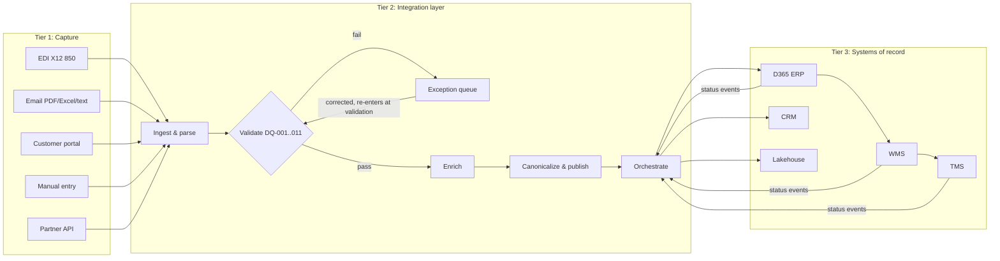

# Sales Order Data Product – Requirements Document

**Order Status API and end-to-end order lifecycle (three-tier architecture)**

## Document control

| Item | Value |
|---|---|
| Document | Sales Order Data Product – Business and System Requirements |
| Document ID | TF-SO-DP-REQ-001 |
| Version | 1.0 |
| Status | Baselined for build (phase 1) |
| Date | November 2026 |
| Business owner | Sales Order Data Product Owner (sales and customer service domain), to be named (decision D-1) |
| Technical owner | Integration Platform Lead (Enterprise Application Integration) |
| Related documents | `docs/00-solution-blueprint.md` (binding contract), `docs/02-technical-design.md`, `docs/03-canonical-data-model.md`, `docs/04-azure-reference-architecture.md`, `cdm/sales-order.v1.schema.json` |
| Source | "Sales Order data product" deck, Taylor Farms, November 2026 (14 slides) |

### Revision history

| Version | Date | Author | Change |
|---|---|---|---|
| 0.1 | Oct 2026 | Integration architecture | Draft from the Sales Order data product deck |
| 0.9 | Nov 2026 | Integration architecture, product owner delegate | Added Order Status API detail, NFRs, traceability |
| 1.0 | Nov 2026 | Integration architecture | Baselined against solution blueprint |

### Approvals

| Role | Name | Decision | Date |
|---|---|---|---|
| Sales Order Data Product Owner | TBD (D-1) | | |
| Director, Customer Service | | | |
| D365 Platform Owner | | | |
| Enterprise Architecture | | | |
| Information Security | | | |
| Data Platform (Databricks) Lead | | | |

### Conventions

- **Shall** marks a mandatory requirement; **should** a recommended one; **may** an optional one.
- Priorities use MoSCoW: **M** = Must (phase 1 go-live), **S** = Should (phase 1 if capacity, else phase 2), **C** = Could, **W** = Won't (this release).
- Requirement identifiers are stable. A retired requirement keeps its number and is marked *Retired*.
- Statuses, history event types, data quality (DQ) codes, topics, routes and environment variables are those in `docs/00-solution-blueprint.md`. They are reproduced here for readability; the blueprint is authoritative.

---

## 1. Purpose and scope

### 1.1 Purpose

This document defines the business and system requirements for the **Sales Order data product**: one governed, canonical and validated record of every customer sales order and its status, regardless of the channel through which the order arrived, published for reuse by Dynamics 365 (D365) and every other consumer.

The centre of this release is the **Order Status API**: a single place where customer service, customers, partners, planning, finance and analytics can see where any order is, how it got there, and what happens next, across every system that touches it.

### 1.2 In scope (phase 1)

| Area | In scope |
|---|---|
| Tier 1 – Capture | EDI X12 850 (AS2/VAN), email orders (PDF, Excel, CSV, message text), customer portal, manual entry by customer service (same portal form), partner REST API |
| Tier 2 – Integrate | Experience APIs per channel; Process APIs for order intake (ingest, validate, enrich, canonicalize, publish), fulfillment orchestration and order status; System APIs for D365, WMS, TMS, CRM and Lakehouse; exception queue and correction loop; transactional outbox and messaging |
| Tier 3 – Systems of record | Sales order creation in D365 F&O (data entities), credit and availability outcome, release to warehouse, ship confirmation, delivery, invoice posting; status events back from D365, WMS and TMS; CRM status visibility; Lakehouse bronze feed |
| Customer acknowledgements | 997 functional acknowledgement, 855 PO acknowledgement, 856 advance ship notice, 810 invoice for EDI customers; email or portal notification for non-EDI customers |
| Order Status API | Search, status view, milestones, line status, shipments, invoices, full lifecycle history for an order and for a group of related orders, documents, webhooks, customer-facing and internal views, KPIs |
| Analytics | Order status event stream to Azure Event Hubs, bronze files on ADLS Gen2, Databricks Delta Live Tables bronze → silver → gold |
| Operations console | A web console to create orders through every channel, track status and history, work exceptions and simulate fulfillment in non-production |
| Deployment | One end-to-end deploy script (`deploy.sh`) for local, Docker and Azure targets |

### 1.3 Out of scope (phase 1)

| Area | Reason / where handled |
|---|---|
| Pricing engine changes in D365 | Pricing remains mastered in D365 (deck slide 12); the data product only checks the price |
| Warehouse execution logic | Owned by WMS; the data product consumes WMS events only |
| Carrier tendering and freight audit | Owned by TMS |
| Returns (RMA) and credit memos | Phase 2; `relatedOrders` already supports a `RETURN` link type |
| EDI 860/865 purchase order change and change acknowledgement | Phase 2; corrections in phase 1 are internal (PATCH) and cancel/re-order |
| Customer master and product master maintenance | Owned by the master data domain; the data product reads only |
| Customer-facing portal UI redesign | The existing portal calls the Experience API; the operations console in this repo is an internal test and operations tool |
| Migration of historical orders | Daily order history from D365 to Databricks is a separate bulk feed (deck slide 10, "S" only) |

### 1.4 Phase 1 pilot channel

Deck slide 14 asks the programme to "prove one channel end to end before onboarding the rest". The recommendation is:

| Option | Volume share (est.) | Complexity | Value | Recommendation |
|---|---|---|---|---|
| EDI X12 850 | Highest for retail and foodservice | Medium (partner maps, 997/855/856/810, chargebacks) | Highest: chargeback avoidance plus touchless rate | **Pilot channel** with two to three trading partners |
| Email | High in foodservice and independents | High (extraction confidence) | High labour saving | Second wave |
| Portal / manual | Medium | Low | Medium; proves the shared form for staff | Built in phase 1 because the operations console and manual entry use it |
| Partner API | Low today | Low | Strategic (faster onboarding) | Built in phase 1, onboard first partner in phase 2 |

All five channels are built in this release so that the canonical path is proven for each; production onboarding follows the pilot sequence above.

---

## 2. Stakeholders and RACI

### 2.1 Stakeholders

| Stakeholder | Interest |
|---|---|
| Sales Order Data Product Owner | Accountable for the contract (canonical model), quality rules, service levels and ROI reporting |
| Customer Service (CS) | Answer "where is my order" from one place, correct exceptions, enter phone/fax orders |
| Planning (demand and supply) | See demand as orders arrive, not after they post in D365 |
| Finance (order to cash, credit) | Track receipt to invoice, credit holds, cost of errors and chargebacks |
| Sales / account teams | Live order status and exceptions per account in CRM |
| IT Integration (EAI team) | Build and run the Experience, Process and System APIs, messaging, monitoring |
| D365 Platform team | Data entities, business events, credit and availability configuration |
| Warehouse and Transportation | Status from WMS and TMS, ship and delivery confirmation |
| Data Platform (Databricks) | Lakehouse ingestion, medallion tables, Unity Catalog, Delta Sharing |
| Information Security | Identity, secrets, PII, audit |
| Trading partners and customers | Accurate acknowledgements and status; fewer chargebacks |

### 2.2 RACI

R = Responsible, A = Accountable, C = Consulted, I = Informed.

| Activity | Product Owner | Customer Service | Planning | Finance | IT Integration | D365 Team | Data Platform | InfoSec |
|---|---|---|---|---|---|---|---|---|
| Canonical model (contract) and versioning | A | C | C | C | R | C | C | I |
| Data quality rules DQ-001..DQ-011 | A | R | C | C | R | C | I | I |
| Channel onboarding (EDI partner, email inbox, partner API) | A | C | I | I | R | I | I | C |
| Exception queue operation and correction | A | R | I | I | C | I | I | I |
| D365 sales order creation mapping | C | I | I | C | R | A | I | I |
| Status events from D365 / WMS / TMS | C | I | I | I | R | A | I | I |
| Order Status API design and SLAs | A | C | C | C | R | I | C | C |
| Lakehouse feeds and gold marts | C | I | C | C | C | I | A/R | I |
| ROI baseline and reporting | A | C | C | R | C | I | R | I |
| Security, identity, secrets | C | I | I | I | R | C | C | A |
| Production deployment and run | I | I | I | I | A/R | C | C | C |

---

## 3. Business context and problem statement

### 3.1 Current state ("interface thinking", deck slide 3)

- Each channel is wired separately to the ERP. EDI, email, portal and manual orders follow different paths and different code.
- Validation rules are duplicated in every interface and drift apart. The same bad order passes on one channel and fails on another.
- No single owner of order quality exists. When an order is wrong, accountability is unclear.
- Order status is scattered across D365, WMS, TMS, CRM, email threads and spreadsheets. Customer service rebuilds the picture by hand for each enquiry.
- For perishable produce the cost of a wrong order is high: a short shelf life leaves no time to correct after shipment, and retail customers levy chargebacks for late or incorrect acknowledgements and ship notices.

### 3.2 Target state ("data product thinking")

- **One canonical order**, whatever the channel.
- **Rules defined once** and applied to all orders.
- **A named owner** accountable for quality, the contract and service levels.
- **One place to see the status** of every order: the Order Status API.

### 3.3 Problem statement

> Taylor Farms receives sales orders through at least five channels, each integrated separately with D365. Validation is inconsistent, exceptions are found late, and order status is fragmented across systems. This drives rework, credits and reshipments, retailer chargebacks, slow order to cash and a high cost to serve. The business needs one governed Sales Order data product, with an Order Status API, that validates every order before it reaches D365 and tracks each order from receipt to invoice.

---

## 4. Business objectives, KPIs and ROI

### 4.1 Objectives

| ID | Objective | Business outcome (deck slide 3) |
|---|---|---|
| BO-1 | Increase the share of orders that reach D365 with no manual correction | Lower cost to serve |
| BO-2 | Shorten receipt-to-D365 and receipt-to-invoice cycle times | Faster order to cash |
| BO-3 | Catch bad orders before they ship | Fewer errors and credits |
| BO-4 | Send acknowledgements and ship notices on time, every time | Fewer chargebacks |
| BO-5 | Onboard a new customer or channel by plugging into existing ports | Faster onboarding |
| BO-6 | Give every consumer one trusted status and history | Customer service, planning, finance, analytics |

### 4.2 KPIs (deck slide 13)

Targets are set with the product owner after a one-quarter baseline (decision D-3). The definitions below are fixed so that the baseline and the post-go-live figures are comparable. All KPIs are served by `GET /process/v1/metrics/kpis` and by the gold marts.

| KPI | Definition | Formula | Source fields (CDM) | Indicative target (to confirm) |
|---|---|---|---|---|
| Touchless order rate | Share of orders reaching D365 with no manual correction | orders with `roi.touchless = true` and status rank ≥ ACCEPTED ÷ orders with status rank ≥ ACCEPTED | `roi.touchless`, `roi.touchCount`, `status` | EDI ≥ 85 %, portal ≥ 90 %, email ≥ 60 % |
| Order cycle time | Receipt to D365 creation, by channel | median and p90 of `roi.stageTimestamps.erpCreated − roi.stageTimestamps.received` | `roi.stageTimestamps`, `sourceChannel` | EDI p90 < 15 min; email p90 < 60 min |
| First-pass validation | Share of orders passing every check on the first attempt | orders whose first validation event is `VALIDATION_PASSED` ÷ orders validated | `orderHistory[]` | ≥ 90 % |
| Data freshness | Lag between a status change in a source system and the data product | p95 of `recordedAt − occurredAt` for status events | `orderHistory[].occurredAt/recordedAt` | p95 < 60 s |
| Acknowledgement timeliness | 855 sent within partner SLA after receipt; 856 before arrival | share of EDI orders with 855 within SLA; 856 before `DELIVERED` | `roi.ackTimestamps` | ≥ 99 % |
| Receipt to invoice | Days from receipt to invoice posted | `invoiced − received` | `roi.stageTimestamps` | Baseline − 1 day |

### 4.3 ROI model (deck slide 4)

Every order carries the tags needed to compute benefit, so benefit can be reported by channel and customer directly from the data product.

| Value driver | Tag carried on each order (CDM element) | How it converts to dollars |
|---|---|---|
| Labour saved | `roi.touchless`, `roi.touchCount`, `roi.manualTouches[]`, `sourceChannel` | Touches avoided × minutes per touch × loaded labour rate |
| Errors avoided | `roi.exceptionReasonCodes[]` (DQ codes caught before D365) | Errors avoided × average cost of a credit or reshipment |
| Chargebacks avoided | `roi.ackTimestamps.{997,855,856,810}`, packing slip / ship notice in fulfillment documents | Reduction in customer fines for late or incorrect documents |
| Cash sooner | `roi.stageTimestamps.{received … invoiced}` | Days saved × average daily revenue × cost of capital |
| Reuse | Consumers registered on each output port (webhook subscriptions, Delta Sharing recipients, APIM subscriptions) | Interfaces not built × average cost of an interface |

**ROI = (annual benefit − annual run cost) ÷ investment.**

Requirements arising:

- Baseline each driver for one quarter before go-live (BR-20).
- Report benefit by channel and by customer from the tags (FR-120..FR-123).
- Annual run cost is taken from Azure Cost Management tagged by `costCenter = sales-order-data-product`.

Worked example (illustrative only, to be replaced by baseline): 400 orders/day, 30 % currently touched, touchless rises to 80 % → 200 touches avoided/day × 6 min × $45/h loaded = $900/day ≈ $234k/yr labour; plus 2 errors avoided/day × $350 average credit/reshipment ≈ $182k/yr.

---

## 5. Personas

| Persona | Role | Goals | Pain today | Primary touchpoints |
|---|---|---|---|---|
| **Carla – Customer Service Representative** | Takes calls, keys phone/fax orders, fixes problems | Answer status in one screen; fix a bad order in minutes | Searches D365, WMS, TMS and email per enquiry | Operations console, portal form, exception queue, CRM |
| **Omar – Customer Service Lead** | Owns queue health and SLAs | See exceptions by reason and age; trend first-pass rate | No queue; problems found by customers | Exception queue, KPI dashboard |
| **Priya – Demand Planner** | Plans harvest, processing and production | See demand as it arrives | Sees orders only after they post | Status events, gold marts in Power BI |
| **Frank – Finance / Credit Analyst** | Order to cash, credit | Track receipt to invoice, credit holds | No end-to-end timestamps | Status API, finance marts |
| **Raj – Retail Buyer (external)** | Customer purchasing via EDI or portal | Accurate 855/856/810 on time; self-service status | Calls CS for status | EDI acks, portal status, webhooks |
| **Nina – Partner Integration Developer (external)** | Builds system-to-system ordering | A stable, documented, versioned API | Bespoke interfaces | Partner Experience API, Status API, webhooks |
| **Ian – Integration Engineer (internal)** | Builds and runs integrations | One pattern, observable, replayable | Many point-to-point interfaces | All APIs, Service Bus, App Insights |
| **Dana – Data Engineer / Analyst** | Analytics and AI | Trusted history in Delta | Rebuilds order history from extracts | Event Hubs, bronze/silver/gold, Unity Catalog |
| **Owen – Product Owner** | Accountable for the data product | Contract, quality, SLAs, ROI evidence | No single owner | KPIs, DQ reports, change control |

---

## 6. End-to-end business process

### 6.1 Seven lifecycle stages (deck slide 6)

| # | Stage | Tier | Description | Order statuses | History events |
|---|---|---|---|---|---|
| 1 | Capture | Tier 1 | Order arrives by EDI, email, portal, manual entry or partner API | RECEIVED | ORDER_RECEIVED, DOCUMENT_SENT (997) |
| 2 | Ingest | Tier 2 | Parsed and translated into one working format; orderId assigned | INGESTED | ORDER_INGESTED, ORDER_SPLIT, ORDER_LINKED |
| 3 | Validate & enrich | Tier 2 | Checked against DQ rules and completed with master data | VALIDATED / EXCEPTION → ENRICHED | VALIDATION_PASSED / VALIDATION_FAILED, ORDER_ENRICHED, ORDER_CORRECTED, ORDER_RESUBMITTED |
| 4 | Publish | Tier 2 | Canonical order published under the contract | PUBLISHED | ORDER_PUBLISHED |
| 5 | Create in D365 | Tier 3 | Sales order created, credit and availability checked, inventory reserved | SUBMITTED_TO_ERP → ACCEPTED / CREDIT_HOLD / ERP_REJECTED | SUBMITTED_TO_ERP, ERP_ACCEPTED, CREDIT_HOLD_PLACED, ERP_REJECTED, INVENTORY_RESERVED, LINE_BACKORDERED, DOCUMENT_SENT (855) |
| 6 | Fulfill | Tier 3 | Released, picked, packed and shipped; delivered | RELEASED → PICKED → PACKED → PARTIALLY_SHIPPED/SHIPPED → DELIVERED | RELEASED_TO_WAREHOUSE, PICKED, PACKED, SHIPPED, DELIVERED, DOCUMENT_SENT (856) |
| 7 | Invoice & analyze | Tier 3 | Invoice posted; history feeds analytics | INVOICED → CLOSED | INVOICED, DOCUMENT_SENT (810), CLOSED |

### 6.2 What the customer hears back

| Document | When | Channel | Requirement |
|---|---|---|---|
| 997 Functional Acknowledgement | On receipt of each X12 850 functional group, accepted or rejected at syntax level | EDI | FR-004 |
| 855 Purchase Order Acknowledgement | On `ERP_ACCEPTED` (accept, accept with changes, backorder) or `REJECTED` | EDI | FR-073 |
| 856 Advance Ship Notice | On `SHIPPED`/`PARTIALLY_SHIPPED`, before arrival | EDI | FR-074 |
| 810 Invoice | On `INVOICED` | EDI | FR-075 |
| Order confirmation, ship and invoice notifications | Same milestones | Email / portal | FR-110..FR-113 |
| Status webhook | Every status change matching the subscription | Partner / portal | FR-090..FR-095 |

### 6.3 Process flow

### 6.4 Exception handling principle (deck slide 8)

No order is dropped. Each is tracked by orderId from receipt to resolution. An order that fails validation is held in the exception queue, customer service corrects it, and it re-enters at validation.

---

## 7. Functional requirements

Each requirement lists priority (MoSCoW) and acceptance criteria (AC). Key requirements include Given/When/Then scenarios.

### 7.1 Capture – common (FR-001 … FR-003)

| ID | Requirement | Pri | Acceptance criteria |
|---|---|---|---|
| FR-001 | Every channel shall submit orders through its own Experience API over the shared Process API (`POST /process/v1/orders/intake`). No channel shall write to D365 directly. | M | Code review and APIM routing show no channel path to D365; all orders have a `sourceChannel`. |
| FR-002 | Each captured order shall receive an immutable `orderId` (format `SO-YYYYMMDD-XXXXXXXX`, 8 upper-case hex characters; group id `OG-YYYYMMDD-XXXXXXXX`) and an `orderGroupId` at ingest; the identifier is returned to the submitter synchronously. | M | 202 response contains `orderId`, `orderGroupId`, `statusUrl`, `historyUrl`, `correlationId`. |
| FR-003 | Order-creating POSTs shall honour an `Idempotency-Key` header; a repeated key within 7 days returns the original `OrderAccepted` response with no second order. | M | Given an order posted with key K, when the same request is posted with K, then the response is identical and only one order exists. |

### 7.2 Capture – EDI (FR-004 … FR-010)

| ID | Requirement | Pri | Acceptance criteria |
|---|---|---|---|
| FR-004 | The system shall accept raw X12 850 interchanges (`POST /exp/edi/v1/x12/850`, `text/plain`) and return a 997 functional acknowledgement synchronously in the response (`ack997`) and store it as an outbound document. | M | 997 contains AK1 with the GS control number, AK2/AK5 per transaction set and AK9 with accepted/rejected counts. |
| FR-005 | One interchange containing multiple ST/SE transaction sets shall create one order per transaction set; all orders from one interchange share an `orderGroupId`. | M | Interchange with 3 ST loops → `orders[]` has 3 entries with the same `orderGroupId`. |
| FR-006 | The sender (ISA06) shall be resolved to a trading partner and customer via `GET /system/v1/masterdata/trading-partners/{isaId}`; an unknown sender returns a 997 with rejection and no order. | M | Unknown ISA06 → AK9 `R`, HTTP 422 problem response, `ORDER_RECEIVED` not recorded. |
| FR-007 | Mapping shall cover BEG (purpose, type, PO number, PO date), CUR, REF, PER, DTM (002 requested delivery, 010 requested ship), N1 loops (ST ship-to, BT bill-to, BY buyer, with qualifier 92/UL), PO1 (quantity, UOM, unit price, IN/VN/UP/UK item qualifiers), PID, CTT. | M | Sample 850 in `cdm/examples` maps to a canonical order matching the expected JSON. |
| FR-008 | Buyer item numbers, UPC and GTIN shall be resolved to Taylor Farms item numbers via the item cross-reference (`/system/v1/masterdata/item-xref`). | M | PO1 with `UP` qualifier resolves to the item whose GTIN matches. |
| FR-009 | The raw inbound interchange shall be stored as an inbound document linked to each order, with ISA/GS/ST control numbers. | M | `GET /process/v1/orders/{id}/documents` lists `X12_850` direction `INBOUND`. |
| FR-010 | In Azure, AS2 receipt and envelope/syntax checks should be performed by Logic Apps with an Integration Account before calling the Experience API. | S | Logic App run history shows decode then HTTP call to APIM. |

### 7.3 Capture – email (FR-011 … FR-016)

| ID | Requirement | Pri | Acceptance criteria |
|---|---|---|---|
| FR-011 | The system shall accept email orders (`POST /exp/email/v1/orders`) as JSON `{from, subject, receivedAt, body, attachments[{fileName, contentType, contentBase64}]}`. | M | Email with CSV attachment produces an order. |
| FR-012 | Extraction shall support CSV, XLSX, plain text body and PDF attachments. PDF shall use Azure AI Document Intelligence when `TFSO_DOCINTEL_ENDPOINT` is set, otherwise local text extraction. | M | Each format has a passing test. |
| FR-013 | The sender address shall be matched to a customer contact; header values (PO, customer, ship-to, delivery date) may come from the body or the attachment. | M | Order from a known contact resolves the customer without a "Customer:" line. |
| FR-014 | Each extracted order shall carry an extraction confidence (0..1). Orders below 0.80 shall fail DQ-011 and go to the exception queue. | M | Given a garbled attachment, when processed, then status is EXCEPTION with DQ-011. |
| FR-015 | The original email and attachments shall be retained as inbound documents. | M | Documents list shows `EMAIL` inbound. |
| FR-016 | In Azure, a Logic App should monitor the shared Microsoft 365 inbox and post messages to the Experience API. | S | New mail in inbox → order within 2 minutes. |

### 7.4 Capture – portal and manual entry (FR-017 … FR-021)

| ID | Requirement | Pri | Acceptance criteria |
|---|---|---|---|
| FR-017 | The portal shall submit orders via `POST /exp/portal/v1/orders` with `PortalOrderRequest`; `channel` = `PORTAL` or `MANUAL`. | M | Both channels accepted; `sourceChannel` reflects the value. |
| FR-018 | Manual entry by customer service shall use the same form and API as the portal so the same rules apply (deck slide 7). `enteredBy` shall be recorded as the actor. | M | Manual order history shows actor type `USER` with the CS user. |
| FR-019 | The portal shall offer pickers for customer, ship-to and items with the customer's contract price from `/exp/portal/v1/catalog/*`. | M | Items list returns `contractPrice` per item for the selected customer. |
| FR-020 | Validation errors shall be returned with the 202 (`exceptions[]`) so the user can correct immediately; the order is still created and tracked. | M | Invalid UOM → 202 with status EXCEPTION and DQ-004 detail. |
| FR-021 | Customers shall see only their own orders (`/exp/portal/v1/customers/{customerId}/orders`) once Entra External ID claims carry the customer id. | M | Customer A token cannot read customer B order (403). |

### 7.5 Capture – partner API (FR-022 … FR-025)

| ID | Requirement | Pri | Acceptance criteria |
|---|---|---|---|
| FR-022 | Partners shall submit orders in the canonical draft format (`POST /exp/partner/v1/orders`), validated against `cdm/sales-order.v1.schema.json` (draft subset). | M | Schema-invalid payload → 400 problem with `errors[]` pointing to the field. |
| FR-023 | Partner calls shall be authenticated (APIM subscription key plus Entra ID client credentials in Azure; `x-api-key` locally). | M | Missing credential → 401. |
| FR-024 | Partners shall read status at `/exp/partner/v1/orders/{orderId}/status` and register webhooks (FR-090). | M | Status returned for own orders only. |
| FR-025 | Partner traffic shall be rate limited per subscription (default 100 calls/min, burst 20). | S | 101st call in a minute → 429 with `Retry-After`. |

### 7.6 Ingest and parse (FR-030 … FR-034)

| ID | Requirement | Pri | Acceptance criteria |
|---|---|---|---|
| FR-030 | Intake shall translate every channel's payload into the canonical working format before any rule runs. | M | Status INGESTED, event ORDER_INGESTED with `sourceDocument` reference. |
| FR-031 | Intake shall record `ORDER_RECEIVED` with the channel receipt time (`receivedAt`) and `ORDER_INGESTED` with the processing time. | M | Both events present, sequence 1 and 2. |
| FR-032 | Orders that must ship from different sites or on different dates may be split into multiple orders in the same group (`ORDER_SPLIT`, `relatedOrders` type `SPLIT`). | C | Split orders list each other under `/related`. |
| FR-033 | Unparseable inputs shall never be discarded; they are stored and raised as an exception with the parse error. | M | Malformed 850 segment → 997 rejected and an operational alert. |
| FR-034 | Each step shall propagate `x-correlation-id` end to end (APIM → Experience → Process → Service Bus → System → D365 call). | M | One correlation id visible in App Insights across all services. |

### 7.7 Validate (FR-040 … FR-052)

Rules are defined once and applied to all orders (deck slide 12). Every rule produces a result recorded on the order (`dataQuality.results[]`) with code, severity, field path and message.

| ID | DQ code | Rule | Severity | Pri | Acceptance criteria |
|---|---|---|---|---|---|
| FR-040 | DQ-001 | Sold-to customer exists and is active | ERROR | M | Inactive customer → EXCEPTION with DQ-001 |
| FR-041 | DQ-002 | Ship-to exists, belongs to customer, is active | ERROR | M | Ship-to of another customer → DQ-002 |
| FR-042 | DQ-003 | Item exists and is active/sellable | ERROR | M | Unknown item → DQ-003 on that line |
| FR-043 | DQ-004 | Unit of measure valid for item | ERROR | M | `PL` for an item sold in `CS` only → DQ-004 |
| FR-044 | DQ-005 | Price matches customer agreement within ±0.5 % | ERROR | M | Price 10 % below agreement → DQ-005; missing price is filled from agreement (no error) |
| FR-045 | DQ-006 | No duplicate open order (customer + customer PO) | ERROR | M | Same PO resubmitted while first is open → DQ-006 |
| FR-046 | DQ-007 | Requested delivery date achievable (lead time, cut-off, ship-to delivery days) | ERROR | M | Date before today + lead time → DQ-007 |
| FR-047 | DQ-008 | Quantity > 0, multiple of order increment, ≥ minimum | ERROR | M | Qty 7 with increment 5 → DQ-008 |
| FR-048 | DQ-009 | Required elements present (PO, ship-to, ≥1 line, delivery date) | ERROR | M | Missing PO → DQ-009 |
| FR-049 | DQ-010 | Shelf life / temperature compatible with ship-to | WARNING | S | Frozen-incompatible ship-to for a chilled item → warning only, order proceeds |
| FR-050 | DQ-011 | Extraction confidence ≥ 0.80 | ERROR | M | See FR-014 |
| FR-051 | – | All rules run on every validation pass (not fail-fast) so the user sees every problem at once | – | M | Order with 3 problems shows 3 results |
| FR-052 | – | Rule thresholds (price tolerance, confidence, lead times) shall be configuration, not code | – | S | Change tolerance without redeploy of logic |

**Key scenario – validation failure (FR-040..FR-051)**

> **Given** an EDI order for customer C-1001 with one line in UOM `PL` that is only sold in `CS`
> **When** the order is ingested
> **Then** the status is `EXCEPTION`, `statusCategory` is `ACTION_REQUIRED`, history contains `VALIDATION_FAILED` with reason `DQ-004`, `roi.exceptionReasonCodes` contains `DQ-004`, the order appears in `GET /process/v1/exceptions`, and no command is sent to D365.

### 7.8 Enrich (FR-055 … FR-059)

| ID | Requirement | Pri | Acceptance criteria |
|---|---|---|---|
| FR-055 | Enrich the order from customer master: D365 customer account, invoice account, payment terms, currency, price group, credit status. | M | Enriched order shows `parties.soldTo.erpAccount`, `paymentTerms`. |
| FR-056 | Enrich from ship-to: delivery address, GLN, shipping site and warehouse, route, delivery days, transit days. | M | Each line has `shipFromSite`, `warehouse`. |
| FR-057 | Enrich from product master: item description, GTIN, pack size, temperature zone, shelf-life days. | M | Lines show `item.gtin`, `item.packSize`. |
| FR-058 | Apply contract price where the order omitted it, recording `pricing.source = AGREEMENT`; compute line and order totals. | M | Totals equal sum of line amounts. |
| FR-059 | Derive requested ship date = requested delivery date − transit days when not supplied. | M | Ship date populated on every line. |

### 7.9 Canonicalize and publish (FR-060 … FR-064)

| ID | Requirement | Pri | Acceptance criteria |
|---|---|---|---|
| FR-060 | The order shall be published in the canonical SalesOrder model version `1.x` with `schemaVersion` set. | M | Document validates against `cdm/sales-order.v1.schema.json`. |
| FR-061 | Publishing shall write an `OrderStatusChanged` CloudEvent (type `tfso.salesorder.OrderStatusChanged`) to topic `sales-order-events` through the transactional outbox. | M | Outbox row in same transaction; event delivered at least once. |
| FR-062 | A breaking schema change shall create a new major version (`v2`) with consumer notice; v1 remains available for ≥ 6 months. | M | Versioning policy in CDM doc; APIM version set. |
| FR-063 | Each order shall carry an optimistic concurrency `version` exposed as `ETag`. | M | Stale `If-Match` → 412. |
| FR-064 | Published orders shall be immutable except through recorded events (correction, status events, cancel). | M | Every change has a history entry with JSON-Patch `changes[]`. |

### 7.10 Orchestrate to systems of record (FR-065 … FR-080)

| ID | Requirement | Pri | Acceptance criteria |
|---|---|---|---|
| FR-065 | After publish, Process API shall send `CreateErpSalesOrder` on `sales-order-commands`; status SUBMITTED_TO_ERP. | M | History SUBMITTED_TO_ERP; System API receives command. |
| FR-066 | System API shall create the D365 sales order via data entities (`SalesOrderHeadersV2`, `SalesOrderLines`) in live mode, or the simulator in non-production. | M | `erpSalesOrderId` stored on the order. |
| FR-067 | D365 outcomes (accepted, credit hold, rejected, reserved, backordered lines) shall return as `StatusEvent` on `system-status-events`. | M | Status ACCEPTED / CREDIT_HOLD / ERP_REJECTED set accordingly. |
| FR-068 | Delivery to D365 shall retry with exponential backoff (5 attempts) and dead-letter afterwards with an alert; no order is lost. | M | Simulated D365 outage → retries visible, DLQ alert after exhaustion. |
| FR-069 | Release, pick, pack and ship confirmations from WMS (`/system/v1/wms/events`) and delivery from TMS (`/system/v1/tms/events`) shall update status and line quantities. | M | Partial ship → PARTIALLY_SHIPPED, line `quantityShipped` updated. |
| FR-070 | Invoice posting from D365 business events (`/system/v1/d365/business-events`) shall set INVOICED with invoice number, date and amount. | M | `invoices[]` populated. |
| FR-071 | Out-of-order events (older rank than current status) shall be recorded as `LATE_EVENT_IGNORED` and shall not regress status. | M | PICKED arriving after SHIPPED → status stays SHIPPED. |
| FR-072 | Duplicate events (same `externalEventId`) shall be ignored idempotently. | M | Replayed event → no new history entry. |
| FR-073 | On ERP_ACCEPTED for EDI orders, generate and store an 855 (accept / accept with changes for backorders). | M | 855 with BAK and ACK segments per line. |
| FR-074 | On SHIPPED/PARTIALLY_SHIPPED for EDI orders, generate an 856 with shipment, order, item hierarchy and carrier/SCAC, tracking and lot numbers where present. | M | 856 HL structure S/O/I. |
| FR-075 | On INVOICED for EDI orders, generate an 810. | M | 810 with BIG, IT1, TDS. |
| FR-076 | Status changes shall be pushed to CRM so account teams see live status and exceptions. | S | CRM adapter receives OrderStatusChanged. |
| FR-077 | Every `OrderStatusChanged` event shall be written to the Lakehouse bronze zone (file locally, ADLS in Azure) and streamed to Event Hubs `order-status-stream`. | M | Bronze file contains the event within 60 s. |
| FR-078 | A cancel (`POST /process/v1/orders/{id}/cancel`) before SHIPPED shall send `CancelErpSalesOrder` if the order exists in D365. | M | Status CANCELLED; D365 cancel recorded. |
| FR-079 | Simulator shall support advancing an order to any fulfillment status with partial quantities (`/system/v1/sim/orders/{orderId}/advance`) and an auto-progress mode (`TFSO_SIM_AUTOPROGRESS`). | M (non-prod) | Advance to SHIPPED with partial line quantities works. |
| FR-080 | CLOSED shall be set when all lines are invoiced or cancelled. | S | Fully invoiced order closes. |

### 7.11 Exception management (FR-081 … FR-087)

| ID | Requirement | Pri | Acceptance criteria |
|---|---|---|---|
| FR-081 | Exception queue (`GET /process/v1/exceptions`) shall list every order in EXCEPTION, ERP_REJECTED, CREDIT_HOLD or ON_HOLD with reasons, age, channel and customer, sortable and filterable. | M | Queue shows age in minutes and DQ codes. |
| FR-082 | Customer service shall correct an order with `PATCH /process/v1/orders/{id}` (header fields, parties, lines), with `If-Match`, a reason and the actor. | M | Correction records ORDER_CORRECTED with JSON-Patch diff; `roi.touchCount` +1; `roi.touchless` false. |
| FR-083 | `POST /process/v1/orders/{id}/resubmit` shall re-enter the order at validation (deck slide 8). | M | ORDER_RESUBMITTED then VALIDATION_PASSED/FAILED. |
| FR-084 | Manual hold and release (`/hold`, `/release-hold`) shall be available for orders not yet shipped. | M | HOLD_PLACED / HOLD_RELEASED recorded; status returns to the pre-hold status. |
| FR-085 | A non-correctable order may be rejected (status REJECTED) with reason; EDI customers receive an 855 reject. | S | 855 BAK02 = `RJ`. |
| FR-086 | Exceptions older than a configurable SLA (default 30 min business hours) shall raise an alert to the CS lead. | S | Azure Monitor alert fires. |
| FR-087 | Credit hold release (D365) shall return the order to ACCEPTED and continue. | M | CREDIT_HOLD → ACCEPTED via event. |

**Key scenario – correct and resubmit**

> **Given** order SO-X in EXCEPTION with DQ-005 (price mismatch) at version 4
> **When** CS sends `PATCH` with `If-Match: "4"` changing line 1 unit price to the agreement price, then `POST /resubmit`
> **Then** history contains ORDER_CORRECTED (actor = CS user, changes = replace `/lines/0/unitPrice`), ORDER_RESUBMITTED, VALIDATION_PASSED, ORDER_ENRICHED, ORDER_PUBLISHED, SUBMITTED_TO_ERP in that order; `roi.touchless` is false and `roi.touchCount` is 1; the order leaves the exception queue.

> **Given** the same order, **when** another user PATCHes with `If-Match: "4"` after the first correction, **then** the response is 412 Precondition Failed and no change is made.

### 7.12 Order Status API (FR-090 … FR-109)

The Order Status API is a Process API (`/process`), "one status across systems" (deck slide 10). It is consumed directly by internal consumers (console, CRM, Databricks reads per slide 10 "Order status for analytics" which needs no experience API) and through Experience APIs for customers and partners, which shape a customer-facing view.

#### 7.12.1 Queries

| ID | Requirement | Pri | Acceptance criteria |
|---|---|---|---|
| FR-090 | `GET /process/v1/orders` shall search orders by `status`, `statusCategory`, `customerId`, `channel`, `customerPo`, `erpSalesOrderId`, `fromDate`, `toDate` (received), `hasExceptions`, free text `q` (PO, order id, customer name, ERP id), with `page`, `pageSize` (max 200) and `sort` (e.g. `-receivedAt`). | M | Response `{items[], page, pageSize, total}`; filters combine with AND. |
| FR-091 | `GET /process/v1/orders/{orderId}` shall return the full canonical SalesOrder with `ETag`. | M | Validates against schema; `If-None-Match` → 304. |
| FR-092 | `GET /process/v1/orders/by-po/{customerPo}?customerId=` shall return the order(s) for a customer PO. | M | Returns all orders in the PO's group. |
| FR-093 | Unknown order → 404 problem+json with correlation id. | M | |

#### 7.12.2 Status view and milestones

| ID | Requirement | Pri | Acceptance criteria |
|---|---|---|---|
| FR-094 | `GET /process/v1/orders/{orderId}/status` shall return `OrderStatusView`: orderId, customerPo, erpSalesOrderId, `status`, `statusCategory`, `statusReason`, `lastUpdated`, milestones, line statuses, shipments, invoices, open exceptions, `nextExpected` (next milestone and expected date). | M | All fields populated for a shipped order. |
| FR-095 | Milestones shall be Received, Confirmed (ACCEPTED), Released, Shipped, Delivered, Invoiced, each with `state` (`COMPLETE`, `CURRENT`, `PENDING`, `SKIPPED`, `BLOCKED`) and timestamp. | M | A shipped order shows Received/Confirmed/Released/Shipped COMPLETE, Delivered PENDING. |
| FR-096 | Line status shall show ordered, confirmed, backordered, shipped, delivered, invoiced and cancelled quantities and line status. | M | Partial ship shows both shipped and open quantity. |
| FR-097 | Shipments shall include shipment id, ship date, carrier, SCAC, tracking/PRO number, BOL, lines/quantities, lot numbers (traceability) and delivery date/POD when known. | M | 856 and status view show the same shipment data. |
| FR-098 | `GET /process/v1/reference/statuses` shall publish the state machine (statuses, ranks, categories, allowed transitions) so consumers do not hard-code it. | M | Response matches blueprint §5. |

**Key scenario – "where is my order"**

> **Given** an order shipped yesterday with tracking number 1Z999
> **When** Carla calls `GET /process/v1/orders/{id}/status`
> **Then** within 300 ms (p95) she sees status SHIPPED, category SHIPPED, carrier, tracking 1Z999, shipped quantities per line, and `nextExpected` = Delivered with the planned delivery date.

#### 7.12.3 History and lifecycle

| ID | Requirement | Pri | Acceptance criteria |
|---|---|---|---|
| FR-099 | `GET /process/v1/orders/{orderId}/history` shall return the complete ordered lifecycle (blueprint §6 fields) from ORDER_RECEIVED onwards, filterable by `eventType` and `since`. | M | Sequence numbers strictly increasing with no gaps. |
| FR-100 | Each history entry shall show `fromStatus`, `toStatus`, tier, source system, actor, correlation and causation ids, reason code, message, line changes, JSON-Patch changes, document reference and `elapsedSincePreviousSeconds`. | M | Correction entry shows field diff; ship entry shows line quantities. |
| FR-101 | `GET /process/v1/orders/{orderId}/related` shall return orders in the same `orderGroupId` and explicit `relatedOrders` links (SPLIT, BACKORDER, REPLACEMENT, DUPLICATE_OF, RETURN). | M | Three orders from one interchange list each other. |
| FR-102 | `GET /process/v1/order-groups/{orderGroupId}/history` shall merge histories of all orders in a group in time order, each entry tagged with its orderId — the lifecycle of a set of orders (e.g. one EDI interchange or one PO split across sites). | M | Merged list sorted by `occurredAt`, then `sequence`. |
| FR-103 | History shall be append-only; no API updates or deletes history. | M | No PUT/PATCH/DELETE on history. |

#### 7.12.4 Documents

| ID | Requirement | Pri | Acceptance criteria |
|---|---|---|---|
| FR-104 | `GET /process/v1/orders/{orderId}/documents` shall list inbound and outbound documents (X12_850, X12_997, X12_855, X12_856, X12_810, EMAIL, JSON) with direction, control number and timestamps; `/documents/{documentId}` returns content. | M | 856 retrievable as raw X12 text. |

#### 7.12.5 Webhooks (status subscriptions)

| ID | Requirement | Pri | Acceptance criteria |
|---|---|---|---|
| FR-105 | Consumers shall register webhooks (`POST /process/v1/subscriptions`) with callback URL, event types/statuses, optional customerId filter; list and delete them. | M | 201 with subscription id and generated secret (shown once). |
| FR-106 | Deliveries shall be CloudEvents 1.0 JSON signed with HMAC-SHA256 in `x-tfso-signature`, retried with backoff for 24 h, and disabled after repeated failure with an alert. | M | Signature verifies with the shared secret. |
| FR-107 | Webhook delivery shall be at least once; receivers deduplicate by event `id`. | M | Documented; id stable across retries. |

#### 7.12.6 Customer-facing vs internal views

| ID | Requirement | Pri | Acceptance criteria |
|---|---|---|---|
| FR-108 | Customer and partner views (`/exp/portal/v1/orders/{id}`, `/exp/partner/v1/orders/{id}/status`) shall show `statusCategory`, milestones, lines, shipments, invoices and customer-safe exception text only; they shall not expose internal statuses (e.g. PUBLISHED, SUBMITTED_TO_ERP), DQ internals, credit information, margins, actor names or internal notes. | M | Internal-only fields absent from customer response (contract test). |
| FR-109 | Internal views (Process API) shall expose full status, history, DQ results and ROI tags to authorised internal roles. | M | Phase 1: APIM subscription (product `sales-order-data-product`) + backend `x-api-key`; target state: Entra app role `Orders.Read.All`. |

#### 7.12.7 Summary and KPIs

| ID | Requirement | Pri | Acceptance criteria |
|---|---|---|---|
| FR-120 | `GET /process/v1/status/summary` shall return counts by status, category and channel. | M | Sum of counts = total orders. |
| FR-121 | `GET /process/v1/metrics/kpis` shall return touchless rate, first-pass validation, cycle time (median/p90) by channel and data freshness over a period. | M | Values recompute after new orders. |
| FR-122 | KPIs shall be reproducible from gold marts in Databricks. | S | Gold KPI equals API KPI for same period ±0.5 %. |
| FR-123 | ROI benefit by channel and customer shall be reportable from ROI tags. | S | Power BI report over gold mart. |

### 7.13 Order history and audit (FR-125 … FR-129)

| ID | Requirement | Pri | Acceptance criteria |
|---|---|---|---|
| FR-125 | Every state change, correction, document and notification shall be recorded as a history event with actor and timestamp. | M | No status change without event. |
| FR-126 | Events from systems shall keep `occurredAt` (source time) and `recordedAt` (data product time) to measure freshness. | M | Both timestamps present. |
| FR-127 | Order snapshots and history shall be retained for 7 years (Lakehouse silver) and 13 months online in the operational store. | M | Retention policies configured. |
| FR-128 | Audit of API access (who read which order) shall be available from APIM and App Insights logs for 1 year. | S | KQL query returns caller per order. |
| FR-129 | ROI stage timestamps and acknowledgement timestamps shall be maintained on the order as milestones occur. | M | `roi.stageTimestamps` populated. |

### 7.14 Notifications (FR-110 … FR-113)

| ID | Requirement | Pri | Acceptance criteria |
|---|---|---|---|
| FR-110 | Non-EDI customers shall receive a confirmation when the order is ACCEPTED, including PO, order id, confirmed quantities and backorders. | S | NOTIFICATION_SENT event recorded. |
| FR-111 | Ship and invoice notifications shall be sent for email/portal customers. | S | NOTIFICATION_SENT on SHIPPED, INVOICED. |
| FR-112 | Action-required notifications (exception needing customer input) may be sent to the buyer contact. | C | |
| FR-113 | Each notification and EDI document sent shall be recorded as DOCUMENT_SENT / NOTIFICATION_SENT with document reference. | M | |

### 7.15 Analytics feeds (FR-130 … FR-135)

| ID | Requirement | Pri | Acceptance criteria |
|---|---|---|---|
| FR-130 | Bronze: raw orders, raw inbound documents and status events, as received, append-only, partitioned by date. | M | Files in `bronze/` by `ingest_date`. |
| FR-131 | Silver: the Sales Order data product (validated canonical orders and history) as Delta tables with expectations matching DQ rules. | M | DLT expectations dashboard. |
| FR-132 | Gold: order, customer and fulfillment marts (daily orders by channel, cycle times, touchless rate, exception reasons, OTIF). | M | Gold tables queryable in Databricks SQL. |
| FR-133 | Tables shall be registered in Unity Catalog with owner, description and column comments; lineage visible in Purview. | S | |
| FR-134 | External consumers may receive data via Delta Sharing. | C | |
| FR-135 | Databricks may read the order status Process API directly (no experience API) for near-real-time status (deck slide 10). | S | |

### 7.16 Administration and operations console (FR-140 … FR-148)

| ID | Requirement | Pri | Acceptance criteria |
|---|---|---|---|
| FR-140 | A web console shall let authorised users create orders through each channel (portal/manual form, partner JSON, EDI 850 text, email with attachment). | M | Each channel creates an order. |
| FR-141 | The console shall show a dashboard (status summary, KPIs, recent orders). | M | |
| FR-142 | The console shall search orders and show order detail: header, parties, lines, status milestones, history timeline with diffs, documents, exceptions. | M | |
| FR-143 | The console shall let CS correct, resubmit, hold, release and cancel orders. | M | |
| FR-144 | In non-production the console shall drive the fulfillment simulator (advance status, partial quantities, credit release, auto-progress). | M | |
| FR-145 | The console shall show service health of Experience, Process and System APIs. | S | |
| FR-146 | The console shall manage webhook subscriptions. | S | |
| FR-147 | Configuration (thresholds, partner maps, inbox addresses) shall be environment configuration or master data, changeable without code change. | S | |
| FR-148 | The whole solution shall deploy with one script (`deploy.sh local|docker|azure|test|destroy`). | M | Fresh environment deploys and passes smoke test. |

---

## 8. User stories

| ID | Persona | Story | Linked FR |
|---|---|---|---|
| US-01 | Carla (CS) | As a CS rep, I want to search by PO, order id or customer and see one status with milestones, so that I can answer "where is my order" in one call. | FR-090, FR-094, FR-095 |
| US-02 | Carla (CS) | As a CS rep, I want to key a phone order in the same form customers use, so that the same checks apply. | FR-017, FR-018 |
| US-03 | Carla (CS) | As a CS rep, I want to see every validation problem at once and fix them in place, so that the order re-enters validation immediately. | FR-051, FR-082, FR-083 |
| US-04 | Omar (CS lead) | As a CS lead, I want the exception queue sorted by age with reason codes, so that I can meet our correction SLA. | FR-081, FR-086 |
| US-05 | Omar (CS lead) | As a CS lead, I want first-pass validation and touchless rate by channel, so that I can target training and partner fixes. | FR-121 |
| US-06 | Priya (Planner) | As a planner, I want accepted demand as soon as orders are published, so that I can plan before orders post. | FR-061, FR-077, FR-131 |
| US-07 | Frank (Finance) | As a finance analyst, I want receipt-to-invoice timestamps per order, so that I can measure cash sooner. | FR-129, FR-123 |
| US-08 | Frank (Finance) | As a credit analyst, I want credit-hold orders in the queue with their D365 reference, so that I can release them quickly. | FR-081, FR-087 |
| US-09 | Raj (Buyer) | As a retail buyer, I want a 997 immediately, an 855 on acceptance and an 856 before the truck arrives, so that my receiving is accurate and I do not issue chargebacks. | FR-004, FR-073, FR-074 |
| US-10 | Raj (Buyer) | As a portal customer, I want to see my orders' status and tracking without calling, so that I can plan receiving. | FR-108, FR-021 |
| US-11 | Nina (Partner dev) | As a partner developer, I want a documented canonical order API and signed status webhooks, so that I can integrate once. | FR-022, FR-105, FR-106 |
| US-12 | Ian (Integration) | As an integration engineer, I want one correlation id across every hop and replay from the outbox, so that I can diagnose and recover. | FR-034, FR-068 |
| US-13 | Dana (Data) | As a data engineer, I want status events in bronze and a validated silver table, so that I can build marts without re-deriving history. | FR-130..FR-133 |
| US-14 | Owen (PO) | As product owner, I want ROI tags on each order, so that benefit can be reported by channel and customer. | FR-129, FR-123 |
| US-15 | Owen (PO) | As product owner, I want the full lifecycle of a group of orders from one EDI interchange, so that I can audit partner issues. | FR-101, FR-102 |

---

## 9. Data requirements

- The canonical model is defined in `docs/03-canonical-data-model.md` and machine-readable in `cdm/sales-order.v1.schema.json` (generated from the Pydantic model in `src/tfso/common`). It is the contract for every consumer.
- Contract entities and mastering (deck slide 12):

| Entity | Holds | Mastered in |
|---|---|---|
| Order header | Order ID, source channel, customer PO, dates, status | Data product |
| Order lines | Item, quantity, UOM, price, requested date | Data product |
| Customer and ship-to | Account, delivery location, terms | Customer master |
| Item | Item number, description, pack size | Product master |
| Pricing | Contract or list price applied to each line | D365 ERP |
| Status events | Accepted, released, shipped, invoiced, with timestamps | Source systems |
| Order history | Lifecycle events for an order and a group of orders | Data product |
| Documents | Inbound and outbound EDI/email/JSON | Data product |
| ROI tags | Touchless, touches, exception codes, stage and ack timestamps | Data product |

- PII in scope: buyer contact name, email, phone; delivery addresses of businesses. No consumer payment data is processed.
- Reference data required at go-live: customers, ship-tos (with EDI location codes/GLN, delivery days, transit days), items (GTIN, UOMs, pack size, order increment, minimum, temperature zone, shelf life), price agreements, trading partners (ISA ids), item cross-references.
- Data retention: operational store 13 months; Lakehouse silver/gold 7 years; bronze raw documents 7 years in cool/archive tier.

---

## 10. Business rules

| ID | Rule |
|---|---|
| BR-01 | An order's `orderId` never changes; D365 `erpSalesOrderId` is an attribute, not the key. |
| BR-02 | Only orders in PUBLISHED status are sent to D365. |
| BR-03 | Corrections are allowed only in EXCEPTION, ERP_REJECTED or ON_HOLD. |
| BR-04 | Cancellation is allowed until the first shipment (status rank < PARTIALLY_SHIPPED). |
| BR-05 | A customer PO is unique per customer among open orders (DQ-006). Closed or cancelled orders do not block reuse. |
| BR-06 | Contract price wins over list price; a submitted price outside ±0.5 % is an exception, not an override. |
| BR-07 | Requested ship date = requested delivery date − ship-to transit days, adjusted to the prior shipping day. |
| BR-08 | Order cut-off: orders received after the site cut-off time count from the next business day for lead time. |
| BR-09 | Status never moves backwards in rank through system events; only explicit holds/releases and corrections change ACTION_REQUIRED states. |
| BR-10 | `roi.touchless` becomes false on the first manual correction, hold, or manual entry by CS on behalf of a customer channel; manual channel orders are touched by definition. |
| BR-11 | An order is CLOSED when every line is invoiced or cancelled. |
| BR-12 | 855 is sent for EDI orders on acceptance, within the partner SLA (default 24 h from receipt). |
| BR-13 | 856 is sent at ship confirmation and before delivery. |
| BR-14 | Lots shipped are recorded on the shipment line for traceability (FSMA 204 key data elements). |
| BR-15 | Customer-facing views show categories, never internal statuses. |
| BR-20 | ROI drivers are baselined for one quarter before go-live. |

---

## 11. Non-functional requirements

### 11.1 Performance and scalability

| ID | Requirement | Measure |
|---|---|---|
| NFR-001 | Order Status API reads (`/status`, `/orders/{id}`, `/history`) | p95 < 300 ms, p99 < 800 ms at 200 requests/s sustained |
| NFR-002 | Order search | p95 < 800 ms for `pageSize` ≤ 50 |
| NFR-003 | Intake (channel POST to 202 response, including validation and enrichment) | p95 < 2 s |
| NFR-004 | Published to D365 created (simulator excluded) | p95 < 2 min |
| NFR-005 | Status freshness (source event `occurredAt` to data product `recordedAt`) | p95 < 60 s |
| NFR-006 | Peak volume | 50,000 orders/day, 250,000 lines/day, 500,000 status events/day; burst 50 orders/s for 5 min (EDI batch windows) |
| NFR-007 | Horizontal scale | Container Apps scale 1→10 replicas per service on HTTP concurrency and Service Bus queue depth |
| NFR-008 | Bronze write latency | < 60 s from event |

### 11.2 Availability and resilience

| ID | Requirement | Measure |
|---|---|---|
| NFR-010 | Availability of Order Status API and intake | 99.9 % monthly (≤ 43 min downtime) |
| NFR-011 | Zero order loss | Every received order is persisted before 202/997; outbox guarantees at-least-once to downstream |
| NFR-012 | Disaster recovery | RPO ≤ 15 min, RTO ≤ 4 h (secondary region) |
| NFR-013 | Graceful degradation | If D365 is down, intake continues and orders queue at SUBMITTED_TO_ERP; status API stays available |
| NFR-014 | Retries | Exponential backoff, 5 attempts, DLQ with alert; replay tooling |

### 11.3 Security and privacy

| ID | Requirement |
|---|---|
| NFR-020 | All external entry through Azure API Management; no service is directly reachable from the internet in production. |
| NFR-021 | Internal users authenticate with Microsoft Entra ID; customers via Entra External ID; partners via client credentials plus APIM subscription key. Locally `x-api-key`. |
| NFR-022 | Service-to-Azure resource access uses managed identities (Service Bus, Event Hubs, Storage, Key Vault, ACR, PostgreSQL Entra auth). No secrets in code or images. |
| NFR-023 | Secrets (D365 client secret, AS2 certificates, webhook secrets) in Key Vault with rotation. |
| NFR-024 | TLS 1.2+ everywhere; data encrypted at rest (platform-managed keys; CMK optional for prod). |
| NFR-025 | Role-based authorisation (target state, Entra app roles): `Orders.Read.All`, `Orders.Write`, `Orders.Correct`, `Orders.Admin`, `Customer.Self`. Phase 1 as deployed: APIM products `sales-order-data-product` (all operations), `order-status-api` (GET only) and `order-console`, with the backend `x-api-key` injected by APIM. |
| NFR-026 | PII (contact name/email/phone) masked in logs; customer-facing responses only show the caller's own data. |
| NFR-027 | OWASP API Top 10 controls: input validation (schema), rate limiting, payload size limits (850 ≤ 10 MB; email ≤ 25 MB), no verbose errors. |
| NFR-028 | Microsoft Defender for Cloud enabled for containers, storage, Key Vault and APIs in production. |

### 11.4 Auditability and compliance

| ID | Requirement |
|---|---|
| NFR-030 | Append-only order history retained 7 years; inbound and outbound documents retained 7 years. |
| NFR-031 | FSMA 204 (Food Traceability Rule) support: shipments record traceability lot codes, quantity, UOM, ship-from and ship-to locations and ship date (Key Data Elements for the shipping Critical Tracking Event), retrievable within 24 hours on request. |
| NFR-032 | EDI partner SLAs: 997 within 1 h of receipt (synchronous in this design), 855 within partner SLA (default 24 h), 856 before arrival; compliance reported per partner. |
| NFR-033 | SOX-relevant changes (price corrections) carry actor, reason and before/after values. |

### 11.5 Observability

| ID | Requirement |
|---|---|
| NFR-040 | Distributed tracing with Application Insights (OpenTelemetry) across APIM and all services, keyed by `x-correlation-id`. |
| NFR-041 | Structured JSON logs with orderId, correlationId, channel, status. |
| NFR-042 | Health endpoints (`/health`) for liveness/readiness, including dependency checks (DB, bus, D365 mode). |
| NFR-043 | Alerts: DLQ > 0, exception queue age > SLA, status freshness p95 > 60 s, 5xx rate > 1 %, intake latency p95 > 2 s, webhook disabled. |
| NFR-044 | Dashboards: operational (Azure Monitor workbook) and business KPIs (Power BI on gold). |

### 11.6 Usability and accessibility

| ID | Requirement |
|---|---|
| NFR-050 | Operations console meets WCAG 2.1 AA (keyboard navigation, contrast, labels, focus states). |
| NFR-051 | Console works on current Edge/Chrome/Safari and at phone width for status lookups. |
| NFR-052 | Error messages are actionable (rule code, field, expected value). |

### 11.7 Maintainability and portability

| ID | Requirement |
|---|---|
| NFR-060 | One container image for all services; configuration by environment variables (blueprint §3). |
| NFR-061 | Infrastructure as code (Bicep) for all Azure resources; `what-if` before deploy. |
| NFR-062 | Automated tests cover the full lifecycle in-process; CI runs them on every change. |
| NFR-063 | Canonical schema versioned with semantic versioning; JSON Schema generated from code. |
| NFR-064 | Runs locally with no Azure dependencies (SQLite, HTTP bus, D365 simulator). |

---

## 12. Integration requirements

| System | Direction | Interface | Data | Frequency / trigger | Requirement |
|---|---|---|---|---|---|
| EDI trading partners (VAN/AS2) | In / Out | AS2 → Logic Apps Integration Account → `POST /exp/edi/v1/x12/850`; outbound 997/855/856/810 | X12 004010 850, 997, 855, 856, 810 | Real time per interchange | FR-004..FR-010, FR-073..FR-075 |
| Microsoft 365 shared inbox | In | Logic App (Office 365 connector) → `POST /exp/email/v1/orders` | Email and attachments | On arrival | FR-011..FR-016 |
| Azure AI Document Intelligence | Call-out | REST analyze (`TFSO_DOCINTEL_ENDPOINT`, `TFSO_DOCINTEL_MODEL_ID`) | PDF orders | Per email | FR-012 |
| Customer portal | In / Out | APIM → Experience API | PortalOrderRequest, status view | Real time | FR-017..FR-021 |
| Partner platforms | In / Out | APIM → Experience API; webhooks | Canonical draft, status, CloudEvents | Real time | FR-022..FR-025, FR-105 |
| D365 F&O | Out / In | System API → OData data entities (`SalesOrderHeadersV2`, `SalesOrderLines`); master data entities (customers, released products, trade agreements); business events → `POST /system/v1/d365/business-events` | Sales orders, master data, confirmations, invoices | Command per order; events real time; master data cached 15 min | FR-065..FR-070 |
| WMS | In | `POST /system/v1/wms/events` | Release, pick, pack, ship confirmation, lots | Real time | FR-069 |
| TMS | In | `POST /system/v1/tms/events` | Load, carrier, delivery/POD | Real time | FR-069 |
| CRM | Out | `sales-order-events` subscription `system-crm` | Status changes | Real time | FR-076 |
| Lakehouse (Databricks/ADLS) | Out | Event Hubs `order-status-stream`; ADLS `bronze` | CloudEvents, raw documents | Real time | FR-077, FR-130 |
| Webhook consumers | Out | HTTPS POST CloudEvents | Status changes | Real time | FR-105..FR-107 |

---

## 13. Reporting requirements

| Report | Audience | Source | Refresh |
|---|---|---|---|
| Exception queue by reason, age, channel, customer | CS lead | Status API / console | Live |
| Daily orders by channel and status | Product owner, Planning | Gold `gold.orders_daily_by_channel` | 15 min |
| Touchless rate, first-pass validation, cycle time by channel | Product owner | KPI API / gold | Hourly |
| Acknowledgement timeliness by trading partner (997/855/856/810) | CS, Sales | Gold | Daily |
| Receipt-to-invoice and cash-sooner benefit | Finance | Gold | Daily |
| ROI benefit by channel and customer | Product owner, Finance | Gold + ROI parameters | Monthly |
| Data freshness and availability (SLO report) | Product owner, IT | Azure Monitor | Monthly |

---

## 14. Assumptions

| ID | Assumption |
|---|---|
| A-1 | D365 Finance & Operations is the fulfillment system of record and exposes standard sales order data entities and business events. |
| A-2 | WMS and TMS can emit events (webhook or via D365 warehouse management events); where they cannot, D365 events are used. |
| A-3 | Customer and product master data are available from D365/MDM with EDI location codes and GTINs maintained. |
| A-4 | Trading partners use X12 version 004010 (others handled by Integration Account maps). |
| A-5 | Most of Tier 3 integration already exists (deck slide 14); the System API wraps it rather than rebuilding it. |
| A-6 | Azure subscription with permissions for Container Apps, APIM, Service Bus, Event Hubs, PostgreSQL, Storage, Key Vault, Document Intelligence and Databricks is available. |
| A-7 | Volumes in NFR-006 cover 3 years of growth. |

## 15. Constraints

| ID | Constraint |
|---|---|
| C-1 | D365 remains master for pricing and fulfillment; the data product does not post financial transactions. |
| C-2 | All integration on Azure Integration Services and Azure Databricks (enterprise standard, deck slide 11). |
| C-3 | Customer-facing EDI formats are dictated by trading partners' implementation guides. |
| C-4 | Perishable products: same-day and next-day delivery windows make validation latency business-critical. |
| C-5 | Production data must stay in the primary US Azure region pair. |

## 16. Dependencies

| ID | Dependency | Owner | Needed by |
|---|---|---|---|
| DEP-1 | Named product owner (D-1) | Business leadership | Before build sign-off |
| DEP-2 | D365 service principal and data entity access; business events endpoint configuration | D365 team | System integration test |
| DEP-3 | Trading partner test windows for pilot partners | CS / EDI team | Pilot |
| DEP-4 | Master data quality (GTIN, EDI codes, price agreements) | Master data team | UAT |
| DEP-5 | Databricks workspace with Unity Catalog | Data platform | Analytics build |
| DEP-6 | Entra ID app registrations and External ID tenant | Identity team | Security testing |

## 17. Risks and mitigations

| ID | Risk | Likelihood | Impact | Mitigation |
|---|---|---|---|---|
| R-1 | Master data gaps (missing GTIN/EDI codes) cause high exception rates at go-live | High | High | Data readiness report from DQ rules run in shadow mode 4 weeks before go-live |
| R-2 | D365 throughput limits during EDI batch windows | Medium | High | Queue-based load levelling via Service Bus; concurrency cap on D365 adapter; batch entity endpoints |
| R-3 | Email extraction accuracy below target | Medium | Medium | Confidence threshold DQ-011, custom Document Intelligence model per top customers, human-in-the-loop queue |
| R-4 | Out-of-order or duplicate events corrupt status | Medium | High | Rank-based state machine, `externalEventId` idempotency, LATE_EVENT_IGNORED |
| R-5 | Scope creep into WMS/TMS logic | Medium | Medium | Product boundary in this document; System APIs only adapt |
| R-6 | Consumer breaking changes | Low | High | Versioned schema, contract tests, 6-month deprecation |
| R-7 | Chargebacks during cutover | Medium | Medium | Parallel run per partner; 855/856 compared against legacy for 2 weeks |
| R-8 | No named owner, decisions stall | Medium | High | Decision D-1 is a gate for build sign-off |

## 18. Open decisions (deck slide 14)

| ID | Decision | Options | Recommendation | Owner | Due |
|---|---|---|---|---|---|
| D-1 | Name the product owner | Sales ops lead; CS director; order-to-cash lead | Business lead in sales and customer service domain accountable for contract and quality | Executive sponsor | Before build sign-off |
| D-2 | Confirm Tier 3 scope for phase 1 | D365 only; D365 + WMS/TMS events; + CRM | D365 + WMS/TMS events + Lakehouse; CRM status push as Should (most Tier 3 integration exists) | Product owner, D365 team | Sprint 0 |
| D-3 | Agree canonical model v1 | Entities, quality rules, versioning policy | Adopt `cdm/sales-order.v1.schema.json`, DQ-001..011, semver with 6-month deprecation | Product owner | Sprint 1 |
| D-4 | Pick the pilot channel | EDI, email, portal, partner | EDI with 2–3 partners (section 1.4) | Product owner, CS | Sprint 1 |
| D-5 | Order store technology | PostgreSQL JSONB; Cosmos DB | PostgreSQL Flexible Server (ADR-002) | Architecture | Sprint 0 |
| D-6 | KPI targets | — | Set after one-quarter baseline | Product owner, Finance | Go-live − 1 month |

---

## 19. Traceability matrix

| Requirement | Component | API / interface | Test (`tests/`) |
|---|---|---|---|
| FR-002, FR-003 | Experience API, Process intake | `POST /exp/portal/v1/orders`, `POST /process/v1/orders/intake` | Portal order happy path; idempotency replay |
| FR-004..FR-009 | Experience EDI, `tfso.common` X12 | `POST /exp/edi/v1/x12/850` | EDI multi-ST interchange; 997 content |
| FR-011..FR-015 | Experience email | `POST /exp/email/v1/orders` | Email CSV order; low confidence exception |
| FR-017..FR-021 | Experience portal | `/exp/portal/v1/*` | Portal and manual order; catalog |
| FR-022..FR-024 | Experience partner | `/exp/partner/v1/*` | Partner canonical order; schema errors |
| FR-040..FR-051 | Process validation | `POST /process/v1/orders/intake` | One test per DQ rule |
| FR-055..FR-059 | Process enrichment, System master data | `/system/v1/masterdata/*` | Enrichment fields and totals |
| FR-060..FR-064 | Process canonicalize, outbox | `sales-order-events` | Schema validation; outbox row; ETag 412 |
| FR-065..FR-072 | Process orchestration, System D365/WMS/TMS | `sales-order-commands`, `system-status-events`, `/process/v1/events` | Full lifecycle to INVOICED; late event; duplicate event |
| FR-073..FR-075 | `tfso.common` X12 generators | `/process/v1/orders/{id}/documents` | 855/856/810 generated |
| FR-077 | System lakehouse adapter | `/system/v1/lakehouse/files` | Bronze file written |
| FR-078 | Process cancel | `/process/v1/orders/{id}/cancel` | Cancel before ship; reject after ship |
| FR-079 | System simulator | `/system/v1/sim/*` | Advance with partial quantities |
| FR-081..FR-087 | Process exceptions | `/process/v1/exceptions`, `PATCH`, `/resubmit`, `/hold` | Correct & resubmit; 412 conflict; hold/release |
| FR-090..FR-098 | Order Status API | `/process/v1/orders*`, `/status`, `/reference/statuses` | Search filters; status view milestones |
| FR-099..FR-103 | Order Status API history | `/history`, `/related`, `/order-groups/{id}/history` | History sequence; group history merge |
| FR-104 | Order Status API documents | `/documents` | Document list/content |
| FR-105..FR-107 | Process webhooks | `/process/v1/subscriptions` | Signed delivery |
| FR-108, FR-109 | Experience views vs Process views | `/exp/portal/v1/orders/{id}` | Customer view omits internal fields |
| FR-120, FR-121 | Process metrics | `/status/summary`, `/metrics/kpis` | KPI computation |
| FR-130..FR-133 | Databricks DLT | `databricks/` pipeline | DLT expectations |
| FR-140..FR-146 | Front end | `frontend/` | Browser smoke test |
| FR-148 | Deployment | `deploy.sh` | `./deploy.sh test`, smoke test |
| NFR-001..NFR-005 | All | APIM, Container Apps | Load test (k6/Azure Load Testing) |
| NFR-020..NFR-028 | APIM, Entra, Key Vault, MI | `infra/` | Security review, penetration test |
| NFR-040..NFR-043 | App Insights, Azure Monitor | `infra/` alerts | Trace verification |

---

## 20. Glossary

| Term | Definition |
|---|---|
| 850 | X12 Purchase Order transaction set |
| 855 | X12 Purchase Order Acknowledgement |
| 856 | X12 Ship Notice/Manifest (Advance Ship Notice, ASN) |
| 810 | X12 Invoice |
| 997 | X12 Functional Acknowledgement |
| API-led connectivity | Layering of Experience (per channel), Process (orchestration) and System (per system) APIs |
| AS2 | Applicability Statement 2, secure transport for EDI |
| Bronze / Silver / Gold | Medallion layers: raw, validated data product, business marts |
| Canonical order / CDM | The channel-neutral Sales Order model (`cdm/sales-order.v1.schema.json`) |
| CloudEvents | CNCF standard event envelope used on all topics and webhooks |
| CTE / KDE | FSMA 204 Critical Tracking Event / Key Data Element |
| D365 | Microsoft Dynamics 365 Finance & Operations / Supply Chain Management |
| Data product | A governed, owned, versioned dataset with ports, contract, quality and service levels |
| DLQ | Dead-letter queue |
| DQ rule | Data quality rule DQ-001..DQ-011 |
| GLN / GTIN | GS1 Global Location Number / Global Trade Item Number |
| Input / output port | How data enters (channels) and leaves (D365, events, tables, API) the data product |
| ISA / GS / ST | X12 interchange, functional group and transaction set envelopes |
| Order group | Set of orders sharing `orderGroupId` (one interchange, one PO split, backorders) |
| Outbox | Table written in the same transaction as the order, then published to the bus |
| OTIF | On time in full |
| SCAC | Standard Carrier Alpha Code |
| Status category | Customer-facing grouping of statuses (RECEIVED, CONFIRMED, IN_FULFILLMENT, SHIPPED, DELIVERED, INVOICED, CLOSED, CANCELLED, ACTION_REQUIRED) |
| Touchless order | Order that reached D365 with no manual correction |
| VAN | Value-added network for EDI |
