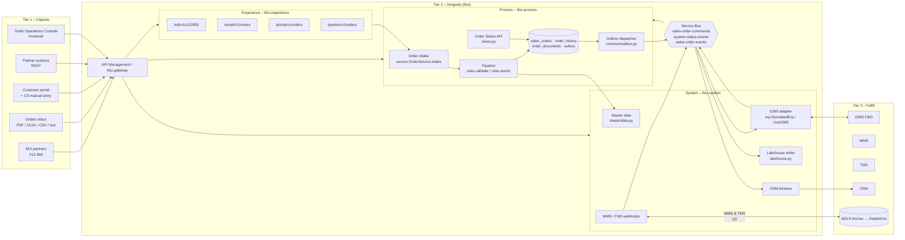
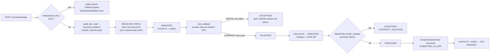
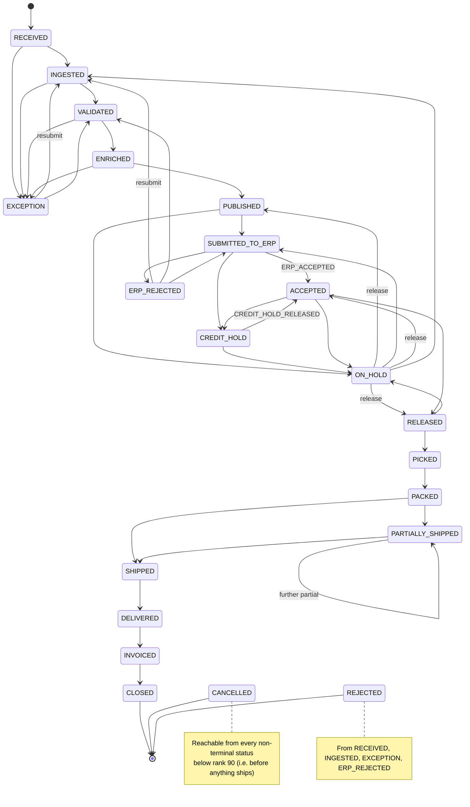
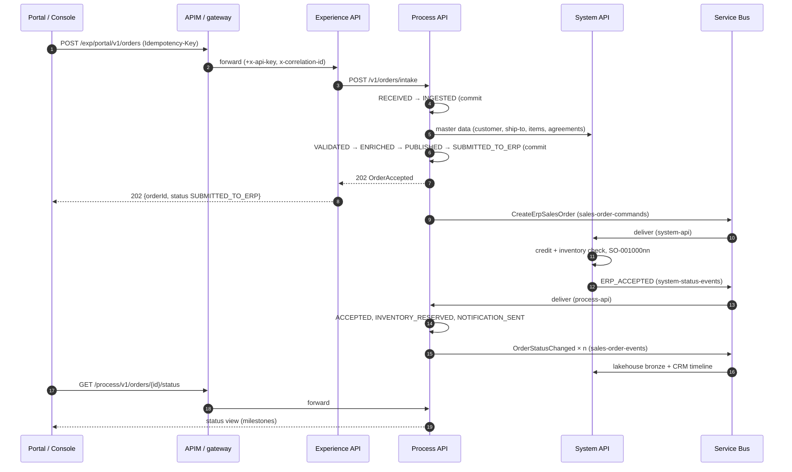
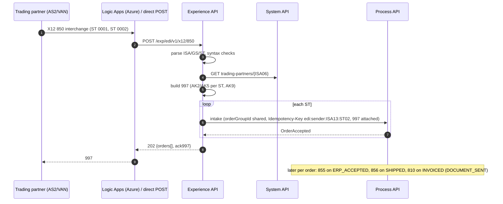
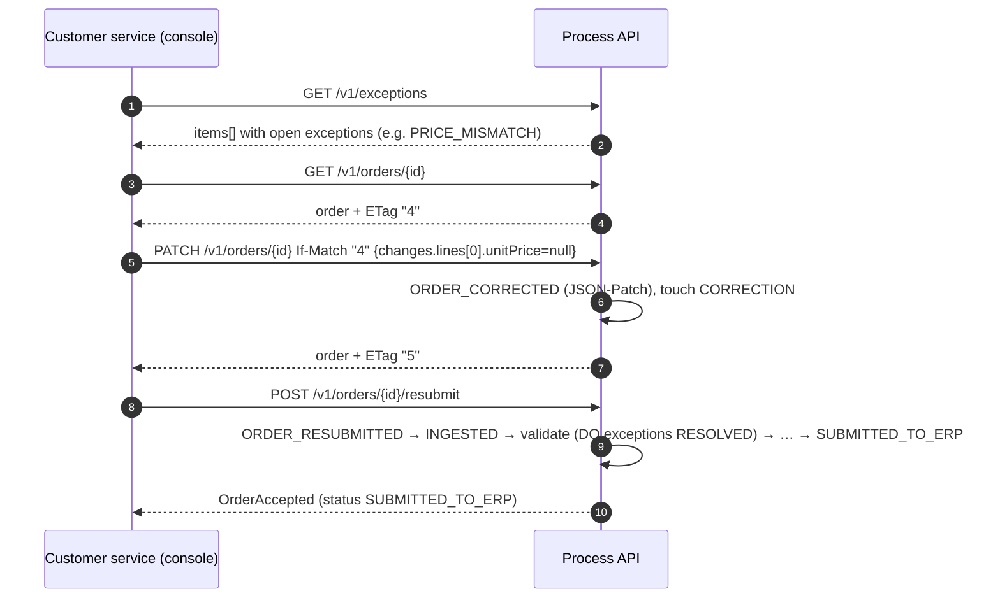
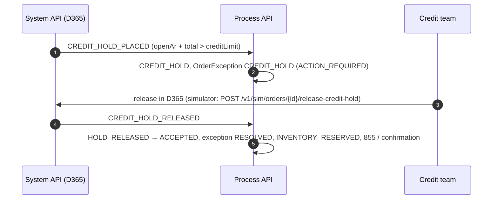
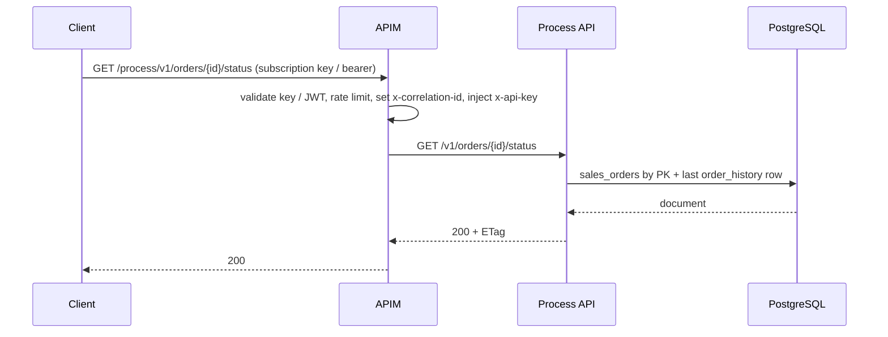

# Technical Design Document – Sales Order Data Product & Order Status API

| Item | Value |
|---|---|
| Document | 02 – Technical Design Document (TDD) |
| Product | Taylor Farms Sales Order data product (Tier 2 integration layer) |
| Version | 1.0 (matches code `tfso` 1.0.0, CDM contract 1.0.0) |
| Status | Baseline for build / pilot |
| Related | [00 Solution blueprint](00-solution-blueprint.md) · [01 Requirements](01-requirements.md) · [03 Canonical data model](03-canonical-data-model.md) · [04 Azure reference architecture](04-azure-reference-architecture.md) |
| Code | `src/tfso/**`, `frontend/`, `infra/`, `databricks/`, `deploy.sh` |

### Revision history

| Version | Date | Change |
|---|---|---|
| 1.0 | 2026-11-13 | First complete design, aligned to the implemented services and a passing end-to-end smoke run |

---

## 1. Context and scope

The deck *Sales Order data product* (Nov 2026) defines a three-tier architecture: **Tier 1 Capture** (EDI, e-mail,
portal, manual entry, partner API), **Tier 2 Integrate** (ingest, validate, enrich, canonicalize, orchestrate) and
**Tier 3 Fulfill** (D365 F&O, WMS, TMS, CRM, Lakehouse). Tier 2 is implemented API-led, in three layers:

| Layer | Responsibility | Package | Local port | Azure |
|---|---|---|---|---|
| Experience | One API per channel; channel formats, channel acknowledgements (997), customer-safe views | `tfso.experience` | 8001 | Container App `ca-<prefix>-<env>-exp`, APIM `/exp` |
| Process | Order Intake (validate, enrich, canonicalize, publish), fulfilment orchestration, exceptions, **Order Status API**, history, webhooks, KPIs | `tfso.process` | 8002 | `ca-<prefix>-<env>-process`, APIM `/process` |
| System | D365 / WMS / TMS / CRM / Lakehouse adapters, master data, fulfilment simulator | `tfso.system` | 8003 | `ca-<prefix>-<env>-system`, APIM `/system` (non-prod) |
| Gateway (local only) | Stand-in for API Management, hosts the console | `tfso.gateway` | 8080 | API Management + Storage static website |

**In scope:** all five channels, the full order lifecycle from receipt to invoice/close, the canonical model and
its lifecycle history, outbound customer documents (997/855/856/810 or e-mail/portal notifications), status
webhooks, analytics landing (bronze) and the Databricks pipeline, local/Docker/Azure deployment.

**Out of scope for this release (see §19):** X12 860/865 change orders, physical AS2 transport (terminated by
Logic Apps Integration Account in Azure), real WMS/TMS connectors (webhook contracts are provided), split /
backorder child orders.

---

## 2. Architecture overview



**Key architectural decisions** (full ADRs in doc 04 §14):

1. **One canonical document per order** (CDM v1, `src/tfso/common/cdm.py`) stored as JSON/JSONB with projected,
   indexed columns for the status API; **history is a separate append-only event table** and is re-embedded as
   `orderHistory` on read.
2. **Every state change is recorded once** through `Recorder.record()` (state machine + history + ROI timestamps +
   outbound event) and committed in the same transaction as the outbox message (transactional outbox).
3. **Asynchronous orchestration** between Process and System over three topics with CloudEvents 1.0 envelopes;
   all consumers are idempotent.
4. **One container image, four entry points** (`SERVICE=experience|process|system|gateway`).
5. **Simulator parity:** the D365/WMS/TMS simulator emits exactly the same `StatusEvent` contract as the live
   adapters, so the lifecycle can be exercised end-to-end in every non-prod environment.

---

## 3. Shared library – `tfso.common`

| Module | Purpose | Key elements |
|---|---|---|
| `config.py` | Environment configuration (§15) | `Settings`, `get_settings(service)`, `default_http_routes()` |
| `cdm.py` | Canonical data model (Pydantic v2, camelCase aliases) | `SalesOrder`, `OrderHistoryEntry`, `OrderGroup`, `OrderStatusChanged`, `StatusEvent`, `CDM_VERSION` |
| `statuses.py` | State machine, categories, milestones, event catalogue | `OrderStatus`, `StatusCategory`, `LineStatus`, `STATUS_META`, `can_transition`, `is_stale`, `MILESTONES`, `HistoryEventType`, `SYSTEM_EVENT_TO_STATUS`, `reference_catalogue()` |
| `db.py` | SQLAlchemy 2 engine/session; JSON → JSONB on PostgreSQL; SQLite WAL locally | `Database`, `JsonDoc` |
| `bus.py` | Broker abstraction and CloudEvent factory; Event Hubs stream | `cloud_event`, `HttpBroker`, `ServiceBusBroker`, `InProcBroker`, `EventStream`, `make_broker` |
| `outbox.py` | Transactional outbox + idempotent inbox | `make_models(Base)`, `Outbox.add/kick/dispatch_once/processed/mark_processed/stats` |
| `web.py` | FastAPI factory, middleware, RFC 7807, auth, inter-service client | `create_app`, `ApiError`, `Authenticator`, `ServiceClient`, `relay`, `register_transport` |
| `x12.py` | X12 parser (850) and generators (997/855/856/810) | `parse_interchange`, `read_850`, `build_997`, `build_855`, `build_856`, `build_810`, `X12Writer` |
| `util.py` | Time, ids, decimals | `order_id()` → `SO-YYYYMMDD-XXXXXXXX`, `group_id()` → `OG-YYYYMMDD-XXXXXXXX` |

### 3.1 App factory (`web.create_app`)

Every service is created through `create_app(settings, title, description)`, which installs:

* **Correlation middleware** – reads `x-correlation-id` (or generates a UUID), stores it in a `ContextVar`, echoes
  it on the response, adds it to every log line, every history entry (`correlationId`) and every CloudEvent
  (`correlationid`), and forwards it on inter-service calls (`ServiceClient`).
* **Authentication** for every path except `/health`, `/docs`, `/redoc`, `/openapi.json` and `OPTIONS` (§12).
* **RFC 7807 error handlers** for `ApiError`, `HTTPException`, request validation (422 with `errors[]`) and
  unhandled exceptions (500, logged with stack trace).
* **CORS** (`*`, exposing `x-correlation-id`, `etag`, `location`) – APIM applies the production CORS policy.
* **Structured JSON logging** to stdout, and **Azure Monitor OpenTelemetry** when
  `APPLICATIONINSIGHTS_CONNECTION_STRING` is set.

`ServiceClient` wraps `httpx.AsyncClient`, injects `x-api-key` (first key of `TFSO_API_KEYS`) and the correlation id,
and `relay()` re-raises a downstream problem+json with its original status, title and detail. Tests register
in-process ASGI transports with `register_transport()`.

---

## 4. Experience APIs – `src/tfso/experience/`

| Module | Responsibility |
|---|---|
| `app.py` | `create_experience_app()`; channel routes, catalog, customer-facing status, EDI document passthrough |
| `extract.py` | E-mail extraction: body text, CSV, XLSX (openpyxl), TXT, PDF (Document Intelligence or pypdf), confidence scoring |

### 4.1 Channel handling

| Channel | Route | Translation | Source document stored | Actor |
|---|---|---|---|---|
| Portal | `POST /portal/v1/orders` (`channel=PORTAL`) | `PortalOrderRequest` → draft (`customerId`, `shipToId`, `purchaseOrder.poNumber/poDate`, lines with `item.itemNumber`, `quantity{value,uom}`, optional `unitPrice`) | `PORTAL_FORM` (request JSON) | `CUSTOMER` |
| Manual entry | same route, `channel=MANUAL` | as portal; customer price becomes `MANUAL_OVERRIDE`; ROI records one `MANUAL_ENTRY` touch (8 min) | `PORTAL_FORM` | `USER` (`enteredBy`) |
| Partner API | `POST /partner/v1/orders` | canonical draft accepted as-is; `customerId` from body, `soldTo`, or `x-partner-id` | `PARTNER_JSON` | `PARTNER` |
| EDI | `POST /edi/v1/x12/850` (text/plain) | `parse_interchange` + `read_850` per ST; trading partner (ISA06) → `customerId` | `X12_850` per transaction set + `X12_997` outbound | `PARTNER` |
| E-mail | `POST /email/v1/orders` | `extract_email` → header + lines + confidence; customer from body or sender e-mail domain | `EMAIL_MESSAGE` / `PDF` / `SPREADSHEET` | `CUSTOMER` |

All channels call **one** Process route, `POST /v1/orders/intake`, with an `IntakeRequest`
(`sourceChannel, channelDetail, receivedAt, orderGroupId, sourceDocument{…, rawContent}, extraction,
submittedBy, acknowledgments[], draft`). The Experience layer never applies business rules.

### 4.2 EDI interchange processing

1. Parse ISA (delimiters from ISA positions 3/104/105), GS, ST…SE loops; syntax checks: SE01 segment count,
   SE02 = ST02, GE01 transaction count, ST01 = 850. Any parse failure → `400 Invalid X12 interchange`.
2. If `x-partner-id` is present it must equal ISA06 (`403 Sender mismatch`).
3. Look up the trading partner agreement (`GET /system/v1/masterdata/trading-partners/{ISA06}`); unknown → `422`.
4. Build the **997** (`AK1` group, `AK2/AK5` per ST – `A` accepted, `R` rejected with `AK3`; `AK9` `A`/`P`/`R`).
5. Create one `orderGroupId` for the interchange; each accepted ST becomes an intake call with
   `Idempotency-Key: edi:{ISA06}:{ISA13}:{ST02}` (re-sent interchanges never duplicate orders) and the 997 attached
   as an already-sent acknowledgement.
6. Response `202 {interchangeControlNumber, sender, customerId, orderGroupId, transactionSets, orders[], rejected[], ack997}`.

#### 850 → canonical draft mapping (`x12.read_850`)

| Segment / element | Canonical path | Notes |
|---|---|---|
| ISA06 / ISA08 / ISA13 | `source.sourceDocument.senderId / receiverId / interchangeControlNumber` | |
| GS06 / GS08 | `sourceDocument.groupControlNumber / x12Version` | |
| ST02 | `sourceDocument.transactionSetControlNumber` | |
| BEG01 | `purpose` | 00 ORIGINAL, 01 CANCELLATION, 04 CHANGE, 05 REPLACE, 06 CONFIRMATION |
| BEG02 | `orderType` | SA/NE STANDARD, RL BLANKET_RELEASE, DS DROP_SHIP, RO RUSH, KN STANDING, OS SAMPLE |
| BEG03 / BEG04 / BEG05 | `purchaseOrder.poNumber / releaseNumber / poDate` | |
| CUR02 | `commercial.currency` | |
| REF*DP / CT / PD | `purchaseOrder.department / contractNumber / promotionDealNumber` | all REFs also in `references[]` |
| PER | `parties.buyer.contacts[]` | TE → phone, EM → email |
| FOB01 | `commercial.fobPoint` | |
| ITD | `commercial.paymentTerms` (`code = X12-<ITD01>`, discount %, days, net days) | replaced by customer master terms on enrichment |
| DTM*002/063/064 | `dates.requestedDeliveryDate` (header) / `lines[].requestedDeliveryDate` (in PO1 loop) | CCYYMMDD → ISO |
| DTM*010/037 | `dates.requestedShipDate` | |
| DTM*001 | `dates.cancelByDate` | |
| TD503 / TD505 | `shipping.carrierScac / routing` | |
| SAC | `allowancesCharges[]` (header or line) | SAC05 implied 2 decimals |
| MSG / NTE | `notes[]` (header or line) | |
| N1*ST / BT / BY / SF / SO | `parties.shipTo / billTo / buyer / shipFrom / soldTo` | N103 UL → `gln`, 1 → `duns`, other (92) → `ediLocationCode` |
| N3 / N4 | `parties.<role>.address` | |
| PO101 | `lines[].buyerLineNumber` | data-product `lineNumber` is assigned 1..n |
| PO102 / PO103 / PO104 / PO105 | `lines[].quantity.value / uom`, `unitPrice.amount / basisUom` | price source `PURCHASE_ORDER` |
| PO1 IN/BP, VN/VP, UP, UK/EN | `item.buyerItemNumber, vendorItemNumber, upc, gtin` | resolved to `item.itemNumber` by DQ-003 |
| PID05 | `item.description` | overwritten by item master on enrichment |
| CTT01 | `declaredLineCount` (draft only) | |

### 4.3 E-mail extraction and confidence (DQ-011)

`extract_email()` parses the body and subject with header regexes (`PO`, `Customer`, `Ship-To`, `Deliver/Need by/Due`)
and a line regex (`<ITEM> <qty> [UOM] [@ price]`). Attachments win over loose body lines:
CSV and XLSX use column aliases (`item/sku/product`, `buyer item`, `qty/quantity/cases`, `uom`, `price`);
TXT is parsed as text; PDFs go to **Azure AI Document Intelligence** (`documentModels/{TFSO_DOCINTEL_MODEL_ID}:analyze`,
API 2024-11-30, Managed Identity) when configured, otherwise `pypdf`.

```
confidence = 1.0 − 0.2 × |missing of {poNumber, shipTo, deliveryDate, lines}|
                 − 0.1 × |lines without item or quantity|
                 − 0.05 (if OCR) − 0.05 (if no customerId)       clipped to [0, 1]
```

If the customer is not stated, it is inferred from the sender's e-mail domain against customer contacts.
A ship-to starting `ST-` is treated as a ship-to id, otherwise as an EDI location code / name. The result carries
`extraction{method, confidence, modelId, fieldsLowConfidence}`; **DQ-011** fails below 0.80.

### 4.4 Catalog and customer views

`/portal/v1/catalog/*` project System API master data for portal pickers (items include the customer's
`contractPrice` and `agreementId`). `GET /portal/v1/orders/{id}` and `/partner/v1/orders/{id}/status` return the
**customer view** of the status (`view=customer`: `openIssues[]` instead of internal exceptions and ROI). When the
caller's token carries `extension_customerId` (Entra External ID), `enforce_customer()` rejects access to other
customers' data with `403`.

---

## 5. Process API – `src/tfso/process/`

| Module | Responsibility |
|---|---|
| `app.py` | `create_process_app()`; routes, bus consumers (`system-status-events`, webhooks), sweeper, lifespan |
| `service.py` | `OrderService` (intake, pipeline, status events, CS actions), `Recorder` (unit of work), `json_diff`, `_apply_changes` |
| `rules.py` | `validate()` (DQ-001..DQ-011), `apply_results()`, `enrich()`, `earliest_valid_delivery()` |
| `views.py` | Read models: `get_order`, `status_view`, `accepted_view`, `search_orders`, `documents`, `related`, `group_history`, `exceptions_queue`, `summary`, `kpis` |
| `models.py` | Tables (§13) |
| `masterdata.py` | `MasterDataClient` – cached (TTL 300 s) System API client, item resolution by item number / buyer item / GTIN / UPC / vendor item |

### 5.1 Intake pipeline



* Commit #1 makes the order durable and visible (status `INGESTED`) before any remote call.
* The pipeline runs under a per-order `asyncio.Lock` and re-checks `version` before commit #2
  (`409 Concurrent modification` if another writer won).
* If master data is unavailable, the pipeline returns without changes; the **sweeper** (every 30 s) retries orders
  that have been `INGESTED` for more than 20 s (batch 50).
* `accepted_view()` is returned with `202`: `orderId, orderGroupId, version, status, statusCategory, customerPo,
  customerId, exceptions[], warnings[], totals, statusUrl, historyUrl, receivedAt`.

### 5.2 Recorder – the unit of work

`Recorder.record(event_type, to_status=…, source_system, tier, actor, occurred_at, reason_code, message, changes,
line_changes, document_ref, external_event_id, causation_id, force)`:

1. Validates the transition with `can_transition()` unless `force=True` (`409 Invalid status transition`).
2. Sets `status`, `statusCategory`, `statusUpdatedAt`, `statusReason` (only for ACTION_REQUIRED / CANCELLED).
3. Stamps `roi.stageTimestamps.<stage>` the **first** time a stage is reached (using `occurredAt`) and recomputes
   `roi.cycleTimes` (`receiptToErpMinutes`, `receiptToShipHours`, `receiptToInvoiceHours`).
4. Appends an `OrderHistoryEntry` with the next `sequence` and `elapsedSincePreviousSeconds`; tier defaults to
   `TIER3` for D365/WMS/TMS/CRM sources, otherwise `TIER2`.
5. Queues an `OrderStatusChanged` CloudEvent (`tfso.salesorder.OrderStatusChanged`, subject = orderId) whose data
   carries the history entry, ROI tags and – for status-changing entries – a `snapshot` of the canonical order.

`Recorder.command()` queues commands (`tfso.salesorder.CreateErpSalesOrder`, `…CancelErpSalesOrder`) on
`sales-order-commands`; `touch()` records manual touches; `add_document()` stores inbound/outbound documents.
`OrderService._persist()` writes the document, projections, history rows, documents and outbox rows **in one
transaction** and increments `version`.

### 5.3 Order state machine

Generated from `statuses.py` (`_EXPLICIT` table plus forward-only progression through
`ACCEPTED → RELEASED → PICKED → PACKED → PARTIALLY_SHIPPED → SHIPPED → DELIVERED → INVOICED → CLOSED`, where stages
may be skipped but never reversed):



Statuses, categories and ranks (blueprint §5) are exposed at runtime by `GET /process/v1/reference/statuses`
(`statuses[].allowedTransitions`, `categories`, `lineStatuses`, `historyEventTypes`, `milestones`, `systemEvents`).
Forward skips (e.g. `ACCEPTED → SHIPPED`) are legal; reversals are not. Terminal: `CLOSED`, `CANCELLED`, `REJECTED`.
Correctable: `EXCEPTION`, `ERP_REJECTED`, `ON_HOLD`.

### 5.4 Applying Tier-3 status events (`OrderService.apply_status_event`)

Input: `StatusEvent` (`eventId, eventType, orderId | erpSalesOrderId, occurredAt, sourceSystem, reason, erp,
lines[], shipment, invoice, promisedShipDate, payload`) from topic `system-status-events` (subscription
`process-api`) or `POST /v1/events`.

1. Resolve the order by `orderId`, else by `erpSalesOrderId` (`404` → message dropped/dead-lettered).
2. **Idempotency:** if `order_history.external_event_id = eventId` exists, return `{duplicate: true}`.
3. Map `eventType` to the target status (`SYSTEM_EVENT_TO_STATUS`) and apply:

| Event | Effect on the canonical order | History entries | Customer communication |
|---|---|---|---|
| `ERP_ACCEPTED` | `erp{salesOrderId, company, customerAccount, invoiceAccount, siteId, warehouseId, …}`; `dates.promisedShipDate`; per line `erpLineId`, `quantities.confirmed/backordered/allocated`, line status `ALLOCATED` / `BACKORDERED` | `ERP_ACCEPTED` → ACCEPTED, `INVENTORY_RESERVED`, `LINE_BACKORDERED` per backordered line | EDI 855 (`AC` when backordered → ack status `ACCEPTED_WITH_CHANGES`, else `AD`) or e-mail/portal confirmation |
| `CREDIT_HOLD_PLACED` | `OrderException{code: CREDIT_HOLD, detectedBy: D365}`; reason code in ROI | `CREDIT_HOLD_PLACED` → CREDIT_HOLD | – |
| `CREDIT_HOLD_RELEASED` | as ERP_ACCEPTED; resolves CREDIT_HOLD exception | `HOLD_RELEASED` → ACCEPTED, `INVENTORY_RESERVED` | 855 / confirmation |
| `ERP_REJECTED` | `erp.rejectionReason`; `OrderException{ERP_REJECTED}` | `ERP_REJECTED` (→ ERP_REJECTED only from SUBMITTED_TO_ERP) | – |
| `RELEASED_TO_WAREHOUSE` / `PICKED` / `PACKED` | line status RELEASED/PICKED/PACKED for confirmed lines; `quantities.picked` on PICKED | `RELEASED_TO_WAREHOUSE` / `PICKED` / `PACKED` | – |
| `SHIPPED` | add `Shipment` (deduped by `shipmentId`); add shipped qty and lots (FSMA TLC) per line | `SHIPPED` → `SHIPPED` when every confirmed qty is shipped, else `PARTIALLY_SHIPPED` | EDI 856 (ASN) or ship notice; ship→ASN minutes |
| `DELIVERED` | shipments DELIVERED + proof of delivery; `quantities.delivered` | `DELIVERED` → DELIVERED | – |
| `INVOICED` | add `Invoice` (deduped by `invoiceId`); `quantities.invoiced` | `INVOICED` → INVOICED | EDI 810 or invoice notice |
| `CLOSED` / `CANCELLED` | – | `CLOSED` / `CANCELLED` | – |

**Out-of-order and stale events.** `is_stale(current, target)` is true when a fulfilment event targets a stage at or
behind the current stage. Such events (other than SHIPPED / DELIVERED / INVOICED, whose facts are still merged)
produce a `LATE_EVENT_IGNORED` entry (`reasonCode OUT_OF_ORDER`) and never regress status.

**Forced physical events.** Physical facts win over administrative holds: a fulfilment event that is ahead of the
current status while the order is `ON_HOLD` or `CREDIT_HOLD` is applied with `force=True`; DELIVERED, INVOICED and
CLOSED are always forced forward.

**Partial shipments.** Each `SHIPPED` event adds its quantities; the order stays `PARTIALLY_SHIPPED` (a legal
self-transition) until `Σ(confirmed − shipped) ≤ 0`. Backordered quantity is not shipped in this release (§19).

### 5.5 Outbound acknowledgements (`OrderService._acknowledge`)

For EDI orders the trading partner agreement controls `send855`, `send856`, `send810`; documents are generated by
`x12.build_855/856/810` with a monotonically increasing interchange/group control number (`counters.x12`, from 1001),
stored as `X12_855/X12_856/X12_810` documents, recorded in `acknowledgments[]`, `roi.acknowledgmentTimestamps`
(`poAck855`, `shipNotice856`, `invoice810`; `functionalAck997` at intake) and a `DOCUMENT_SENT` history entry.
**Chargeback risk:** if the elapsed time from receipt (855) or shipment (856) exceeds the partner's
`ackSlaMinutes`, `LATE_855` / `LATE_856` is appended to `roi.chargebackRisk`; `roi.cycleTimes.shipToAsnMinutes` is
recorded for every 856. Non-EDI channels get an `EMAIL_NOTIFICATION` document (order confirmation, shipment notice,
invoice) addressed to the sold-to contact, acknowledgement type `EMAIL_CONFIRMATION` (EMAIL, MANUAL) or
`PORTAL_NOTIFICATION` (PORTAL, PARTNER_API), and a `NOTIFICATION_SENT` entry. In Azure a Logic App (target state)
sends the stored X12 over AS2.

### 5.6 Customer-service actions

| Action | Route | Preconditions | Effect |
|---|---|---|---|
| Correct | `PATCH /v1/orders/{id}` | `If-Match` required (`428` if missing, `412` + current `ETag` if stale); status ∈ {EXCEPTION, ERP_REJECTED, ON_HOLD} (`409`) ; non-empty diff (`422 No changes`) | `_apply_changes()`; `ORDER_CORRECTED` with JSON-Patch `changes`; manual touch `CORRECTION` (6 min); `touchless=false` |
| Resubmit | `POST /v1/orders/{id}/resubmit` | status ∈ {EXCEPTION, ERP_REJECTED} | `ORDER_RESUBMITTED` → INGESTED, then full pipeline; resolves previous DQ exceptions that now pass |
| Hold | `POST /v1/orders/{id}/hold` | `can_transition(status, ON_HOLD)` | stores `extensions.heldFromStatus`; `HOLD_PLACED` → ON_HOLD |
| Release hold | `POST /v1/orders/{id}/release-hold` | status ON_HOLD | `HOLD_RELEASED` → held-from status; if that was PUBLISHED the ERP command is sent |
| Cancel | `POST /v1/orders/{id}/cancel` | not terminal and rank < 90 (nothing shipped) | resolves open exceptions, lines `CANCELLED`, `CANCELLED` (forced); `CancelErpSalesOrder` if a D365 order exists |

Correction payload (`changes`): `customerPo`, `purchaseOrder{}`, `requestedDeliveryDate`, `dates{}`, `shipTo{shipToId}`
or `shipToId`, `customerId`/`soldTo`, `shipping{}`, `notes`, `lines[]` (by `lineNumber`; `remove: true` deletes;
unknown number adds; `item{itemNumber}`/`itemNumber`, `quantity{value,uom}`/number, `uom`,
`unitPrice{amount}`/number — an explicit `null` drops the customer price so the agreement price applies,
`requestedDeliveryDate`, `minRemainingShelfLifeDays`, `substitutionAllowed`). Changing ship-to or delivery date clears
the derived `requestedShipDate`.

### 5.7 Data quality rules (`rules.validate`)

| Rule | Check | Severity | Exception codes |
|---|---|---|---|
| DQ-001 | Sold-to exists (by id, ERP account or partner client id) and is active | ERROR | `CUSTOMER_NOT_FOUND`, `CUSTOMER_INACTIVE` |
| DQ-002 | Ship-to resolved by id, EDI location code, GLN or name; belongs to the customer; active | ERROR | `SHIPTO_NOT_FOUND`, `SHIPTO_CUSTOMER_MISMATCH`, `SHIPTO_INACTIVE` |
| DQ-003 | Item resolved (item number, buyer item xref, GTIN, UPC, vendor item) and active | ERROR | `ITEM_NOT_FOUND`, `ITEM_INACTIVE` |
| DQ-004 | UOM in the item's `salesUoms` | ERROR | `UOM_INVALID` |
| DQ-005 | When the customer sent a price: within ±0.5 % (min $0.01) of the agreement price valid on the delivery date, else list price; EA prices converted via `uomConversions` | ERROR | `PRICE_MISMATCH` |
| DQ-006 | No other open order (not terminal, not EXCEPTION) with the same customer + PO; skipped for CHANGE / CANCELLATION purposes | ERROR | `DUPLICATE_ORDER` |
| DQ-007 | Delivery date not in the past; `deliveryDate − transitDays ≥ today + (maxLeadTime − 1) (+1 after 22:00 UTC cut-off)`; ship-to receiving day | ERROR (receiving day: WARNING) | `DATE_IN_PAST`, `DATE_NOT_ACHIEVABLE`, `NON_RECEIVING_DAY` |
| DQ-008 | Quantity > 0, ≥ `minOrderQty`, multiple of `orderIncrement` | ERROR | `QUANTITY_INVALID`, `QUANTITY_INCREMENT` |
| DQ-009 | PO number, sold-to, ship-to reference, ≥ 1 line, delivery date, every line has an item reference and quantity | ERROR | `MISSING_REQUIRED_DATA` |
| DQ-010 | Item shelf life − transit ≥ line `minRemainingShelfLifeDays`; frozen item to non-frozen location | WARNING | `SHELF_LIFE_RISK`, `TEMPERATURE_MISMATCH` |
| DQ-011 | Extraction confidence ≥ 0.80 (only orders with `source.extraction`) | ERROR | `EXTRACTION_LOW_CONFIDENCE` |

`apply_results()` writes `dataQuality{attempt, validatedAt, results[], passed, firstPass (first attempt only),
score = passed checks / checks}`, resolves previously open `DQ-*` exceptions, opens one `OrderException` per failing
ERROR result and appends new codes to `roi.exceptionReasonCodes`. WARNINGs never block.

### 5.8 Enrichment (`rules.enrich`)

* **Parties:** sold-to name/ERP account/DUNS/GLN/contacts; ship-to customer, name, D365 delivery location id,
  address, delivery days, receiving hours, GLN, EDI code; bill-to from the invoice account; supplier and ship-from
  (warehouse / site).
* **Commercial:** currency, payment terms (customer master), price group, sales responsible, agreement id.
* **Shipping:** delivery mode, ship-from site/warehouse, appointment flag, transport responsibility,
  temperature requirement (zone of the ship-to, 0.5–4.0 °C for refrigerated).
* **Dates:** `requestedShipDate = requestedDeliveryDate − transitDays`; `orderDate` from PO date or receipt.
* **Lines:** item GTIN/UPC/description/pack/brand/temperature/shelf life/weight/commodity; price from the agreement
  (`CUSTOMER_AGREEMENT`) or list (`LIST`) when the customer sent none, otherwise the PO price is kept with
  `agreementPrice` and `listPrice` alongside; `lineAmount`, `quantities.ordered`, line dates.
* **Totals:** line count, quantity, subtotal, allowances, charges, tax (0 – D365 calculates tax), grand total,
  weight. Every enrichment is recorded as JSON-Patch `changes` on the `ORDER_ENRICHED` entry (max 200 ops).

### 5.9 Order Status API read models (`views.py`)

* **Search** – filters `status`, `statusCategory`, `channel` (comma lists), `customerId`, `customerPo`,
  `erpSalesOrderId`, `fromDate`/`toDate` (received), `hasExceptions`, `q` (order id, PO, customer, ERP id; ILIKE);
  `sort` ∈ {receivedAt, updatedAt, status, customerId, customerPo, totalAmount, requestedDeliveryDate, orderId},
  `-` prefix for descending; `page`, `pageSize ≤ 200`. Only indexed projection columns are touched.
* **Status view** – status, category, description, reason, ERP id, dates, **milestones** (`DONE` with timestamp,
  `CURRENT` – flagged `blocked` with `blockedReason` when ACTION_REQUIRED – `PENDING`, or `SKIPPED` after
  cancellation/close), `nextExpected{milestone, label, by}` (promised ship date or shipment ETA), line quantities,
  shipments, invoices, acknowledgements, totals, `lastEvent`; internal view adds `openExceptions` and ROI.
* **History** – entries ordered by `sequence`, filters `eventType` (comma list) and `since`.
* **Group history** – all orders sharing `orderGroupId`, merged by `recordedAt`, with `aggregateStatusCategory`
  (ACTION_REQUIRED if any order needs action, otherwise the least advanced category).
* **KPIs** (§5.11).

### 5.10 Webhooks

`POST /v1/subscriptions {callbackUrl, eventTypes[] (default ["*"]; matches history eventType or toStatus),
customerId?}` → `201` with a one-time `secret`. The `process-webhooks` consumer of `sales-order-events` posts the
CloudEvent (without `snapshot`) with headers `content-type: application/cloudevents+json`,
`x-tfso-event-id`, and `x-tfso-signature: sha256=<hex HMAC-SHA256(secret, raw body)>`. Delivery is best-effort per
event (counters `deliveries`, `failures`, `lastStatus`, `lastDeliveryAt`); HTTPS is mandatory in prod.

```python
import hashlib, hmac

def verify(secret: str, raw_body: bytes, signature_header: str) -> bool:
    expected = "sha256=" + hmac.new(secret.encode(), raw_body, hashlib.sha256).hexdigest()
    return hmac.compare_digest(expected, signature_header)
```

Receivers should dedupe on `x-tfso-event-id` and order by `data.sequence` per `subject`.

### 5.11 KPIs (`views.kpis`)

| KPI | Formula (over orders in the store) |
|---|---|
| `touchlessRate` | orders that reached D365 (`erpCreated`) with `touchless = true` ÷ orders that reached D365 |
| `firstPassValidationRate` | orders whose first validation passed ÷ orders validated at least once |
| `avgReceiptToErpMinutes` / `avgReceiptToShipHours` | mean of `roi.cycleTimes` |
| `openExceptions` | orders with ≥ 1 open exception |
| `dataFreshnessSeconds` | mean `recordedAt − occurredAt` of the last 200 D365/WMS/TMS events |
| `manualTouchMinutes` | Σ `roi.manualTouches[].minutes` |
| `estimatedLaborSavedHours / Usd` | touchless ERP orders × 8 min baseline ÷ 60 (× `laborRatePerHour`, default 32) |
| `chargebackRiskFlags` | Σ `roi.chargebackRisk` entries |
| `exceptionReasons` | count by reason code |
| `byChannel[]` | all of the above per source channel |

The production equivalents are the Databricks gold marts (`databricks/pipelines/sales_order_dlt.sql`).

---

## 6. System API – `src/tfso/system/`

| Module | Responsibility |
|---|---|
| `app.py` | `create_system_app()`; routes, consumers (`sales-order-commands/system-api`, `sales-order-events/system-lakehouse`, `sales-order-events/system-crm`), auto-progress, simulator guard |
| `erp.py` | `SimulatedErp`, `LiveD365`, `translate_business_event`, tables `erp_sales_orders`, `counters`, `crm_activities` |
| `d365_client.py` | `D365Client` – OAuth2 client credentials (Entra), OData paging (`@odata.nextLink`), create/action |
| `masterdata.py` | `SeedMasterData` (`seed/masterdata.json`) and `D365MasterData` (CustomersV3, ReleasedProductsV2, SalesPriceAgreements, 15-min cache) |
| `lakehouse.py` | `LakehouseWriter` – bronze landing (file or ADLS Gen2) |

### 6.1 D365 simulator behaviour

* **Create:** idempotent per `orderId` (an active ERP order returns ERP_ACCEPTED again). Inactive customer →
  `ERP_REJECTED`. ERP number `SO-<8 digits>` from 00100001. Per line `confirmed = min(ordered, available)` from the
  seed inventory (decremented), remainder backordered (e.g. `TF-40001` has 20 cases). Promised ship date =
  max(requested ship date, today + lead time − 1). **Credit check:** `openAr + order total > creditLimit` →
  `CREDIT_HOLD_PLACED` (e.g. customer `C-1003`, limit 6 000).
* **Advance** (`POST /v1/sim/orders/{id}/advance {to, lines?, carrier?}`): emits every intermediate stage
  (`RELEASED_TO_WAREHOUSE` D365 → `PICKED`, `PACKED` WMS → `SHIPPED` WMS → `DELIVERED` TMS → `INVOICED`, `CLOSED`
  D365). Partial shipping ships only the given line quantities and leaves the ERP stage at PACKED.
* **Shipments** carry shipment/ASN/packing slip/BOL/PRO/trailer/seal numbers, carrier (SCAC), ETA (+20 h), an SSCC,
  and per line a lot with **FSMA 204 Traceability Lot Code** (`0614141` + lot), pack date and best-by date (+12 d).
* **Invoices** `INV-7000xx` for shipped-but-uninvoiced quantity; due date from payment-term net days.
* **Auto-progress** (`TFSO_SIM_AUTOPROGRESS` or `PUT /v1/sim/config`) walks accepted orders through fulfilment
  every `stepSeconds`. Simulator endpoints return `403` when `TFSO_ENV=prod`.

### 6.2 Live D365 mapping (`LiveD365.create_sales_order`)

| D365 entity.field | Canonical source |
|---|---|
| `SalesOrderHeadersV2.dataAreaId` | `TFSO_D365_COMPANY` |
| `.OrderingCustomerAccountNumber` | `parties.soldTo.erpAccount` (fallback `partyId`) |
| `.InvoiceCustomerAccountNumber` | `parties.billTo.erpAccount` |
| `.CustomerRequisitionNumber` | `purchaseOrder.poNumber` |
| `.CustomersOrderReference` | `orderId` (round-trips in business events) |
| `.CurrencyCode` | `commercial.currency` |
| `.RequestedReceiptDate` / `.RequestedShippingDate` | `dates.requestedDeliveryDate` / `requestedShipDate` |
| `.DeliveryAddressLocationId` | `parties.shipTo.erpAccount` |
| `.DeliveryModeCode` | `shipping.deliveryMode` |
| `.DefaultShippingSiteId` / `.DefaultShippingWarehouseId` | `shipping.shipFromSite` / `shipFromWarehouse` |
| `.SalesOrderOriginCode` | `source.channel` |
| `SalesOrderLines.ItemNumber / OrderedSalesQuantity / SalesUnitSymbol / SalesPrice / RequestedReceiptDate / CustomersLineNumber` | `item.itemNumber`, `quantity.value`, `quantity.uom`, `unitPrice.amount`, line or header delivery date, `buyerLineNumber` or `lineNumber` |

**Business events** (`POST /v1/d365/business-events`, single or array) → `StatusEvent`:
`SalesOrderConfirmedBusinessEvent` → ERP_ACCEPTED, `SalesOrderReleasedToWarehouseBusinessEvent` →
RELEASED_TO_WAREHOUSE, `SalesOrderPackingSlipPostedBusinessEvent` → SHIPPED (shipment from `PackingSlipId`),
`SalesOrderInvoicePostedBusinessEvent` → INVOICED (`InvoiceId`, `InvoiceDate`, `InvoiceAmount`),
`SalesOrderCreditLimitCheckFailedBusinessEvent` → CREDIT_HOLD_PLACED, `SalesOrderCanceledBusinessEvent` → CANCELLED.
`EventId` becomes the idempotency key; unknown events are ignored (`{accepted, ignored}`).
**WMS / TMS webhooks:** `POST /v1/wms/events` (PICKED, PACKED, SHIPPED) and `POST /v1/tms/events` (DELIVERED) accept
`{eventType, orderId|erpSalesOrderId, eventId?, occurredAt?, shipment?, lines?, reason?}`.

### 6.3 Lakehouse and CRM

`system-lakehouse` writes every `OrderStatusChanged` envelope to bronze:
`./data/lakehouse/bronze/sales-order-events/date=YYYY-MM-DD/part-HH.jsonl` (file) or
`abfss://bronze@<account>/sales-order-events/date=YYYY-MM-DD/<eventId>.json` (ADLS, Managed Identity).
Duplicates from at-least-once delivery are removed downstream by event id. `system-crm` stores timeline activities
for ACTION_REQUIRED events and ERP_ACCEPTED/SHIPPED/DELIVERED/INVOICED/CANCELLED (`GET /v1/crm/orders/{id}/activities`);
the production adapter pushes the same activity to Dynamics 365 Customer Service.

---

## 7. Messaging, outbox and idempotency

| Topic | Producer | Subscription → consumer | CloudEvent `type` |
|---|---|---|---|
| `sales-order-commands` | Process outbox | `system-api` → `on_command` | `tfso.salesorder.CreateErpSalesOrder`, `tfso.salesorder.CancelErpSalesOrder` |
| `system-status-events` | System outbox | `process-api` → `on_status_event` | `tfso.system.<EventType>` (e.g. `tfso.system.SHIPPED`) |
| `sales-order-events` | Process outbox (+ Event Hubs `order-status-stream`) | `system-lakehouse`, `system-crm`, `process-webhooks` | `tfso.salesorder.OrderStatusChanged` |

Envelope: `{specversion "1.0", id, source ("/process/sales-orders" | "/system/<d365|wms|tms>"), type, subject (orderId),
time, datacontenttype, correlationid, data}`. Service Bus `MessageId = id`, `Subject = type`,
`CorrelationId = correlationid`, application properties `orderId`, `type`.

**Bus modes** (`TFSO_BUS_MODE`): `servicebus` (Managed Identity via `DefaultAzureCredential` or connection string;
receiver loops per subscription complete on success / abandon on failure → dead-letter after max delivery count),
`http` (local: POST to `{service}/v1/bus/{topic}` per `TFSO_BUS_HTTP_ROUTES`, non-2xx raises so the outbox retries),
`inproc` (tests: a process-wide registry drained explicitly).

**Outbox dispatcher** (`Outbox._run`): woken by `kick()` after each commit or every 1 s; reads up to 100
undispatched rows in id order; **per-order ordering** – once a message for a subject fails or is waiting for its
retry time, later messages for that subject are held back; exponential backoff `min(300 s, 2^min(attempts, 8))`;
`last_error` and `attempts` recorded; `GET /health` reports `outbox.pending` and `outbox.retrying`.

**Idempotency at every hop**

| Hop | Mechanism |
|---|---|
| Client → intake | `Idempotency-Key` header → `idempotency_keys` stores the `OrderAccepted` response; replays return it with `idempotentReplay: true` |
| EDI re-send | key `edi:{ISA06}:{ISA13}:{ST02}` |
| E-mail re-delivery | key `email:{messageId}` |
| Command consumer (System) | inbox: `processed(id)` checked before, `mark_processed(id)` **after** the handler succeeds |
| Status event consumer (Process) | inbox as above + unique `order_history.external_event_id = StatusEvent.eventId` |
| CRM consumer | inbox key `crm:{id}` written in the same transaction as the activity |
| D365 create | simulator/adapter returns the existing ERP order for the same `orderId` |

**Optimistic concurrency.** `GET /v1/orders/{id}` and `/status` return `ETag: "<version>"`; `If-None-Match` gives
`304`. `PATCH` requires `If-Match` (`428` / `412`). Writers inside the service re-check `version` before commit.

---

## 8. API specification

All APIs are versioned in the path (`/v1`), JSON, camelCase, and documented live at `/docs` (OpenAPI 3.1) on each
service. Through APIM / the gateway prefix with `/exp`, `/process`, `/system`. Common headers: `x-api-key`
(local) or `Ocp-Apim-Subscription-Key` + `Authorization: Bearer` (Azure), `x-correlation-id`, `Idempotency-Key`
(order-creating POSTs), `If-Match` (PATCH).

### 8.1 Experience API (`/exp`)

| Method | Path | Request | Response | Codes |
|---|---|---|---|---|
| GET | `/health` | – | `{status ok|degraded, dependencies{process, system}}` | 200 |
| GET | `/portal/v1/catalog/customers` | – | `{items[{customerId, name, active, segment, channels, currency}]}` | 200 |
| GET | `/portal/v1/catalog/customers/{customerId}/ship-tos` | – | `{items[{shipToId, name, active, address{city, state, …}, deliveryDays, transitDays}]}` | 200, 403 |
| GET | `/portal/v1/catalog/items?customerId=` | – | `{items[{itemNumber, description, packSize, uom, salesUoms, listPrice, contractPrice, agreementId, gtin, temperatureZone, leadTimeDays, orderIncrement, minOrderQty}]}` | 200 |
| POST | `/portal/v1/orders` | `PortalOrderRequest {channel PORTAL|MANUAL, customerId, shipToId, customerPo, requestedDeliveryDate, orderType?, currency?, notes?, contact?{name,email,phone}, enteredBy?, lines[{itemNumber, quantity>0, uom=CA, unitPrice?, notes?}] (1..500)}` | `OrderAccepted` | 202, 401, 403, 422 |
| GET | `/portal/v1/orders/{orderId}` | – | customer status view | 200, 403, 404 |
| GET | `/portal/v1/customers/{customerId}/orders?status=&page=&pageSize=` | – | search page | 200, 403 |
| POST | `/partner/v1/orders` | canonical draft (`customerId`/`soldTo`, `customerPo` or `purchaseOrder`, `shipTo`, `requestedDeliveryDate` or `dates`, `lines[]`, `externalOrderId?`); header `x-partner-id?` | `OrderAccepted` | 202, 422 |
| GET | `/partner/v1/orders/{orderId}/status` | – | customer status view | 200, 404 |
| POST | `/edi/v1/x12/850` | `text/plain` X12 interchange; header `x-partner-id?` | `{interchangeControlNumber, sender, customerId, orderGroupId, transactionSets, orders[OrderAccepted], rejected[], ack997}` | 202, 400, 403, 422 |
| GET | `/edi/v1/orders/{orderId}/documents?includeContent=` | – | documents list (with content) | 200, 404 |
| POST | `/email/v1/orders` | `{messageId?, from, to?, subject?, receivedAt?, body?, attachments[{fileName, contentType?, contentBase64}]}` | `OrderAccepted + extraction{confidence, method, sources, linesFound, lowConfidenceFields}` | 202, 422 |

`OrderAccepted` example (exception case):

```json
{
  "orderId": "SO-20261113-2FC9F2B7", "orderGroupId": "OG-20261113-5D1C02AA", "version": 2,
  "status": "EXCEPTION", "statusCategory": "ACTION_REQUIRED", "customerPo": "BAD-SMOKE-7A5BF0DB", "customerId": "C-1002",
  "exceptions": [{"code": "PRICE_MISMATCH", "ruleId": "DQ-005", "severity": "ERROR",
                  "message": "Price 9.99 differs from agreement TA-SF-2026 20.75 by more than 0.5%",
                  "lineNumber": 1, "field": "unitPrice.amount"}],
  "warnings": [], "totals": {},
  "statusUrl": "/exp/portal/v1/orders/SO-20261113-2FC9F2B7", "historyUrl": "/v1/orders/SO-20261113-2FC9F2B7/history",
  "receivedAt": "2026-11-13T17:15:29.101Z"
}
```

### 8.2 Process API (`/process`) – Order Intake and **Order Status API**

| Method | Path | Purpose | Codes |
|---|---|---|---|
| GET | `/health` | `{status, db, outbox{pending, retrying}, eventStream, busMode}` | 200 |
| GET | `/v1/reference/statuses` | State machine catalogue | 200 |
| POST | `/v1/orders/intake` | Channel-neutral intake (`IntakeRequest`) → `OrderAccepted` | 202, 409, 422 |
| GET | `/v1/orders` | Search (§5.9) → `{items[OrderListItem], page, pageSize, total, totalPages}` | 200, 400 |
| GET | `/v1/orders/by-po/{customerPo}?customerId=` | Lookup by customer PO | 200, 404 |
| GET | `/v1/orders/{orderId}?includeHistory=true` | Canonical `SalesOrder` incl. `orderHistory`; `ETag` | 200, 304, 404 |
| GET | `/v1/orders/{orderId}/status?view=internal|customer` | Status view with milestones; `ETag` | 200, 404 |
| GET | `/v1/orders/{orderId}/history?eventType=&since=` | `{orderId, items[OrderHistoryEntry], count}` | 200, 404 |
| GET | `/v1/orders/{orderId}/documents` | `{orderId, items[{documentId, documentType, direction, controlNumber, partner, contentType, createdAt, sizeBytes}]}` | 200, 404 |
| GET | `/v1/orders/{orderId}/documents/{documentId}` | document incl. `content` | 200, 404 |
| GET | `/v1/orders/{orderId}/related` | `{orderId, orderGroupId, orders[OrderListItem + relationType], relatedOrders[]}` | 200, 404 |
| GET | `/v1/order-groups/{orderGroupId}/history` | `OrderGroup` + `orders[]` + merged `history[]` | 200, 404 |
| PATCH | `/v1/orders/{orderId}` | Correction `{changes, reason?, reasonCode?, actor?}`; `If-Match` | 200, 409, 412, 422, 428 |
| POST | `/v1/orders/{orderId}/resubmit` | `{actor?, comment?}` → `OrderAccepted` | 200, 409 |
| POST | `/v1/orders/{orderId}/hold` · `/release-hold` | `{actor?, reason?}` → status view | 200, 409 |
| POST | `/v1/orders/{orderId}/cancel` | `{actor?, reasonCode?, reason?}` → status view | 200, 409 |
| POST | `/v1/events` | Apply a `StatusEvent` (requires `eventId`, `eventType`) | 202, 404, 409, 422 |
| GET | `/v1/exceptions?customerId=&code=` | `{items[OrderListItem + exceptions[] + ageMinutes], total, byCode}` | 200 |
| GET | `/v1/status/summary` | `{total, byStatus, byStatusCategory, byChannel, openExceptions, asOf}` | 200 |
| GET | `/v1/metrics/kpis?laborRatePerHour=` | KPIs (§5.11) | 200 |
| GET / POST / DELETE | `/v1/subscriptions[/{id}]` | Webhooks (§5.10) | 200, 201, 204, 404, 422 |
| POST | `/v1/bus/{topic}` | Local HTTP bus delivery (hidden) | 200 |

`OrderListItem`: `orderId, orderGroupId, status, statusCategory, sourceChannel, customerId, customerName, customerPo,
shipToId, erpSalesOrderId, requestedDeliveryDate, receivedAt, updatedAt, totalAmount, currency, openExceptionCount,
touchless, version`.

Status view example (abridged from `cdm/examples/order-status-view.example.json`):

```json
{
  "orderId": "SO-20261113-63B9D3E7", "orderGroupId": "OG-20261113-D69EA874", "version": 9,
  "customerId": "C-1001", "customerName": "FreshMart Grocery", "customerPo": "FM590128A",
  "shipToId": "ST-1001-01", "shipToName": "FreshMart DC 12", "sourceChannel": "EDI",
  "status": "INVOICED", "statusCategory": "INVOICED", "statusDescription": "Invoice posted in D365",
  "erpSalesOrderId": "SO-00100002", "requestedDeliveryDate": "2026-11-16", "promisedShipDate": "2026-11-15",
  "milestones": [
    {"milestone": "RECEIVED", "label": "Order received", "status": "DONE", "at": "2026-11-13T17:15:27.951058Z"},
    {"milestone": "ACCEPTED", "label": "Confirmed in D365", "status": "DONE", "at": "2026-11-13T17:15:28.041973Z"},
    {"milestone": "INVOICED", "label": "Invoiced", "status": "DONE", "at": "…"}
  ],
  "nextExpected": null,
  "lines": [{"lineNumber": 1, "itemNumber": "TF-10001", "buyerItemNumber": "FM-55012", "uom": "CA",
             "status": "INVOICED", "ordered": "40", "confirmed": "40", "backordered": "0",
             "shipped": "40.0", "delivered": "40.0", "invoiced": "40.0"}]
}
```

### 8.3 System API (`/system`)

| Method | Path | Purpose |
|---|---|---|
| GET | `/health` | `d365Mode`, `masterDataMode`, `lakehouseMode`, `busMode`, `outbox`, `simulator` config |
| GET | `/v1/masterdata/customers[/{id}]`, `/customers/{id}/ship-tos` | Customers and ship-tos |
| GET | `/v1/masterdata/ship-tos/{shipToId}`, `/v1/masterdata/ship-tos?customerId=&ediLocationCode=&gln=&name=` | Ship-to by id / lookup |
| GET | `/v1/masterdata/items[/{itemNumber}]` | Items (single item adds `available`) |
| GET | `/v1/masterdata/item-xref?customerId=&buyerItem=&gtin=&upc=&vendorItem=` | Resolve item or list cross references |
| GET | `/v1/masterdata/price-agreements?customerId=&itemNumber=&on=` | Trade agreements valid on a date |
| GET | `/v1/masterdata/trading-partners/{isaId}` | EDI partner agreement (`customerId`, `send997/855/856/810`, `ackSlaMinutes`) |
| POST | `/v1/d365/sales-orders` | Synchronous create (normally via command topic) → `201 {events}` |
| GET | `/v1/d365/sales-orders/{erpId}` · `/v1/d365/sales-orders?orderId=` | ERP order state |
| POST | `/v1/d365/business-events` | D365 business events webhook → `202 {accepted, ignored}` |
| POST | `/v1/wms/events` · `/v1/tms/events` | WMS / TMS webhooks → `202 {accepted, eventId}` (422 unsupported) |
| POST | `/v1/sim/orders/{orderId}/advance` | Simulator → `{orderId, emitted[], events[]}` (403 prod, 404 not in D365, 409 invalid) |
| POST | `/v1/sim/orders/{orderId}/release-credit-hold` | Simulator |
| GET / PUT | `/v1/sim/config` | `{autoProgress, stepSeconds, creditCheck, inventoryCheck}` |
| GET | `/v1/lakehouse/files` | Bronze files written |
| GET | `/v1/crm/orders/{orderId}/activities` | CRM timeline |
| POST | `/v1/bus/{topic}` | Local HTTP bus delivery |

### 8.4 Error model

RFC 7807 `application/problem+json`:

```json
{"type": "https://tfso.taylorfarms.example/problems/precondition-failed", "title": "Precondition failed",
 "status": 412, "detail": "Order is at version 5, you sent 4. Reload and retry.",
 "instance": "/v1/orders/SO-20261113-2FC9F2B7", "correlationId": "79ef8e24-…", "errors": []}
```

| Status | Used for |
|---|---|
| 400 | Invalid X12, invalid sort |
| 401 | Missing/invalid `x-api-key` or bearer token |
| 403 | Customer scoping, EDI sender mismatch, simulator in prod |
| 404 | Unknown order, document, group, master data |
| 409 | Invalid status transition, not correctable/cancellable/holdable, concurrent modification |
| 412 / 428 | Stale or missing `If-Match` |
| 422 | Body validation (`errors[{field, message, type}]`), unknown partner, no changes, unknown event |
| 500 / 502 | Unhandled error (logged with correlation id) / gateway cannot reach backend |

---

## 9. Sequence diagrams

### 9.1 Portal order – happy path



### 9.2 EDI interchange with several purchase orders



### 9.3 Exception → correction → resubmit



### 9.4 Credit hold → release



### 9.5 Status query through APIM



---

## 10. Front end – Order Operations Console (`frontend/`)

Static SPA without a build step (ES modules), configured by `frontend/config.js`
(`window.TFSO_CONFIG = {apiBase, subscriptionKey, apiKey}`, overridable in Settings). Views: Dashboard (health,
summary, KPIs), New Order (portal/manual, EDI 850 generator, e-mail with attachments, partner JSON), Orders search,
Order detail (canonical order, milestone stepper, lifecycle timeline, documents, related/group history, hold,
release, cancel, correct & resubmit, fulfilment simulator), Exceptions queue, Webhooks, API explorer, Settings.
Locally served by the gateway at `http://localhost:8080/`; in Azure from the Storage static website with
`apiBase` = APIM gateway URL.

---

## 11. Persistence design

### 11.1 Process database (`tfso_process`)

| Table | Columns (type) | Keys / indexes |
|---|---|---|
| `sales_orders` | `order_id` (40), `order_group_id`, `version`, `history_seq`, `status`, `status_category`, `source_channel`, `customer_id`, `customer_name`, `customer_po`, `ship_to_id`, `erp_sales_order_id`, `requested_delivery_date` (date), `received_at`, `updated_at` (timestamptz), `total_amount` (numeric 14,2), `currency`, `open_exception_count`, `touchless`, `first_pass`, `erp_created` (bool), `receipt_to_erp_minutes`, `receipt_to_ship_hours` (float), `doc` (JSONB) | PK `order_id`; ix on group, status, category, channel, customer, PO, ERP id, received_at; composite `(customer_id, customer_po)` |
| `order_history` | `event_id` (PK), `order_id` (FK), `order_group_id`, `sequence`, `event_type`, `occurred_at`, `recorded_at`, `from_status`, `to_status`, `source_system`, `external_event_id`, `entry` (JSONB) | unique `(order_id, sequence)`; unique `external_event_id`; ix order, group, event_type, recorded_at |
| `order_documents` | `document_id`, `order_id`, `order_group_id`, `document_type`, `direction` (INBOUND/OUTBOUND), `control_number`, `content_type`, `partner`, `created_at`, `content` (text) | ix order, group |
| `webhook_subscriptions` | `subscription_id`, `callback_url`, `event_types` (JSON), `customer_id`, `secret`, `active`, `created_at`, `deliveries`, `failures`, `last_status`, `last_delivery_at` | PK |
| `idempotency_keys` | `key` (200), `response` (JSON), `created_at` | PK |
| `counters` | `name`, `value` | PK (X12 control numbers) |
| `outbox` | `id`, `message_id` (unique), `topic`, `envelope`, `created_at`, `dispatched_at`, `attempts`, `next_attempt_at`, `last_error` | ix topic, dispatched_at |
| `inbox` | `message_id`, `topic`, `processed_at` | PK |

The canonical document in `doc` excludes `orderHistory`; history is the event store and is merged on read.
Retention: history and documents are immutable (7-year retention, NFR); bronze holds the full event stream.

### 11.2 System database (`tfso_system`)

`erp_sales_orders` (simulator ERP state: `erp_sales_order_id` PK, `order_id` unique, `customer_id`, `status`, `doc`),
`counters` (ERP, shipment, invoice numbers), `crm_activities`, `outbox`, `inbox`. Master data is read from the seed
file or D365 (cached), not persisted.

---

## 12. Security design

| Concern | Design |
|---|---|
| Authentication modes | `TFSO_AUTH_MODE=none` (tests), `apikey` (local and phase-1 Azure: `x-api-key` ∈ `TFSO_API_KEYS`), `entra` (bearer JWT validated against `login.microsoftonline.com/{tenant}/discovery/v2.0/keys`, RS256, `aud = TFSO_ENTRA_AUDIENCE`, `iss = …/{tenant}/v2.0`; the APIM-injected `x-api-key` is also accepted for gateway traffic) |
| Front door | API Management: subscription keys per product (`sales-order-data-product`, `order-status-api` read-only, `order-console`), rate limiting, CORS, correlation id, backend `x-api-key` from a Key Vault named value |
| Customer scoping | `extension_customerId` claim (Entra External ID) enforced by the Experience API on catalog, order and status routes |
| EDI | ISA06 must match the authenticated partner; unknown partners rejected |
| Webhooks | HMAC-SHA256 signatures, per-subscription secret shown once, HTTPS in prod |
| Secrets | Key Vault (Postgres password, API key, D365 client secret); Managed Identity for Service Bus, Event Hubs, ADLS, Document Intelligence |
| Simulator | Disabled when `TFSO_ENV=prod`; `/system` not published by APIM in prod |
| Data | TLS 1.2+ in transit; encryption at rest (PostgreSQL, Storage); PII limited to contact names/e-mails/phones (doc 03 §10) |
| Audit | Every change is an immutable history entry with actor, correlation id and JSON-Patch diff |

---

## 13. Observability

* **Logs:** one JSON line per log record (`ts, level, logger, msg, correlationId, exc`) and one access line per request
  (`METHOD path -> status (ms)`), shipped by Container Apps to Log Analytics.
* **Tracing:** Azure Monitor OpenTelemetry (`configure_azure_monitor`) instruments FastAPI, httpx and logging; the
  correlation id flows HTTP → history entry → CloudEvent `correlationid` → Service Bus `CorrelationId`.
* **Health:** `/health` on every service (no auth) – DB ping, outbox backlog, dependency health (Experience),
  adapter modes (System); used by Container Apps probes, Docker healthcheck and `deploy.sh`.
* **Business telemetry:** KPIs endpoint, exceptions queue `byCode`, Databricks gold marts.
* Suggested alerts (doc 04 §11): outbox `retrying > 0` for 10 min, dead-letter count > 0, p95 status latency
  > 300 ms, orders in `SUBMITTED_TO_ERP` > 15 min, exception queue age > 2 h.

---

## 14. Configuration

| Variable | Default | Used by | Meaning |
|---|---|---|---|
| `TFSO_ENV` | `local` | all | `local`, `dev`, `test`, `prod` (prod disables simulator, requires HTTPS webhooks) |
| `TFSO_DB_URL` | `sqlite:///./data/<service>.db` | process, system | SQLAlchemy URL; Azure `postgresql+psycopg://…?sslmode=require` |
| `TFSO_BUS_MODE` | `http` | process, system | `http`, `servicebus`, `inproc` |
| `TFSO_BUS_HTTP_ROUTES` | derived | process, system | JSON `{topic: [urls]}` for the HTTP bus |
| `TFSO_SERVICEBUS_FQDN` / `TFSO_SERVICEBUS_CONNECTION` | – | process, system | Service Bus namespace (MI) or connection string |
| `TFSO_EVENTHUB_FQDN` / `TFSO_EVENTHUB_NAME` | – / `order-status-stream` | process | Event Hubs stream for Databricks |
| `TFSO_PROCESS_URL` / `TFSO_SYSTEM_URL` / `TFSO_EXPERIENCE_URL` | `http://localhost:8002/8003/8001` | all | Service locations |
| `TFSO_AUTH_MODE` / `TFSO_API_KEYS` | `apikey` / `local-dev-key` | all | Auth (§12); first key used for outbound calls |
| `TFSO_ENTRA_TENANT_ID` / `TFSO_ENTRA_AUDIENCE` | – | all | JWT validation |
| `TFSO_D365_MODE` | `simulator` | system | `simulator` or `live` |
| `TFSO_D365_URL` / `_TENANT_ID` / `_CLIENT_ID` / `_CLIENT_SECRET` / `_COMPANY` | – / … / `usmf` | system, process | D365 F&O OData; company also written to `erp.company` |
| `TFSO_SIM_AUTOPROGRESS` / `TFSO_SIM_STEP_SECONDS` | `false` / `5` | system | Simulator auto-progress |
| `TFSO_LAKEHOUSE_MODE` / `_ACCOUNT_URL` / `_CONTAINER` / `_LOCAL_PATH` | `file` / – / `bronze` / `./data/lakehouse` | system | Bronze landing |
| `TFSO_DOCINTEL_ENDPOINT` / `TFSO_DOCINTEL_MODEL_ID` | – / `prebuilt-layout` | experience | Document Intelligence |
| `APPLICATIONINSIGHTS_CONNECTION_STRING` | – | all | Telemetry |
| `TFSO_ISA_SENDER_ID` | `TAYLORFARMS` | experience, process | Our ISA/GS id on outbound X12 |
| `TFSO_FRONTEND_DIR` | `<repo>/frontend` | gateway | Console files |
| `AZURE_CLIENT_ID` | – | all (Azure) | User-assigned managed identity for `DefaultAzureCredential` |

---

## 15. Deployment

`deploy.sh` is the single entry point:

| Command | What it does |
|---|---|
| `./deploy.sh local` | `.venv`, `pip install`, starts system :8003, process :8002, experience :8001, gateway :8080 (SQLite, HTTP bus, API key), waits for health, runs the smoke test, prints URLs; `local-stop` stops |
| `./deploy.sh docker` | `docker compose up -d --build` (PostgreSQL 16 with `tfso_process`/`tfso_system`, 4 containers of one image), smoke test; `docker-down` |
| `./deploy.sh azure` | Resource group, secrets in `.deploy/<env>.env`, Bicep (`infra/main.bicep`), `az acr build`, roll-out to Container Apps, static website + `config.js` with the APIM URL/key, smoke test through APIM |
| `./deploy.sh test` / `smoke [URL]` / `destroy` | pytest / smoke / delete resource group |

Image: `docker/Dockerfile` (python:3.12-slim, non-root), entrypoint maps `SERVICE` to
`uvicorn tfso.<SERVICE>.app:app`. Each service module exposes `app` lazily (PEP 562 `__getattr__`), so importing
packages has no side effects (tests build apps with explicit settings via `create_*_app(settings)`).

---

## 16. Testing strategy

| Level | Scope | How |
|---|---|---|
| Unit | X12 parse/generate, state machine (`can_transition`, `is_stale`), rules, JSON diff, extraction | `tests/` (pytest) |
| Component / end-to-end in-process | All three apps in one interpreter with `TFSO_BUS_MODE=inproc`, in-memory SQLite, `register_transport()` routing inter-service HTTP to ASGI apps; `InProcBroker.drain()` delivers messages deterministically | `tests/` (pytest), `./deploy.sh test` |
| Smoke (deployed) | `python -m tfso.tools.smoke --base <api base>`: health ×3; portal order → ACCEPTED (simulator) → SHIPPED → INVOICED, all milestones DONE, history sequence 1..n contains the key events, idempotent replay; EDI interchange with two POs → 997 `AK9*A`, documents 850/997/855/856/810, group of two; MANUAL order with bad price → EXCEPTION `PRICE_MISMATCH` → exception queue → PATCH (If-Match) → resubmit → SUBMITTED_TO_ERP; search by PO, by-po lookup, reference, KPIs | `deploy.sh local|docker|azure` |
| Contract | Every published order validates against `SalesOrder` before PUBLISHED; JSON Schemas regenerated from code (`python -m tfso.tools.export_schema`) | pipeline + CI |
| Performance | k6/Locust on `GET /status` (target p95 < 300 ms at 200 rps) and intake (< 2 s) | pre-prod |

---

## 17. Non-functional design

| Area | Design |
|---|---|
| Performance | Status/list reads hit indexed projection columns and a single JSONB document; history read is one indexed range scan; master data cached 5 min in Process (15 min D365 provider) |
| Scalability | Stateless services; Container Apps HTTP scaling + KEDA on Service Bus backlog; per-order ordering via outbox + Service Bus sessions-ready subject; PostgreSQL vertical scale + read replica for reporting; 50k orders/day ≈ 0.6 orders/s average, peaks absorbed by the bus |
| Concurrency | Per-order lock within a replica + optimistic versioning across replicas (409 → client/consumer retry; Service Bus redelivers) |
| Availability | ≥ 2 replicas per service in prod, zone-redundant PostgreSQL HA, Service Bus Standard/Premium, APIM multi-zone (Premium) |
| Resilience | Outbox retries with backoff, dead-letter after 10 deliveries, sweeper for stuck INGESTED orders, idempotent consumers, replay from outbox or bronze |
| DR | RPO 15 min (PITR, geo-backup), RTO 4 h (redeploy with `deploy.sh azure` into the paired region, restore DB) |

---

## 18. Traceability to requirements

| Requirement area (doc 01) | Implemented in |
|---|---|
| Capture per channel | `experience/app.py`, `experience/extract.py`, `common/x12.py` |
| Validate / enrich / canonicalize / publish | `process/rules.py`, `process/service.py` (`run_pipeline`), `common/cdm.py` |
| Orchestrate to D365/WMS/TMS/CRM/Lakehouse | `process/service.py` (`_submit_to_erp`, `apply_status_event`), `system/*` |
| Exception management | `process/service.py` (`correct`, `resubmit`, `hold`, `cancel`), `views.exceptions_queue` |
| Order Status API & history | `process/app.py`, `process/views.py`, `order_history` table |
| Notifications & EDI acknowledgements | `service._acknowledge`, `x12.build_*` |
| ROI tags & KPIs | `Recorder` (stage timestamps, touches), `views.kpis`, `databricks/` |

---

## 19. Known limitations and roadmap

| # | Limitation (v1.0) | Roadmap |
|---|---|---|
| 1 | X12 860 change orders / 865 are not parsed; BEG01 = 04/05 sets `purpose` only | 860 parser → `ORDER_CHANGED` history with line diffs; 865 generation |
| 2 | Backordered quantity remains on the same order | Optional backorder child order (`relatedOrders` `BACKORDER_OF`) and `ORDER_SPLIT` history |
| 3 | AS2/VAN transport is outside the services | Logic Apps Standard + Integration Account (X12 decode/encode, AS2 MDN) in front of `/edi/v1/x12/850` and for outbound 855/856/810 |
| 4 | WMS/TMS are simulated; webhook contracts exist | Real connectors (e.g. Blue Yonder / Manhattan / MercuryGate) mapping to `/v1/wms/events`, `/v1/tms/events` |
| 5 | Webhook delivery is best-effort per event | Per-subscription retry queue with backoff and dead-letter, replay API |
| 6 | Per-order lock is per replica | Service Bus sessions keyed by orderId for strict single-writer processing at scale |
| 7 | Tax is not calculated (D365 is the tax engine) | Read back tax from D365 invoice into `totals.tax` |
| 8 | Entra app roles are not yet enforced per route | Role checks (`Orders.Read.All`, `Orders.Correct`, …) in `create_app` once app registrations exist |
| 9 | Live D365 master data replaces seed customers/items but keeps seed cross-references and partners | Cross references from MDM / Integration Account |
