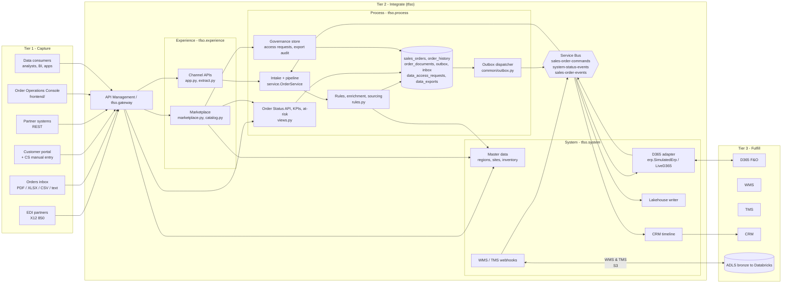
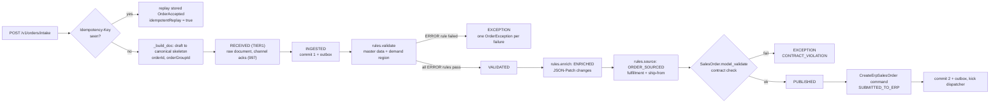
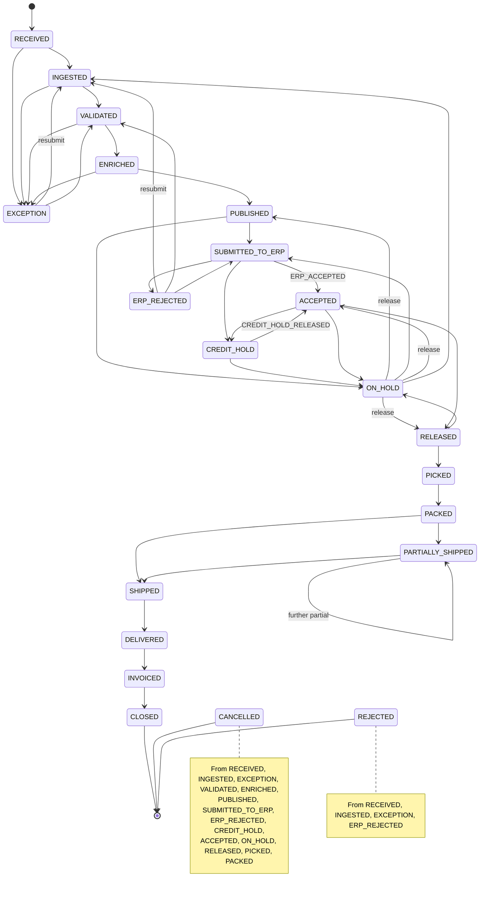
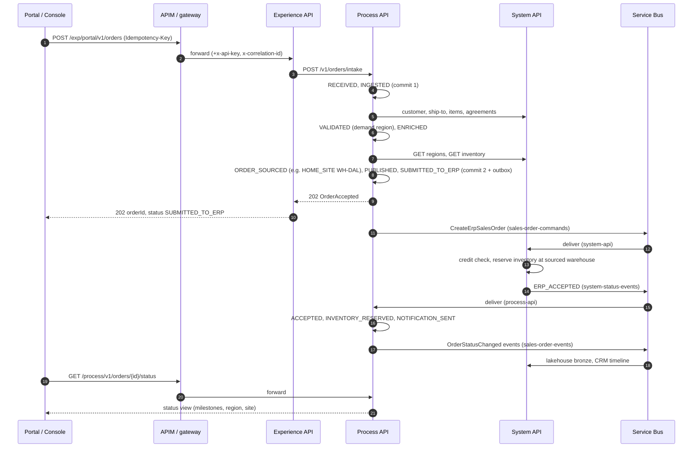
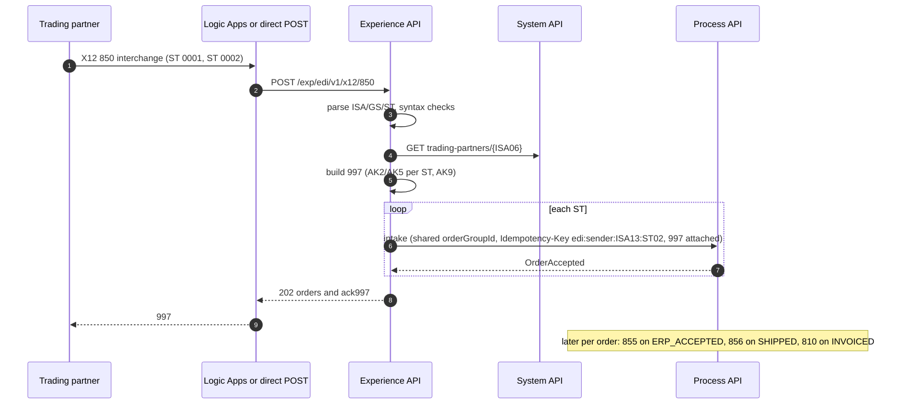
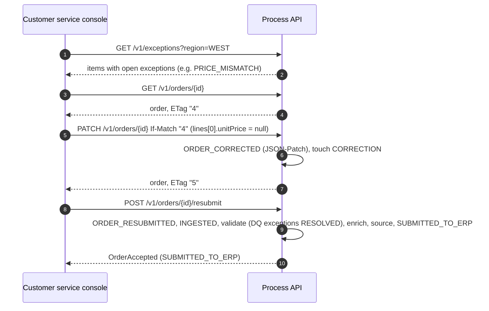
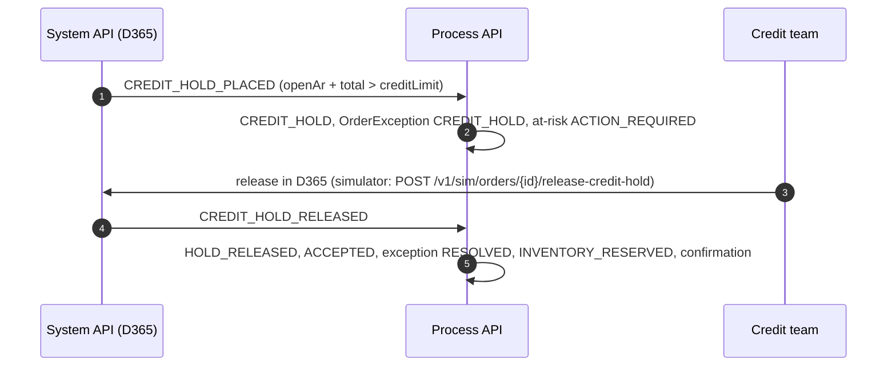
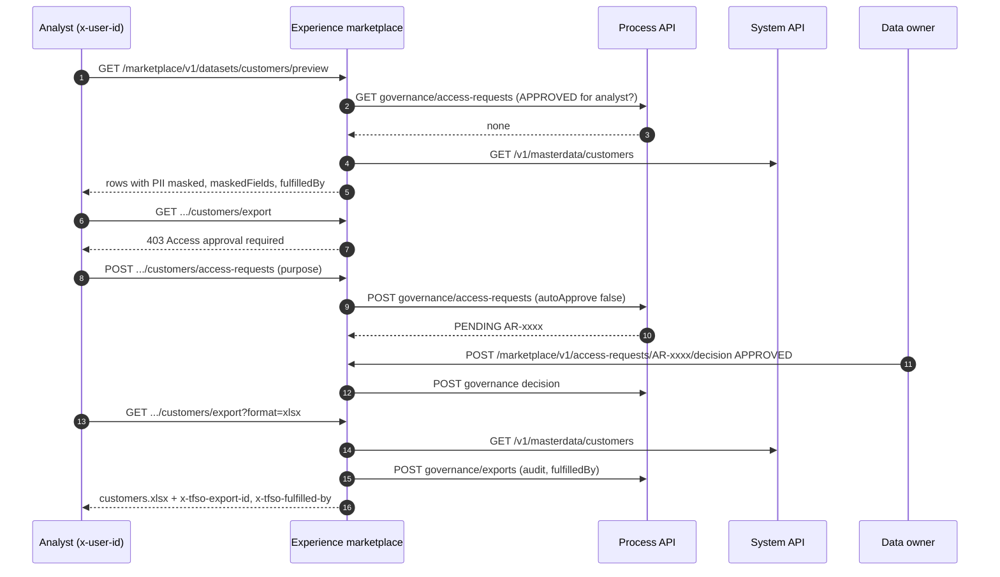
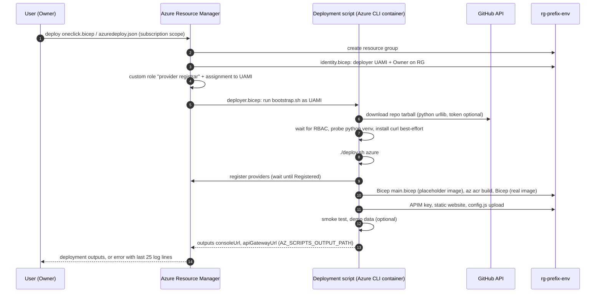

# Technical Specification – Sales Order Data Product, Order Status API & Data Marketplace

| Item | Value |
|---|---|
| Document | 02 – Technical Specification / Technical Design Document (TDD) |
| Product | Taylor Farms Sales Order data product (Tier 2 integration layer, data marketplace, regional operations) |
| Version | **2.0** – matches code `tfso` 1.0.0 with CDM contract **1.1.0** |
| Date | 2026-11-14 |
| Status | Baseline for pilot; platform templates compile in CI, first full Azure run in progress (§20) |
| Related | [00 Solution blueprint](00-solution-blueprint.md) · [01 Requirements](01-requirements.md) · [03 Canonical data model](03-canonical-data-model.md) · [04 Azure reference architecture](04-azure-reference-architecture.md) · [05 Product strategy](05-product-strategy.md) · [06 One-click Azure deployment](06-azure-one-click-deployment.md) |
| Code | `src/tfso/**`, `frontend/**`, `infra/**`, `databricks/**`, `deploy.sh`, `deploy.ps1`, `.github/workflows/**`, `scripts/**`, `tests/**`, `cdm/**` |

### Revision history

| Version | Date | Change |
|---|---|---|
| 1.0 | 2026-11-13 | First complete design: three API layers, intake pipeline, lifecycle history, EDI, status events, Order Status API, deployment |
| 2.0 | 2026-11-14 | Full rewrite against the current code. Adds: API explorer call log; data marketplace (catalog, lineage, preview, export, access governance); regional & national operating model (regions, sites, per-site inventory, network sourcing, CDM 1.1.0 `fulfillment`, `ORDER_SOURCED`); scope filters; OTIF / fill rate / perfect order KPIs; orders at risk; additive DB auto-migration; demo data loader; Windows `deploy.ps1`; one-click Azure deployment (subscription template, deployment script, provider-registrar role, GitHub Actions OIDC, template spec) |

### Conventions

* "Process", "Experience", "System" refer to the three API layers; APIM path prefixes are `/process`, `/exp`, `/system`.
* File references are relative to the repository root; `views.kpis` means function `kpis` in `src/tfso/process/views.py`.
* JSON is camelCase; Python is snake_case (Pydantic alias generator).

---

## 1. Context and scope

The deck *Sales Order data product* defines three tiers: **Tier 1 Capture** (EDI, e-mail, portal, manual entry,
partner API), **Tier 2 Integrate** (ingest, validate, enrich, canonicalize, orchestrate) and **Tier 3 Fulfill**
(D365 F&O, WMS, TMS, CRM, Lakehouse). Tier 2 is implemented API-led in three layers plus a local gateway:

| Layer | Responsibility | Package | Local port | Azure |
|---|---|---|---|---|
| Experience | One API per channel; channel formats and acknowledgements (997); customer-safe views; regions catalog; **data marketplace** | `tfso.experience` | 8001 | Container App `ca-<prefix>-<env>-exp`, APIM `/exp` |
| Process | Order intake (validate, enrich, **source**, canonicalize, publish), fulfilment orchestration, exceptions, **Order Status API**, lifecycle history, KPIs, **orders at risk**, webhooks, **data governance store** | `tfso.process` | 8002 | `ca-<prefix>-<env>-process`, APIM `/process` |
| System | D365 / WMS / TMS / CRM / Lakehouse adapters, master data incl. **regions, sites, per-site inventory**, fulfilment simulator | `tfso.system` | 8003 | `ca-<prefix>-<env>-system`, APIM `/system` (non-prod) |
| Gateway (local only) | Stand-in for API Management; hosts the console | `tfso.gateway` | 8080 (fallback 8081+ on Windows) | API Management + Storage static website |

**In scope (this release):** five channels; the full lifecycle from receipt to invoice/close; the canonical model
(CDM 1.1.0) and its append-only history; outbound documents (997/855/856/810, e-mail/portal notifications); status
webhooks; regional network sourcing and scope filtering; service-level KPIs and at-risk detection; the data
marketplace with governed access and audited export; bronze landing and the Databricks pipeline; local, Docker,
Windows and Azure deployment including one-click.

**Out of scope (see §21):** X12 860/865 change orders; AS2 transport (Logic Apps Integration Account in Azure);
real WMS/TMS connectors (webhook contracts exist); backorder child orders; per-route Entra app roles.

---

## 2. Architecture overview

### 2.1 Component view



### 2.2 Key architectural decisions

1. **One canonical document per order** (`src/tfso/common/cdm.py`) stored as JSON/JSONB with projected, indexed
   columns for queries; **history is a separate append-only table**, re-embedded as `orderHistory` on read.
2. **Every state change goes through `Recorder.record()`** (state machine, history entry, ROI timestamps, outbound
   CloudEvent) and is committed in the same transaction as its outbox rows (transactional outbox).
3. **Asynchronous orchestration** between Process and System over three topics with CloudEvents 1.0; every consumer
   is idempotent and marks messages processed only **after** success.
4. **One container image, four entry points** (`SERVICE=experience|process|system|gateway`).
5. **Simulator parity:** the D365/WMS/TMS simulator emits the same `StatusEvent` contract as live adapters.
6. **Network-aware sourcing in the Process layer**, recorded on the order (CDM 1.1.0 `fulfillment`) so every region
   view and KPI is a filter over the same data (`region`, `site`, `accountScope`).
7. **The marketplace owns no data.** It is an Experience API that fulfils every request through the Process and
   System APIs and reports the calls it made (`fulfilledBy`); governance records live in the Process database.
8. **One deployment engine** (`deploy.sh azure`) behind every Azure entry point (CLI, GitHub Actions, portal
   one-click via a deployment script).

### 2.3 Runtime topology

| Concern | Local (`deploy.sh local` / `deploy.ps1 local`) | Docker (`deploy.sh docker`) | Azure (`deploy.sh azure`, one-click) |
|---|---|---|---|
| Processes | 4 × uvicorn (8001–8003, 8080) | 4 containers from one image + PostgreSQL 16 | 3 Container Apps (+ APIM instead of gateway) |
| Database | SQLite `./data/process.db`, `./data/system.db` (WAL) | PostgreSQL `tfso_process`, `tfso_system` | Azure Database for PostgreSQL Flexible Server |
| Bus | HTTP fan-out (`TFSO_BUS_MODE=http`) | HTTP fan-out | Service Bus Standard (Managed Identity) |
| Event stream | – | – | Event Hubs `order-status-stream` |
| Lakehouse | `./data/lakehouse/bronze/...jsonl` | `/app/data/lakehouse` | ADLS Gen2 `bronze` container |
| Auth | `x-api-key: local-dev-key` | same | APIM subscription key; APIM injects backend `x-api-key` (Key Vault named value) |
| Console | gateway `/` | gateway `/` | Storage static website, `config.js` with APIM URL + console key |
| D365 | simulator | simulator | simulator, or live OData when `D365_URL` is set |
| Tests | pytest in-process (`TFSO_BUS_MODE=inproc`) | – | smoke test through APIM |

---

## 3. Shared library – `tfso.common`

| Module | Purpose | Key elements |
|---|---|---|
| `config.py` | Environment configuration (§16) | `Settings` (frozen dataclass), `get_settings(service)` (cached), `default_http_routes()` |
| `cdm.py` | Canonical data model, Pydantic v2, camelCase aliases; `CDM_VERSION = "1.1.0"` | `SalesOrder`, `Fulfillment`, `SourcingDecision`, `SourcingCandidate`, `OrderHistoryEntry`, `OrderGroup`, `OrderStatusChanged`, `StatusEvent`, 40+ value objects |
| `statuses.py` | State machine, categories, milestones, event catalogue | `OrderStatus`, `StatusCategory`, `LineStatus`, `STATUS_META`, `can_transition`, `is_stale`, `MILESTONES`, `HistoryEventType` (incl. `ORDER_SOURCED`), `SYSTEM_EVENT_TO_STATUS`, `reference_catalogue()` |
| `db.py` | SQLAlchemy 2 engine/session; JSON → JSONB on PostgreSQL; SQLite WAL + busy timeout; **additive auto-migration** | `Database`, `JsonDoc`, `Database._add_missing_columns()` |
| `bus.py` | Broker abstraction, CloudEvent factory, Event Hubs stream | `cloud_event`, `HttpBroker`, `ServiceBusBroker`, `InProcBroker`, `EventStream`, `make_broker` |
| `outbox.py` | Transactional outbox + idempotent inbox | `make_models(Base)`, `Outbox.add / kick / dispatch_once / processed / mark_processed / stats` |
| `web.py` | FastAPI factory, middleware, RFC 7807, auth, inter-service client | `create_app`, `ApiError`, `Authenticator`, `ServiceClient`, `relay`, `register_transport`, `correlation_id_var` |
| `x12.py` | X12 parser (850) and generators (997/855/856/810) | `parse_interchange`, `read_850`, `build_997`, `build_855`, `build_856`, `build_810`, `X12Writer` |
| `util.py` | Time, ids, decimals | `order_id()` → `SO-YYYYMMDD-XXXXXXXX`, `group_id()` → `OG-YYYYMMDD-XXXXXXXX`, `qty_str()` (canonical quantity strings: `30.0` → `"30"`), `money()`, `parse_dt`, `parse_date` |

### 3.1 App factory (`web.create_app`)

`create_app(settings, title, description)` installs:

* **Correlation middleware** – reads `x-correlation-id` (or generates a UUID) into a `ContextVar`, echoes it on the
  response, adds it to every log line, history entry (`correlationId`), CloudEvent (`correlationid`) and outbound
  call (`ServiceClient`).
* **Authentication** for every path except `/health`, `/docs`, `/redoc`, `/openapi.json` and `OPTIONS` (§13).
* **RFC 7807 handlers** for `ApiError`, `HTTPException`, request validation (422 with `errors[]`) and unhandled
  exceptions (500, logged with stack trace).
* **CORS** (`*`, exposing `x-correlation-id`, `etag`, `location`); APIM applies the production CORS policy.
* **Structured JSON logging** to stdout and **Azure Monitor OpenTelemetry** when
  `APPLICATIONINSIGHTS_CONNECTION_STRING` is set.

`ServiceClient` wraps `httpx.AsyncClient`, injects `x-api-key` (first of `TFSO_API_KEYS`) and the correlation id;
`relay()` re-raises a downstream problem+json with its status, title and detail. Tests route inter-service calls to
in-process ASGI apps with `register_transport()`.

Every service module exposes `app` lazily through PEP 562 `__getattr__`, so importing a package has no side effects;
tests call `create_*_app(settings)` directly.

### 3.2 Additive auto-migration (`Database._add_missing_columns`)

After `create_all`, the database inspects every existing table and issues `ALTER TABLE … ADD COLUMN` for model
columns that are missing, with the scalar default (booleans rendered `TRUE/FALSE`) and a single-column index when one
is declared. This upgrades databases created by earlier versions (e.g. the regional columns on `sales_orders`) in
place. Only additive, nullable/defaulted changes are supported; renames and type changes need a real migration
(Alembic is on the roadmap). Rows written before an upgrade keep `NULL` in the new columns until they change again.

### 3.3 Message bus (`bus.py`)

| Mode (`TFSO_BUS_MODE`) | Use | Behaviour |
|---|---|---|
| `servicebus` | Azure | Topic senders per topic; one receiver loop per (topic, subscription) registered by the service; complete on success, abandon on handler failure (redelivery → dead-letter after max delivery count 10); receiver loops restart after 5 s on crash. Managed Identity (`DefaultAzureCredential`, `AZURE_CLIENT_ID`) or `TFSO_SERVICEBUS_CONNECTION`. |
| `http` | Local / Docker | `publish` POSTs the envelope to every URL in `TFSO_BUS_HTTP_ROUTES[topic]` (default derived from `TFSO_PROCESS_URL`/`TFSO_SYSTEM_URL`); non-2xx raises so the outbox retries. Receiving services expose `POST /v1/bus/{topic}` → `deliver_local`. |
| `inproc` | Tests | Class-level registry and queue; `InProcBroker.drain()` delivers deterministically. |

`EventStream` additionally sends `sales-order-events` to Event Hubs (`TFSO_EVENTHUB_FQDN`), partition key = order id.

### 3.4 Outbox and inbox (`outbox.py`)

* `Outbox.add(session, topic, envelope)` inserts in the caller's transaction; `kick()` wakes the dispatcher.
* `dispatch_once()` reads up to 100 undispatched rows in id order. **Per-subject ordering:** once a message for an
  order fails or is waiting for its retry time, later messages for the same subject are held back. Backoff:
  `next_attempt_at = now + min(300 s, 2^min(attempts, 8))`. `last_error` and `attempts` are kept.
* The dispatcher loop runs every 1 s or on `kick()`; `stats()` → `{pending, retrying}` is shown in `/health`.
* **Inbox semantics:** consumers call `processed(message_id)` first and `mark_processed(message_id, topic[, session])`
  **after** their effects are committed (or in the same session), so a failed handler is retried on redelivery.

---

## 4. Experience APIs – `src/tfso/experience/`

| Module | Responsibility |
|---|---|
| `app.py` | `create_experience_app()`: channel routes, portal catalog (customers, ship-tos, items, **regions**), customer-facing status, EDI documents, includes the marketplace router |
| `extract.py` | E-mail extraction: body text, CSV, XLSX (openpyxl), TXT, PDF (Document Intelligence or pypdf), confidence scoring |
| `catalog.py` | Marketplace catalog: 15 dataset contract cards (definition, owner, steward, classification, refresh/SLA, schema, lineage graph, filters, consumption) |
| `marketplace.py` | Marketplace router `/marketplace/v1`: live facts, preview, export (CSV/JSON/NDJSON/XLSX), access requests, export audit; `Fulfilment` call recorder |

### 4.1 Channel handling

| Channel | Route | Translation | Source document stored | Actor |
|---|---|---|---|---|
| Portal | `POST /portal/v1/orders` (`channel=PORTAL`) | `PortalOrderRequest` → draft (`customerId`, `shipToId`, `purchaseOrder.poNumber/poDate`, lines `item.itemNumber`, `quantity{value,uom}`, optional `unitPrice`) | `PORTAL_FORM` | `CUSTOMER` |
| Manual entry | same, `channel=MANUAL` | customer price becomes `MANUAL_OVERRIDE`; ROI records one `MANUAL_ENTRY` touch (8 min) | `PORTAL_FORM` | `USER` (`enteredBy`) |
| Partner API | `POST /partner/v1/orders` | canonical draft accepted as-is; customer from `customerId`, `soldTo` or `x-partner-id` | `PARTNER_JSON` | `PARTNER` |
| EDI | `POST /edi/v1/x12/850` (text/plain) | `parse_interchange` + `read_850` per ST; ISA06 → trading partner → `customerId` | `X12_850` per ST + outbound `X12_997` | `PARTNER` |
| E-mail | `POST /email/v1/orders` | `extract_email` → header, lines, confidence; customer from body or sender domain | `EMAIL_MESSAGE` / `PDF` / `SPREADSHEET` | `CUSTOMER` |

All channels call one Process route, `POST /v1/orders/intake`, with an `IntakeRequest`
(`sourceChannel, channelDetail, receivedAt, orderGroupId, sourceDocument{…, rawContent}, extraction, submittedBy,
acknowledgments[], draft`). The Experience layer applies no business rules.

### 4.2 EDI interchange processing

1. Parse ISA (delimiters from positions 3/104/105), GS, ST…SE; syntax checks: SE01 count, SE02 = ST02, GE01 count,
   ST01 = 850. Parse failure → `400 Invalid X12 interchange`.
2. `x-partner-id`, when present, must equal ISA06 (`403 Sender mismatch`).
3. Trading partner (`GET /system/v1/masterdata/trading-partners/{ISA06}`); unknown → `422`.
4. 997: `AK1` group, `AK2/AK5` per ST (`A` / `R` with `AK3`), `AK9` `A`/`P`/`R`.
5. One `orderGroupId` per interchange; each accepted ST becomes an intake call with
   `Idempotency-Key: edi:{ISA06}:{ISA13}:{ST02}` and the 997 attached as an already-sent acknowledgement.
6. Response `202 {interchangeControlNumber, sender, customerId, orderGroupId, transactionSets, orders[], rejected[], ack997}`.

#### 850 → canonical draft mapping (`x12.read_850`)

| Segment / element | Canonical path | Notes |
|---|---|---|
| ISA06 / ISA08 / ISA13 | `source.sourceDocument.senderId / receiverId / interchangeControlNumber` | |
| GS06 / GS08 / ST02 | `sourceDocument.groupControlNumber / x12Version / transactionSetControlNumber` | |
| BEG01 | `purpose` | 00 ORIGINAL, 01 CANCELLATION, 04 CHANGE, 05 REPLACE, 06 CONFIRMATION |
| BEG02 | `orderType` | SA/NE STANDARD, RL BLANKET_RELEASE, DS DROP_SHIP, RO RUSH, KN STANDING, OS SAMPLE |
| BEG03 / 04 / 05 | `purchaseOrder.poNumber / releaseNumber / poDate` | |
| CUR02 | `commercial.currency` | |
| REF*DP / CT / PD | `purchaseOrder.department / contractNumber / promotionDealNumber` | all REFs also in `references[]` |
| PER | `parties.buyer.contacts[]` | TE → phone, EM → email |
| FOB01 / ITD | `commercial.fobPoint` / `commercial.paymentTerms` | terms replaced by customer master on enrichment |
| DTM*002/063/064 · 010/037 · 001 | `dates.requestedDeliveryDate` · `requestedShipDate` · `cancelByDate` (header or line) | CCYYMMDD → ISO |
| TD503 / TD505 | `shipping.carrierScac / routing` | |
| SAC | `allowancesCharges[]` (header, or line when after PO1) | SAC05 implied 2 decimals |
| MSG / NTE | `notes[]` | |
| N1*ST / BT / BY / SF / SO + N3/N4 | `parties.shipTo / billTo / buyer / shipFrom / soldTo` (+ address) | N103 UL → `gln`, 1 → `duns`, other → `ediLocationCode` |
| PO101–PO105 | `buyerLineNumber`, `quantity.value/uom`, `unitPrice.amount/basisUom` | price source `PURCHASE_ORDER` |
| PO1 IN/BP, VN/VP, UP, UK/EN | `item.buyerItemNumber, vendorItemNumber, upc, gtin` | resolved to `item.itemNumber` by DQ-003 |
| PID05 / CTT01 | `item.description` / `declaredLineCount` | |

### 4.3 E-mail extraction and confidence (DQ-011)

Header regexes (`PO`, `Customer`, `Ship-To`, `Deliver/Need by/Due`) and a line regex (`<ITEM> <qty> [UOM] [@ price]`)
over body + subject; attachments win over loose body lines (CSV/XLSX with column aliases, TXT as text, PDF via Azure AI
Document Intelligence `documentModels/{TFSO_DOCINTEL_MODEL_ID}:analyze` API 2024-11-30 with Managed Identity, else
pypdf).

```
confidence = 1.0 − 0.2 × |missing of {poNumber, shipTo, deliveryDate, lines}|
                 − 0.1 × |lines without item or quantity|
                 − 0.05 (OCR) − 0.05 (no customerId)        clipped to [0, 1]
```

Customer inferred from the sender's e-mail domain when absent. Ship-to beginning `ST-` is treated as an id, otherwise
as an EDI location code / name. DQ-011 fails below 0.80.

### 4.4 Catalog and customer views

`/portal/v1/catalog/*` project System master data: customers (incl. `accountScope`, `regions`, `homeRegion`), ship-tos
(incl. `region`), items with the customer's `contractPrice`/`agreementId`, and **regions with sites**
(`/portal/v1/catalog/regions` proxies `/system/v1/masterdata/regions` so the console works in prod where `/system` is
not published). `GET /portal/v1/orders/{id}` and `/partner/v1/orders/{id}/status` return the customer view
(`openIssues[]` instead of internal exceptions and ROI). `enforce_customer()` rejects other customers' data with `403`
when the token carries `extension_customerId`.

### 4.5 Data marketplace (`marketplace.py`, `catalog.py`)

**Catalog (`catalog.DATASETS`, 15 entries).** Each card has `id, name, object, domain, type, version,
classification (Public | Internal | Confidential), accessPolicy (auto | approval), tags, certified, summary,
description, owner, steward, refresh{mode, frequency, freshnessSlaSeconds, detail}, retention, grain, primaryKey,
qualityRules[], filters[], schema[], lineage{nodes, edges}, consumption{rest[], events, lakehouse, edi, schemaRef},
consumers[], sensitiveFields[]`. Field definitions: `name, type, description, primaryKey, pii, nullable, example?, source?`.

| Dataset id | Domain | Class / policy | Backed by |
|---|---|---|---|
| `sales-orders` | Sales | Internal / auto | `GET /process/v1/orders` (paged, 200/page) |
| `sales-order-lines` | Sales | Internal / auto | `/process/v1/orders?full=true` flattened per line |
| `order-lifecycle-events` | Sales | Internal / auto | `/process/v1/order-events` |
| `order-exceptions` | Sales | Internal / auto | `/process/v1/exceptions` flattened per exception |
| `shipments` | Fulfilment | Internal / auto | full orders flattened per shipment line lot (FSMA TLC) |
| `invoices` | Finance | **Confidential / approval** | full orders flattened per invoice line |
| `order-kpis` | Analytics | Internal / auto | `/process/v1/metrics/kpis` → `byChannel` |
| `regional-performance` | Operations | Internal / auto | `/process/v1/metrics/kpis` → `byRegion` or `bySite` (`level` filter) |
| `orders-at-risk` | Operations | Internal / auto | `/process/v1/orders/at-risk` flattened per reason |
| `sites-inventory` | Operations | Internal / auto | `/system/v1/masterdata/inventory` |
| `customers` | Customer | **Confidential / approval** | `/system/v1/masterdata/customers` (first contact flattened) |
| `ship-tos` | Customer | Internal / auto | `/system/v1/masterdata/ship-tos` |
| `items` | Product | Public / auto | `/system/v1/masterdata/items` |
| `price-agreements` | Pricing | **Confidential / approval** | `/system/v1/masterdata/price-agreements` |
| `trading-partners` | Integration | Internal / auto | `/system/v1/masterdata/trading-partners` |

Order datasets accept scope filters `region` (enum of region ids) and `accountScope` plus their own filters (status,
channel, customerId, dates, event type, source system …); `filters_of()` passes only declared filters.

**Lineage.** `_order_lineage()` / `_fulfilment_lineage()` / `_master_lineage()` build graphs whose nodes carry a
`stage` (diagram column) and `kind` (`source, system, integration, store, dataset, stream, consumer`): channels →
Experience APIs → order intake (with master data) → Sales Order store → dataset; store → `sales-order-events` →
lakehouse bronze / silver / gold and CRM; D365 and WMS/TMS → fulfilment events → store.

**Fulfilment recording.** `Fulfilment.get(api, path, params)` performs each backend call and appends
`"GET /<api><path>?<query>"` to `calls`; responses expose them as `fulfilledBy` (catalog, preview) or the header
`x-tfso-fulfilled-by` (export, joined with ` | `, ≤ 4000 chars).

**Live facts (`live_facts`, cached 15 s).** One computation per 15 s: `GET /process/v1/datasets/stats`,
`/process/health` (outbox `retrying`), all orders with `full=true` (counts of lines, shipments, invoices, last ship
and invoice dates), `/process/v1/exceptions`, `/process/v1/governance/usage`, `/process/v1/orders/at-risk` and the
System master-data lists. Per dataset: `recordCount`, `lastDataChangeAt`, `lastRefreshedAt`,
`freshnessStatus = DELAYED` when an event-driven dataset's pipeline has retrying outbox messages, else `ON_TIME`,
`freshnessDetail`, `usage{exports, lastExportAt, approvedConsumers, pendingRequests}`, `factsAsOf`.

**Access policy.**

* `who(request)` = `x-user-id` header, else the authenticated principal, else `anonymous`.
* `has_approval(ds, requester)`: `auto` datasets → always; `approval` datasets → an `APPROVED`, unexpired request for
  (dataset, requester) in the governance store.
* **Masking:** previews replace values of `pii` fields and `sensitiveFields` with `"•••• (restricted)"` until
  approved; the response lists `maskedFields`.
* **Export** without approval → `403 Access approval required` naming the owner's e-mail.
* Access requests for `auto` datasets are approved by policy (`decidedBy = policy:auto-approve`, expiry +365 d);
  `approval` datasets create `PENDING` requests decided by `POST /marketplace/v1/access-requests/{id}/decision`
  (`APPROVED | REJECTED | REVOKED`, `decidedBy` = caller). In Azure this operation is intended to be restricted to the
  data-owner role by APIM (target state).

**Export.** `GET /marketplace/v1/datasets/{id}/export?format=csv|json|ndjson|xlsx&limit (≤ 50 000)&fields=&<filters>`:

| Format | Serializer | Notes |
|---|---|---|
| `csv` | `to_csv` | UTF-8 with BOM (Excel); lists joined with `|`, objects as compact JSON |
| `json` | inline | `{dataset{id, name, version, exportedAt, filters, rowCount}, columns, rows}` |
| `ndjson` | inline | one JSON object per line |
| `xlsx` | `to_xlsx` (openpyxl) | data sheet (bold header, frozen row) + `About` sheet with dataset metadata and field dictionary |

Rows are projected to the dataset schema (`_project`; unknown `fields` → `400`). Each export is audited through
`POST /process/v1/governance/exports {datasetId, requester, format, filters, fields, rowCount, bytes, fulfilledBy}`;
response headers `Content-Disposition`, `x-tfso-row-count`, `x-tfso-export-id`, `x-tfso-fulfilled-by`
(exposed for CORS).

---

## 5. Process API – `src/tfso/process/`

| Module | Responsibility |
|---|---|
| `app.py` | `create_process_app()`: routes, bus consumers (`system-status-events/process-api`, `sales-order-events/process-webhooks`), sweeper, governance endpoints, lifespan |
| `service.py` | `OrderService` (intake, pipeline incl. sourcing, status events, CS actions, acknowledgements), `Recorder`, `json_diff`, `_apply_changes`, `_check_version` |
| `rules.py` | `validate()` (DQ-001..011, demand region), `apply_results()`, `enrich()`, `source()`, `earliest_valid_delivery()` |
| `views.py` | Read models: `get_order`, `status_view`, `accepted_view`, `search_orders`, `scope_conds`, `documents`, `related`, `group_history`, `exceptions_queue`, `summary`, `service_facts`, `risk_reasons`, `at_risk`, `kpis`, `event_feed`, `dataset_stats` |
| `models.py` | Tables (§12) |
| `masterdata.py` | `MasterDataClient` – System API client with per-key TTL cache (300 s default; inventory 2 s), item resolution, `regions()`, `inventory()` |

### 5.1 Intake pipeline



* Commit 1 makes the order durable and visible (`INGESTED`) before any remote call.
* The pipeline runs under a per-order `asyncio.Lock` and re-checks `version` before commit 2
  (`409 Concurrent modification` if another writer won).
* If master data, enrichment or sourcing calls fail (`ApiError`), the pipeline returns without changes; the
  **sweeper** (every 30 s) retries orders `INGESTED` for more than 20 s (batch 50).
* `accepted_view()` is returned with `202`: `orderId, orderGroupId, version, status, statusCategory, customerPo,
  customerId, exceptions[], warnings[], totals, statusUrl, historyUrl, receivedAt, correlationId`.

### 5.2 Recorder – the unit of work

`Recorder.record(event_type, to_status, source_system, tier, actor, occurred_at, reason_code, message, changes,
line_changes, document_ref, external_event_id, causation_id, force)`:

1. Validates the transition with `can_transition()` unless `force=True` (`409 Invalid status transition`).
2. Sets `status`, `statusCategory`, `statusUpdatedAt`, `statusReason` (ACTION_REQUIRED / CANCELLED only).
3. Stamps `roi.stageTimestamps.<stage>` the first time a stage is reached (using `occurredAt`) and recomputes
   `roi.cycleTimes` (`receiptToErpMinutes`, `receiptToShipHours`, `receiptToInvoiceHours`).
4. Appends an `OrderHistoryEntry` with the next `sequence` and `elapsedSincePreviousSeconds`; tier defaults to
   `TIER3` for D365/WMS/TMS/CRM, otherwise `TIER2`.
5. Queues an `OrderStatusChanged` CloudEvent (`tfso.salesorder.OrderStatusChanged`, subject = orderId) carrying the
   history entry, ROI tags and, for status-changing entries, a `snapshot` of the canonical order.

`command()` queues `tfso.salesorder.CreateErpSalesOrder` / `CancelErpSalesOrder`; `touch()` records manual touches
(minutes per action: MANUAL_ENTRY 8, CORRECTION 6, RESUBMIT 1, HOLD 2, RELEASE_HOLD 2, CANCEL 3); `add_document()`
stores documents. `OrderService._persist()` writes the document, projections (incl. `region`,
`ship_from_warehouse`, `account_scope`, `cross_region` from `fulfillment`), history rows, documents and outbox rows in
**one transaction** and increments `version`.

### 5.3 Order state machine

Accurate to `statuses.py` (`_EXPLICIT` plus forward-only progression through
`ACCEPTED → RELEASED → PICKED → PACKED → PARTIALLY_SHIPPED → SHIPPED → DELIVERED → INVOICED → CLOSED`, stages may be
skipped, never reversed; `PARTIALLY_SHIPPED → PARTIALLY_SHIPPED` is the only legal self-transition):



Statuses, categories and ranks: RECEIVED 10, INGESTED 20, EXCEPTION 25, VALIDATED 30, ENRICHED 40, PUBLISHED 50,
SUBMITTED_TO_ERP 60, ERP_REJECTED 65, CREDIT_HOLD 68, ACCEPTED 70, ON_HOLD 72, RELEASED 80, PICKED 85, PACKED 88,
PARTIALLY_SHIPPED 90, SHIPPED 92, DELIVERED 95, INVOICED 98, CLOSED/CANCELLED/REJECTED 100. Terminal: CLOSED,
CANCELLED, REJECTED. Correctable: EXCEPTION, ERP_REJECTED, ON_HOLD. Cancellation is refused at rank ≥ 90 (anything
shipped). Runtime catalogue: `GET /process/v1/reference/statuses`.

History event types (`HistoryEventType`): ORDER_RECEIVED, ORDER_INGESTED, VALIDATION_PASSED, VALIDATION_FAILED,
ORDER_ENRICHED, **ORDER_SOURCED**, ORDER_PUBLISHED, ORDER_CORRECTED, ORDER_RESUBMITTED, SUBMITTED_TO_ERP, ERP_ACCEPTED,
ERP_REJECTED, CREDIT_HOLD_PLACED, HOLD_PLACED, HOLD_RELEASED, INVENTORY_RESERVED, LINE_BACKORDERED,
RELEASED_TO_WAREHOUSE, PICKED, PACKED, SHIPPED, DELIVERED, INVOICED, CLOSED, CANCELLED, REJECTED, DOCUMENT_SENT,
NOTIFICATION_SENT, LATE_EVENT_IGNORED, ORDER_SPLIT, ORDER_LINKED.

### 5.4 Applying Tier-3 status events (`OrderService.apply_status_event`)

Input: `StatusEvent` (`eventId, eventType, orderId | erpSalesOrderId, occurredAt, sourceSystem, reason, erp, lines[],
shipment, invoice, promisedShipDate, payload`) from `system-status-events` or `POST /v1/events`.

1. Resolve the order by `orderId`, else `erpSalesOrderId` (`404` → dropped / dead-lettered).
2. **Idempotency:** existing `order_history.external_event_id = eventId` → `{orderId, duplicate: true}`.
3. Map `eventType` through `SYSTEM_EVENT_TO_STATUS` and apply:

| Event | Effect on the canonical order | History entries | Customer communication |
|---|---|---|---|
| `ERP_ACCEPTED` | `erp{…}`; `dates.promisedShipDate`; per line `erpLineId`, `confirmed/backordered/allocated`, status `ALLOCATED`/`BACKORDERED` | `ERP_ACCEPTED` → ACCEPTED, `INVENTORY_RESERVED`, `LINE_BACKORDERED` per backordered line | EDI 855 (AC/`ACCEPTED_WITH_CHANGES` when backordered, else AD) or e-mail/portal confirmation |
| `CREDIT_HOLD_PLACED` | `OrderException{CREDIT_HOLD, detectedBy D365}`; ROI reason | `CREDIT_HOLD_PLACED` → CREDIT_HOLD | – |
| `CREDIT_HOLD_RELEASED` | as ERP_ACCEPTED; resolves CREDIT_HOLD | `HOLD_RELEASED` → ACCEPTED, `INVENTORY_RESERVED` | 855 / confirmation |
| `ERP_REJECTED` | `erp.rejectionReason`; `OrderException{ERP_REJECTED}` | `ERP_REJECTED` (status change only from SUBMITTED_TO_ERP) | – |
| `RELEASED_TO_WAREHOUSE` / `PICKED` / `PACKED` | line status for confirmed lines; `picked` qty on PICKED | same names | – |
| `SHIPPED` | add `Shipment` (dedupe `shipmentId`); shipped qty + lots (FSMA TLC) | `SHIPPED` → SHIPPED when Σ(confirmed − shipped) ≤ 0, else PARTIALLY_SHIPPED | EDI 856 or ship notice |
| `DELIVERED` | shipments DELIVERED + POD (`deliveredAt` = event `occurredAt`); `delivered` qty | `DELIVERED` → DELIVERED (forced) | – |
| `INVOICED` | add `Invoice` (dedupe `invoiceId`); `invoiced` qty | `INVOICED` → INVOICED (forced) | EDI 810 or invoice notice |
| `CLOSED` / `CANCELLED` | – | `CLOSED` (forced) / `CANCELLED` (forced unless terminal) | – |

* **Stale events.** `is_stale(current, target)` = fulfilment target at or behind the current stage (excluding
  PARTIALLY_SHIPPED). Stale events other than SHIPPED/DELIVERED/INVOICED produce `LATE_EVENT_IGNORED`
  (`reasonCode OUT_OF_ORDER`); facts of stale SHIPPED/DELIVERED/INVOICED are still merged, status never regresses.
* **Forced physical events.** A fulfilment event ahead of the current status while `ON_HOLD` or `CREDIT_HOLD` is
  applied with `force=True`; DELIVERED, INVOICED and CLOSED are always forced forward.
* **Partial shipments.** Each SHIPPED adds quantities; the order stays PARTIALLY_SHIPPED until everything confirmed
  has shipped. Backordered quantity stays on the order (§21).

### 5.5 Outbound acknowledgements (`OrderService._acknowledge`)

EDI orders: the partner agreement controls `send855/856/810`; `x12.build_855/856/810` with a control number from
`counters.x12` (from 1001); stored as `X12_855/856/810` documents, `acknowledgments[]`,
`roi.acknowledgmentTimestamps` (`functionalAck997` at intake, `poAck855`, `shipNotice856`, `invoice810`) and a
`DOCUMENT_SENT` entry. **Chargeback risk:** elapsed time from receipt (855) or ship (856) above the partner's
`ackSlaMinutes` adds `LATE_855` / `LATE_856` to `roi.chargebackRisk`; `cycleTimes.shipToAsnMinutes` recorded per 856.
Other channels: `EMAIL_NOTIFICATION` document to the sold-to contact, ack type `EMAIL_CONFIRMATION` (EMAIL, MANUAL)
or `PORTAL_NOTIFICATION` (PORTAL, PARTNER_API), `NOTIFICATION_SENT` entry.

### 5.6 Customer-service actions

| Action | Route | Preconditions | Effect |
|---|---|---|---|
| Correct | `PATCH /v1/orders/{id}` | `If-Match` (428 missing, 412 stale + current `ETag`); status ∈ {EXCEPTION, ERP_REJECTED, ON_HOLD} (409); non-empty diff (422) | `_apply_changes()`; `ORDER_CORRECTED` with JSON-Patch; touch CORRECTION |
| Resubmit | `POST /v1/orders/{id}/resubmit` | status ∈ {EXCEPTION, ERP_REJECTED} | `ORDER_RESUBMITTED` → INGESTED, full pipeline (incl. re-sourcing) |
| Hold | `POST /v1/orders/{id}/hold` | `can_transition(status, ON_HOLD)` | `extensions.heldFromStatus`; `HOLD_PLACED` → ON_HOLD |
| Release hold | `POST /v1/orders/{id}/release-hold` | ON_HOLD | `HOLD_RELEASED` → held-from status; ERP command if it was PUBLISHED |
| Cancel | `POST /v1/orders/{id}/cancel` | not terminal, rank < 90 | resolves open exceptions, lines CANCELLED, `CANCELLED` (forced); `CancelErpSalesOrder` if a D365 order exists |

Correction payload `changes`: `customerPo`, `purchaseOrder{}`, `requestedDeliveryDate`, `dates{}`, `shipTo{shipToId}` or
`shipToId`, `customerId`/`soldTo`, `shipping{}`, `notes`, `lines[]` by `lineNumber` (`remove: true` deletes; unknown
number adds; `item{itemNumber}`/`itemNumber`; `quantity{value,uom}` or number; `uom`; `unitPrice{amount}` or number —
an explicit `null` drops the customer price so the agreement price applies; `requestedDeliveryDate`,
`minRemainingShelfLifeDays`, `substitutionAllowed`). Changing the ship-to clears `requestedShipDate` **and the
preliminary `fulfillment`**, so the region is re-derived on resubmit. Quantities are normalised with `qty_str`.

### 5.7 Data quality rules (`rules.validate`)

| Rule | Check | Severity | Exception codes |
|---|---|---|---|
| DQ-001 | Sold-to exists (id, ERP account or partner client id) and active | ERROR | `CUSTOMER_NOT_FOUND`, `CUSTOMER_INACTIVE` |
| DQ-002 | Ship-to resolved (id, EDI code, GLN, name), belongs to customer, active | ERROR | `SHIPTO_NOT_FOUND`, `SHIPTO_CUSTOMER_MISMATCH`, `SHIPTO_INACTIVE` |
| DQ-003 | Item resolved (item number, buyer xref, GTIN, UPC, vendor item) and active | ERROR | `ITEM_NOT_FOUND`, `ITEM_INACTIVE` |
| DQ-004 | UOM in `salesUoms` | ERROR | `UOM_INVALID` |
| DQ-005 | Customer price within ±0.5 % (min $0.01) of agreement (valid on delivery date) else list; EA via `uomConversions` | ERROR | `PRICE_MISMATCH` |
| DQ-006 | No other open order with same customer + PO (EXCEPTION ignored; skipped for CHANGE/CANCELLATION) | ERROR | `DUPLICATE_ORDER` |
| DQ-007 | Not in the past; `rdd − transitDays ≥ today + (maxLeadTime − 1) (+1 after 22:00 UTC)`; receiving day | ERROR (receiving day WARNING) | `DATE_IN_PAST`, `DATE_NOT_ACHIEVABLE`, `NON_RECEIVING_DAY` |
| DQ-008 | Qty > 0, ≥ `minOrderQty`, multiple of `orderIncrement` | ERROR | `QUANTITY_INVALID`, `QUANTITY_INCREMENT` |
| DQ-009 | PO, sold-to, ship-to reference, ≥ 1 line, delivery date, every line has item ref + quantity | ERROR | `MISSING_REQUIRED_DATA` |
| DQ-010 | Shelf life − transit ≥ line minimum; frozen item to non-frozen location | WARNING | `SHELF_LIFE_RISK`, `TEMPERATURE_MISMATCH` |
| DQ-011 | Extraction confidence ≥ 0.80 (orders with `source.extraction`) | ERROR | `EXTRACTION_LOW_CONFIDENCE` |

**Demand region.** When DQ-002 passes, `_assign_demand_region()` sets a preliminary `fulfillment{regionId,
regionName, customerRegionId, accountScope, crossRegion: false}` from the ship-to's `region` and the customer's
`accountScope` (unless a sourcing decision already exists). Exception orders are therefore visible in regional scope.

`apply_results()` writes `dataQuality{attempt, validatedAt, results[], passed, firstPass (first attempt only),
score}`, resolves previously open `DQ-*` exceptions, opens one exception per failing ERROR and adds codes to
`roi.exceptionReasonCodes`. WARNINGs never block.

### 5.8 Enrichment (`rules.enrich`)

Parties (sold-to, ship-to incl. address/delivery days/receiving hours/GLN/EDI code/D365 location, bill-to from invoice
account, supplier, ship-from); commercial (currency, payment terms, price group, sales responsible, agreement id);
shipping (delivery mode, site/warehouse defaults, appointment, transport responsibility, temperature 0.5–4.0 °C);
dates (`requestedShipDate = rdd − transitDays`, `orderDate`); lines (item attributes; price from agreement
`CUSTOMER_AGREEMENT` or `LIST` when absent, else PO price kept with `agreementPrice`/`listPrice`; `lineAmount`;
`quantities.ordered`); totals (count, quantity, subtotal, allowances, charges, tax 0, grand total, weight). Recorded
as JSON-Patch on `ORDER_ENRICHED` (≤ 200 ops).

### 5.9 Network sourcing (`rules.source`)

Runs after ENRICHED and is recorded as `ORDER_SOURCED` (no status change, `reasonCode` = rule).

1. **Candidates.** Home region = ship-to `region`. Order: home region sites (primary first), then the home region's
   `adjacentRegions` in listed order (primary first), then all remaining regions.
2. **Needs.** Per line: `cases = quantity.value ÷ uomConversions[uom]` (default 1), keyed by item number.
3. **Fill rate** per candidate = `Σ min(cases_i, onHand[warehouse, item_i]) ÷ Σ cases_i` (4 dp), on-hand from
   `GET /system/v1/masterdata/inventory` (Process cache TTL 2 s).
4. **Selection.** First candidate with fill rate ≥ 1.0 → `HOME_SITE` (home region primary),
   `ALTERNATE_SITE_IN_REGION` (same region) or `CROSS_REGION`. If none fills: `max(fillRate, home)` → `BEST_AVAILABLE`
   (home site wins ties; remainder will be backordered by D365).
5. **Effects.** `fulfillment = {regionId, regionName, customerRegionId, siteId, warehouse, siteName, accountScope,
   crossRegion, sourcing{rule, reason, decidedAt, candidates[{warehouse, siteId, regionId, fillRate, home, chosen}]}}`;
   `shipping.shipFromSite/shipFromWarehouse` and `parties.shipFrom` set to the chosen site; D365 creates the sales order
   against that warehouse; projections `region`, `ship_from_warehouse`, `account_scope`, `cross_region` are updated.

### 5.10 Order Status API read models (`views.py`)

* **Scope** – `scope_conds(region, site, accountScope)`: `region IN (…)` (comma list, upper-cased),
  `ship_from_warehouse IN (…)`, `account_scope = …`. Applied by search, exceptions, summary, KPIs, at-risk and (via an
  `order_id IN (subquery)`) the event feed. National = no condition.
* **Search** – filters `status`, `statusCategory`, `channel` (comma lists), `customerId`, `customerPo`,
  `erpSalesOrderId`, `fromDate`/`toDate`, `hasExceptions`, `q` (ILIKE over id, PO, customer, ERP id), scope; `sort` ∈
  {receivedAt, updatedAt, status, customerId, customerPo, totalAmount, requestedDeliveryDate, orderId} (`-` = desc);
  `page`, `pageSize ≤ 200`; `full=true` adds the canonical document as `order`.
* **List item** – `orderId, orderGroupId, status, statusCategory, sourceChannel, customerId, customerName,
  customerPo, shipToId, erpSalesOrderId, requestedDeliveryDate, receivedAt, updatedAt, totalAmount, currency,
  openExceptionCount, touchless, version, region, regionName, shipFromWarehouse, shipFromSite, accountScope,
  crossRegion`.
* **Status view** – status, category, description, reason, ERP id, **region, regionName, shipFromWarehouse,
  shipFromSite, sourcingRule**, dates, milestones (`DONE` + timestamp, `CURRENT` with `blocked`/`blockedReason` when
  ACTION_REQUIRED, `PENDING`, `SKIPPED` after cancel/close), `nextExpected{milestone, label, by}`, lines with
  quantities, shipments, invoices, acknowledgements, totals, `lastEvent`; internal view adds `openExceptions` and ROI,
  customer view adds `openIssues`.
* **History / group history / related / documents** – as in v1 (ordered by `sequence`; group merged by `recordedAt`
  with `aggregateStatusCategory`).
* **Event feed** (`event_feed`) – all history entries oldest first, filters `since`, `until`, `eventType`, `orderId`,
  `sourceSystem`, scope; `pageSize ≤ 1000`; returns `lastRecordedAt`.
* **Dataset stats** (`dataset_stats`) – `orders, ordersLastUpdatedAt, historyEvents, historyLastRecordedAt,
  openExceptionOrders, documents, asOf`.

### 5.11 KPI formulas (`views.kpis`, exactly as coded)

`kpis(laborRatePerHour = 32, region, site, accountScope)` loads the scoped orders, then per set of rows (`agg`):

| KPI | Formula |
|---|---|
| `orders` / `ordersTotal` | count of rows |
| `revenue` | Σ `total_amount` of rows whose status ∉ {CANCELLED, REJECTED} ("live") |
| `avgOrderValue` | revenue ÷ live rows |
| `touchlessRate` | rows with `erp_created` and `touchless` ÷ rows with `erp_created` |
| `firstPassValidationRate` | rows with `first_pass = true` ÷ rows with `first_pass` not null |
| `avgReceiptToErpMinutes` / `avgReceiptToShipHours` | mean of the projected cycle-time columns (non-null) |
| `otifRate` | delivered live orders that are on time **and** in full ÷ delivered live orders |
| `onTimeDeliveryRate` | delivered live orders with `stageTimestamps.delivered[:10] ≤ requestedDeliveryDate` ÷ delivered live orders |
| `inFullRate` | delivered live orders where every line `quantities.delivered ≥ quantities.ordered` ÷ delivered live orders |
| `fillRate` | Σ shipped ÷ Σ ordered over live orders with shipped > 0 (quantities in order UOM) |
| `perfectOrderRate` (north star) | delivered live orders that are `touchless` **and** on time **and** in full ÷ delivered live orders |
| `openExceptions` | rows with `open_exception_count > 0` |
| `ordersAtRisk` / `valueAtRisk` | rows with ≥ 1 `risk_reasons` / Σ their `total_amount` |
| `crossRegionOrders` / `crossRegionSourcingRate` | rows with `cross_region` / ÷ rows with a region |
| `dataFreshnessSeconds` | mean `recordedAt − occurredAt` over the last 200 D365/WMS/TMS history rows in scope, **excluding negative lags** (future-dated events such as simulated PODs) |
| `manualTouchMinutes` | Σ `roi.manualTouches[].minutes` |
| `estimatedLaborSavedHours / Usd` | touchless ERP orders × 8 min ÷ 60 (× rate) |
| `chargebackRiskFlags` / `exceptionReasons` | Σ chargeback flags / counts by reason code |

Breakdowns: `byChannel[]`, `byRegion[]` (with `regionName`), `bySite[]` (`site, siteName, region`),
`byAccountScope[]`, each with the full `agg` set; plus `scope{region, site, accountScope}`, `assumptions`, `asOf`.
Rates are 0–1 or `null` when the denominator is 0.

### 5.12 Orders at risk (`views.risk_reasons`, `views.at_risk`)

Evaluated for open orders (status ∉ CLOSED, CANCELLED, REJECTED, INVOICED, DELIVERED → no reasons):

| Code | Rule |
|---|---|
| `ACTION_REQUIRED` | `statusCategory = ACTION_REQUIRED` (exception, credit hold, ERP rejection, manual hold) |
| `LATE_PROMISE` | `promisedShipDate > requestedShipDate` |
| `SHIP_DATE_MISSED` | `requestedShipDate < today` and not shipped |
| `DELIVERY_OVERDUE` | `requestedDeliveryDate < today` and not delivered |
| `BACKORDER` | Σ backordered > 0 and not shipped |
| `ACK_855_LATE` | EDI order, no `poAck855`, received > 4 h ago |

Severity `HIGH` if any of ACTION_REQUIRED, DELIVERY_OVERDUE, SHIP_DATE_MISSED, else `MEDIUM`. `at_risk()` returns items
(list item + `promisedShipDate`, `severity`, `reasons[{code, message}]`) sorted HIGH first then by value descending,
with `total`, `valueAtRisk`, `byReason`, `bySeverity`, `scope`, `asOf`; filters scope + `customerId`.

### 5.13 Webhooks

`POST /v1/subscriptions {callbackUrl, eventTypes[] (default ["*"]; matches history eventType or toStatus),
customerId?}` → `201` with a one-time `secret` (HTTPS required in prod). The `process-webhooks` consumer posts the
CloudEvent (without `snapshot`) with `content-type: application/cloudevents+json`, `x-tfso-event-id` and
`x-tfso-signature: sha256=<hex HMAC-SHA256(secret, body)>`; best-effort per event with delivery counters.

```python
import hashlib, hmac

def verify(secret: str, raw_body: bytes, signature_header: str) -> bool:
    expected = "sha256=" + hmac.new(secret.encode(), raw_body, hashlib.sha256).hexdigest()
    return hmac.compare_digest(expected, signature_header)
```

### 5.14 Data governance store

Backs the marketplace (§4.5); tables `data_access_requests`, `data_exports` (§12).

* `POST /v1/governance/access-requests {datasetId, requester, team?, purpose (≥ 3), consumerSystem?, accessLevel
  READ|EXPORT|SUBSCRIBE, autoApprove}` → `AR-XXXXXXXX`; `autoApprove` → `APPROVED` by `policy:auto-approve`, expiry
  +365 d; otherwise `PENDING`.
* `POST /v1/governance/access-requests/{id}/decision {decision APPROVED|REJECTED|REVOKED, decidedBy, note?}`; only
  PENDING may be approved/rejected (`409`), REVOKED allowed any time; approval sets expiry +365 d.
* `POST /v1/governance/exports` → `EX-XXXXXXXXXX`; `GET /v1/governance/exports?datasetId&requester&limit≤500`.
* `GET /v1/governance/usage` → per dataset `{exports, lastExportAt, approvedConsumers, pendingRequests, …}`.

---

## 6. System API – `src/tfso/system/`

| Module | Responsibility |
|---|---|
| `app.py` | `create_system_app()`: routes, consumers (`sales-order-commands/system-api`, `sales-order-events/system-lakehouse`, `sales-order-events/system-crm`), auto-progress, simulator guard |
| `erp.py` | `SimulatedErp`, `LiveD365`, `translate_business_event`, tables `erp_sales_orders`, `counters`, `crm_activities` |
| `d365_client.py` | `D365Client` – OAuth2 client credentials (Entra), OData paging, create/action |
| `masterdata.py` | `SeedMasterData` (`seed/masterdata.json`: customers, ship-tos, items, agreements, xref, partners, **regions, sites, inventoryBySite**) and `D365MasterData` (CustomersV3, ReleasedProductsV2, SalesPriceAgreements; 15-min cache; regions/inventory from seed) |
| `lakehouse.py` | `LakehouseWriter` – bronze landing (file or ADLS Gen2) |

### 6.1 Regions, sites and inventory

* `regions`: `{regionId, name, adjacentRegions[], sites[{siteId, warehouse, name, city, stateProvince, primary}]}`;
  seed regions WEST, SOUTHWEST, CENTRAL, SOUTHEAST, NORTHEAST with nine sites (**illustrative network**, marked as such
  in the seed `_note`).
* `sites`: flattened by warehouse with `regionId`, `regionName`.
* `inventory_by_site[warehouse][item]` (cases); `available(wh, item)`, `consume(wh, item, qty)`, `inventory`
  property = network total per item.
* Ship-tos carry `region` (derived from state) and default `site/warehouse` (region primary); customers carry
  `regions[]`, `accountScope` (NATIONAL if active ship-tos span > 1 region) and `homeRegion`.

### 6.2 D365 simulator behaviour

* **Create** – idempotent per `orderId`; inactive customer → `ERP_REJECTED`; ERP number `SO-<8 digits>` from 00100001.
  Warehouse = `shipping.shipFromWarehouse` (default WH-SAL). Per line `confirmed = min(ordered, available(warehouse,
  item))`, inventory consumed at that warehouse, remainder backordered; quantities as `qty_str`. Promised ship =
  max(requested ship, today + lead − 1). Credit check `openAr + total > creditLimit` → `CREDIT_HOLD_PLACED`.
* **Advance** `POST /v1/sim/orders/{id}/advance {to, lines?, carrier?, deliveredAt?}` emits every intermediate stage
  (D365 RELEASED_TO_WAREHOUSE → WMS PICKED, PACKED, SHIPPED → TMS DELIVERED → D365 INVOICED, CLOSED). Partial shipping
  ships only listed lines (others 0) and leaves the stage at PACKED. **`deliveredAt`** sets POD time and the DELIVERED
  event `occurredAt` (used for late-delivery demos).
* **Shipments** – shipment/ASN/packing slip/BOL/PRO/trailer/seal, carrier SCAC, ETA +20 h, SSCC, per-line lot with FSMA
  204 Traceability Lot Code (`0614141` + lot), pack date, best-by +12 d.
* **Invoices** `INV-7000xx` for shipped-but-uninvoiced quantity; due date from payment terms.
* **Auto-progress** (`TFSO_SIM_AUTOPROGRESS` or `PUT /v1/sim/config`) every `stepSeconds`; simulator routes `403` in prod.

### 6.3 Live D365 mapping (`LiveD365.create_sales_order`)

| D365 entity.field | Canonical source |
|---|---|
| `SalesOrderHeadersV2.dataAreaId` | `TFSO_D365_COMPANY` |
| `.OrderingCustomerAccountNumber` / `.InvoiceCustomerAccountNumber` | `parties.soldTo.erpAccount` / `parties.billTo.erpAccount` |
| `.CustomerRequisitionNumber` / `.CustomersOrderReference` | `purchaseOrder.poNumber` / `orderId` |
| `.CurrencyCode`, `.RequestedReceiptDate`, `.RequestedShippingDate` | `commercial.currency`, `dates.*` |
| `.DeliveryAddressLocationId`, `.DeliveryModeCode` | `parties.shipTo.erpAccount`, `shipping.deliveryMode` |
| `.DefaultShippingSiteId` / `.DefaultShippingWarehouseId` | `shipping.shipFromSite` / `shipFromWarehouse` (**the sourced site**) |
| `.SalesOrderOriginCode` | `source.channel` |
| `SalesOrderLines.ItemNumber / OrderedSalesQuantity / SalesUnitSymbol / SalesPrice / RequestedReceiptDate / CustomersLineNumber` | item, quantity, UOM, price, line/header date, buyer or data-product line |

**Business events** (`POST /v1/d365/business-events`, single or array): SalesOrderConfirmed → ERP_ACCEPTED,
ReleasedToWarehouse → RELEASED_TO_WAREHOUSE, PackingSlipPosted → SHIPPED, InvoicePosted → INVOICED,
CreditLimitCheckFailed → CREDIT_HOLD_PLACED, Canceled → CANCELLED; `EventId` is the idempotency key.
**WMS/TMS webhooks** `POST /v1/wms/events` (PICKED, PACKED, SHIPPED), `POST /v1/tms/events` (DELIVERED).

### 6.4 Lakehouse and CRM

`system-lakehouse` writes every `OrderStatusChanged` envelope to bronze (`./data/lakehouse/bronze/sales-order-events/
date=YYYY-MM-DD/part-HH.jsonl` or `abfss://bronze@<account>/sales-order-events/date=…/<eventId>.json`).
`system-crm` stores timeline activities for ACTION_REQUIRED events and ERP_ACCEPTED/SHIPPED/DELIVERED/INVOICED/
CANCELLED (inbox key `crm:{id}` in the same transaction).

---

## 7. Gateway and tools

* **`tfso.gateway`** – `/api/{exp|process|system}/{path}` reverse proxy (all methods), strips hop-by-hop headers, sets
  `x-correlation-id` and the backend `x-api-key` when the client sent none (like the APIM policy), `502` problem on
  backend errors; serves the console from `TFSO_FRONTEND_DIR` (SPA fallback to `index.html`, path traversal guarded);
  httpx client closed in the FastAPI lifespan.
* **`tfso.tools.smoke`** – end-to-end smoke (§17.2); `--base`, `--api-key` or `--subscription-key`; exits non-zero.
* **`tfso.tools.seed_demo`** – loads 21 orders across all regions, channels and account types (portal, manual,
  partner, two EDI interchanges, one price exception), then advances them with the simulator including two late
  deliveries (`deliveredAt` = requested date + 1 d), a backorder delivered short and a credit hold; prints national and
  per-region KPIs. `--api-key` may be empty (APIM uses the subscription key).
* **`tfso.tools.export_schema`** – renders `SalesOrder`, `OrderHistoryEntry`, `OrderGroup`, `OrderStatusChanged`,
  `StatusEvent` to `cdm/*.v1.schema.json` (JSON Schema 2020-12, `x-cdm-version`).

---

## 8. Messaging, outbox and idempotency

| Topic | Producer | Subscription → consumer | CloudEvent `type` |
|---|---|---|---|
| `sales-order-commands` | Process outbox | `system-api` → `on_command` | `tfso.salesorder.CreateErpSalesOrder`, `tfso.salesorder.CancelErpSalesOrder` |
| `system-status-events` | System outbox | `process-api` → `on_status_event` | `tfso.system.<EventType>` |
| `sales-order-events` | Process outbox (+ Event Hubs `order-status-stream`) | `system-lakehouse`, `system-crm`, `process-webhooks` | `tfso.salesorder.OrderStatusChanged` |

Envelope `{specversion "1.0", id, source ("/process/sales-orders" | "/system/<d365|wms|tms>"), type, subject (orderId),
time, datacontenttype, correlationid, data}`; Service Bus `MessageId = id`, `Subject = type`,
`CorrelationId = correlationid`, application properties `orderId`, `type`. Data of `OrderStatusChanged`: `orderId,
orderGroupId, sequence, eventType, fromStatus, toStatus, statusCategory, occurredAt, recordedAt, sourceSystem,
sourceChannel, customerId, customerPo, erpSalesOrderId, totalAmount, currency, roi{…}, historyEntry, snapshot?`
(example `cdm/examples/order-status-changed.cloudevent.example.json`).

| Hop | Idempotency mechanism |
|---|---|
| Client → intake | `Idempotency-Key` → `idempotency_keys` stores the `OrderAccepted`; replay returns it with `idempotentReplay: true` |
| EDI re-send / e-mail re-delivery | `edi:{ISA06}:{ISA13}:{ST02}` / `email:{messageId}` |
| Command consumer (System) | inbox `processed()` before, `mark_processed()` after success |
| Status event consumer (Process) | inbox + unique `order_history.external_event_id` |
| CRM consumer | inbox key `crm:{id}` in the activity transaction |
| D365 create | existing ERP order for the same `orderId` is returned |
| Lakehouse | duplicates removed downstream by event `id` |

**Optimistic concurrency.** `GET /v1/orders/{id}` and `/status` return `ETag: "<version>"`; `If-None-Match` → `304`;
`PATCH` requires `If-Match` (`428`/`412`); internal writers re-check `version` before commit.

---

## 9. API specification

All APIs are path-versioned (`/v1`), JSON/camelCase, documented live at `/docs` (OpenAPI 3.1) per service. Through
APIM or the gateway prefix `/exp`, `/process`, `/system`. Headers: `x-api-key` (local) or `Ocp-Apim-Subscription-Key`
(Azure), `x-correlation-id`, `Idempotency-Key` (order-creating POSTs), `If-Match` (PATCH), `x-user-id` (marketplace
identity), `x-partner-id` (partner/EDI).

### 9.1 Experience API (`/exp`)

| Method | Path | Request / params | Response | Codes |
|---|---|---|---|---|
| GET | `/health` | – | `{status ok|degraded, service, env, dependencies{process, system}}` | 200 |
| GET | `/portal/v1/catalog/customers` | – | `{items[{customerId, name, active, segment, channels, currency, accountScope, regions, homeRegion}]}` | 200 |
| GET | `/portal/v1/catalog/regions` | – | `{items[{regionId, name, adjacentRegions, sites[{siteId, warehouse, name, city, stateProvince, primary}]}]}` | 200 |
| GET | `/portal/v1/catalog/customers/{customerId}/ship-tos` | – | `{items[{shipToId, name, active, region, address{city, state, …}, deliveryDays, transitDays}]}` | 200, 403 |
| GET | `/portal/v1/catalog/items?customerId=` | – | `{items[{itemNumber, description, packSize, uom, salesUoms, listPrice, contractPrice, agreementId, gtin, temperatureZone, leadTimeDays, orderIncrement, minOrderQty}]}` | 200 |
| POST | `/portal/v1/orders` | `PortalOrderRequest {channel PORTAL|MANUAL, customerId, shipToId, customerPo, requestedDeliveryDate, orderType?, currency?, notes?, contact?, enteredBy?, lines[1..500]{itemNumber, quantity>0, uom=CA, unitPrice?, notes?}}` | `OrderAccepted` | 202, 401, 403, 422 |
| GET | `/portal/v1/orders/{orderId}` | – | customer status view | 200, 403, 404 |
| GET | `/portal/v1/customers/{customerId}/orders?status=&page=&pageSize=` | – | search page | 200, 403 |
| POST | `/partner/v1/orders` | canonical draft; `x-partner-id?` | `OrderAccepted` | 202, 422 |
| GET | `/partner/v1/orders/{orderId}/status` | – | customer status view | 200, 404 |
| POST | `/edi/v1/x12/850` | `text/plain` interchange; `x-partner-id?` | `{interchangeControlNumber, sender, customerId, orderGroupId, transactionSets, orders[], rejected[], ack997}` | 202, 400, 403, 422 |
| GET | `/edi/v1/orders/{orderId}/documents?includeContent=` | – | documents | 200, 404 |
| POST | `/email/v1/orders` | `{messageId?, from, to?, subject?, receivedAt?, body?, attachments[{fileName, contentType?, contentBase64}]}` | `OrderAccepted + extraction{confidence, method, sources, linesFound, lowConfidenceFields}` | 202, 422 |

**Data marketplace (`/exp/marketplace/v1`)**

| Method | Path | Params / body | Response | Codes |
|---|---|---|---|---|
| GET | `/datasets` | `q` (all terms match name, object, summary, description, tags, field names), `domain`, `classification`, `type`, `tag` | `{items[card + live facts], total, domains, classifications, types, fulfilledBy}` | 200 |
| GET | `/datasets/{id}` | `x-user-id` | full card + live facts + `requester`, `myAccess{canExport, requests[]}`, `maskedFields`, `formats`, `maxExportRows` | 200, 404 |
| GET | `/datasets/{id}/schema` | – | `{datasetId, version, primaryKey, grain, fields[], schemaRef}` | 200, 404 |
| GET | `/datasets/{id}/lineage` | – | `{datasetId, nodes[{id, label, kind, stage, detail}], edges[{from, to, label?}]}` | 200, 404 |
| GET | `/datasets/{id}/preview` | `limit` 1–200 (20), `fields`, dataset filters | `{datasetId, columns, rows, rowCount, filters, maskedFields, fulfilledBy}` (newest first for lifecycle events) | 200, 400, 404 |
| GET | `/datasets/{id}/export` | `format` csv|json|ndjson|xlsx, `limit` ≤ 50 000 (10 000), `fields`, filters | file + `x-tfso-row-count`, `x-tfso-export-id`, `x-tfso-fulfilled-by` | 200, 400, 403, 404 |
| POST | `/datasets/{id}/access-requests` | `{purpose, team?, consumerSystem?, accessLevel EXPORT|READ|SUBSCRIBE}` | access request | 201, 404, 422 |
| GET | `/access-requests` | `datasetId`, `requester`, `status` | `{items[]}` | 200 |
| POST | `/access-requests/{requestId}/decision` | `{decision APPROVED|REJECTED|REVOKED, note?}` | access request | 200, 404, 409 |
| GET | `/exports` | `datasetId`, `requester` | `{items[{exportId, datasetId, requester, format, filters, fields, rowCount, bytes, fulfilledBy, createdAt}]}` | 200 |
| GET | `/domains` | – | `{items[{domain, datasets}]}` | 200 |

`OrderAccepted` example (exception):

```json
{
  "orderId": "SO-20261113-2FC9F2B7", "orderGroupId": "OG-20261113-5D1C02AA", "version": 2,
  "status": "EXCEPTION", "statusCategory": "ACTION_REQUIRED", "customerPo": "BAD-SMOKE-7A5BF0DB", "customerId": "C-1002",
  "exceptions": [{"code": "PRICE_MISMATCH", "ruleId": "DQ-005", "severity": "ERROR",
                  "message": "Price 9.99 differs from agreement TA-SF-2026 20.75 by more than 0.5%",
                  "lineNumber": 1, "field": "unitPrice.amount"}],
  "warnings": [], "totals": {},
  "statusUrl": "/exp/portal/v1/orders/SO-20261113-2FC9F2B7", "historyUrl": "/v1/orders/SO-20261113-2FC9F2B7/history",
  "receivedAt": "2026-11-13T17:15:29.101Z", "correlationId": "79ef8e24-…"
}
```

### 9.2 Process API (`/process`) – Order Intake, Order Status API, governance

Scope params **`region`, `site`, `accountScope`** are accepted by the routes marked ★.

| Method | Path | Purpose | Codes |
|---|---|---|---|
| GET | `/health` | `{status, service, env, busMode, db, outbox{pending, retrying}, eventStream}` | 200 |
| GET | `/v1/reference/statuses` | State machine catalogue | 200 |
| POST | `/v1/orders/intake` | `IntakeRequest` → `OrderAccepted` | 202, 409, 422 |
| GET | `/v1/orders` ★ | Search (§5.10), `full=true` adds `order` → `{items, page, pageSize, total, totalPages}` | 200, 400 |
| GET | `/v1/orders/at-risk` ★ | Orders at risk, `customerId?` (§5.12) | 200 |
| GET | `/v1/order-events` ★ | Event feed `since, until, eventType, orderId, sourceSystem, page, pageSize ≤ 1000` | 200 |
| GET | `/v1/datasets/stats` | Live catalog facts | 200 |
| GET | `/v1/orders/by-po/{customerPo}?customerId=` | Lookup | 200, 404 |
| GET | `/v1/orders/{orderId}?includeHistory=true` | Canonical `SalesOrder` incl. `orderHistory`, `fulfillment`; `ETag` | 200, 304, 404 |
| GET | `/v1/orders/{orderId}/status?view=internal|customer` | Status view; `ETag` | 200, 404 |
| GET | `/v1/orders/{orderId}/history?eventType=&since=` | `{orderId, items, count}` | 200, 404 |
| GET | `/v1/orders/{orderId}/documents[/{documentId}]` | Documents / content | 200, 404 |
| GET | `/v1/orders/{orderId}/related` | Same group + links | 200, 404 |
| GET | `/v1/order-groups/{orderGroupId}/history` | Merged group lifecycle | 200, 404 |
| PATCH | `/v1/orders/{orderId}` | Correction; `If-Match` | 200, 409, 412, 422, 428 |
| POST | `/v1/orders/{orderId}/resubmit` · `/hold` · `/release-hold` · `/cancel` | CS actions (§5.6) | 200, 409 |
| POST | `/v1/events` | Apply a `StatusEvent` | 202, 404, 409, 422 |
| GET | `/v1/exceptions` ★ | `customerId?, code?` → `{items[+exceptions, ageMinutes], total, byCode}` | 200 |
| GET | `/v1/status/summary` ★ | `{total, byStatus, byStatusCategory, byChannel, byRegion, bySite, byAccountScope, openExceptions, scope, asOf}` | 200 |
| GET | `/v1/metrics/kpis` ★ | KPIs (§5.11), `laborRatePerHour` | 200 |
| POST / GET | `/v1/governance/access-requests` | Create / list (`datasetId, requester, status`) | 201 / 200 |
| POST | `/v1/governance/access-requests/{id}/decision` | Decide | 200, 404, 409 |
| POST / GET | `/v1/governance/exports` | Record / list | 201 / 200 |
| GET | `/v1/governance/usage` | Per-dataset usage | 200 |
| GET / POST / DELETE | `/v1/subscriptions[/{id}]` | Webhooks | 200, 201, 204, 404, 422 |
| POST | `/v1/bus/{topic}` | Local HTTP bus (hidden) | 200 |

KPI response excerpt (scope West; illustrative values from a demo-data run):

```json
{"scope": {"region": "WEST", "site": null, "accountScope": null},
 "ordersTotal": 13, "revenue": 15418.0, "perfectOrderRate": 0.75, "otifRate": 0.875, "fillRate": 0.9503,
 "touchlessRate": 0.833, "ordersAtRisk": 1, "valueAtRisk": 6985.0, "crossRegionSourcingRate": 0.0,
 "bySite": [{"site": "WH-SAL", "siteName": "Salinas Processing", "region": "WEST", "orders": 13, "otifRate": 0.875}]}
```

### 9.3 System API (`/system`)

| Method | Path | Purpose |
|---|---|---|
| GET | `/health` | `d365Mode`, `masterDataMode`, `lakehouseMode`, `busMode`, `db`, `outbox`, `simulator` |
| GET | `/v1/masterdata/customers[/{id}]` · `/customers/{id}/ship-tos` | Customers, ship-tos |
| GET | `/v1/masterdata/ship-tos/{shipToId}` · `/ship-tos?customerId=&ediLocationCode=&gln=&name=` | By id; lookup, or list (all or per customer) when no lookup key |
| GET | `/v1/masterdata/regions` · `/sites?region=` | Regions with sites; flattened sites |
| GET | `/v1/masterdata/inventory?warehouse=&region=&itemNumber=` | `{items[{warehouse, siteId, siteName, region, regionName, itemNumber, available}]}` |
| GET | `/v1/masterdata/items[/{itemNumber}]` | Items (single adds network `available`) |
| GET | `/v1/masterdata/item-xref?customerId=&buyerItem=&gtin=&upc=&vendorItem=` | Resolve or list cross references |
| GET | `/v1/masterdata/price-agreements?customerId=&itemNumber=&on=` | Agreements valid on a date |
| GET | `/v1/masterdata/trading-partners[/{isaId}]` | List / one EDI partner agreement |
| POST | `/v1/d365/sales-orders` | Synchronous create → `201 {events}` |
| GET | `/v1/d365/sales-orders/{erpId}` · `?orderId=` | ERP order state (incl. `warehouse`) |
| POST | `/v1/d365/business-events` | → `202 {accepted, ignored}` |
| POST | `/v1/wms/events` · `/v1/tms/events` | → `202 {accepted, eventId}` (422 unsupported) |
| POST | `/v1/sim/orders/{orderId}/advance` | `{to, lines?, carrier?, deliveredAt?}` → `{orderId, emitted[], events[]}` (403 prod, 404, 409) |
| POST | `/v1/sim/orders/{orderId}/release-credit-hold` | Simulator (403, 404, 409) |
| GET / PUT | `/v1/sim/config` | `{autoProgress, stepSeconds, creditCheck, inventoryCheck}` |
| GET | `/v1/lakehouse/files` · `/v1/crm/orders/{orderId}/activities` | Bronze files; CRM timeline |
| POST | `/v1/bus/{topic}` | Local HTTP bus |

### 9.4 Error model

RFC 7807 `application/problem+json` `{type, title, status, detail, instance, correlationId, errors[]}`:

| Status | Used for |
|---|---|
| 400 | Invalid X12, invalid sort, unknown export fields |
| 401 | Missing/invalid `x-api-key` or bearer token |
| 403 | Customer scoping, EDI sender mismatch, simulator in prod, **marketplace export without approval** |
| 404 | Unknown order, document, group, master data, dataset, access request |
| 409 | Invalid transition; not correctable/cancellable/holdable; concurrent modification; access request already decided |
| 412 / 428 | Stale / missing `If-Match` |
| 422 | Body validation (`errors[{field, message, type}]`), unknown partner, no changes, unknown event |
| 500 / 502 | Unhandled error / gateway cannot reach backend |

---

## 10. Sequence diagrams

### 10.1 Portal order – happy path with sourcing



### 10.2 EDI interchange with several purchase orders



### 10.3 Exception → correction → resubmit



### 10.4 Credit hold → release



### 10.5 Marketplace – confidential export with approval



### 10.6 One-click deployment



---

## 11. Front end – Order Operations Console (`frontend/`)

**Architecture.** Static SPA with no build step (native ES modules, no CDN), served by the gateway locally and by the
Storage static website in Azure. `config.js` sets `window.TFSO_CONFIG = {apiBase, subscriptionKey, apiKey}`; Settings
overrides it in `localStorage` (`tfso.settings`, wrapped in try/catch).

| File | Responsibility |
|---|---|
| `js/app.js` | Hash router (dashboard, new, orders, order detail, exceptions, webhooks, marketplace, dataset, explorer, settings); theme; mobile nav; initialises scope, re-renders on `tfso:scope` |
| `js/api.js` | `request(layer, path, opts)` (keys, correlation id, idempotency key, RFC 7807 → `ApiError`, `raw`/`withHeaders`); **call log** (`callLog`, `onCall`, `clearCallLog`, 300 entries, masked keys, `toCurl`); `download()` (blob + filename, logged); **scope helpers** `scope()`, `scopeQuery()`, `setScope()` (localStorage `tfso.scope`, event `tfso:scope`), cached `regions()` |
| `js/scope.js` | Global scope selector (top bar + mobile nav): National / region / site options grouped by region, Accounts (all / national / regional); `scopeLabel`, `scopePill`, `drillTo` |
| `js/ui.js` | Escaping `html` template tag, formatting, badges, X12 pretty printer |
| `views/dashboard.js` | **Command center** for the scope: service health; tiles (perfect order rate, revenue, orders, OTIF, fill rate, orders at risk + value, touchless, first-pass, receipt→D365, cross-region, freshness); regional table (national) or site table (region) with colour-coded OTIF/fill and click-to-drill; orders at risk card; status/channel bars; KPIs by channel; recent orders |
| `views/newOrder.js` | Portal/manual form with catalog pickers, EDI 850 generator (1–2 ST), e-mail with attachment, partner JSON; result shows region / ship-from / sourcing rule |
| `views/orders.js`, `exceptions.js` | Scoped search/queue with Region and Site columns |
| `views/orderDetail.js` | `normalizeOrder()` maps CDM paths to view fields; stepper, parties, lines, **Fulfillment & sourcing card** (candidates table), history timeline, documents (X12 viewer), related, canonical JSON, CS actions, simulator |
| `views/webhooks.js`, `settings.js` | Subscriptions; connection settings |
| `views/explorer.js` | Presets with descriptions for every route; **input/output panels** (method, URL, masked headers, body / status, ms, correlation id, headers, body, copy as cURL); session **call log** (all pages; expand rows; export JSON); **end-to-end scenario** (12 steps with per-step I/O) |
| `views/marketplace.js` | Catalog (tiles, search, classification/type filters, domain chips, cards with live facts) and dataset page tabs: Overview, Data definition, **Lineage** (SVG: nodes laid out in columns by `stage`, rows centred per column, cubic Bézier edges with arrow markers and labels, colour per `kind`; fit-to-width with min 760 px or actual size), Preview, Retrieve/export (filters pre-filled from global scope, field checklist, format, download, fulfilled-by, history), Access (request form, owner approve/reject/revoke), How to consume (curl, source APIs, events, Databricks SQL); consumer identity (`tfso.consumer`) sent as `x-user-id` |

**Accessibility and theming.** CSS tokens with light/dark (`prefers-color-scheme` + toggle), labelled controls, focus
states, `aria-live` toasts, `aria-pressed` chips, responsive at 375 px without horizontal scroll (verified with
Playwright).

---

## 12. Persistence design

### 12.1 Process database (`tfso_process`)

| Table | Columns | Keys / indexes |
|---|---|---|
| `sales_orders` | `order_id`, `order_group_id`, `version`, `history_seq`, `status`, `status_category`, `source_channel`, `customer_id`, `customer_name`, `customer_po`, `ship_to_id`, `erp_sales_order_id`, `requested_delivery_date`, `received_at`, `updated_at`, `total_amount` (numeric 14,2), `currency`, `open_exception_count`, `touchless`, `first_pass`, `erp_created`, `receipt_to_erp_minutes`, `receipt_to_ship_hours`, **`region`** (20), **`ship_from_warehouse`** (20), **`account_scope`** (10), **`cross_region`** (bool), `doc` (JSONB) | PK `order_id`; ix group, status, category, channel, customer, PO, ERP id, received_at, **region, ship_from_warehouse, account_scope**; composite `(customer_id, customer_po)` |
| `order_history` | `event_id`, `order_id` (FK), `order_group_id`, `sequence`, `event_type`, `occurred_at`, `recorded_at`, `from_status`, `to_status`, `source_system`, `external_event_id`, `entry` (JSONB) | unique `(order_id, sequence)`, unique `external_event_id`; ix order, group, event_type, recorded_at |
| `order_documents` | `document_id`, `order_id`, `order_group_id`, `document_type`, `direction`, `control_number`, `content_type`, `partner`, `created_at`, `content` | ix order, group |
| `webhook_subscriptions` | `subscription_id`, `callback_url`, `event_types`, `customer_id`, `secret`, `active`, `created_at`, `deliveries`, `failures`, `last_status`, `last_delivery_at` | PK |
| `data_access_requests` | `request_id`, `dataset_id`, `requester`, `team`, `purpose`, `consumer_system`, `access_level`, `status`, `requested_at`, `decided_at`, `decided_by`, `decision_note`, `expires_at` | PK; ix dataset, requester, status |
| `data_exports` | `export_id`, `dataset_id`, `requester`, `format`, `filters` (JSON), `fields` (JSON), `row_count`, `bytes`, `fulfilled_by` (JSON), `created_at` | PK; ix dataset, requester, created_at |
| `idempotency_keys` | `key`, `response`, `created_at` | PK |
| `counters` | `name`, `value` | PK (X12 control numbers) |
| `outbox` | `id`, `message_id` (unique), `topic`, `envelope`, `created_at`, `dispatched_at`, `attempts`, `next_attempt_at`, `last_error` | ix topic, dispatched_at |
| `inbox` | `message_id`, `topic`, `processed_at` | PK |

`doc` excludes `orderHistory`; history is the event store, merged on read. Existing databases gain new columns through
the additive auto-migration (§3.2).

### 12.2 System database (`tfso_system`)

`erp_sales_orders` (`erp_sales_order_id` PK, `order_id` unique, `customer_id`, `status`, `doc` incl. `warehouse`,
lines, shipments, invoices), `counters` (ERP, shipment, invoice), `crm_activities`, `outbox`, `inbox`. Master data and
inventory come from the seed file or D365 (inventory is held in memory by the simulator).

### 12.3 Canonical data model 1.1.0 (summary)

`SalesOrder` (header, source, purchaseOrder, erp, parties, dates, commercial, shipping, **fulfillment**, lines,
allowances/charges, totals, references, notes, shipments, invoices, acknowledgments, exceptions, dataQuality, roi,
relatedOrders, orderHistory, audit, extensions). 1.1.0 is additive (`fulfillment` + `ORDER_SOURCED`). Full dictionary,
mappings and versioning policy: [03 Canonical data model](03-canonical-data-model.md); schemas in `cdm/`.

---

## 13. Security design

| Concern | Design |
|---|---|
| Authentication | `TFSO_AUTH_MODE=none` (tests), `apikey` (`x-api-key` ∈ `TFSO_API_KEYS`; local and phase-1 Azure behind APIM), `entra` (RS256 JWT against tenant JWKS, `aud`, `iss`; APIM-injected key also accepted) |
| Front door | APIM subscription keys per product (`sales-order-data-product`, read-only `order-status-api`, `order-console`), rate limit, CORS, correlation id, backend key from Key Vault named value; `/system` not published in prod |
| Customer scoping | `extension_customerId` claim enforced on Experience catalog, order and status routes |
| Marketplace | Identity = `x-user-id` (console consumer identity); **target:** APIM sets it from the Entra token (`preferred_username`/`oid`) and restricts `/access-requests/{id}/decision` to a data-owner role. Classification-driven policy, PII masking, approval-gated export, audited exports with `fulfilledBy` |
| EDI | ISA06 must match `x-partner-id`; unknown partners rejected |
| Webhooks | HMAC-SHA256 signature, secret shown once, HTTPS in prod |
| Secrets | Key Vault (Postgres password, backend API key, D365 secret); Managed Identity for Service Bus, Event Hubs, ADLS, Document Intelligence, ACR; console `config.js` contains the console subscription key (dev only) |
| Deployment identities | **One-click:** user-assigned deployer identity with Owner on the target resource group only + custom role *TFSO resource provider registrar* limited to `<namespace>/register/action` for the 12 solution providers and provider read. **GitHub Actions:** Entra app with OIDC federated credentials per GitHub environment (no client secret), Owner on the environment resource groups only. **Local `.deploy/<env>.env`** holds generated secrets (gitignored); CI/one-click regenerate them per run unless supplied |
| Simulator | Disabled when `TFSO_ENV=prod` |
| Data | TLS 1.2+, encryption at rest; PII limited to contacts (doc 03 classification) |
| Audit | Immutable history (actor, correlation id, JSON-Patch), governance tables for data access and exports |

---

## 14. Observability

* **Logs:** JSON lines (`ts, level, logger, msg, correlationId, exc`) plus one access line per request; Container
  Apps → Log Analytics.
* **Tracing:** Azure Monitor OpenTelemetry; correlation id flows HTTP → history → CloudEvent → Service Bus.
* **Health:** `/health` on every service (no auth): DB ping, outbox backlog, dependencies (Experience), adapter modes
  (System). Used by Container Apps probes, Docker healthcheck, `deploy.sh`/`deploy.ps1` waits.
* **Business telemetry:** KPIs and at-risk endpoints, marketplace freshness (`freshnessStatus`), Databricks gold marts.
* **Client telemetry:** console API call log (per browser session) with correlation ids for support.
* Suggested alerts: outbox `retrying > 0` for 10 min, dead-letters > 0, p95 status latency > 300 ms, orders in
  `SUBMITTED_TO_ERP` > 15 min, exception age > 2 h, `valueAtRisk` above threshold per region.

---

## 15. Error handling and resilience

Outbox retries with backoff and per-order ordering; dead-letter after 10 deliveries; sweeper for stuck `INGESTED`;
idempotent consumers marking processed after success; status events never regress status; replay from outbox or
bronze; `deploy.sh` retries Bicep 3× (RBAC propagation) and the one-click bootstrap surfaces the last 25 log lines in
the ARM error.

---

## 16. Configuration

| Variable | Default | Used by | Meaning |
|---|---|---|---|
| `TFSO_ENV` | `local` | all | `local`, `dev`, `test`, `prod` |
| `TFSO_DB_URL` | `sqlite:///./data/<service>.db` | process, system | SQLAlchemy URL; Azure `postgresql+psycopg://…?sslmode=require` |
| `TFSO_BUS_MODE` | `http` | process, system | `http`, `servicebus`, `inproc` |
| `TFSO_BUS_HTTP_ROUTES` | derived | process, system | JSON `{topic: [urls]}` |
| `TFSO_SERVICEBUS_FQDN` / `TFSO_SERVICEBUS_CONNECTION` | – | process, system | Service Bus |
| `TFSO_EVENTHUB_FQDN` / `TFSO_EVENTHUB_NAME` | – / `order-status-stream` | process | Event stream |
| `TFSO_PROCESS_URL` / `TFSO_SYSTEM_URL` / `TFSO_EXPERIENCE_URL` | `http://localhost:8002/8003/8001` | all | Service locations |
| `TFSO_AUTH_MODE` / `TFSO_API_KEYS` | `apikey` / `local-dev-key` | all | Auth; first key used outbound |
| `TFSO_ENTRA_TENANT_ID` / `TFSO_ENTRA_AUDIENCE` | – | all | JWT validation |
| `TFSO_D365_MODE` | `simulator` | system | `simulator` or `live` |
| `TFSO_D365_URL` / `_TENANT_ID` / `_CLIENT_ID` / `_CLIENT_SECRET` / `_COMPANY` | – / … / `usmf` | system, process | D365 OData |
| `TFSO_SIM_AUTOPROGRESS` / `TFSO_SIM_STEP_SECONDS` | `false` / `5` | system | Simulator auto-progress |
| `TFSO_LAKEHOUSE_MODE` / `_ACCOUNT_URL` / `_CONTAINER` / `_LOCAL_PATH` | `file` / – / `bronze` / `./data/lakehouse` | system | Bronze landing |
| `TFSO_DOCINTEL_ENDPOINT` / `TFSO_DOCINTEL_MODEL_ID` | – / `prebuilt-layout` | experience | Document Intelligence |
| `APPLICATIONINSIGHTS_CONNECTION_STRING` | – | all | Telemetry |
| `TFSO_ISA_SENDER_ID` | `TAYLORFARMS` | experience, process | Our X12 id |
| `TFSO_FRONTEND_DIR` | `<repo>/frontend` | gateway | Console files |
| `AZURE_CLIENT_ID` | – | all (Azure) | Workload user-assigned identity |

**Deploy-time variables** (`deploy.sh`/`deploy.ps1`/workflow/one-click): `PREFIX` (tfso), `LOCATION` (eastus2),
`ENVIRONMENT` (dev), `RG` (`rg-<prefix>-<env>`), `APIM_SKU` (Developer), `APIM_PUBLISHER_EMAIL` (required for Azure),
`IMAGE_REPO`, `IMAGE_TAG`, `D365_URL/_TENANT_ID/_CLIENT_ID/_CLIENT_SECRET/_COMPANY`, `ISA_SENDER_ID`, `LOCAL_API_KEY`,
`PYTHON`, `VENV_DIR`, `ASSUME_YES`, `SKIP_SMOKE`, `LOAD_DEMO_DATA`, `POSTGRES_ADMIN_PASSWORD`, `TFSO_BACKEND_API_KEY`,
`GATEWAY_PORT` (deploy.ps1). One-click script env: `REPO_URL`, `REPO_REF`, `REPO_TOKEN` (secure, only when set),
`DEPLOYER_PRINCIPAL_ID`, `PREREQUISITES`.

---

## 17. Testing strategy

### 17.1 Automated suites (`tests/`, 31 tests, ~6 s)

| File | Tests | Scope |
|---|---|---|
| `conftest.py` | – | `Harness`: three apps in one interpreter, `inproc` bus, SQLite per test, `register_transport`, `pump()` drains both outboxes and the bus |
| `test_order_lifecycle.py` | 14 | Portal lifecycle to INVOICED (history incl. ORDER_SOURCED, CDM validation, FSMA lots); EDI multi-PO + acks + group + idempotent replay; invalid X12 / unknown partner; correction with 428/412 + resubmit; credit hold/release; backorder + partial shipment; duplicate/date/inactive rules; e-mail CSV + low confidence; partner pricing; idempotent + out-of-order events; hold/release/cancel; search/KPIs/reference/ETag/auth/customer view; webhooks CRUD; lakehouse + CRM |
| `test_units.py` | 6 | State machine, 850 parsing (incl. line-level SAC), segment-count rejection, 997 structure, e-mail text/table parsing, JSON diff |
| `test_marketplace.py` | 5 | Catalog live facts + search/domain; card/schema/lineage graph integrity; preview + CSV/JSON/NDJSON/XLSX exports with audit and usage; confidential masking, 403, request → approve → export, other user still blocked; auto-approval |
| `test_regional.py` | 6 | Home-site sourcing + D365 warehouse + ORDER_SOURCED; alternate/cross-region sourcing; scope filters on orders/KPIs/summary/event feed incl. OTIF/fill/revenue; orders at risk; regions + inventory reference; exception orders carry demand region |

### 17.2 Smoke test (`tfso.tools.smoke`, 26 checks)

Health ×3; portal order → ACCEPTED → SHIPPED → INVOICED with all milestones DONE and sequential history containing
key events, idempotent replay; EDI interchange with two POs → 997 `AK9*A`, documents 850/997/855/856/810, group of two;
MANUAL bad price → EXCEPTION PRICE_MISMATCH → queue → PATCH (If-Match) → resubmit; search by PO, by-po, reference,
KPIs. Simulator steps are skipped when System reports `d365Mode=live`.

### 17.3 Browser and deployment tests

* Playwright scripts (run during development) drive every console page, all four order channels, simulator, history,
  explorer scenario (12 steps), marketplace (search, tabs, CSV/XLSX downloads, approval flow), regional drill-down and
  375 px layout, failing on console/page/HTTP errors.
* **Stubbed Azure CLI tests** run `infra/oneclick/bootstrap.sh` + `deploy.sh azure` end to end against a recording `az`
  stub, including a minimal `PATH` without curl/tar/jq/git and a real repository download, a forced Bicep failure (to
  verify the error surfaced to ARM) and a re-run.
* CI `build-arm-template.yml` compiles `infra/main.bicep` and `infra/oneclick.bicep` (Bicep CLI) on every infra change;
  `deploy-azure.yml` runs the pytest suite as a gate before deploying.
* `shellcheck` clean for `deploy.sh`, `scripts/*.sh`, `infra/oneclick/bootstrap.sh`.

---

## 18. Deployment and DevOps

### 18.1 `deploy.sh` (Linux, macOS, Git Bash, WSL)

| Command | What it does |
|---|---|
| `local` | `.venv` (Windows `Scripts/python.exe` aware), install, start system/process/experience/gateway (SQLite, HTTP bus, API key), wait for health, smoke, print URLs |
| `local-stop` | Stop PIDs and wait (≤ 15 s) until health ports stop answering |
| `docker` / `docker-down` | Compose (PostgreSQL 16 + 4 containers), health waits, smoke |
| `azure` | See §18.3 |
| `test` / `smoke [URL]` / `demo-data [URL]` | pytest / smoke / `seed_demo` |
| `destroy` | Delete the resource group (confirmation unless `ASSUME_YES`) |

`http_ok()` uses curl when present, otherwise Python `urllib`, so the script runs in minimal containers.

### 18.2 `deploy.ps1` (native Windows PowerShell 5.1+/7)

`local`, `local-stop` (taskkill /T), `test`, `smoke`, `demo-data`, `docker`, `docker-down`; `azure`/`destroy`
delegate to `deploy.sh` via WSL or Git Bash. Python discovery probes `py -3`, `python`, `python3` (skips Store stubs);
`$ErrorActionPreference = Continue` with `$LASTEXITCODE` checks; **port checks bind each port** (`TcpListener`) to
detect busy or Windows-reserved ports, the gateway falls back to 8081–8099/18080–18099 (or `GATEWAY_PORT`), and a
service that exits or never becomes healthy prints the last 25 lines of its logs. `.gitattributes` keeps `*.sh` LF.

### 18.3 Azure flow (`deploy.sh azure`)

Pre-flight: `az` signed in, `APIM_PUBLISHER_EMAIL`, valid `PREFIX`; Python only when smoke/demo data run.
**Provider registration** (`register_providers`): for each of the 12 providers not `Registered`, register; fail fast
with the exact Cloud Shell command if the identity may not; wait (15 s polls, ≤ 15 min; continue after 3 min if state
is unreadable). Then:

1. Resource group.
2. Platform Bicep (`infra/main.bicep`) – first with a placeholder image when ACR has none (3 attempts, 60 s apart).
3. `az acr build` of `docker/Dockerfile` (`:tag` and `:latest`).
4. Bicep again with the real image; wait for each Container App `/health`.
5. APIM `order-console` subscription key (`listSecrets`).
6. Static website enable, generated `config.js`, upload (Entra auth with RBAC retries, account-key fallback).
7. Smoke test through APIM; optional demo data (non-prod); GitHub job summary when `GITHUB_STEP_SUMMARY` is set.

### 18.4 One-click deployment

| Artifact | Role |
|---|---|
| `infra/oneclick.bicep` | Subscription-scope template: resource group; `identity.bicep`; custom role definition + assignment; `deployer.bicep`; outputs `resourceGroup, consoleUrl, apiGatewayUrl, orderStatusApi` |
| `infra/oneclick/identity.bicep` | Deployer UAMI + Owner on the RG |
| `infra/oneclick/deployer.bicep` | `Microsoft.Resources/deploymentScripts@2023-08-01` (AzureCLI 2.63.0, timeout PT2H, retention P1D, cleanup OnSuccess, `forceUpdateTag = utcNow()`), env vars (optional secure values only when set), `scriptContent = loadTextContent('bootstrap.sh')` |
| `infra/oneclick/bootstrap.sh` | Python download/extract of the GitHub tarball (token optional, safe tar filter), best-effort curl install, RBAC wait, venv probe, `deploy.sh azure` with tee'd log, failure summary to stderr, outputs JSON via Python |
| `infra/azuredeploy.json` | Compiled ARM template committed by CI; target of the "Deploy to Azure" button |
| `.github/workflows/deploy-azure.yml` | `workflow_dispatch` (environment, location, APIM SKU, demo data, smoke) → tests → OIDC `azure/login@v2` → `./deploy.sh azure`; GitHub environments for approvals |
| `.github/workflows/build-arm-template.yml` | On `infra/**`: install Bicep, build `main.bicep` and `oneclick.bicep`, commit `azuredeploy.json`, upload artifact |
| `scripts/azure-github-setup.sh` | One-time: providers, RGs, Entra app + SP, Owner on RGs, OIDC federated credentials per environment, GitHub secrets/variables/environments via `gh` |
| `scripts/publish-template-spec.sh` | Publishes `oneclick.bicep` as Template Spec `tfso-sales-order` (works for private repos) |

Image: `docker/Dockerfile` (python:3.12-slim, non-root); entrypoint maps `SERVICE` to `uvicorn tfso.<SERVICE>.app:app`.

### 18.5 Databricks pipeline (`databricks/pipelines/sales_order_dlt.sql`)

Bronze `bronze_order_events` (Auto Loader over the bronze CloudEvents, type `tfso.salesorder.OrderStatusChanged`) →
silver `silver_order_history` (append-only), `silver_sales_orders` (APPLY CHANGES by `orderId` sequenced by
`sequence`), `silver_order_snapshots` (parsed snapshot incl. `fulfillment`) → gold `gold_order_status_daily`,
`gold_order_cycle_time_by_channel`, `gold_touchless_rate`, `gold_exception_reasons`, `gold_roi_drivers`,
**`gold_order_latest`** (latest snapshot per order with region/site/account scope/cross-region/amount) and
**`gold_regional_performance`** (orders, revenue, OTIF, fill rate, cross-region rate with grouping sets: site, region,
account scope, national). Unity Catalog setup in `databricks/unity_catalog/setup.sql`.

---

## 19. Non-functional design

| Area | Design |
|---|---|
| Performance | Status/list reads hit indexed projections and one JSONB document; history is one indexed range scan; master data cached 5 min (inventory 2 s); marketplace facts cached 15 s |
| Scalability | Stateless services; Container Apps HTTP scaling + KEDA on Service Bus backlog; scope queries on indexed columns; derived marketplace datasets move to Databricks gold at volume |
| Concurrency | Per-order lock per replica + optimistic versioning across replicas |
| Availability | ≥ 2 replicas per service in prod, zone-redundant PostgreSQL HA, Service Bus, APIM multi-zone (Premium) |
| Resilience | §15 |
| DR | RPO 15 min (PITR, geo-backup), RTO 4 h (redeploy with `deploy.sh azure` or one-click into the paired region, restore DB) |
| Portability | Same code runs in-process, local, Docker, Windows and Azure; one image |

---

## 20. Known limitations

| # | Limitation |
|---|---|
| 1 | Regions, sites, inventory and customers in the seed are **illustrative**; replace with the real network and D365 warehouses before pilot |
| 2 | Marketplace derived datasets (lines, shipments, invoices) and live facts read all orders through the Process API (cached 15 s) – fine for pilot volumes, should be served from Databricks gold at scale |
| 3 | Simulated late deliveries are future-dated (a delivery can only be late after a future requested date); freshness excludes negative lags |
| 4 | CI and one-click regenerate the Postgres password and backend API key per run unless provided (consistent rotation) |
| 5 | Azure stages after provider registration (APIM, ACR build, Container Apps rollout, static website) have been verified with a stubbed CLI and CI compilation; the first full real-Azure run is in progress |
| 6 | Auto-migration is additive only; existing rows keep NULL regional columns until changed |
| 7 | Marketplace decision endpoint is not role-restricted in the services (APIM/Entra target state) |
| 8 | X12 860/865, AS2 transport, real WMS/TMS connectors, backorder child orders, per-route Entra roles (as v1) |
| 9 | Live D365 master data keeps seed cross references, partners, regions and inventory |

## 21. Roadmap

| Horizon | Item |
|---|---|
| Pilot | Real site network and D365 warehouse mapping; live D365 on-hand inventory for sourcing; Entra identities for the console and marketplace (claims → `x-user-id`, region scope by group) |
| Next | X12 860/865 change orders and backorder splits as linked orders; shelf-life-aware and freight-cost-aware sourcing; TMS ETA and proactive at-risk notifications; webhook retry queue; Alembic migrations; marketplace datasets from Databricks gold / Delta Sharing |
| Later | Demand sensing from the order stream; customer-facing status API and Delta Sharing for national accounts; chargeback recovery from history evidence; Service Bus sessions for strict single-writer ordering |

## 22. Traceability to requirements

| Requirement area (doc 01) | Implemented in |
|---|---|
| Capture per channel | `experience/app.py`, `experience/extract.py`, `common/x12.py` |
| Validate / enrich / canonicalize / publish | `process/rules.py`, `process/service.py` (`run_pipeline`), `common/cdm.py` |
| Regional operating model & sourcing | `process/rules.py` (`_assign_demand_region`, `source`), `system/masterdata.py`, `system/erp.py`, `common/cdm.py` (`Fulfillment`) |
| Orchestrate to D365/WMS/TMS/CRM/Lakehouse | `process/service.py`, `system/*` |
| Exception management | `process/service.py` (`correct`, `resubmit`, `hold`, `cancel`), `views.exceptions_queue` |
| Order Status API, history, scope filters | `process/app.py`, `process/views.py`, `order_history` |
| Service levels, KPIs, orders at risk | `views.kpis`, `views.service_facts`, `views.risk_reasons`, `views.at_risk`, `frontend/js/views/dashboard.js` |
| Notifications & EDI acknowledgements | `service._acknowledge`, `x12.build_*` |
| Data marketplace & governance | `experience/marketplace.py`, `experience/catalog.py`, Process `/v1/governance/*`, `frontend/js/views/marketplace.js` |
| API exploration & support | `frontend/js/api.js` (call log), `frontend/js/views/explorer.js` |
| Deployment (local, Windows, Docker, Azure, one-click) | `deploy.sh`, `deploy.ps1`, `docker/`, `infra/`, `.github/workflows/`, `scripts/` |
| Analytics | `system/lakehouse.py`, `databricks/` |
