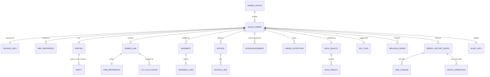

# Canonical Data Model – Sales Order (CDM v1)

| Item | Value |
|---|---|
| Document | 03 – Canonical Data Model |
| Contract | `SalesOrder` v1.0.0 (`schemaVersion: "1.0.0"`) |
| Source of truth | `src/tfso/common/cdm.py` (Pydantic v2) → JSON Schema 2020-12 in `cdm/*.v1.schema.json` |
| Owner | Sales Order data product owner (sales & customer service domain) |
| Related | [02 Technical design](02-technical-design.md) · [cdm/README](../cdm/README.md) · [01 Requirements](01-requirements.md) |

## 1. Purpose

The CDM is the **contract** of the Sales Order data product (deck slide 12): one canonical, validated record of
every order – whatever the channel – plus its complete lifecycle. Every channel is translated *into* it, every Tier-3
system is fed *from* it, and every consumer (Order Status API, webhooks, CRM, Databricks, Delta Sharing) reads it.

It covers the entities on slide 12 (order header, order lines, customer and ship-to, item, pricing, status events) and
extends them with the industry elements needed to run a fresh-produce order-to-cash flow end to end: X12
acknowledgements, shipments with lots and FSMA 204 traceability lot codes, invoices, data-quality results,
exceptions, ROI tags and an **order history** that records the whole lifecycle of an order and of groups of orders.

## 2. Design principles

1. **Channel-neutral** – nothing in the model depends on how the order arrived; channel specifics live in
   `source` and in stored raw documents.
2. **One document, many projections** – the order is a single JSON document; the status API, list views and
   Databricks tables are projections of it.
3. **Lifecycle is append-only** – `orderHistory` entries are immutable and ordered by `sequence`; current state is
   derivable from history plus the latest snapshot.
4. **Quantities through the lifecycle** – every line carries `quantities.{ordered, confirmed, backordered, allocated,
   picked, shipped, delivered, invoiced, cancelled}` so partial fulfilment is explicit.
5. **Identify with standards, keep the customer's identifiers** – GS1 GTIN/GLN/SSCC and X12 qualifiers alongside the
   Taylor Farms (D365) identifiers and the buyer's own item and location codes.
6. **Decimals are strings in JSON** (`"24.50"`) to avoid binary floating point; dates are ISO 8601 (`date` =
   `YYYY-MM-DD`, `date-time` = UTC with `Z`).
7. **camelCase JSON**, additive evolution, `extensions` for namespaced non-contract attributes.

## 3. Standards alignment

| Standard | How it is used |
|---|---|
| ANSI ASC X12 004010 | 850 (inbound PO) mapped into the CDM; 997, 855, 856, 810 generated from it; ISA/GS/ST control numbers kept in `source.sourceDocument` |
| GS1 | GTIN-14 (`item.gtin`), GTIN-12/UPC (`item.upc`), GLN (`party.gln`), SSCC (`shipment.sscc`) |
| OAGIS SalesOrder | Header / line / party / document-reference structure and naming (`purchaseOrder`, `parties`, `references`) |
| Dynamics 365 F&O | `erp` block and the CDM→D365 mapping to `SalesOrderHeadersV2` / `SalesOrderLines` (§11) |
| FSMA 204 (Food Traceability Rule) | Key data elements for shipping CTE: lot (`lots[].lotNumber`), Traceability Lot Code (`traceabilityLotCode`), quantity/UOM, ship-from/ship-to locations (GLN), ship date, product description, commodity (`commodityCode`) |
| CloudEvents 1.0 | Envelope for `OrderStatusChanged`, commands and system status events |
| JSON-Patch (RFC 6902 subset) | `orderHistory[].changes` |
| ISO 4217 / 3166 / 8601 | Currency, country, dates |

## 4. Entity-relationship view



Top-level structure of a `SalesOrder`:

```
SalesOrder
├─ identity: schemaVersion, orderId, orderGroupId, version, orderType, purpose
├─ status: status, statusCategory, statusReason, statusUpdatedAt
├─ source{channel, receivedAt, sourceDocument{…ISA/GS/ST…}, extraction, submittedBy}
├─ purchaseOrder{poNumber, poDate, releaseNumber, contractNumber, department, promotionDealNumber}
├─ erp{system, company, salesOrderId, salesOrderStatus, customerAccount, invoiceAccount, siteId, warehouseId, …}
├─ parties{soldTo, shipTo, billTo, payer, buyer, supplier, shipFrom, carrier}
├─ dates · commercial · shipping
├─ lines[]{lineNumber, item, quantity, quantities, unitPrice, lineAmount, status, lots[], …}
├─ allowancesCharges[] · totals · references[] · notes[]
├─ shipments[] · invoices[] · acknowledgments[]
├─ exceptions[] · dataQuality
├─ roi{touchless, touchCount, manualTouches, exceptionReasonCodes, stageTimestamps, acknowledgmentTimestamps, cycleTimes, chargebackRisk}
├─ relatedOrders[] · orderHistory[]
└─ audit{createdAt, createdBy, updatedAt, updatedBy, contractVersion, lineage[]} · extensions{}
```

## 5. Enumerations

| Enumeration | Values |
|---|---|
| `AckType` | `FUNCTIONAL_ACK_997`, `PO_ACK_855`, `SHIP_NOTICE_856`, `INVOICE_810`, `EMAIL_CONFIRMATION`, `PORTAL_NOTIFICATION`, `WEBHOOK` |
| `ActorType` | `SYSTEM`, `USER`, `CUSTOMER`, `PARTNER` |
| `ExceptionState` | `OPEN`, `RESOLVED`, `OVERRIDDEN` |
| `HistoryEventType` | `ORDER_RECEIVED`, `ORDER_INGESTED`, `VALIDATION_PASSED`, `VALIDATION_FAILED`, `ORDER_ENRICHED`, `ORDER_PUBLISHED`, `ORDER_CORRECTED`, `ORDER_RESUBMITTED`, `SUBMITTED_TO_ERP`, `ERP_ACCEPTED`, `ERP_REJECTED`, `CREDIT_HOLD_PLACED`, `HOLD_PLACED`, `HOLD_RELEASED`, `INVENTORY_RESERVED`, `LINE_BACKORDERED`, `RELEASED_TO_WAREHOUSE`, `PICKED`, `PACKED`, `SHIPPED`, `DELIVERED`, `INVOICED`, `CLOSED`, `CANCELLED`, `REJECTED`, `DOCUMENT_SENT`, `NOTIFICATION_SENT`, `LATE_EVENT_IGNORED`, `ORDER_SPLIT`, `ORDER_LINKED` |
| `LineStatus` | `OPEN`, `CONFIRMED`, `BACKORDERED`, `ALLOCATED`, `RELEASED`, `PICKED`, `PACKED`, `SHIPPED`, `DELIVERED`, `INVOICED`, `CANCELLED` |
| `OrderPurpose` | `ORIGINAL`, `CHANGE`, `CANCELLATION`, `REPLACE`, `CONFIRMATION` |
| `OrderStatus` | `RECEIVED`, `INGESTED`, `EXCEPTION`, `VALIDATED`, `ENRICHED`, `PUBLISHED`, `SUBMITTED_TO_ERP`, `ERP_REJECTED`, `CREDIT_HOLD`, `ACCEPTED`, `ON_HOLD`, `RELEASED`, `PICKED`, `PACKED`, `PARTIALLY_SHIPPED`, `SHIPPED`, `DELIVERED`, `INVOICED`, `CLOSED`, `CANCELLED`, `REJECTED` |
| `OrderType` | `STANDARD`, `RUSH`, `STANDING`, `BLANKET_RELEASE`, `DROP_SHIP`, `SAMPLE`, `REPLACEMENT` |
| `RelationshipType` | `SAME_INTERCHANGE`, `SPLIT_FROM`, `SPLIT_INTO`, `BACKORDER_OF`, `REPLACES`, `REPLACED_BY`, `CHANGE_OF`, `DUPLICATE_OF` |
| `Severity` | `ERROR`, `WARNING`, `INFO` |
| `SourceChannel` | `EDI`, `EMAIL`, `PORTAL`, `MANUAL`, `PARTNER_API` |
| `SourceDocumentType` | `X12_850`, `X12_860`, `EMAIL_MESSAGE`, `PDF`, `SPREADSHEET`, `PORTAL_FORM`, `PARTNER_JSON` |
| `StatusCategory` | `RECEIVED`, `ACTION_REQUIRED`, `CONFIRMED`, `IN_FULFILLMENT`, `SHIPPED`, `DELIVERED`, `INVOICED`, `CLOSED`, `CANCELLED` |
| `TemperatureZone` | `FROZEN`, `REFRIGERATED`, `AMBIENT` |
| `Tier` | `TIER1`, `TIER2`, `TIER3` |
## 6. Element dictionary

Generated from `src/tfso/common/cdm.py`; every entity and element of contract v1 is listed. *Card.* is the
cardinality in the JSON document (`1` always present, `0..1` optional, `0..*` array that may be empty).
*Class.* is the data classification (§10). Mapping columns show the primary X12 4010, D365 F&O and portal source.

#### SalesOrder

Canonical Sales Order - the published record of the Sales Order data product.

| Element (JSON) | Type | Card. | Description | X12 | D365 F&O | Portal / other | Class. |
|---|---|---|---|---|---|---|---|
| `schemaVersion` | string | 1 | CDM contract version the document conforms to. Default `1.0.0`. |  |  |  | Internal |
| `orderId` | string | 1 | Data product order id: SO-YYYYMMDD-XXXXXXXX | – | SalesOrderHeadersV2.CustomersOrderReference | generated at ingest | Internal |
| `orderGroupId` | string | 1 | Groups orders that arrived together (one interchange/email) or were split/replaced | one per ISA interchange | – | one per submission | Internal |
| `version` | integer | 1 | Optimistic concurrency version; increments on every change. Default `1`. |  |  |  | Internal |
| `orderType` | OrderType (enum) | 1 | Commercial order type. Default `STANDARD`. | BEG02 | SalesType / order pool | orderType | Internal |
| `purpose` | OrderPurpose (enum) | 1 | Why the document was sent (original, change, cancellation ...). Default `ORIGINAL`. | BEG01 | – | ORIGINAL | Internal |
| `status` | OrderStatus (enum) | 1 | Current lifecycle status (state machine, doc 02 §5.3) | – | derived from business events | – | Internal |
| `statusCategory` | StatusCategory (enum) | 1 | Customer-facing grouping of the status |  |  |  | Internal |
| `statusReason` | string | 0..1 | Reason text when ACTION_REQUIRED or CANCELLED |  |  |  | Internal |
| `statusUpdatedAt` | date-time | 1 | When the status last changed |  |  |  | Internal |
| `source` | [SourceInfo](#sourceinfo) | 1 | How and where the order was captured (Tier 1) |  |  |  | Internal |
| `purchaseOrder` | [PurchaseOrderReference](#purchaseorderreference) | 1 | Customer purchase order reference |  |  |  | Internal |
| `erp` | [ErpReference](#erpreference) | 0..1 | D365 sales order created for this order |  |  |  | Internal |
| `parties` | [Parties](#parties) | 1 | Sold-to, ship-to, bill-to and other parties |  |  |  | Internal |
| `dates` | [OrderDates](#orderdates) | 1 | Header dates |  |  |  | Internal |
| `commercial` | [Commercial](#commercial) | 1 | Currency, terms, pricing context |  |  |  | Internal |
| `shipping` | [ShippingInstructions](#shippinginstructions) | 1 | Delivery and handling instructions |  |  |  | Internal |
| `lines` | array<[OrderLine](#orderline)> | 1..* | Order lines (≥ 1 required by DQ-009) |  |  |  | Internal |
| `allowancesCharges` | array<[AllowanceCharge](#allowancecharge)> | 0..* | Header allowances and charges |  |  |  | Internal |
| `totals` | [Totals](#totals) | 1 | Computed order totals |  |  |  | Internal |
| `references` | array<[Reference](#reference)> | 0..* | Additional references (X12 REF) |  |  |  | Internal |
| `notes` | array<[Note](#note)> | 0..* | Customer, internal, shipping notes |  |  |  | Internal |
| `shipments` | array<[Shipment](#shipment)> | 0..* | Shipments (856) against the order |  |  |  | Internal |
| `invoices` | array<[Invoice](#invoice)> | 0..* | Invoices (810) against the order |  |  |  | Internal |
| `acknowledgments` | array<[Acknowledgment](#acknowledgment)> | 0..* | Documents and notifications sent to the customer |  |  |  | Internal |
| `exceptions` | array<[OrderException](#orderexception)> | 0..* | Quality and processing exceptions (open and resolved) |  |  |  | Internal |
| `dataQuality` | [DataQuality](#dataquality) | 1 | Result of the latest validation run |  |  |  | Internal |
| `roi` | [RoiTags](#roitags) | 1 | ROI tags carried on every order (deck slide 4) |  |  |  | Internal |
| `relatedOrders` | array<[RelatedOrder](#relatedorder)> | 0..* | Links to other orders |  |  |  | Internal |
| `orderHistory` | array<[OrderHistoryEntry](#orderhistoryentry)> | 0..* | Complete, ordered lifecycle of this order |  |  |  | Internal |
| `audit` | [AuditInfo](#auditinfo) | 1 | Creation/update audit and lineage |  |  |  | Internal |
| `extensions` | object | 1 | Namespaced, non-contract attributes |  |  |  | Internal |

#### SourceInfo

| Element (JSON) | Type | Card. | Description | X12 | D365 F&O | Portal / other | Class. |
|---|---|---|---|---|---|---|---|
| `channel` | SourceChannel (enum) | 1 | Tier-1 capture channel |  |  |  | Internal |
| `channelDetail` | string | 0..1 | e.g. VAN name, mailbox, partner platform |  |  |  | Internal |
| `receivedAt` | date-time | 1 | When the channel received the order |  |  |  | Internal |
| `sourceDocument` | [SourceDocument](#sourcedocument) | 1 | Pointer to the raw inbound document |  |  |  | Internal |
| `extraction` | [ExtractionInfo](#extractioninfo) | 0..1 | Extraction method/confidence (e-mail, OCR) |  |  |  | Internal |
| `submittedBy` | [Actor](#actor) | 0..1 | Who submitted the order |  |  |  | Internal |

#### SourceDocument

| Element (JSON) | Type | Card. | Description | X12 | D365 F&O | Portal / other | Class. |
|---|---|---|---|---|---|---|---|
| `documentType` | SourceDocumentType (enum) | 1 | Inbound document type |  |  |  | Internal |
| `documentId` | string | 0..1 | Pointer to the stored raw document (documents API / bronze) |  |  |  | Internal |
| `reference` | string | 0..1 | Channel reference: email Message-ID, file name, portal session |  |  |  | Internal |
| `senderId` | string | 0..1 | ISA06 / email sender / partner client id | ISA06 |  | customerId / e-mail sender | Internal |
| `receiverId` | string | 0..1 | ISA08 | ISA08 |  |  | Internal |
| `interchangeControlNumber` | string | 0..1 | ISA13 | ISA13 |  |  | Internal |
| `groupControlNumber` | string | 0..1 | GS06 | GS06 |  |  | Internal |
| `transactionSetControlNumber` | string | 0..1 | ST02 | ST02 |  |  | Internal |
| `x12Version` | string | 0..1 | GS08, e.g. 004010 | GS08 |  |  | Internal |
| `receivedAt` | date-time | 0..1 |  |  |  |  | Internal |

#### ExtractionInfo

| Element (JSON) | Type | Card. | Description | X12 | D365 F&O | Portal / other | Class. |
|---|---|---|---|---|---|---|---|
| `method` | enum(STRUCTURED, TEMPLATE, OCR, LLM, MANUAL) | 1 | Default `STRUCTURED`. |  |  |  | Internal |
| `confidence` | number | 1 | Default `1.0`. |  |  |  | Internal |
| `modelId` | string | 0..1 |  |  |  |  | Internal |
| `fieldsLowConfidence` | array<string> | 0..* |  |  |  |  | Internal |

#### Actor

| Element (JSON) | Type | Card. | Description | X12 | D365 F&O | Portal / other | Class. |
|---|---|---|---|---|---|---|---|
| `type` | ActorType (enum) | 1 | Default `SYSTEM`. |  |  |  | Internal |
| `id` | string | 1 | User principal, service name or trading-partner id |  |  |  | Internal |
| `name` | string | 0..1 |  |  |  |  | PII |

#### PurchaseOrderReference

| Element (JSON) | Type | Card. | Description | X12 | D365 F&O | Portal / other | Class. |
|---|---|---|---|---|---|---|---|
| `poNumber` | string | 1 | Customer purchase order number (X12 BEG03) | BEG03 | CustomerRequisitionNumber | customerPo | Internal |
| `poDate` | date | 0..1 | BEG05 | BEG05 | – | submission date | Internal |
| `releaseNumber` | string | 0..1 | BEG04 - blanket release | BEG04 | – | – | Internal |
| `contractNumber` | string | 0..1 | REF*CT | REF*CT | – | – | Internal |
| `department` | string | 0..1 | REF*DP | REF*DP | – | – | Internal |
| `promotionDealNumber` | string | 0..1 | REF*PD | REF*PD | – | – | Internal |

#### ErpReference

| Element (JSON) | Type | Card. | Description | X12 | D365 F&O | Portal / other | Class. |
|---|---|---|---|---|---|---|---|
| `system` | string | 1 | Default `D365FO`. |  |  |  | Internal |
| `company` | string | 1 | D365 legal entity (dataAreaId) | – | dataAreaId | – | Internal |
| `salesOrderId` | string | 0..1 | D365 SalesOrderNumber | 855 BAK08 / REF*VN | SalesOrderNumber | – | Internal |
| `salesOrderStatus` | string | 0..1 | D365 SalesStatus: Backorder, Delivered, Invoiced, Canceled |  |  |  | Internal |
| `customerAccount` | string | 0..1 | OrderingCustomerAccountNumber | – | OrderingCustomerAccountNumber | – | Internal |
| `invoiceAccount` | string | 0..1 | InvoiceCustomerAccountNumber | – | InvoiceCustomerAccountNumber | – | Internal |
| `siteId` | string | 0..1 |  | – | DefaultShippingSiteId | – | Internal |
| `warehouseId` | string | 0..1 |  | – | DefaultShippingWarehouseId | – | Internal |
| `deliveryMode` | string | 0..1 |  | – | DeliveryModeCode | – | Internal |
| `createdAt` | date-time | 0..1 |  |  |  |  | Internal |
| `lastSyncedAt` | date-time | 0..1 |  |  |  |  | Internal |
| `rejectionReason` | string | 0..1 |  |  |  |  | Internal |

#### Parties

| Element (JSON) | Type | Card. | Description | X12 | D365 F&O | Portal / other | Class. |
|---|---|---|---|---|---|---|---|
| `soldTo` | [Party](#party) | 1 |  |  |  |  | Internal |
| `shipTo` | [Party](#party) | 1 |  |  |  |  | Internal |
| `billTo` | [Party](#party) | 0..1 |  |  |  |  | Internal |
| `payer` | [Party](#party) | 0..1 |  |  |  |  | Internal |
| `buyer` | [Party](#party) | 0..1 |  |  |  |  | Internal |
| `supplier` | [Party](#party) | 0..1 |  |  |  |  | Internal |
| `shipFrom` | [Party](#party) | 0..1 |  |  |  |  | Internal |
| `carrier` | [Party](#party) | 0..1 |  |  |  |  | Internal |

#### Party

| Element (JSON) | Type | Card. | Description | X12 | D365 F&O | Portal / other | Class. |
|---|---|---|---|---|---|---|---|
| `role` | enum(SOLD_TO, SHIP_TO, BILL_TO, PAYER, BUYER, SUPPLIER, CARRIER, SHIP_FROM) | 1 | Party function |  |  |  | Internal |
| `partyId` | string | 0..1 | Data product party key (customer id or ship-to id) | resolved from ISA06 / N1 | – | customerId / shipToId | Internal |
| `customerId` | string | 0..1 | Owning customer id (for SHIP_TO / BILL_TO) |  |  |  | Internal |
| `erpAccount` | string | 0..1 | D365 customer account / delivery address location id | – | CustomerAccount / DeliveryAddressLocationId | master data | Internal |
| `name` | string | 0..1 |  | N102 | OrganizationName / address name | master data | Internal |
| `gln` | string | 0..1 | GS1 Global Location Number (N104 qualifier UL) | N104 (N103=UL) | – | master data | Internal |
| `duns` | string | 0..1 | DUNS (N104 qualifier 1) | N104 (N103=1) | – | master data | Internal |
| `ediLocationCode` | string | 0..1 | Buyer-assigned location code (N104 qualifier 92) | N104 (N103=92) | – | – | Internal |
| `address` | [Address](#address) | 0..1 | Postal address | N3/N4 | postal address | master data | PII |
| `contacts` | array<[Contact](#contact)> | 0..* | Contacts | PER | contact person | contact | Internal |
| `receivingHours` | string | 0..1 |  |  |  |  | Internal |
| `deliveryDays` | array<string> | 0..* | Days the location accepts deliveries |  |  |  | Internal |

#### Address

| Element (JSON) | Type | Card. | Description | X12 | D365 F&O | Portal / other | Class. |
|---|---|---|---|---|---|---|---|
| `line1` | string | 0..1 |  | N301 |  |  | Internal |
| `line2` | string | 0..1 |  | N302 |  |  | Internal |
| `city` | string | 0..1 |  | N401 |  |  | Internal |
| `stateProvince` | string | 0..1 |  | N402 |  |  | Internal |
| `postalCode` | string | 0..1 |  | N403 |  |  | Internal |
| `country` | string | 1 | ISO 3166-1 alpha-2. Default `US`. | N404 |  |  | Internal |

#### Contact

| Element (JSON) | Type | Card. | Description | X12 | D365 F&O | Portal / other | Class. |
|---|---|---|---|---|---|---|---|
| `role` | string | 0..1 | X12 PER01 e.g. BD (buyer), OC (order contact) | PER01 |  |  | Internal |
| `name` | string | 0..1 |  | PER02 |  | contact.name | PII |
| `email` | string | 0..1 |  | PER05=EM/PER06 |  | contact.email | PII |
| `phone` | string | 0..1 |  | PER03=TE/PER04 |  | contact.phone | PII |

#### OrderDates

| Element (JSON) | Type | Card. | Description | X12 | D365 F&O | Portal / other | Class. |
|---|---|---|---|---|---|---|---|
| `orderDate` | date | 0..1 | Customer PO date | BEG05 | – | submission date | Internal |
| `requestedDeliveryDate` | date | 0..1 | DTM*002 | DTM*002 | RequestedReceiptDate | requestedDeliveryDate | Internal |
| `requestedShipDate` | date | 0..1 | DTM*010; derived from transit time when absent | DTM*010 | RequestedShippingDate | derived | Internal |
| `promisedShipDate` | date | 0..1 | Confirmed by D365 (855 DTM*068) | 855 DTM*068 | ConfirmedShippingDate | – | Internal |
| `promisedDeliveryDate` | date | 0..1 |  |  |  |  | Internal |
| `cancelByDate` | date | 0..1 | DTM*001 cancel-after | DTM*001 | – | – | Internal |
| `deliveryWindow` | [DateWindow](#datewindow) | 0..1 |  |  |  |  | Internal |

#### DateWindow

| Element (JSON) | Type | Card. | Description | X12 | D365 F&O | Portal / other | Class. |
|---|---|---|---|---|---|---|---|
| `start` | date-time | 0..1 |  |  |  |  | Internal |
| `end` | date-time | 0..1 |  |  |  |  | Internal |

#### Commercial

| Element (JSON) | Type | Card. | Description | X12 | D365 F&O | Portal / other | Class. |
|---|---|---|---|---|---|---|---|
| `currency` | string | 1 | Default `USD`. | CUR02 | CurrencyCode | currency | Internal |
| `paymentTerms` | [PaymentTerms](#paymentterms) | 0..1 |  | ITD | PaymentTermsName | customer master | Internal |
| `priceAgreementId` | string | 0..1 | Trade agreement journal applied | – | TradeAgreementJournalNumber | – | Internal |
| `customerPriceGroup` | string | 0..1 |  |  |  |  | Internal |
| `incoterms` | string | 0..1 | Incoterms 2020 code, e.g. FCA, DAP |  |  |  | Internal |
| `fobPoint` | string | 0..1 | X12 FOB01: PP prepaid, CC collect | FOB01 | – | – | Internal |
| `salesResponsible` | string | 0..1 |  |  |  |  | Internal |
| `taxExemptNumber` | string | 0..1 |  |  |  |  | Internal |

#### PaymentTerms

| Element (JSON) | Type | Card. | Description | X12 | D365 F&O | Portal / other | Class. |
|---|---|---|---|---|---|---|---|
| `code` | string | 1 | D365 terms of payment code, e.g. Net30 |  |  |  | Confidential |
| `description` | string | 0..1 |  |  |  |  | Confidential |
| `netDays` | integer | 0..1 |  |  |  |  | Confidential |
| `discountPercent` | decimal | 0..1 |  |  |  |  | Confidential |
| `discountDays` | integer | 0..1 |  |  |  |  | Confidential |

#### ShippingInstructions

| Element (JSON) | Type | Card. | Description | X12 | D365 F&O | Portal / other | Class. |
|---|---|---|---|---|---|---|---|
| `deliveryMode` | string | 0..1 | D365 mode of delivery, e.g. TRUCK-REEFER | – | DeliveryModeCode | ship-to master | Internal |
| `transportResponsibility` | enum(SUPPLIER_DELIVERED, CUSTOMER_PICKUP, THIRD_PARTY) | 1 | Default `SUPPLIER_DELIVERED`. |  |  |  | Internal |
| `carrierScac` | string | 0..1 | Standard Carrier Alpha Code (TD503) | TD503 | – | – | Internal |
| `carrierName` | string | 0..1 |  |  |  |  | Internal |
| `serviceLevel` | string | 0..1 |  |  |  |  | Internal |
| `routing` | string | 0..1 |  | TD505 | – | – | Internal |
| `shipFromSite` | string | 0..1 |  | – | DefaultShippingSiteId | ship-to master | Internal |
| `shipFromWarehouse` | string | 0..1 |  | – | DefaultShippingWarehouseId | ship-to master | Internal |
| `temperature` | [TemperatureRequirement](#temperaturerequirement) | 0..1 |  |  |  |  | Internal |
| `appointmentRequired` | boolean | 1 | Default `False`. |  |  |  | Internal |
| `palletType` | string | 0..1 |  |  |  |  | Internal |
| `specialInstructions` | string | 0..1 |  |  |  |  | Internal |

#### TemperatureRequirement

| Element (JSON) | Type | Card. | Description | X12 | D365 F&O | Portal / other | Class. |
|---|---|---|---|---|---|---|---|
| `zone` | TemperatureZone (enum) | 1 | Default `REFRIGERATED`. |  |  |  | Internal |
| `minCelsius` | decimal | 0..1 |  |  |  |  | Internal |
| `maxCelsius` | decimal | 0..1 |  |  |  |  | Internal |

#### OrderLine

| Element (JSON) | Type | Card. | Description | X12 | D365 F&O | Portal / other | Class. |
|---|---|---|---|---|---|---|---|
| `lineNumber` | integer | 1 | Data product line number |  |  |  | Internal |
| `buyerLineNumber` | string | 0..1 | PO101 assigned identification | PO101 | CustomersLineNumber | – | Internal |
| `erpLineId` | string | 0..1 | D365 LineCreationSequenceNumber / InventTransId | – | LineCreationSequenceNumber / InventTransId | – | Internal |
| `item` | [ItemReference](#itemreference) | 1 | Item identification |  |  |  | Internal |
| `quantity` | [Quantity](#quantity) | 1 | Ordered quantity in the customer's unit of measure | PO102/PO103 | OrderedSalesQuantity / SalesUnitSymbol | lines[].quantity/uom | Internal |
| `quantities` | [LineQuantities](#linequantities) | 1 | Running quantities across the lifecycle |  |  |  | Internal |
| `unitPrice` | [Price](#price) | 0..1 |  | PO104/PO105 | SalesPrice | lines[].unitPrice | Internal |
| `lineAmount` | decimal | 0..1 | Quantity × unit price |  |  |  | Confidential |
| `allowancesCharges` | array<[AllowanceCharge](#allowancecharge)> | 0..* |  | SAC in PO1 loop | misc. charges | – | Internal |
| `taxes` | array<[TaxAmount](#taxamount)> | 0..* |  |  |  |  | Internal |
| `requestedDeliveryDate` | date | 0..1 |  | DTM*002 in PO1 loop | RequestedReceiptDate | header date | Internal |
| `requestedShipDate` | date | 0..1 |  |  |  |  | Internal |
| `promisedShipDate` | date | 0..1 | Ship date confirmed by D365 |  |  |  | Internal |
| `status` | LineStatus (enum) | 1 | Line lifecycle status. Default `OPEN`. |  |  |  | Internal |
| `substitutionAllowed` | boolean | 1 | Customer accepts substitutes. Default `False`. |  |  |  | Internal |
| `substitutedItemNumber` | string | 0..1 |  |  |  |  | Internal |
| `minRemainingShelfLifeDays` | integer | 0..1 | Minimum remaining shelf life on receipt (DQ-010) |  |  |  | Internal |
| `lots` | array<[LotAllocation](#lotallocation)> | 0..* | Lots shipped against the line (FSMA 204) |  |  |  | Internal |
| `notes` | array<[Note](#note)> | 0..* |  | MSG/NTE in PO1 loop | – | lines[].notes | Internal |

#### ItemReference

| Element (JSON) | Type | Card. | Description | X12 | D365 F&O | Portal / other | Class. |
|---|---|---|---|---|---|---|---|
| `itemNumber` | string | 0..1 | Taylor Farms item number (D365 ItemNumber) | PO1 VN (or resolved) | ItemNumber | itemNumber | Internal |
| `buyerItemNumber` | string | 0..1 | PO1 qualifier IN | PO1 IN/BP | external item id | – | Internal |
| `vendorItemNumber` | string | 0..1 | PO1 qualifier VN | PO1 VN/VP | ItemNumber | – | Internal |
| `gtin` | string | 0..1 | GS1 GTIN-14 (case) | PO1 UK/EN, 856 LIN UK | GTIN (bar code setup) | item master | Internal |
| `upc` | string | 0..1 | GTIN-12 consumer unit (PO1 qualifier UP) | PO1 UP | bar code | item master | Internal |
| `description` | string | 0..1 |  | PID05 | ProductName / SearchName | item master | Internal |
| `brand` | string | 0..1 |  |  |  |  | Internal |
| `packSize` | string | 0..1 | e.g. 6x2 LB |  |  |  | Internal |
| `temperatureZone` | TemperatureZone (enum) | 0..1 |  |  |  |  | Internal |
| `shelfLifeDays` | integer | 0..1 |  |  |  |  | Internal |
| `caseWeightLb` | decimal | 0..1 |  |  |  |  | Internal |
| `commodityCode` | string | 0..1 | Produce commodity / FSMA Food Traceability List category |  |  |  | Internal |

#### Quantity

| Element (JSON) | Type | Card. | Description | X12 | D365 F&O | Portal / other | Class. |
|---|---|---|---|---|---|---|---|
| `value` | decimal | 1 | Quantity in the stated unit of measure |  |  |  | Internal |
| `uom` | string | 1 | X12 355 unit code: CA (case), EA, LB, BX, PL (pallet) |  |  |  | Internal |

#### LineQuantities

| Element (JSON) | Type | Card. | Description | X12 | D365 F&O | Portal / other | Class. |
|---|---|---|---|---|---|---|---|
| `ordered` | decimal | 1 | Default `0`. |  |  |  | Internal |
| `confirmed` | decimal | 1 | Default `0`. |  |  |  | Internal |
| `backordered` | decimal | 1 | Default `0`. |  |  |  | Internal |
| `allocated` | decimal | 1 | Default `0`. |  |  |  | Internal |
| `picked` | decimal | 1 | Default `0`. |  |  |  | Internal |
| `shipped` | decimal | 1 | Default `0`. |  |  |  | Internal |
| `delivered` | decimal | 1 | Default `0`. |  |  |  | Internal |
| `invoiced` | decimal | 1 | Default `0`. |  |  |  | Internal |
| `cancelled` | decimal | 1 | Default `0`. |  |  |  | Internal |

#### Price

| Element (JSON) | Type | Card. | Description | X12 | D365 F&O | Portal / other | Class. |
|---|---|---|---|---|---|---|---|
| `amount` | decimal | 1 | Unit price per pricing UOM |  |  |  | Confidential |
| `currency` | string | 1 | Default `USD`. |  |  |  | Confidential |
| `basisUom` | string | 0..1 | Pricing unit (PO105 basis) |  |  |  | Confidential |
| `source` | enum(CUSTOMER_AGREEMENT, LIST, PURCHASE_ORDER, MANUAL_OVERRIDE) | 1 | Default `PURCHASE_ORDER`. |  |  |  | Confidential |
| `agreementId` | string | 0..1 |  |  |  |  | Confidential |
| `agreementPrice` | decimal | 0..1 | Price per the trade agreement at validation time |  |  |  | Confidential |
| `listPrice` | decimal | 0..1 |  |  |  |  | Confidential |

#### AllowanceCharge

| Element (JSON) | Type | Card. | Description | X12 | D365 F&O | Portal / other | Class. |
|---|---|---|---|---|---|---|---|
| `indicator` | enum(ALLOWANCE, CHARGE) | 1 |  | SAC01 |  |  | Confidential |
| `code` | string | 1 | X12 SAC02 code e.g. D240 freight, C310 discount, F050 fuel | SAC02 |  |  | Confidential |
| `description` | string | 0..1 |  |  |  |  | Confidential |
| `amount` | decimal | 0..1 |  | SAC05 |  |  | Confidential |
| `percent` | decimal | 0..1 |  |  |  |  | Confidential |
| `lineNumber` | integer | 0..1 |  |  |  |  | Confidential |

#### TaxAmount

| Element (JSON) | Type | Card. | Description | X12 | D365 F&O | Portal / other | Class. |
|---|---|---|---|---|---|---|---|
| `taxType` | string | 1 | Default `SALES`. |  |  |  | Confidential |
| `jurisdiction` | string | 0..1 |  |  |  |  | Confidential |
| `rate` | decimal | 0..1 |  |  |  |  | Confidential |
| `amount` | decimal | 1 |  |  |  |  | Confidential |

#### LotAllocation

| Element (JSON) | Type | Card. | Description | X12 | D365 F&O | Portal / other | Class. |
|---|---|---|---|---|---|---|---|
| `lotNumber` | string | 1 |  | 856 REF*LT | InventBatchId |  | Internal |
| `quantity` | decimal | 1 |  |  |  |  | Internal |
| `traceabilityLotCode` | string | 0..1 | FSMA 204 Traceability Lot Code (TLC) | FSMA 204 KDE | batch attribute |  | Internal |
| `packDate` | date | 0..1 |  |  |  |  | Internal |
| `harvestDate` | date | 0..1 |  |  |  |  | Internal |
| `bestByDate` | date | 0..1 |  |  |  |  | Internal |
| `countryOfOrigin` | string | 0..1 |  |  |  |  | Internal |

#### Totals

| Element (JSON) | Type | Card. | Description | X12 | D365 F&O | Portal / other | Class. |
|---|---|---|---|---|---|---|---|
| `lineCount` | integer | 1 | Default `0`. |  |  |  | Confidential |
| `totalQuantity` | decimal | 1 | Default `0`. |  |  |  | Confidential |
| `subtotal` | decimal | 1 | Default `0`. |  |  |  | Confidential |
| `allowances` | decimal | 1 | Default `0`. |  |  |  | Confidential |
| `charges` | decimal | 1 | Default `0`. |  |  |  | Confidential |
| `tax` | decimal | 1 | Default `0`. |  |  |  | Confidential |
| `grandTotal` | decimal | 1 | Default `0`. |  |  |  | Confidential |
| `currency` | string | 1 | Default `USD`. |  |  |  | Confidential |
| `totalWeightLb` | decimal | 0..1 |  |  |  |  | Confidential |

#### Reference

| Element (JSON) | Type | Card. | Description | X12 | D365 F&O | Portal / other | Class. |
|---|---|---|---|---|---|---|---|
| `qualifier` | string | 1 | X12 REF01 / OAGIS DocumentReference type, e.g. DP (department), CT (contract), IA (vendor #) | REF01 |  |  | Internal |
| `value` | string | 1 |  | REF02 |  |  | Internal |
| `description` | string | 0..1 |  |  |  |  | Internal |

#### Note

| Element (JSON) | Type | Card. | Description | X12 | D365 F&O | Portal / other | Class. |
|---|---|---|---|---|---|---|---|
| `type` | enum(CUSTOMER, INTERNAL, SHIPPING, RECEIVING) | 1 | Default `CUSTOMER`. |  |  |  | Internal |
| `text` | string | 1 |  |  |  |  | PII |
| `createdBy` | string | 0..1 |  |  |  |  | Internal |
| `createdAt` | date-time | 0..1 |  |  |  |  | Internal |

#### Shipment

| Element (JSON) | Type | Card. | Description | X12 | D365 F&O | Portal / other | Class. |
|---|---|---|---|---|---|---|---|
| `shipmentId` | string | 1 | Shipment identifier |  |  |  | Internal |
| `asnNumber` | string | 0..1 | 856 BSN02 shipment identification | 856 BSN02 | – |  | Internal |
| `erpPackingSlipId` | string | 0..1 |  | – | PackingSlipId |  | Internal |
| `carrierScac` | string | 0..1 |  | 856 TD503 | – |  | Internal |
| `carrierName` | string | 0..1 |  |  |  |  | Internal |
| `trackingNumber` | string | 0..1 |  |  |  |  | Internal |
| `billOfLading` | string | 0..1 |  | 856 REF*BM | – |  | Internal |
| `proNumber` | string | 0..1 |  | 856 REF*CN | – |  | Internal |
| `trailerNumber` | string | 0..1 |  |  |  |  | Internal |
| `sealNumber` | string | 0..1 |  |  |  |  | Internal |
| `shipFromWarehouse` | string | 0..1 |  |  |  |  | Internal |
| `shippedAt` | date-time | 0..1 |  | 856 DTM*011 | packing slip date |  | Internal |
| `estimatedDeliveryAt` | date-time | 0..1 |  |  |  |  | Internal |
| `deliveredAt` | date-time | 0..1 |  |  |  |  | Internal |
| `status` | enum(PLANNED, IN_TRANSIT, DELIVERED, EXCEPTION) | 1 | Shipment status. Default `IN_TRANSIT`. |  |  |  | Internal |
| `sscc` | array<string> | 0..* | GS1 SSCC pallet labels | 856 MAN*GM | license plate |  | Internal |
| `temperatureLogRef` | string | 0..1 |  |  |  |  | Internal |
| `proofOfDelivery` | [ProofOfDelivery](#proofofdelivery) | 0..1 |  |  |  |  | Internal |
| `lines` | array<[ShipmentLine](#shipmentline)> | 0..* | Shipped quantities per line |  |  |  | Internal |

#### ShipmentLine

| Element (JSON) | Type | Card. | Description | X12 | D365 F&O | Portal / other | Class. |
|---|---|---|---|---|---|---|---|
| `lineNumber` | integer | 1 |  |  |  |  | Internal |
| `itemNumber` | string | 0..1 |  |  |  |  | Internal |
| `quantity` | decimal | 1 |  | 856 SN102 |  |  | Internal |
| `uom` | string | 0..1 |  |  |  |  | Internal |
| `lots` | array<[LotAllocation](#lotallocation)> | 0..* |  |  |  |  | Internal |

#### ProofOfDelivery

| Element (JSON) | Type | Card. | Description | X12 | D365 F&O | Portal / other | Class. |
|---|---|---|---|---|---|---|---|
| `receivedBy` | string | 0..1 |  |  |  |  | PII |
| `receivedAt` | date-time | 0..1 |  |  |  |  | Internal |
| `exceptions` | array<string> | 0..* | OS&D: over, short, damaged, temperature |  |  |  | Internal |

#### Invoice

| Element (JSON) | Type | Card. | Description | X12 | D365 F&O | Portal / other | Class. |
|---|---|---|---|---|---|---|---|
| `invoiceId` | string | 1 |  | 810 BIG02 | InvoiceId |  | Confidential |
| `invoiceDate` | date | 1 |  | 810 BIG01 | InvoiceDate |  | Confidential |
| `dueDate` | date | 0..1 |  |  |  |  | Confidential |
| `amount` | decimal | 1 |  | 810 TDS01 | InvoiceAmount |  | Confidential |
| `taxAmount` | decimal | 1 | Default `0`. |  |  |  | Confidential |
| `currency` | string | 1 | Default `USD`. |  |  |  | Confidential |
| `status` | enum(POSTED, SENT, PAID, CREDITED) | 1 | Invoice status. Default `POSTED`. |  |  |  | Confidential |
| `lines` | array<[InvoiceLine](#invoiceline)> | 0..* | Invoiced quantities per line |  |  |  | Confidential |

#### InvoiceLine

| Element (JSON) | Type | Card. | Description | X12 | D365 F&O | Portal / other | Class. |
|---|---|---|---|---|---|---|---|
| `lineNumber` | integer | 1 |  |  |  |  | Confidential |
| `quantity` | decimal | 1 |  | 810 IT102 |  |  | Confidential |
| `unitPrice` | decimal | 0..1 |  |  |  |  | Confidential |
| `amount` | decimal | 1 |  |  |  |  | Confidential |

#### Acknowledgment

| Element (JSON) | Type | Card. | Description | X12 | D365 F&O | Portal / other | Class. |
|---|---|---|---|---|---|---|---|
| `type` | AckType (enum) | 1 | Kind of acknowledgement |  |  |  | Internal |
| `documentId` | string | 0..1 |  |  |  |  | Internal |
| `controlNumber` | string | 0..1 |  |  |  |  | Internal |
| `status` | enum(ACCEPTED, ACCEPTED_WITH_CHANGES, REJECTED, SENT) | 1 | Acceptance status conveyed. Default `SENT`. |  |  |  | Internal |
| `channel` | string | 0..1 |  |  |  |  | Internal |
| `recipient` | string | 0..1 |  |  |  |  | Internal |
| `sentAt` | date-time | 1 | When it was sent |  |  |  | Internal |

#### OrderException

| Element (JSON) | Type | Card. | Description | X12 | D365 F&O | Portal / other | Class. |
|---|---|---|---|---|---|---|---|
| `exceptionId` | string | 1 |  |  |  |  | Internal |
| `code` | string | 1 | Machine-readable reason code, e.g. PRICE_MISMATCH |  |  |  | Internal |
| `ruleId` | string | 0..1 |  |  |  |  | Internal |
| `severity` | Severity (enum) | 1 | Default `ERROR`. |  |  |  | Internal |
| `message` | string | 1 | Human-readable explanation |  |  |  | Internal |
| `lineNumber` | integer | 0..1 |  |  |  |  | Internal |
| `field` | string | 0..1 |  |  |  |  | Internal |
| `detectedAt` | date-time | 1 |  |  |  |  | Internal |
| `detectedBy` | string | 1 | Service or system that raised it. Default `process-api`. |  |  |  | Internal |
| `state` | ExceptionState (enum) | 1 | OPEN until resolved or overridden. Default `OPEN`. |  |  |  | Internal |
| `resolvedAt` | date-time | 0..1 |  |  |  |  | Internal |
| `resolvedBy` | string | 0..1 |  |  |  |  | Internal |
| `resolutionNote` | string | 0..1 |  |  |  |  | Internal |

#### DataQuality

| Element (JSON) | Type | Card. | Description | X12 | D365 F&O | Portal / other | Class. |
|---|---|---|---|---|---|---|---|
| `ruleSetVersion` | string | 1 | Default `1.0`. |  |  |  | Internal |
| `validatedAt` | date-time | 0..1 |  |  |  |  | Internal |
| `attempt` | integer | 1 | Default `0`. |  |  |  | Internal |
| `passed` | boolean | 1 | Default `False`. |  |  |  | Internal |
| `firstPass` | boolean | 0..1 | True when the first validation attempt passed every rule |  |  |  | Internal |
| `score` | number | 1 | Share of rule checks passed (0-1). Default `0`. |  |  |  | Internal |
| `results` | array<[RuleResult](#ruleresult)> | 0..* |  |  |  |  | Internal |

#### RuleResult

| Element (JSON) | Type | Card. | Description | X12 | D365 F&O | Portal / other | Class. |
|---|---|---|---|---|---|---|---|
| `ruleId` | string | 1 | DQ-001 .. DQ-011 |  |  |  | Internal |
| `name` | string | 1 |  |  |  |  | Internal |
| `passed` | boolean | 1 |  |  |  |  | Internal |
| `severity` | Severity (enum) | 1 | Default `ERROR`. |  |  |  | Internal |
| `message` | string | 0..1 |  |  |  |  | Internal |
| `lineNumber` | integer | 0..1 |  |  |  |  | Internal |
| `field` | string | 0..1 |  |  |  |  | Internal |

#### RoiTags

| Element (JSON) | Type | Card. | Description | X12 | D365 F&O | Portal / other | Class. |
|---|---|---|---|---|---|---|---|
| `sourceChannel` | SourceChannel (enum) | 1 | Channel for ROI attribution |  |  |  | Internal |
| `touchless` | boolean | 1 | No manual touch so far. Default `True`. |  |  |  | Internal |
| `touchCount` | integer | 1 | Number of manual touches. Default `0`. |  |  |  | Internal |
| `manualTouches` | array<[ManualTouch](#manualtouch)> | 0..* |  |  |  |  | Internal |
| `exceptionReasonCodes` | array<string> | 0..* | Every exception code ever raised (errors-avoided driver) |  |  |  | Internal |
| `stageTimestamps` | [StageTimestamps](#stagetimestamps) | 1 | First time each lifecycle stage was reached |  |  |  | Internal |
| `acknowledgmentTimestamps` | [AckTimestamps](#acktimestamps) | 1 |  |  |  |  | Internal |
| `cycleTimes` | [CycleTimes](#cycletimes) | 1 |  |  |  |  | Internal |
| `chargebackRisk` | array<string> | 0..* | LATE_855, LATE_856, ASN_MISMATCH ... |  |  |  | Internal |
| `registeredConsumers` | array<string> | 0..* | Output-port consumers that received the order |  |  |  | Internal |

#### StageTimestamps

| Element (JSON) | Type | Card. | Description | X12 | D365 F&O | Portal / other | Class. |
|---|---|---|---|---|---|---|---|
| `received` | date-time | 0..1 |  |  |  |  | Internal |
| `ingested` | date-time | 0..1 |  |  |  |  | Internal |
| `validated` | date-time | 0..1 |  |  |  |  | Internal |
| `enriched` | date-time | 0..1 |  |  |  |  | Internal |
| `published` | date-time | 0..1 |  |  |  |  | Internal |
| `submittedToErp` | date-time | 0..1 |  |  |  |  | Internal |
| `erpCreated` | date-time | 0..1 |  |  |  |  | Internal |
| `released` | date-time | 0..1 |  |  |  |  | Internal |
| `picked` | date-time | 0..1 |  |  |  |  | Internal |
| `packed` | date-time | 0..1 |  |  |  |  | Internal |
| `shipped` | date-time | 0..1 |  |  |  |  | Internal |
| `delivered` | date-time | 0..1 |  |  |  |  | Internal |
| `invoiced` | date-time | 0..1 |  |  |  |  | Internal |
| `closed` | date-time | 0..1 |  |  |  |  | Internal |
| `cancelled` | date-time | 0..1 |  |  |  |  | Internal |

#### AckTimestamps

| Element (JSON) | Type | Card. | Description | X12 | D365 F&O | Portal / other | Class. |
|---|---|---|---|---|---|---|---|
| `functionalAck997` | date-time | 0..1 |  |  |  |  | Internal |
| `poAck855` | date-time | 0..1 |  |  |  |  | Internal |
| `shipNotice856` | date-time | 0..1 |  |  |  |  | Internal |
| `invoice810` | date-time | 0..1 |  |  |  |  | Internal |

#### CycleTimes

| Element (JSON) | Type | Card. | Description | X12 | D365 F&O | Portal / other | Class. |
|---|---|---|---|---|---|---|---|
| `receiptToErpMinutes` | number | 0..1 |  |  |  |  | Internal |
| `receiptToShipHours` | number | 0..1 |  |  |  |  | Internal |
| `receiptToInvoiceHours` | number | 0..1 |  |  |  |  | Internal |
| `shipToAsnMinutes` | number | 0..1 | Chargeback driver: ASN latency after ship |  |  |  | Internal |

#### ManualTouch

| Element (JSON) | Type | Card. | Description | X12 | D365 F&O | Portal / other | Class. |
|---|---|---|---|---|---|---|---|
| `at` | date-time | 1 |  |  |  |  | Internal |
| `actor` | string | 1 |  |  |  |  | Internal |
| `action` | string | 1 |  |  |  |  | Internal |
| `minutes` | number | 0..1 | Estimated handling minutes for labor ROI |  |  |  | Internal |

#### RelatedOrder

| Element (JSON) | Type | Card. | Description | X12 | D365 F&O | Portal / other | Class. |
|---|---|---|---|---|---|---|---|
| `orderId` | string | 1 |  |  |  |  | Internal |
| `relationship` | RelationshipType (enum) | 1 |  |  |  |  | Internal |
| `note` | string | 0..1 |  |  |  |  | Internal |
| `createdAt` | date-time | 1 |  |  |  |  | Internal |

#### OrderHistoryEntry

One immutable entry in the lifecycle of an order (append-only, ordered by `sequence`).

| Element (JSON) | Type | Card. | Description | X12 | D365 F&O | Portal / other | Class. |
|---|---|---|---|---|---|---|---|
| `eventId` | string | 1 | Unique id of the entry |  |  |  | Internal |
| `orderId` | string | 1 |  |  |  |  | Internal |
| `orderGroupId` | string | 0..1 |  |  |  |  | Internal |
| `sequence` | integer | 1 | Monotonic per order |  |  |  | Internal |
| `eventType` | HistoryEventType (enum) | 1 | What happened |  |  |  | Internal |
| `occurredAt` | date-time | 1 | When it happened in the source system |  |  |  | Internal |
| `recordedAt` | date-time | 1 | When the data product recorded it |  |  |  | Internal |
| `fromStatus` | OrderStatus (enum) | 0..1 | Status before |  |  |  | Internal |
| `toStatus` | OrderStatus (enum) | 0..1 | Status after (equals fromStatus for non-status events) |  |  |  | Internal |
| `statusCategory` | StatusCategory (enum) | 0..1 | Category after the event |  |  |  | Internal |
| `tier` | Tier (enum) | 1 | Architecture tier where it happened. Default `TIER2`. |  |  |  | Internal |
| `sourceSystem` | string | 1 | EDI-GATEWAY, EMAIL, PORTAL, PROCESS-API, D365, WMS, TMS, CRM ... |  |  |  | Internal |
| `actor` | [Actor](#actor) | 1 | Who/what caused it |  |  |  | Internal |
| `correlationId` | string | 0..1 | Request/trace correlation id |  |  |  | Internal |
| `causationId` | string | 0..1 | Event or command that caused this entry |  |  |  | Internal |
| `externalEventId` | string | 0..1 | Idempotency key from the source system |  |  |  | Internal |
| `reasonCode` | string | 0..1 | Machine-readable reason |  |  |  | Internal |
| `message` | string | 0..1 | Human-readable description |  |  |  | Internal |
| `lineChanges` | array<[LineChange](#linechange)> | 0..* | Line-level field changes |  |  |  | Internal |
| `changes` | array<[PatchOperation](#patchoperation)> | 0..* | JSON-Patch style diff of the canonical order |  |  |  | Internal |
| `documentRef` | string | 0..1 | Document produced/consumed |  |  |  | Internal |
| `elapsedSincePreviousSeconds` | number | 0..1 | Seconds since the previous entry of this order |  |  |  | Internal |

#### LineChange

| Element (JSON) | Type | Card. | Description | X12 | D365 F&O | Portal / other | Class. |
|---|---|---|---|---|---|---|---|
| `lineNumber` | integer | 1 |  |  |  |  | Internal |
| `field` | string | 1 |  |  |  |  | Internal |
| `fromValue` | any | 1 |  |  |  |  | Internal |
| `toValue` | any | 1 |  |  |  |  | Internal |

#### PatchOperation

| Element (JSON) | Type | Card. | Description | X12 | D365 F&O | Portal / other | Class. |
|---|---|---|---|---|---|---|---|
| `op` | enum(add, remove, replace) | 1 |  |  |  |  | Internal |
| `path` | string | 1 |  |  |  |  | Internal |
| `value` | any | 1 |  |  |  |  | Internal |
| `fromValue` | any | 1 |  |  |  |  | Internal |

#### AuditInfo

| Element (JSON) | Type | Card. | Description | X12 | D365 F&O | Portal / other | Class. |
|---|---|---|---|---|---|---|---|
| `createdAt` | date-time | 1 |  |  |  |  | Internal |
| `createdBy` | string | 1 |  |  |  |  | Internal |
| `updatedAt` | date-time | 1 |  |  |  |  | Internal |
| `updatedBy` | string | 1 |  |  |  |  | Internal |
| `contractVersion` | string | 1 | Default `1.0.0`. |  |  |  | Internal |
| `lineage` | array<[LineageStep](#lineagestep)> | 0..* | Processing steps (capture → orchestrate) |  |  |  | Internal |

#### LineageStep

| Element (JSON) | Type | Card. | Description | X12 | D365 F&O | Portal / other | Class. |
|---|---|---|---|---|---|---|---|
| `step` | enum(CAPTURE, INGEST, VALIDATE, ENRICH, CANONICALIZE, PUBLISH, ORCHESTRATE, SYNC) | 1 |  |  |  |  | Internal |
| `service` | string | 1 |  |  |  |  | Internal |
| `at` | date-time | 1 |  |  |  |  | Internal |
| `inputRef` | string | 0..1 |  |  |  |  | Internal |
| `outputRef` | string | 0..1 |  |  |  |  | Internal |

#### Money

| Element (JSON) | Type | Card. | Description | X12 | D365 F&O | Portal / other | Class. |
|---|---|---|---|---|---|---|---|
| `amount` | decimal | 1 |  |  |  |  | Confidential |
| `currency` | string | 1 | ISO 4217. Default `USD`. |  |  |  | Confidential |

#### OrderGroup

Lifecycle across orders that belong together (multi-ST interchange, split, backorder, replacement).

| Element (JSON) | Type | Card. | Description | X12 | D365 F&O | Portal / other | Class. |
|---|---|---|---|---|---|---|---|
| `orderGroupId` | string | 1 |  |  |  |  | Internal |
| `origin` | string | 0..1 | e.g. ISA13 control number or email Message-ID |  |  |  | Internal |
| `orderIds` | array<string> | 1..* |  |  |  |  | Internal |
| `aggregateStatusCategory` | StatusCategory (enum) | 0..1 |  |  |  |  | Internal |
| `createdAt` | date-time | 1 |  |  |  |  | Internal |
| `history` | array<[OrderHistoryEntry](#orderhistoryentry)> | 0..* |  |  |  |  | Internal |

#### OrderStatusChanged

`data` payload of the sales-order-events CloudEvent (output port: order status events).

| Element (JSON) | Type | Card. | Description | X12 | D365 F&O | Portal / other | Class. |
|---|---|---|---|---|---|---|---|
| `orderId` | string | 1 |  |  |  |  | Internal |
| `orderGroupId` | string | 0..1 |  |  |  |  | Internal |
| `sequence` | integer | 1 |  |  |  |  | Internal |
| `eventType` | HistoryEventType (enum) | 1 |  |  |  |  | Internal |
| `fromStatus` | OrderStatus (enum) | 0..1 |  |  |  |  | Internal |
| `toStatus` | OrderStatus (enum) | 0..1 |  |  |  |  | Internal |
| `statusCategory` | StatusCategory (enum) | 0..1 |  |  |  |  | Internal |
| `occurredAt` | date-time | 1 |  |  |  |  | Internal |
| `sourceChannel` | SourceChannel (enum) | 1 |  |  |  |  | Internal |
| `customerId` | string | 0..1 |  |  |  |  | Internal |
| `customerPo` | string | 0..1 |  |  |  |  | Internal |
| `erpSalesOrderId` | string | 0..1 |  |  |  |  | Internal |
| `totalAmount` | decimal | 0..1 |  |  |  |  | Confidential |
| `currency` | string | 0..1 |  |  |  |  | Internal |
| `roi` | object | 0..1 |  |  |  |  | Internal |

#### StatusEvent

Inbound status event from a Tier-3 system (system-status-events topic / POST /v1/events).

| Element (JSON) | Type | Card. | Description | X12 | D365 F&O | Portal / other | Class. |
|---|---|---|---|---|---|---|---|
| `eventId` | string | 1 |  |  |  |  | Internal |
| `eventType` | string | 1 | ERP_ACCEPTED, ERP_REJECTED, CREDIT_HOLD_PLACED, RELEASED_TO_WAREHOUSE, PICKED, PACKED, SHIPPED, DELIVERED, INVOICED, CLOSED, CANCELLED |  |  |  | Internal |
| `orderId` | string | 0..1 |  |  |  |  | Internal |
| `erpSalesOrderId` | string | 0..1 |  |  |  |  | Internal |
| `occurredAt` | date-time | 1 |  |  |  |  | Internal |
| `sourceSystem` | string | 1 |  |  |  |  | Internal |
| `reason` | string | 0..1 |  |  |  |  | Internal |
| `erp` | [ErpReference](#erpreference) | 0..1 |  |  |  |  | Internal |
| `lines` | array<object> | 0..* | [{lineNumber, quantity, status, confirmedQuantity, backorderedQuantity, erpLineId, lots[]}] |  |  |  | Internal |
| `shipment` | [Shipment](#shipment) | 0..1 |  |  |  |  | Internal |
| `invoice` | [Invoice](#invoice) | 0..1 |  |  |  |  | Internal |
| `promisedShipDate` | date | 0..1 |  |  |  |  | Internal |
| `payload` | object | 1 |  |  |  |  | Internal |

## 7. Order history – the lifecycle of an order and of groups of orders

### 7.1 What is recorded

Every change to an order – from capture in Tier 1, through every Tier-2 step, to every Tier-3 event – appends exactly
one `OrderHistoryEntry`. Nothing is updated or deleted. The history is stored in the `order_history` event table and
returned as `SalesOrder.orderHistory` (and on `GET /process/v1/orders/{id}/history`).

| Element | Semantics |
|---|---|
| `sequence` | 1, 2, 3 … per order, gap-free, unique with `orderId` (DB constraint). Defines the order of events for consumers. |
| `occurredAt` / `recordedAt` | When it happened in the source system vs. when the data product recorded it. `recordedAt − occurredAt` is the freshness lag (KPI `dataFreshnessSeconds`). |
| `elapsedSincePreviousSeconds` | `recordedAt` minus the previous entry's `recordedAt` – stage durations without joins. |
| `fromStatus` / `toStatus` | Status before/after. For informational entries (`DOCUMENT_SENT`, `INVENTORY_RESERVED`, `ORDER_CORRECTED` …) both are the current status. The first entry has no `fromStatus`. |
| `statusCategory` | Customer-facing category after the entry. |
| `tier` | `TIER1` capture/communication (channels, EDI gateway, notifications), `TIER2` integration layer, `TIER3` systems of record. |
| `sourceSystem` | `EDI-GATEWAY`, `EMAIL-INTAKE`, `CUSTOMER-PORTAL`, `CS-PORTAL`, `PARTNER-API`, `PROCESS-API`, `D365`, `WMS`, `TMS`, `NOTIFICATION`, `EXTERNAL`. |
| `actor` | `{type: SYSTEM | USER | CUSTOMER | PARTNER, id, name}` – e.g. the trading partner for receipt, the CS user for corrections, `D365` for ERP events. |
| `correlationId` / `causationId` | Trace of the request that caused the change / the message (CloudEvent id) that caused it. |
| `externalEventId` | Idempotency key of the Tier-3 event (unique). A redelivered event is detected and not recorded twice. |
| `reasonCode` / `message` | Machine-readable reason (e.g. `PRICE_MISMATCH`, `CREDIT_HOLD`, `OUT_OF_ORDER`, `MANUAL_HOLD`) and human text. |
| `changes[]` | JSON-Patch operations on the canonical document (`op`, `path`, `value`, `fromValue`) – enrichment (`ORDER_ENRICHED`) and corrections (`ORDER_CORRECTED`). |
| `lineChanges[]` | Line-level changes `{lineNumber, field, fromValue, toValue}` – confirmations, backorders, shipped/delivered/invoiced quantities, line status. |
| `documentRef` | The raw inbound document (receipt) or the outbound document produced (997/855/856/810/e-mail). |

### 7.2 Event types

| Phase | Event types |
|---|---|
| Capture & ingest | `ORDER_RECEIVED`, `ORDER_INGESTED`, `ORDER_LINKED` (joined an existing group) |
| Quality | `VALIDATION_PASSED`, `VALIDATION_FAILED`, `ORDER_ENRICHED`, `ORDER_PUBLISHED` |
| Customer service | `ORDER_CORRECTED`, `ORDER_RESUBMITTED`, `HOLD_PLACED`, `HOLD_RELEASED`, `CANCELLED`, `REJECTED` |
| ERP | `SUBMITTED_TO_ERP`, `ERP_ACCEPTED`, `ERP_REJECTED`, `CREDIT_HOLD_PLACED`, `INVENTORY_RESERVED`, `LINE_BACKORDERED` |
| Fulfilment | `RELEASED_TO_WAREHOUSE`, `PICKED`, `PACKED`, `SHIPPED`, `DELIVERED`, `INVOICED`, `CLOSED` |
| Communication | `DOCUMENT_SENT` (997/855/856/810), `NOTIFICATION_SENT` (e-mail / portal) |
| Integrity | `LATE_EVENT_IGNORED` (out-of-order event that would regress status) |
| Reserved (v1.x) | `ORDER_SPLIT` (split/backorder child orders) |

### 7.3 Out-of-order and duplicate events

* **Duplicates** – an event whose `externalEventId` is already recorded is ignored (no new entry).
* **Late events** – a fulfilment event behind the current stage records `LATE_EVENT_IGNORED`
  (`reasonCode: OUT_OF_ORDER`) without changing status; SHIPPED / DELIVERED / INVOICED facts (shipments, quantities,
  invoices) are still merged.
* **Physical facts win** – shipment, delivery and invoice events are applied even if the order is on an
  administrative hold.

### 7.4 Lifecycle of groups of orders

Orders that belong together share an `orderGroupId`:

* all purchase orders of one X12 interchange (`origin` = ISA13);
* one e-mail or portal submission;
* future: split, backorder and replacement orders (`relatedOrders[].relationship` = `SPLIT_FROM/INTO`,
  `BACKORDER_OF`, `REPLACES/REPLACED_BY`, `CHANGE_OF`, `DUPLICATE_OF`).

`OrderGroup` (`GET /process/v1/order-groups/{orderGroupId}/history`) merges the histories of all orders of the group by
`recordedAt` and derives `aggregateStatusCategory` (`ACTION_REQUIRED` if any order needs action, otherwise the least
advanced category). `GET /process/v1/orders/{id}/related` lists the orders of the group with their relationship.
Each order also records `relatedOrders` (`SAME_INTERCHANGE`) and an `ORDER_LINKED` entry when it joins a group.

### 7.5 Example (EDI order, abridged from `cdm/examples/sales-order.edi-invoiced.example.json`)

| seq | eventType | from → to | tier | source | message |
|---|---|---|---|---|---|
| 1 | ORDER_RECEIVED | – → RECEIVED | TIER1 | EDI-GATEWAY | Received via EDI (ISA794590128/ST0001) |
| 2 | DOCUMENT_SENT | RECEIVED | TIER1 | EDI-GATEWAY | FUNCTIONAL_ACK_997 sent to FRESHMART |
| 3 | ORDER_INGESTED | RECEIVED → INGESTED | TIER2 | PROCESS-API | Parsed 1 line(s) into the working format |
| 4 | VALIDATION_PASSED | INGESTED → VALIDATED | TIER2 | PROCESS-API | 9 checks passed |
| 5 | ORDER_ENRICHED | VALIDATED → ENRICHED | TIER2 | PROCESS-API | Applied … master data (49 element(s)) |
| 6 | ORDER_PUBLISHED | ENRICHED → PUBLISHED | TIER2 | PROCESS-API | Canonical order published under contract v1.0.0 |
| 7 | SUBMITTED_TO_ERP | PUBLISHED → SUBMITTED_TO_ERP | TIER2 | PROCESS-API | CreateErpSalesOrder command sent |
| 8 | ERP_ACCEPTED | SUBMITTED_TO_ERP → ACCEPTED | TIER3 | D365 | Sales order SO-00100002 created in D365 |
| 9 | INVENTORY_RESERVED | ACCEPTED | TIER3 | D365 | Inventory reserved at WH-SAL |
| 10 | DOCUMENT_SENT | ACCEPTED | TIER1 | EDI-GATEWAY | X12 855 sent to FRESHMART (control 1001) |
| 11–13 | RELEASED_TO_WAREHOUSE, PICKED, PACKED | → RELEASED → PICKED → PACKED | TIER3 | D365 / WMS | |
| 14 | SHIPPED | PACKED → SHIPPED | TIER3 | WMS | Shipment SHP-500002 via Cold Road Freight |
| 15 | DOCUMENT_SENT | SHIPPED | TIER1 | EDI-GATEWAY | X12 856 sent |
| 16 | DELIVERED | SHIPPED → DELIVERED | TIER3 | TMS | Proof of delivery received |
| 17 | INVOICED | DELIVERED → INVOICED | TIER3 | D365 | Invoice INV-700002 posted for 980.00 USD |
| 18 | DOCUMENT_SENT | INVOICED | TIER1 | EDI-GATEWAY | X12 810 sent |

A Tier-3 entry in full:

```json
{
  "eventId": "hist-3e574e84-a0ec-4e67-b831-2ff854d32295",
  "orderId": "SO-20261113-63B9D3E7", "orderGroupId": "OG-20261113-D69EA874",
  "sequence": 8, "eventType": "ERP_ACCEPTED",
  "occurredAt": "2026-11-13T17:15:28.041973Z", "recordedAt": "2026-11-13T17:15:28.054623Z",
  "fromStatus": "SUBMITTED_TO_ERP", "toStatus": "ACCEPTED", "statusCategory": "CONFIRMED",
  "tier": "TIER3", "sourceSystem": "D365", "actor": {"type": "SYSTEM", "id": "D365"},
  "correlationId": "540cfc23-357b-4284-b8d6-73e82782556a",
  "causationId": "evt-2c50d0f7-2188-4da6-96a8-f7dcbbf07e96",
  "externalEventId": "evt-2c50d0f7-2188-4da6-96a8-f7dcbbf07e96",
  "message": "Sales order SO-00100002 created in D365",
  "lineChanges": [
    {"lineNumber": 1, "field": "quantities.confirmed", "fromValue": null, "toValue": "40"},
    {"lineNumber": 1, "field": "quantities.backordered", "fromValue": null, "toValue": "0"},
    {"lineNumber": 1, "field": "status", "fromValue": "OPEN", "toValue": "ALLOCATED"}
  ],
  "elapsedSincePreviousSeconds": 0.083
}
```

## 8. Status and milestone model

`status` follows the state machine in doc 02 §5.3 (21 statuses); `statusCategory` is the customer-facing grouping:

| Category | Statuses |
|---|---|
| RECEIVED | RECEIVED, INGESTED, VALIDATED, ENRICHED, PUBLISHED, SUBMITTED_TO_ERP |
| ACTION_REQUIRED | EXCEPTION, ERP_REJECTED, CREDIT_HOLD, ON_HOLD |
| CONFIRMED | ACCEPTED |
| IN_FULFILLMENT | RELEASED, PICKED, PACKED |
| SHIPPED | PARTIALLY_SHIPPED, SHIPPED |
| DELIVERED | DELIVERED |
| INVOICED | INVOICED |
| CLOSED | CLOSED |
| CANCELLED | CANCELLED, REJECTED |

The status view derives nine **milestones** from `roi.stageTimestamps`: Order received (`received`), Validated &
enriched (`validated`), Published (`published`), Confirmed in D365 (`erpCreated`), Released (`released`), Picked & packed
(`picked`/`packed`), Shipped (`shipped`), Delivered (`delivered`), Invoiced (`invoiced`) – each `DONE` (with time),
`CURRENT` (optionally `blocked`), `PENDING` or `SKIPPED`. Line status (`LineStatus`) tracks each line independently.

## 9. Events

### 9.1 OrderStatusChanged (output port "order status events")

Published for **every** history entry on topic `sales-order-events` and Event Hubs `order-status-stream` as a
CloudEvent: `type = "tfso.salesorder.OrderStatusChanged"`, `source = "/process/sales-orders"`, `subject = orderId`.
`data` (`cdm/order-status-changed.v1.schema.json`) = `orderId, orderGroupId, sequence, eventType, fromStatus, toStatus,
statusCategory, occurredAt, recordedAt, sourceSystem, sourceChannel, customerId, customerPo, erpSalesOrderId,
totalAmount, currency, roi{touchless, touchCount, exceptionReasonCodes, stageTimestamps, acknowledgmentTimestamps,
cycleTimes, chargebackRisk}, historyEntry{…}` and – for status-changing entries – `snapshot` (the full canonical
order without `orderHistory`). Webhook deliveries omit `snapshot`. Example: `cdm/examples/order-status-changed.cloudevent.example.json`.

### 9.2 StatusEvent (input from Tier 3)

`cdm/status-event.v1.schema.json`: `eventId` (idempotency key), `eventType` (`ERP_ACCEPTED, ERP_REJECTED,
CREDIT_HOLD_PLACED, CREDIT_HOLD_RELEASED, RELEASED_TO_WAREHOUSE, PICKED, PACKED, SHIPPED, DELIVERED, INVOICED, CLOSED,
CANCELLED`), `orderId` or `erpSalesOrderId`, `occurredAt`, `sourceSystem`, `reason`, `erp`, `lines[]`
(`lineNumber, confirmedQuantity, backorderedQuantity, shippedQuantity, deliveredQuantity, invoicedQuantity, status,
erpLineId, lots[]`), `shipment`, `invoice`, `promisedShipDate`, `payload`. Carried on `system-status-events` with
CloudEvent type `tfso.system.<eventType>`.

## 10. Data classification and PII

| Class | Elements | Handling |
|---|---|---|
| PII | `Contact.name/email/phone`, `ProofOfDelivery.receivedBy`, `Actor.name` (users), free-text `Note.text`, party addresses of individuals | Least-privilege access; masked in non-prod copies; excluded from Delta Sharing; retained with the order (7 years) |
| Confidential (commercial) | Prices (`Price.*`), `lineAmount`, `Totals`, `Invoice*`, `AllowanceCharge`, `TaxAmount`, `PaymentTerms`, credit information in exception messages | Internal roles and the owning customer only; customer views never show other customers' agreements |
| Internal | Everything else (identifiers, statuses, dates, quantities, history) | Available to registered consumers of the data product |

Unity Catalog tags (`databricks/unity_catalog/setup.sql`) carry the same classification.

## 11. Mappings

### 11.1 X12 850 → CDM

| X12 | CDM |
|---|---|
| ISA06, ISA08, ISA13, GS06, GS08, ST02 | `source.sourceDocument.senderId, receiverId, interchangeControlNumber, groupControlNumber, x12Version, transactionSetControlNumber`; ISA06 → trading partner → `parties.soldTo.partyId` |
| BEG01 / BEG02 / BEG03 / BEG04 / BEG05 | `purpose` / `orderType` / `purchaseOrder.poNumber` / `releaseNumber` / `poDate` |
| CUR02 | `commercial.currency` |
| REF*DP / CT / PD / other | `purchaseOrder.department / contractNumber / promotionDealNumber`; all in `references[]` |
| PER | `parties.buyer.contacts[]` |
| FOB01, ITD | `commercial.fobPoint`, `commercial.paymentTerms` |
| DTM*002 / 010 / 001 (header or PO1 loop) | `dates.requestedDeliveryDate / requestedShipDate / cancelByDate` (or line dates) |
| TD503, TD505 | `shipping.carrierScac`, `shipping.routing` |
| SAC | `allowancesCharges[]` / `lines[].allowancesCharges[]` |
| MSG, NTE | `notes[]` / `lines[].notes[]` |
| N1*ST/BT/BY/SF/SO + N3/N4 | `parties.shipTo/billTo/buyer/shipFrom/soldTo` (`gln` UL, `duns` 1, `ediLocationCode` 92, `address`) |
| PO101–PO105 | `lines[].buyerLineNumber, quantity.value, quantity.uom, unitPrice.amount, unitPrice.basisUom` |
| PO1 IN/BP, VN/VP, UP, UK/EN | `lines[].item.buyerItemNumber, vendorItemNumber, upc, gtin` → resolved `item.itemNumber` |
| PID05 | `lines[].item.description` |

Outbound: **997** (AK1/AK2/AK5/AK9 from the interchange), **855** (BAK, REF*VN = `erp.salesOrderId`, DTM*068 =
`dates.promisedShipDate`, PO1 + ACK IA/IB/BP from `quantities.confirmed/backordered`), **856** (BSN = `asnNumber`,
TD5 carrier, REF*BM/CN, DTM*011, HL S/O/I, PRF = PO, LIN with GTIN, SN1 shipped qty, REF*LT lot), **810** (BIG,
REF*VN, ITD, IT1 per invoice line, TDS total in cents). See `cdm/examples/x12-*.edi`.

### 11.2 CDM → D365 F&O

| CDM | D365 entity.field |
|---|---|
| (config) | `SalesOrderHeadersV2.dataAreaId` |
| `parties.soldTo.erpAccount` | `OrderingCustomerAccountNumber` |
| `parties.billTo.erpAccount` | `InvoiceCustomerAccountNumber` |
| `purchaseOrder.poNumber` | `CustomerRequisitionNumber` |
| `orderId` | `CustomersOrderReference` |
| `commercial.currency` | `CurrencyCode` |
| `dates.requestedDeliveryDate` / `requestedShipDate` | `RequestedReceiptDate` / `RequestedShippingDate` |
| `parties.shipTo.erpAccount` | `DeliveryAddressLocationId` |
| `shipping.deliveryMode` | `DeliveryModeCode` |
| `shipping.shipFromSite` / `shipFromWarehouse` | `DefaultShippingSiteId` / `DefaultShippingWarehouseId` |
| `source.channel` | `SalesOrderOriginCode` |
| `lines[].item.itemNumber` | `SalesOrderLines.ItemNumber` |
| `lines[].quantity.value` / `.uom` | `OrderedSalesQuantity` / `SalesUnitSymbol` |
| `lines[].unitPrice.amount` | `SalesPrice` |
| `lines[].requestedDeliveryDate` | `RequestedReceiptDate` |
| `lines[].buyerLineNumber` (or `lineNumber`) | `CustomersLineNumber` |
| ← `SalesOrderNumber` | `erp.salesOrderId` |
| ← business events (confirmed, released, packing slip, invoice, credit check, canceled) | `StatusEvent` → history |

## 12. Data quality rules mapped to elements

| Rule | Elements checked | Exception codes |
|---|---|---|
| DQ-001 | `parties.soldTo.partyId` | CUSTOMER_NOT_FOUND, CUSTOMER_INACTIVE |
| DQ-002 | `parties.shipTo.{partyId, ediLocationCode, gln, name}` | SHIPTO_NOT_FOUND, SHIPTO_CUSTOMER_MISMATCH, SHIPTO_INACTIVE |
| DQ-003 | `lines[].item.{itemNumber, buyerItemNumber, gtin, upc, vendorItemNumber}` | ITEM_NOT_FOUND, ITEM_INACTIVE |
| DQ-004 | `lines[].quantity.uom` | UOM_INVALID |
| DQ-005 | `lines[].unitPrice.amount` vs agreement | PRICE_MISMATCH |
| DQ-006 | `parties.soldTo.partyId` + `purchaseOrder.poNumber` | DUPLICATE_ORDER |
| DQ-007 | `dates.requestedDeliveryDate` (+ lead time, transit, receiving days) | DATE_IN_PAST, DATE_NOT_ACHIEVABLE, NON_RECEIVING_DAY (warning) |
| DQ-008 | `lines[].quantity.value` | QUANTITY_INVALID, QUANTITY_INCREMENT |
| DQ-009 | `purchaseOrder.poNumber`, `parties.soldTo`, `parties.shipTo`, `lines`, `dates.requestedDeliveryDate`, line item/quantity | MISSING_REQUIRED_DATA |
| DQ-010 | `lines[].minRemainingShelfLifeDays`, `item.shelfLifeDays/temperatureZone` | SHELF_LIFE_RISK, TEMPERATURE_MISMATCH (warnings) |
| DQ-011 | `source.extraction.confidence` | EXTRACTION_LOW_CONFIDENCE |

Results are stored in `dataQuality.results[]`; failures open `exceptions[]` and are tagged in `roi.exceptionReasonCodes`.
Before publishing, the whole document is validated against the `SalesOrder` schema (`CONTRACT_VIOLATION` otherwise).

## 13. Versioning and compatibility policy

* **Semantic versioning** of the contract: `schemaVersion` `MAJOR.MINOR.PATCH`; JSON Schema `$id`
  `https://schemas.taylorfarms.example/sales-order/sales-order.v1.json` carries the major version.
* **Additive (minor)** – new optional elements, new enumeration values in `extensions`-style open lists, new event
  types, new history `reasonCode`s. Consumers must ignore unknown elements (*tolerant reader*).
* **Breaking (major)** – removing/renaming elements, changing types or cardinality, changing the meaning of a status,
  adding values to closed enumerations that consumers switch on (`status`, `statusCategory`). A breaking change ships
  as `v2` side-by-side (`/v2` routes, `sales-order.v2.schema.json`, CloudEvent type suffix) while v1 is served for a
  **deprecation window of at least 6 months**; registered consumers (APIM subscriptions, webhook subscriptions,
  Delta Sharing recipients) receive notice at the start of the window and at 30 days before retirement.
* **Patch** – description and documentation fixes only.
* Schemas are generated from code (`python -m tfso.tools.export_schema`) and every published order is validated
  against the model, so the code, the schema files and the data cannot drift.

## 14. Worked example – line with lifecycle quantities and FSMA lot

```json
{
  "lineNumber": 1, "buyerLineNumber": "1", "erpLineId": "SO-00100002-001",
  "item": {"buyerItemNumber": "FM-55012", "itemNumber": "TF-10001", "description": "Chopped Romaine",
           "gtin": "10614141100011", "upc": "61414110001", "packSize": "6x2 LB", "brand": "Taylor Farms",
           "temperatureZone": "REFRIGERATED", "shelfLifeDays": 14, "caseWeightLb": 12, "commodityCode": "LEAFY_GREENS"},
  "quantity": {"value": "40", "uom": "CA"},
  "quantities": {"ordered": "40", "confirmed": "40", "backordered": "0", "allocated": "40", "picked": "40",
                 "shipped": "40", "delivered": "40", "invoiced": "40"},
  "unitPrice": {"amount": "24.5", "source": "CUSTOMER_AGREEMENT", "currency": "USD", "basisUom": "CA",
                "agreementPrice": "24.5", "listPrice": "24.5", "agreementId": "TA-FM-2026"},
  "lineAmount": "980.00", "status": "INVOICED",
  "requestedDeliveryDate": "2026-11-16", "requestedShipDate": "2026-11-15", "promisedShipDate": "2026-11-15",
  "lots": [{"lotNumber": "L2631700176", "quantity": "40", "traceabilityLotCode": "0614141L2631700176",
            "packDate": "2026-11-13", "bestByDate": "2026-11-25", "countryOfOrigin": "US"}]
}
```

ROI tags of the same order:

```json
{
  "sourceChannel": "EDI", "touchless": true, "touchCount": 0, "manualTouches": [], "exceptionReasonCodes": [],
  "stageTimestamps": {"received": "2026-11-13T17:15:27.951058Z", "validated": "2026-11-13T17:15:27.970934Z",
                      "published": "2026-11-13T17:15:27.971769Z", "erpCreated": "2026-11-13T17:15:28.041973Z",
                      "shipped": "2026-11-13T17:15:28.524151Z", "invoiced": "2026-11-13T17:15:28.525535Z"},
  "acknowledgmentTimestamps": {"functionalAck997": "2026-11-13T17:15:27.953466Z", "poAck855": "2026-11-13T17:15:28.054727Z",
                               "shipNotice856": "2026-11-13T17:15:28.588346Z", "invoice810": "2026-11-13T17:15:28.626716Z"},
  "cycleTimes": {"receiptToErpMinutes": 0.0, "receiptToShipHours": 0.0, "shipToAsnMinutes": 0.0, "receiptToInvoiceHours": 0.0},
  "chargebackRisk": [], "registeredConsumers": ["d365-erp", "lakehouse", "crm"]
}
```

Full examples: `cdm/examples/sales-order.edi-invoiced.example.json` (complete order with 18 history entries),
`order-status-view.example.json`, `order-group-history.example.json` (two-PO interchange, merged history),
`order-status-changed.cloudevent.example.json`, `x12-850/997/855/856/810.edi`.


## Addendum: contract 1.1.0, `fulfillment` (regional network)

Version 1.1.0 is an **additive** minor release: v1.0 consumers keep working unchanged. It adds `SalesOrder.fulfillment`, which records where in the regional network the order is fulfilled and why.

| Element | Type | Description |
|---|---|---|
| `fulfillment.regionId` | string | Fulfilling operating region (WEST, SOUTHWEST, CENTRAL, SOUTHEAST, NORTHEAST). Before sourcing it holds the demand region |
| `fulfillment.regionName` | string | Display name |
| `fulfillment.customerRegionId` | string | Region of the ship-to (demand region) |
| `fulfillment.siteId` / `warehouse` / `siteName` | string | Processing site and D365 warehouse that ships the order |
| `fulfillment.accountScope` | enum | NATIONAL (customer served from more than one region) or REGIONAL |
| `fulfillment.crossRegion` | boolean | Fulfilled outside the ship-to's region |
| `fulfillment.sourcing.rule` | enum | HOME_SITE, ALTERNATE_SITE_IN_REGION, CROSS_REGION, BEST_AVAILABLE |
| `fulfillment.sourcing.reason` | string | Human-readable explanation |
| `fulfillment.sourcing.decidedAt` | datetime | When the decision was made |
| `fulfillment.sourcing.candidates[]` | array | `warehouse`, `siteId`, `regionId`, `fillRate` (0–1), `home`, `chosen` for every site evaluated |

New history event type: `ORDER_SOURCED` (no status change; `reasonCode` = sourcing rule). The schema is regenerated in `cdm/sales-order.v1.schema.json` (`x-cdm-version: 1.1.0`).
