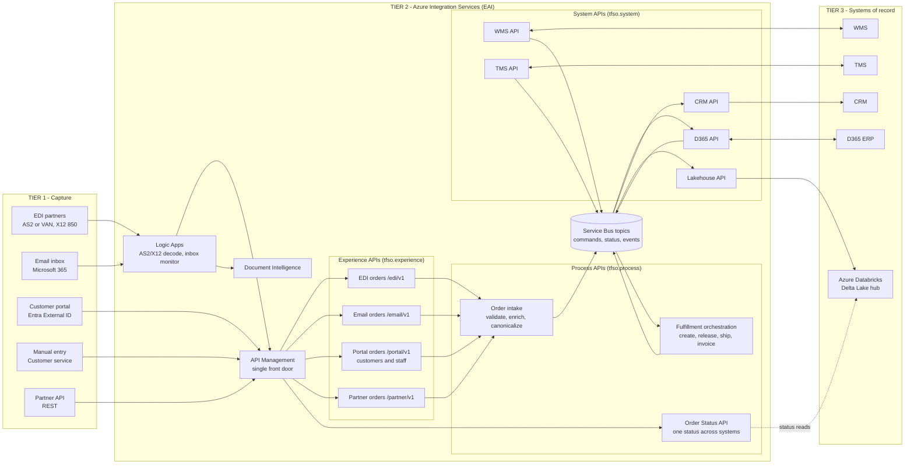
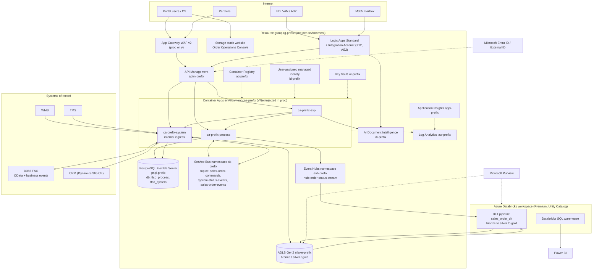
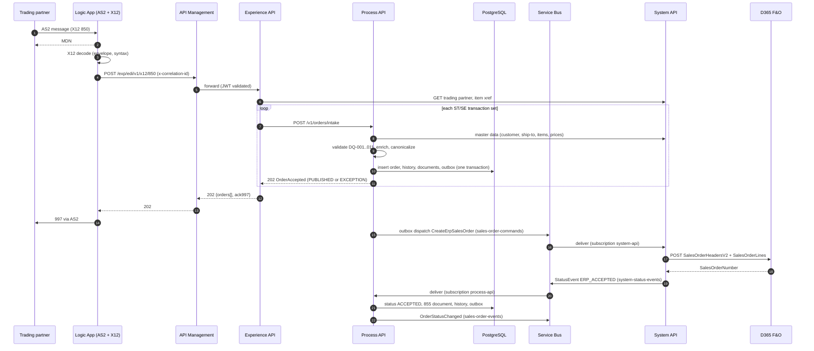
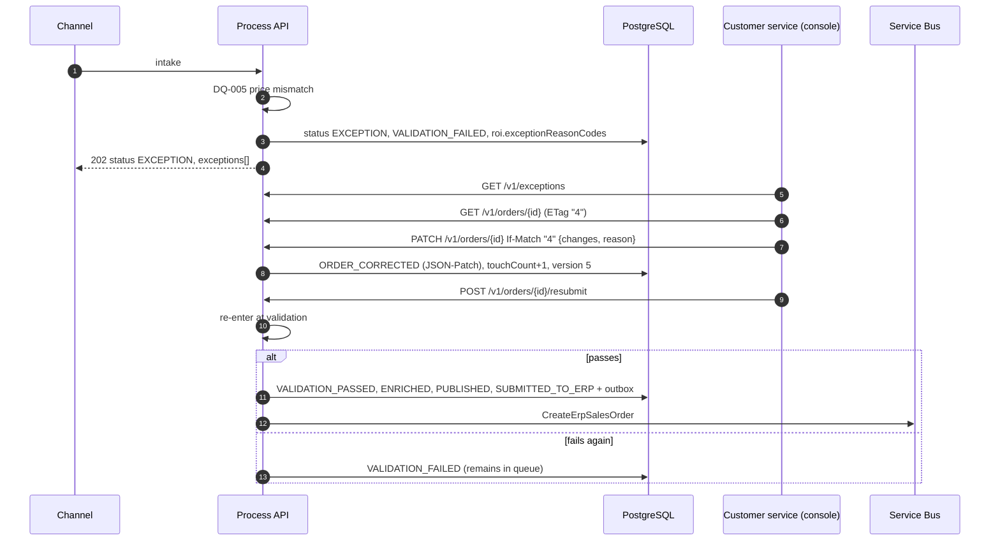
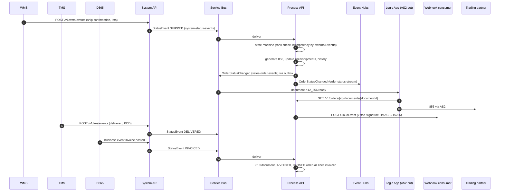
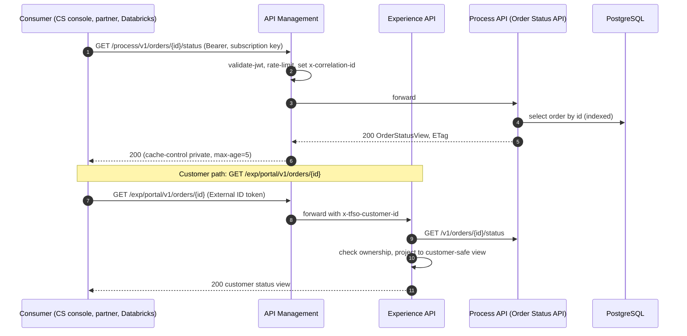
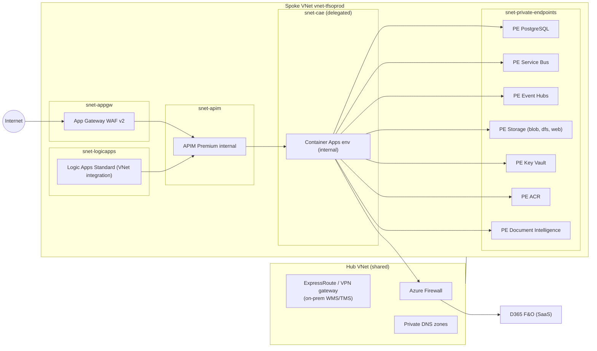

# Azure Reference Architecture – Sales Order Data Product

**Azure Integration Services with Azure Databricks as the data hub, organised as API-led Experience / Process / System layers**

| Item | Value |
|---|---|
| Document ID | TF-SO-DP-ARC-004 |
| Version | 1.0 (November 2026) |
| Related | `docs/00-solution-blueprint.md` (binding), `docs/01-requirements.md`, `docs/02-technical-design.md`, `docs/03-canonical-data-model.md` |
| Implemented by | `infra/` (Bicep), `deploy.sh`, `src/tfso/`, `frontend/`, `databricks/` |

---

## 1. Architecture principles

| # | Principle | Implication |
|---|---|---|
| P1 | **One canonical order, whatever the channel** | Every channel lands in the same Process API intake; one CDM (`cdm/sales-order.v1.schema.json`). |
| P2 | **Use only the layers a flow needs** (deck slide 10) | Order capture uses E→P→S; analytics reads the Process API or the event stream directly (P→S or event only); bulk D365 history goes S-only to Databricks. |
| P3 | **APIM is the single front door** | No service is reachable from the internet except through API Management. |
| P4 | **Messages, not calls, between tiers** | Process ↔ System communication is asynchronous over Service Bus topics with a transactional outbox; HTTP is used only for synchronous queries and master data. |
| P5 | **Idempotent and replayable** | Every message is a CloudEvent with a stable `id`; consumers deduplicate; outbox and bronze allow replay. |
| P6 | **Identity, not secrets** | Managed identities for every Azure resource hop; Key Vault for the few secrets that remain (D365 client secret, AS2 certificates, webhook secrets). |
| P7 | **Databricks is the analytical hub, not the transactional store** | Operational state lives in PostgreSQL behind the Process API; Delta Lake holds history for analytics and 7-year retention. |
| P8 | **Same code everywhere** | One container image; local, Docker and Azure differ only by environment variables (blueprint §3). |
| P9 | **Observable by correlation id** | `x-correlation-id` from APIM through every service, message and D365 call, traced in Application Insights. |

---

## 2. Logical architecture (three tiers × API-led layers)



### 2.1 Layer responsibilities

| Layer | Owns | Does not own | Implementation |
|---|---|---|---|
| Experience | Channel protocol and format (X12, email, portal JSON, partner JSON), channel auth, customer-facing response shaping (customer-safe status view), 997 synchronous acknowledgement | Business rules, status | `src/tfso/experience/` (Container App `ca-<prefix>-<env>-exp`, APIM path `/exp`) |
| Process | Canonical order, DQ rules DQ-001..DQ-011, enrichment, state machine, history, exception queue, outbound document generation (855/856/810), webhooks, KPIs, **Order Status API** | System protocols | `src/tfso/process/` (Container App `ca-<prefix>-<env>-process`, APIM path `/process`) |
| System | D365 OData and business events, WMS/TMS webhooks, CRM push, Lakehouse writer, master data provider, D365 simulator | Orchestration decisions | `src/tfso/system/` (Container App `ca-<prefix>-<env>-system`, internal ingress; APIM `/system` in non-prod only) |

### 2.2 Flows and the layers they use (deck slide 10)

| Flow | E | P | S | Path |
|---|---|---|---|---|
| Order capture (any channel) | ✔ | ✔ | ✔ | Channel → APIM → Experience → Process intake → `sales-order-commands` → System D365 |
| Status back to customer | ✔ | ✔ | ✔ | D365/WMS/TMS → System → `system-status-events` → Process → 855/856/810, webhooks, Experience status views |
| Order status for analytics | – | ✔ | – | Databricks reads Process API `/v1/orders`, or consumes `order-status-stream` on Event Hubs |
| Daily order history | – | – | ✔ | D365 bulk export (Synapse Link / data entities) → ADLS → Databricks; no business logic so a system API is enough |

---

## 3. Physical Azure architecture



Naming follows `<type>-<prefix>` where `prefix` = `tfso<env>` (for example `tfsodev`); storage and registry names drop hyphens.

---

## 4. Component catalogue

SKUs are recommendations; dev/test favour cost, prod favours resilience. All resources are deployed by `infra/main.bicep` except Databricks, Logic Apps Integration Account, App Gateway and Purview, which are shared enterprise components referenced by parameter (see §14).

| Component | Purpose | Dev SKU | Test SKU | Prod SKU | Key configuration | Scaling | HA |
|---|---|---|---|---|---|---|---|
| API Management | Single front door; products as deployed: `sales-order-data-product` (all APIs), `order-status-api` (read-only GET on `/process`), `order-console` (console key); target-state products `customer-portal`, `partners`, `internal`, `nonprod-sim`; JWT validation; rate limits; correlation id | Developer (no SLA) | Developer | Premium 1 unit (VNet internal mode) or Standard v2 | APIs `exp`, `process`, `system`; policies in `infra/apim/policies/*.xml`; named values from Key Vault | Premium units / Standard v2 scale units | Premium: availability zones, multi-region gateway optional |
| Container Apps environment | Hosts the three services | Consumption | Consumption | Workload profiles (D4) with VNet integration | Log Analytics destination; Dapr not used | Per app | Zone redundant (prod) |
| `ca-<prefix>-<env>-exp` | Experience APIs | 0.5 vCPU / 1 GiB, min 0 | min 1 | 1 vCPU / 2 GiB, min 2 max 10 | `SERVICE=experience`, ingress external (APIM-only via IP restriction / internal in prod) | HTTP concurrency 50 | ≥2 replicas across zones |
| `ca-<prefix>-<env>-process` | Process APIs + Order Status API + outbox dispatcher + `system-status-events` consumer | 0.5 / 1, min 1 | min 1 | 1 / 2, min 2 max 10 | `SERVICE=process`, `TFSO_BUS_MODE=servicebus` | HTTP concurrency 50 + KEDA Service Bus scaler on `process-api` subscription | ≥2 replicas |
| `ca-<prefix>-<env>-system` | System APIs, D365 adapter, simulator, lakehouse writer | 0.5 / 1, min 1 | min 1 | 1 / 2, min 2 max 10 | `SERVICE=system`, internal ingress, `TFSO_D365_MODE=simulator` (dev/test) / `live` (prod) | KEDA Service Bus scaler on `system-api` subscription | ≥2 replicas |
| Container Registry | Image `tfso:<git-sha>` | Basic | Basic | Premium (geo-replication, private endpoint) | Admin disabled; AcrPull for UAMI | – | Geo-replica (prod) |
| PostgreSQL Flexible Server | Operational store (orders JSONB, history, documents, outbox, subscriptions) | Burstable B1ms, 32 GB | B2s | General Purpose D4ds_v5, 256 GB, zone-redundant HA | Entra auth + password in Key Vault; PG 16; `pg_stat_statements` | Vertical; read replica for reporting | Zone-redundant HA standby; geo-redundant backup, PITR 35 days |
| Service Bus | Reliable command/event delivery | Standard | Standard | Premium 1 MU (private endpoint, geo-DR alias) | Topics: `sales-order-commands`, `system-status-events`, `sales-order-events`; duplicate detection 10 min; max delivery 5; DLQ on | Premium MU autoscale | Premium: zones + geo-DR pairing |
| Event Hubs | Status event stream for Databricks | Standard 1 TU | Standard 1 TU | Standard 2 TU auto-inflate to 10 (or Premium) | Hub `order-status-stream`, 4 partitions (prod 8), retention 7 days, consumer group `databricks` | Auto-inflate | Zone redundant |
| ADLS Gen2 (Storage, HNS) | Lakehouse zones | Standard LRS | Standard ZRS | Standard ZRS (RA-GZRS for bronze) | Containers `bronze`, `silver`, `gold`; lifecycle to cool after 90 d, archive raw after 1 y | – | ZRS / GZRS |
| Storage static website | Order Operations Console (`$web`) | Standard LRS | Standard LRS | Standard ZRS behind Front Door/App Gateway | `config.js` written at deploy time with APIM URL | – | ZRS |
| AI Document Intelligence | Extract orders from emailed PDFs | S0 | S0 | S0 (private endpoint) | Model `prebuilt-layout` or a custom PO model (`TFSO_DOCINTEL_MODEL_ID`) | – | Regional |
| Logic Apps Standard + Integration Account | AS2 receive/send, X12 decode/encode, inbox monitoring | WS1 + Integration Account Free | WS1 + Basic | WS2 + Standard IA | X12 agreements per trading partner; AS2 certificates in Key Vault | Elastic | Zone redundant (WS) |
| Key Vault | Secrets, certificates | Standard | Standard | Premium (HSM-backed keys) | RBAC mode; soft delete + purge protection | – | Built-in |
| User-assigned managed identity | One identity for the three apps | – | – | Optionally one per app in prod | Roles in §8.3 | – | – |
| Log Analytics + Application Insights | Logs, metrics, distributed traces | PAYG, 30 d | 30 d | 90 d hot + archive 2 y | Workspace-based App Insights; `APPLICATIONINSIGHTS_CONNECTION_STRING` | – | – |
| Azure Databricks | Data hub: DLT, SQL, ML | Premium, small job cluster | Premium | Premium, Unity Catalog, serverless SQL | `databricks/pipelines/` DLT; `databricks/sql/` UC DDL | Autoscale clusters | Workspace per region; tables on ZRS/GZRS |
| Microsoft Purview | Catalog and lineage | – | – | Shared enterprise | Scans ADLS and Unity Catalog | – | – |
| App Gateway WAF v2 | Internet ingress for APIM internal mode | – | – | WAF_v2, 2 instances, zones | OWASP 3.2 rule set | Autoscale | Zones |

---

## 5. Integration patterns per flow

### 5.1 EDI (X12 850 in; 997/855/856/810 out)

1. Trading partner sends 850 over AS2 (or the VAN drops it to SFTP/AS2).
2. **Logic Apps Standard** AS2 Decode verifies signature/decrypts with certificates in Key Vault and returns the MDN.
3. X12 Decode (Integration Account agreement per partner) validates the envelope and syntax. Syntax-invalid interchanges get a negative 997 from the Integration Account and never reach the APIs.
4. The Logic App posts the raw interchange text to APIM `POST /exp/edi/v1/x12/850` with header `x-partner-id` and a managed identity token.
5. The Experience API parses every ST/SE (`src/tfso/common` X12 parser), resolves the partner and items, calls Process intake per transaction set (shared `orderGroupId`), and returns `{orders[], ack997}`. The Logic App sends the 997 back via AS2 (business-level 997 from the API supersedes the syntax 997 when configured).
6. Outbound 855/856/810 are produced by the Process API on status changes, stored as documents and emitted in `OrderStatusChanged` events. In the target state a Logic App subscribed to `sales-order-events` (subscription `edi-outbound`, filter on `DOCUMENT_SENT` history entries whose `documentRef` points to an `X12_855`/`X12_856`/`X12_810` document) pulls the document via `GET /process/v1/orders/{id}/documents/{documentId}`, X12-encodes/validates with the partner agreement and sends over AS2.

In local and Docker modes, steps 2–3 are skipped: the console posts X12 text directly to the Experience API.

### 5.2 Email

1. Logic App (Office 365 Outlook connector, managed identity / connection) monitors the shared order mailbox.
2. For each message it posts `{from, subject, receivedAt, body, attachments[]}` (base64) to `POST /exp/email/v1/orders`.
3. Experience API extracts: CSV/XLSX/TXT locally; PDF via **Document Intelligence** (`TFSO_DOCINTEL_ENDPOINT`, `TFSO_DOCINTEL_MODEL_ID`) using the UAMI (`Cognitive Services User`).
4. Extraction confidence travels with the order; < 0.80 fails DQ-011 and lands in the exception queue.
5. The Logic App moves the message to a `Processed` or `Needs review` folder based on the 202 body.

### 5.3 Customer portal and manual entry

- Portal (App Service or Static Web App) authenticates customers with **Entra External ID**; customer service staff with Entra ID (workforce).
- Target state: portal calls APIM product `customer-portal` (phase 1 uses `sales-order-data-product`); APIM `validate-jwt` checks issuer/audience and maps the `customerId` claim to header `x-tfso-customer-id`, which the Experience API enforces for customer-scoped reads.
- Manual entry uses the same form and endpoint with `channel = MANUAL` and `enteredBy` from the token.

### 5.4 Partner API

- Target-state APIM product `partners` (phase 1: `sales-order-data-product`): subscription key + OAuth2 client credentials (Entra app per partner), rate limit 100 calls/min, quota per month, payload limit.
- `POST /exp/partner/v1/orders` accepts the canonical draft; status via `/exp/partner/v1/orders/{orderId}/status`; webhooks via Process `/v1/subscriptions` exposed in the partner product with the partner's customer filter forced by policy.

### 5.5 D365 Finance & Operations

| Direction | Mechanism | Detail |
|---|---|---|
| Create sales order | OData data entities | `POST /data/SalesOrderHeadersV2` then `POST /data/SalesOrderLines` (or batch `$batch`) with `dataAreaId = TFSO_D365_COMPANY`; Entra client credentials (`TFSO_D365_CLIENT_ID`, secret from Key Vault); concurrency cap 8 per replica to respect D365 throttling (priority-based throttling returns 429 + `Retry-After`) |
| Master data | OData | `CustomersV3`, `CustomerPostalAddresses`, `ReleasedProductsV2`, `ProductUnitOfMeasureConversions`, sales trade agreement entities; cached 15 min in System API |
| Status back | D365 Business Events | Sales order confirmed, credit hold, packing slip posted, invoice posted → HTTPS endpoint `POST /system/v1/d365/business-events` (via APIM internal product) or Service Bus endpoint |
| Bulk history | Synapse Link for Dataverse / data entity export to ADLS | Daily order history to bronze, S-only flow |

In dev/test, `TFSO_D365_MODE=simulator` runs an in-service D365 emulator (credit check, availability, ERP order numbers) and the fulfillment simulator (`/system/v1/sim/*`).

### 5.6 WMS and TMS

- WMS posts release/pick/pack/ship confirmations with lots, quantities and containers to `POST /system/v1/wms/events`.
- TMS posts load planning, carrier/SCAC, tracking and proof of delivery to `POST /system/v1/tms/events`.
- System API normalises to `StatusEvent` and publishes on `system-status-events`. Where WMS/TMS do not support webhooks, a Logic App polls their APIs or D365 warehouse events are used instead.

### 5.7 CRM

Subscription `system-crm` on `sales-order-events`; the System API upserts an order status record (Dataverse table or Dynamics 365 CE timeline activity) so account teams see live status and exceptions.

### 5.8 Lakehouse

- Process API outbox publishes every `OrderStatusChanged` to `sales-order-events` **and** to Event Hubs `order-status-stream`.
- Subscription `system-lakehouse` writes the CloudEvent as JSON lines to ADLS `bronze/order_events/ingest_date=YYYY-MM-DD/` (`TFSO_LAKEHOUSE_MODE=adls`); raw inbound documents go to `bronze/raw_documents/`.
- Databricks DLT reads Event Hubs (Kafka endpoint) for low latency and ADLS Auto Loader for completeness.

---

## 6. Sequence diagrams

### 6.1 EDI order capture, end to end



### 6.2 Exception and correction loop



### 6.3 Status events back to the customer



### 6.4 Order status query through APIM



---

## 7. Messaging topology

### 7.1 Topics and subscriptions

| Topic | Producer | Subscription | Consumer | Filter | Max delivery | Lock | Notes |
|---|---|---|---|---|---|---|---|
| `sales-order-commands` | Process API outbox | `system-api` | System API | none | 5 | 60 s | Session-less; D365 concurrency capped |
| `system-status-events` | System API | `process-api` | Process API | none | 10 | 60 s | Idempotent by `externalEventId` |
| `sales-order-events` | Process API outbox | `system-lakehouse` | System API lakehouse writer | none | 10 | 60 s | Bronze writer |
| `sales-order-events` | Process API outbox | `system-crm` | System API CRM adapter | `statusCategory` change | 10 | 60 s | |
| `sales-order-events` | Process API outbox | `process-webhooks` | Process API webhook dispatcher | none | 10 | 60 s | Fans out to `/v1/subscriptions` |
| `sales-order-events` | Process API outbox | `edi-outbound` (target state, not deployed in phase 1) | Logic App AS2 sender | `data.eventType = 'DOCUMENT_SENT'` | 10 | 5 min | 855/856/810 |

Event Hubs `order-status-stream` (consumer group `databricks`) receives the same `OrderStatusChanged` CloudEvents, partition key = `orderId` (ordering per order).

### 7.2 Envelope

CloudEvents 1.0 structured JSON: `specversion`, `id` (UUID; status events from Tier 3 use `evt-<uuid>`), `source` (`/process/sales-orders` or `/system/<d365|wms|tms>`), `type` (`tfso.salesorder.OrderStatusChanged`, `tfso.salesorder.CreateErpSalesOrder`, `tfso.salesorder.CancelErpSalesOrder`, `tfso.system.<EventType>` e.g. `tfso.system.SHIPPED`), `subject` (orderId), `time`, `datacontenttype`, `correlationid`, `data`. Service Bus `MessageId` = CloudEvent `id` so duplicate detection (10 min window) removes producer retries.

### 7.3 Reliability mechanisms

| Concern | Mechanism |
|---|---|
| Lost writes between DB and bus | **Transactional outbox**: order change + history + outbox row in one PostgreSQL transaction; dispatcher publishes and marks `dispatched_at`; retries with `next_attempt_at` backoff |
| Duplicate delivery | Consumers deduplicate on CloudEvent `id` / `externalEventId` (unique index in `order_events`) |
| Ordering | Per-order rank-based state machine tolerates reordering; Event Hubs partition by `orderId` |
| Poison messages | After max delivery → DLQ; alert `DeadLetteredMessages > 0`; replay via `deploy.sh` ops or Service Bus Explorer after fix |
| Downstream outage (D365) | Messages wait in subscription (TTL 7 days); orders remain SUBMITTED_TO_ERP; KEDA scales consumers on backlog when D365 recovers |
| Replay for analytics | Event Hubs 7-day retention; bronze is the long-term replay source; outbox table keeps 30 days |

Locally `TFSO_BUS_MODE=http` maps each topic to `POST {service}/v1/bus/{topic}`; tests use `inproc`.

---

## 8. Identity and security

### 8.1 Identities

| Principal | Type | Used by | Authenticates to |
|---|---|---|---|
| `id-<prefix>` | User-assigned managed identity | All three Container Apps | ACR, Service Bus, Event Hubs, Storage, Key Vault, PostgreSQL (Entra auth), Document Intelligence |
| Logic App system identity | System-assigned MI | Logic Apps | APIM (token), Key Vault, Service Bus |
| `app-tfso-api` | Entra app registration (API) | APIM `validate-jwt` audience | Exposes app roles `Orders.Read.All`, `Orders.Write`, `Orders.Correct`, `Orders.Admin` (target state; not created by `infra/`) |
| `app-tfso-console` | Entra SPA registration | Order Operations Console | Delegated to `app-tfso-api` |
| `app-tfso-d365` | Entra app registration | System API live mode | D365 F&O (registered in D365 Entra applications) |
| Partner apps | Entra app per partner | Partner systems | Client credentials to `app-tfso-api` |
| Customers | Entra External ID | Portal | `Customer.Self` with `customerId` claim |

### 8.2 Authorisation model

| Role | Experience | Process | System |
|---|---|---|---|
| `Customer.Self` | Portal endpoints for own customerId | – | – |
| Partner | Partner endpoints, webhooks for own customer | – | – |
| `Orders.Read.All` (CS, planning, finance, Databricks) | – | GET orders, status, history, documents, KPIs | – |
| `Orders.Write` (CS) | Portal manual entry | – | – |
| `Orders.Correct` (CS) | – | PATCH, resubmit, hold, release, cancel | – |
| `Orders.Admin` (integration) | all | all + subscriptions admin | master data, sim (non-prod) |

APIM enforces roles; services additionally check `TFSO_AUTH_MODE=entra` JWTs (defence in depth) or API keys (`TFSO_API_KEYS`) locally.

### 8.3 Azure RBAC assignments

| Scope | Role | Assignee |
|---|---|---|
| ACR | AcrPull | `id-<prefix>` |
| Service Bus namespace | Azure Service Bus Data Sender + Data Receiver | `id-<prefix>` |
| Event Hubs namespace | Azure Event Hubs Data Sender | `id-<prefix>` |
| Event Hubs namespace | Azure Event Hubs Data Receiver | Databricks access connector |
| ADLS account | Storage Blob Data Contributor | `id-<prefix>`, Databricks access connector |
| Key Vault | Key Vault Secrets User | `id-<prefix>`, APIM identity, Logic App identity |
| Document Intelligence | Cognitive Services User | `id-<prefix>`, Logic App identity |
| PostgreSQL | Entra admin / database roles `tfso_app` | `id-<prefix>` |
| Static website storage | Storage Blob Data Contributor | Deployment principal only |

### 8.4 APIM policies (in `infra/apim/policies/`)

| Scope | Policy |
|---|---|
| Global | Generate/propagate `x-correlation-id` (`set-header` with `context.RequestId` if absent); CORS for the console origin; strip `X-Powered-By`; `set-backend-service` from named values; emit to App Insights |
| Product `customer-portal` (target state) | `validate-jwt` (External ID), map `customerId` claim → `x-tfso-customer-id`; rate limit 60/min per user |
| Product `partners` | `validate-jwt` (client credentials, role Partner), `rate-limit-by-key` 100/min, `quota-by-key` 200k/month, payload `<= 10 MB` |
| Product `internal` | `validate-jwt` (workforce), role check by operation |
| Product `nonprod-sim` (target state; phase 1 publishes the `system` API only outside prod) | `/system/*` exposed only when environment ≠ prod (not deployed in prod) |
| Operation `GET /process/v1/orders/{id}/status` | `cache-lookup`/`cache-store` 5 s vary by `Authorization` |

### 8.5 Network security

| Control | Dev / test | Prod |
|---|---|---|
| Ingress | APIM public; Container Apps external ingress restricted to APIM egress IPs; System API internal | App Gateway WAF v2 → APIM (internal VNet mode) → Container Apps (internal environment) |
| Data services | Public endpoints with firewall (allow Azure services + deployer IP) | Private endpoints for PostgreSQL, Service Bus Premium, Event Hubs, Storage, Key Vault, ACR, Document Intelligence; public access disabled |
| DNS | Azure default | Private DNS zones linked to hub |
| Egress | Default | Azure Firewall in hub; allow-list D365 (`*.operations.dynamics.com`), `login.microsoftonline.com`, partner webhook hosts |
| Threat protection | Defender for Cloud free tier | Defender for Containers, Storage, Key Vault, APIs, Open-source databases |

### 8.6 Prod network (hub-spoke)



---

## 9. Data architecture (Databricks as hub)

### 9.1 Medallion layers

| Layer | Storage | Tables (Unity Catalog `tfso_<env>`) | Content | Retention |
|---|---|---|---|---|
| Bronze | `bronze` container | `bronze.order_events_raw`, `bronze.raw_documents`, `bronze.d365_sales_order_history` | CloudEvents and raw inbound documents as received (append-only), D365 daily history | 7 years (cool after 90 days) |
| Silver | `silver` container | `silver.sales_order` (current state, one row per order, SCD1), `silver.sales_order_line`, `silver.order_history` (one row per lifecycle event), `silver.order_document`, `silver.order_exception` | **Sales Order data product**, validated with DLT expectations mirroring DQ rules | 7 years |
| Gold | `gold` container | `gold.orders_daily_by_channel`, `gold.order_cycle_time`, `gold.touchless_rate`, `gold.exception_reasons`, `gold.ack_timeliness_by_partner`, `gold.otif`, `gold.customer_order_summary`, `gold.roi_benefit` | Order, customer and fulfillment marts | 7 years |
| Serve | – | Databricks SQL, Power BI (Direct Lake / DirectQuery), Delta Sharing shares `share_sales_order_status`, ML feature tables | | |

Pipeline: `databricks/pipelines/` (Delta Live Tables, SQL). Ingestion uses Auto Loader on `bronze/order_events/` plus a streaming read from Event Hubs (Kafka surface) for low latency; silver applies `APPLY CHANGES INTO` keyed by `orderId` sequenced by `data.version`.

### 9.2 Governance

- **Unity Catalog**: catalog per environment, schemas `bronze`, `silver`, `gold`; table and column comments taken from the CDM; owner = product owner group; row filters for customer-scoped shares; column masks on contact PII.
- **Purview**: scans ADLS and Unity Catalog (lineage from Event Hubs → bronze → silver → gold); glossary terms from `docs/01-requirements.md` §20.
- **Data contract**: `cdm/sales-order.v1.schema.json` is the contract; DLT expectations fail a batch on schema-breaking drift; a breaking change creates `v2` tables alongside `v1`.
- **Delta Sharing**: share selected gold tables with customers/partners (e.g. OTIF and acknowledgement timeliness) without copies.

---

## 10. Observability

### 10.1 Tracing

- APIM generates `x-correlation-id` when absent and logs to App Insights.
- Each service (`tfso.common` telemetry) uses Azure Monitor OpenTelemetry when `APPLICATIONINSIGHTS_CONNECTION_STRING` is set; spans carry `order.id`, `order.channel`, `order.status`, `correlation.id`.
- The correlation id is copied into every CloudEvent (`correlationid`) and Service Bus application property, and into D365 OData calls as `x-ms-client-request-id`.

### 10.2 KQL samples

End-to-end trace for one order:

```kusto
union AppRequests, AppDependencies, AppTraces, AppExceptions
| where Properties["order.id"] == "SO-01JD8Z3Q2K" or Properties["correlation.id"] == "c0ffee-1234"
| project TimeGenerated, AppRoleName, Type, Name, ResultCode, DurationMs, Message
| order by TimeGenerated asc
```

Order Status API latency by operation (p95, last hour):

```kusto
AppRequests
| where AppRoleName == "tfso-process" and Name startswith "GET /v1/orders"
| where TimeGenerated > ago(1h)
| summarize p95=percentile(DurationMs, 95), rps=count()/3600.0 by Name
```

Status freshness (lag between source event and data product):

```kusto
AppTraces
| where Message == "status_event_applied"
| extend lag_s = todouble(Properties["freshness.seconds"])
| summarize p95_lag=percentile(lag_s, 95) by bin(TimeGenerated, 5m)
```

Exception queue inflow by DQ code:

```kusto
AppTraces
| where Message == "validation_failed"
| mv-expand code = todynamic(Properties["dq.codes"])
| summarize count() by tostring(code), bin(TimeGenerated, 1h)
```

### 10.3 Alerts

| Alert | Signal | Threshold | Action |
|---|---|---|---|
| Dead-lettered messages | Service Bus `DeadletteredMessages` | > 0 for 5 min | Integration on-call |
| Command backlog | `ActiveMessages` on `sales-order-commands/system-api` | > 500 for 10 min | Integration on-call (D365 slow/down) |
| Status API latency | App Insights p95 `GET /v1/orders/*` | > 300 ms for 15 min | Integration on-call |
| Intake latency | p95 intake | > 2 s for 15 min | Integration on-call |
| 5xx rate | APIM `Requests` failed | > 1 % for 5 min | Integration on-call |
| Status freshness | KQL above | p95 > 60 s | Integration on-call |
| Exception queue age | Custom metric `exceptions.oldest_minutes` | > 30 | CS lead |
| Webhook disabled | Trace `webhook_disabled` | any | Partner onboarding |
| PostgreSQL CPU / storage | Metrics | > 80 % | Platform team |

---

## 11. Environments and CI/CD

| Environment | Purpose | D365 mode | Network | Data |
|---|---|---|---|---|
| local | Developer laptop, `./deploy.sh local` | simulator | localhost | SQLite, HTTP bus, file lakehouse |
| docker | Integration test, `./deploy.sh docker` | simulator | compose network | PostgreSQL container |
| dev | Shared development, `./deploy.sh azure dev` | simulator | public + restrictions | synthetic |
| test | SIT/UAT with D365 test company | live (test company) | public + restrictions | masked copies |
| prod | Production | live | private (hub-spoke) | production |

Pipeline (GitHub Actions, recommended):

```mermaid
flowchart LR
  PR["Pull request"] --> CI["CI: ruff, pytest (in-process lifecycle),<br/>JSON Schema regen check, bicep build"]
  CI --> IMG["Build image tfso:sha<br/>az acr build"]
  IMG --> WHATIF["az deployment group what-if<br/>(infra/main.bicep)"]
  WHATIF --> DEV["Deploy dev<br/>deploy.sh azure dev"]
  DEV --> SMOKE["Smoke test<br/>deploy.sh test --target dev"]
  SMOKE --> TEST["Deploy test (manual approval)"]
  TEST --> PROD["Deploy prod (approval, new revision 0 % traffic)"]
  PROD --> SHIFT["Traffic shift 10 % → 100 %<br/>Container Apps revisions"]
```



- GitHub OIDC federated credential to Azure (no stored secrets).
- Container Apps multiple-revision mode in prod: deploy new revision with 0 % traffic, smoke test via revision URL, shift traffic, keep previous revision for instant rollback.
- Database migrations run as a Container Apps job before traffic shift (schema is additive; JSONB documents carry `schemaVersion`).
- `deploy.sh azure` performs the same steps for a single operator: Bicep deploy → `az acr build` → update apps → upload console with generated `config.js` → APIM import → smoke test.

---

## 12. Resiliency and disaster recovery

| Component | Within region | Cross region (prod) | RPO | RTO |
|---|---|---|---|---|
| Container Apps | Zone-redundant env, ≥2 replicas | Redeploy in paired region from IaC + ACR geo-replica | 0 (stateless) | < 1 h |
| PostgreSQL | Zone-redundant HA (automatic failover ~60–120 s) | Geo-redundant backup restore or cross-region read replica promotion | ≤ 15 min (replica) / ≤ 1 h (geo-backup) | < 4 h |
| Service Bus Premium | Zones | Geo-DR alias (metadata) + replay from outbox (`dispatched_at` reset for window) | Messages in flight are recovered from outbox | < 1 h |
| Event Hubs | Zones | Geo-DR alias; consumers resume; gaps backfilled from bronze/outbox | ≤ 15 min | < 1 h |
| ADLS | ZRS | RA-GZRS for bronze | ≤ 15 min | < 4 h |
| APIM Premium | Zones | Additional regional gateway | 0 | minutes |
| Key Vault | Built-in | Paired-region read-only failover | 0 | automatic |
| Databricks | – | Secondary workspace; tables on GZRS; DLT re-run | ≤ 15 min | < 4 h |

Replay strategy: because the Process API persists every outbound message in the outbox and every event in append-only history, any downstream (D365, lakehouse, webhooks, Event Hubs) can be rebuilt by re-dispatching outbox rows for a time window; silver can be rebuilt from bronze.

---

## 13. Capacity, scaling and cost

### 13.1 Sizing at peak (NFR-006: 50,000 orders/day)

| Load | Peak rate | Design capacity |
|---|---|---|
| Intake | 50 orders/s burst (EDI batch windows) | 10 replicas × ~10 orders/s each (validation + 1 DB transaction) |
| Status reads | 200 req/s sustained | 2–4 process replicas; single indexed PK lookup + APIM 5 s cache |
| Status events | 500k/day ≈ 6/s average, 60/s peak | 1 MU Service Bus Premium handles > 1,000 msg/s |
| D365 creates | 50k/day ≈ 0.6/s average, 15/s peak | Capped at 8 concurrent per replica, KEDA up to 4 system replicas; queue absorbs bursts |
| Storage | ~20 KB/order document + 15 events × 1 KB | ≈ 1.75 GB/day raw, ≈ 650 GB/yr operational before pruning (13-month online retention) |
| Event Hubs | 60 events/s peak × 2 KB | 1 TU (1 MB/s in) with auto-inflate headroom |

### 13.2 Estimated monthly cost (USD, list price, estimate only)

These are planning estimates, not quotes; validate with the Azure Pricing Calculator and enterprise agreement pricing.

| Component | Dev | Test | Prod |
|---|---|---|---|
| API Management | ~$50 (Developer) | ~$50 | ~$2,800 (Premium 1 unit) or ~$700 (Standard v2) |
| Container Apps (3 apps) | $10–40 | $40–120 | $400–900 (workload profile, zone redundant) |
| PostgreSQL Flexible Server | $15–30 | $30–60 | $700–1,100 (D4ds_v5 HA + storage + backup) |
| Service Bus | ~$10 (Standard) | ~$10 | ~$680 (Premium 1 MU) |
| Event Hubs | ~$25 | ~$25 | $50–250 |
| Storage (ADLS + static site) | $5–20 | $10–40 | $100–300 |
| Document Intelligence | $0–20 | $10–50 | $100–500 (volume-based) |
| Logic Apps Standard + Integration Account | $180–300 | $300–600 | $900–1,500 |
| Key Vault, ACR, identity | $10–20 | $10–20 | $60–200 (ACR Premium) |
| Log Analytics / App Insights | $20–60 | $50–150 | $300–800 |
| Databricks (DLT + SQL) | $100–300 | $200–600 | $1,500–4,000 |
| App Gateway WAF v2 + private endpoints | – | – | $400–700 |
| **Total (approx.)** | **$450–900** | **$800–1,800** | **$8,000–14,000** |

Cost levers: Standard v2 instead of Premium APIM where VNet internal mode is not required; Container Apps min replicas 0 in dev; Databricks serverless with auto-stop; lifecycle policies on bronze.

---

## 14. Architecture decision records

### ADR-001 – Azure Container Apps for the API services (over Azure Functions)

- **Context**: Three long-running HTTP APIs with background workers (outbox dispatcher, Service Bus consumers, simulator), Python/FastAPI, need for local parity.
- **Decision**: Container Apps (one image, three apps) with KEDA scaling on HTTP and Service Bus.
- **Consequences**: Same container runs locally and in Azure; revisions enable blue/green; no Functions-specific programming model. Functions remain an option for small event handlers (the deck slide 11 "Functions: validation and master data enrichment" role is fulfilled by the Process/System containers).

### ADR-002 – PostgreSQL Flexible Server with JSONB document store (over Cosmos DB)

- **Context**: The canonical order is a document; the Process API also needs transactions spanning order, history, documents and outbox, plus ad-hoc search.
- **Decision**: PostgreSQL with the order as JSONB plus projected, indexed columns; append-only history table; outbox in the same database.
- **Consequences**: Single ACID transaction for the outbox pattern; SQL for search and KPIs; SQLite locally via SQLAlchemy. Cosmos DB would need its own change feed for outbox semantics and has higher cost at this volume. Revisit if global multi-region writes become a requirement.

### ADR-003 – Service Bus for commands and status (over Event Grid), plus Event Hubs for analytics streaming

- **Context**: Commands to D365 require ordered retry, DLQ, back-pressure and at-least-once semantics; analytics needs a high-throughput replayable stream.
- **Decision**: Service Bus topics for `sales-order-commands`, `system-status-events`, `sales-order-events`; Event Hubs `order-status-stream` for Databricks. Event Grid is used only where Azure services emit events natively (e.g. storage).
- **Consequences**: Mature retry/DLQ/duplicate detection; two messaging services to operate.

### ADR-004 – Transactional outbox

- **Context**: Order state and published events must never diverge ("no order is dropped").
- **Decision**: Write outbox rows in the same transaction as order changes; a dispatcher publishes with backoff; consumers idempotent.
- **Consequences**: At-least-once delivery, replay from the outbox; small dispatch latency (< 1 s typical).

### ADR-005 – Azure Databricks as the data hub

- **Context**: Deck slide 11 positions Databricks as hub for history, analytics, sharing and ML.
- **Decision**: Delta Lake on ADLS with Unity Catalog; DLT medallion; Event Hubs + bronze landing; Delta Sharing for external consumers.
- **Consequences**: Operational queries stay in the Order Status API; analytical queries in Databricks SQL. No transactional dependency on Databricks.

### ADR-006 – API Management as the single front door

- **Context**: Multiple audiences (customers, partners, staff, Databricks) and products with different auth and limits.
- **Decision**: All external traffic through APIM (Premium internal + App Gateway in prod); products per audience; policies for JWT, rate limits, correlation and caching.
- **Consequences**: Central security and analytics; APIM is a critical dependency (zone redundant in prod).

### ADR-007 – One container image, many services

- **Context**: Shared CDM, state machine, X12 library and telemetry across three services.
- **Decision**: Single Python package `tfso` and image; `SERVICE` env var selects `experience`, `process`, `system` (and `gateway` locally).
- **Consequences**: One build, consistent versions, simpler supply chain; services still deploy and scale independently as separate Container Apps.

### ADR-008 – D365 simulator in non-production

- **Context**: D365 test environments are scarce and slow to reset; the full lifecycle (credit hold, partial ship, invoice) must be testable on every commit.
- **Decision**: System API implements `TFSO_D365_MODE=simulator` (credit, availability, ERP numbers) and a fulfillment simulator (`/system/v1/sim/*`, `TFSO_SIM_AUTOPROGRESS`), sharing the same event contracts as the live adapters.
- **Consequences**: Deterministic end-to-end tests and demos; the simulator path is excluded from prod by APIM product and environment flag; live adapter covered by SIT against the D365 test company.

---

## 15. How this repository implements the architecture

| Architecture element | Repository location | Notes |
|---|---|---|
| Binding contract | `docs/00-solution-blueprint.md` | Names, routes, statuses, env vars |
| Canonical data model | `src/tfso/common/` (Pydantic), `cdm/sales-order.v1.schema.json`, `cdm/examples/` | Schema generated from code |
| Experience APIs | `src/tfso/experience/` | Portal, partner, EDI (X12 parse + 997), email (CSV/XLSX/TXT/PDF, Document Intelligence) |
| Process APIs / Order Status API | `src/tfso/process/` | Intake, DQ rules, enrichment, state machine, history, exceptions, documents (855/856/810), webhooks, KPIs, outbox dispatcher |
| System APIs | `src/tfso/system/` | Master data, D365 live/simulator, WMS/TMS webhooks, CRM, lakehouse writer, fulfillment simulator |
| Local APIM stand-in | `src/tfso/gateway/` | Same `/api/exp`, `/api/process`, `/api/system` paths as APIM |
| Messaging abstraction | `src/tfso/common/` bus | `http`, `servicebus`, `inproc` modes |
| Order Operations Console | `frontend/` | Static SPA; `config.js` generated per environment |
| Azure infrastructure | `infra/main.bicep`, `infra/modules/*.bicep` | Log Analytics, App Insights, Key Vault, UAMI, ACR, Service Bus (3 topics + subscriptions), Event Hubs, ADLS Gen2 (bronze/silver/gold), static website, PostgreSQL Flexible Server, Document Intelligence, Container Apps env + 3 apps, APIM |
| APIM policies | `infra/apim/policies/` | Global, product and operation policies |
| Lakehouse | `databricks/` | DLT bronze/silver/gold pipeline and Unity Catalog DDL |
| Container build | `docker/Dockerfile`, `docker-compose.yml` | One image; compose mirrors Azure topology |
| Single deploy script | `deploy.sh` | `local`, `docker`, `azure`, `test`, `destroy` |
| Tests | `tests/` | In-process end-to-end lifecycle |

Components referenced but not provisioned by `infra/main.bicep` (shared enterprise or tenant-level): Azure Databricks workspace and Unity Catalog metastore, Logic Apps Integration Account with trading-partner agreements, App Gateway WAF and hub networking, Microsoft Purview, Entra ID app registrations and External ID tenant. Their integration points are parameters and documented above.
