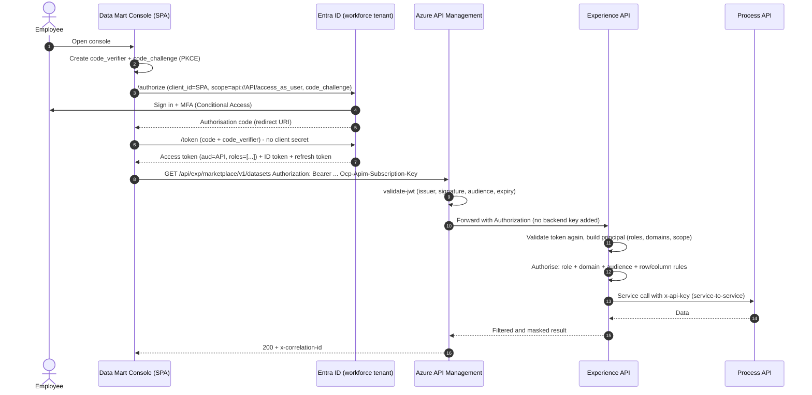
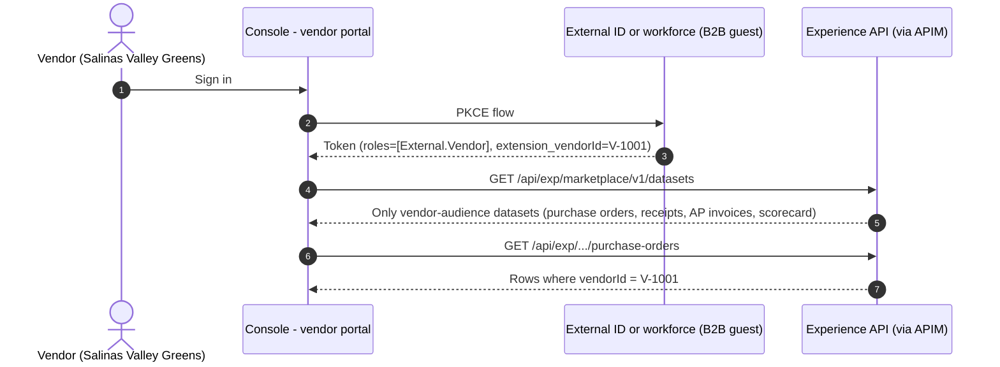

# Single sign-on and access control (Microsoft Entra ID)

This guide explains how people sign in to the Taylor Farms Enterprise Data Mart and how the platform decides what each person can see. The binding technical contract is [docs/07-data-mart-access-contract.md](07-data-mart-access-contract.md). Where the two differ, docs/07 wins.

**Contents**

1. [How it fits together](#1-how-it-fits-together)
2. [Identity model: internal, customers, vendors](#2-identity-model)
3. [App roles](#3-app-roles)
4. [Groups strategy](#4-groups-strategy)
5. [Row- and column-level security](#5-row-and-column-level-security)
6. [Local and test sign-in (dev personas)](#6-local-and-test-sign-in-dev-personas)
7. [Step-by-step setup](#7-step-by-step-setup)
8. [Token claims reference](#8-token-claims-reference)
9. [Configuration reference](#9-configuration-reference)
10. [Troubleshooting](#10-troubleshooting)
11. [Security notes](#11-security-notes)

---

## 1. How it fits together

There are three authentication modes, set with `TFSO_AUTH_MODE` (docs/07 §1):

| Mode | Where | How a user is identified |
|---|---|---|
| `entra` | Azure; **required for prod** | `Authorization: Bearer <access token>` issued by the workforce tenant or by Entra External ID |
| `dev` | Your laptop and non-prod Azure | `x-dev-persona: <persona id>`, chosen on the sign-in page. Refused when `TFSO_ENV=prod` |
| `apikey` | Legacy and automation | `x-api-key` only (service principal) |

In every mode, `x-api-key` identifies the **service principal**, which is for system-to-system calls only. If a request carries both a user identity and a key, the user identity wins, so a signed-in person never runs with service rights.

### 1.1 Internal user (workforce tenant, authorisation code + PKCE)



APIM validates the token at the edge. The Experience API validates it again and makes every authorisation decision, so the rules are enforced even if a request bypasses APIM. Process and System APIs are called by the Experience API with the service key. They are not reachable with a user token.

### 1.2 External customer (Entra External ID, or B2B guest)

```mermaid
sequenceDiagram
    autonumber
    actor C as Customer buyer (FreshMart)
    participant SPA as Console - customer portal
    participant XID as Entra External ID tenant (ciamlogin.com)
    participant APIM as API Management
    participant EXP as Experience API
    C->>SPA: "Sign in as a customer or vendor"
    SPA->>XID: /authorize (externalAuthority, PKCE)
    XID->>C: Email one-time passcode / password / social
    XID-->>SPA: Code -> token (roles=[External.Customer], extension_customerId=C-1001)
    SPA->>APIM: GET /api/exp/portal/v1/my/orders  Bearer
    APIM->>APIM: validate-jwt (accepts the External ID issuer too)
    APIM->>EXP: Forward
    EXP->>EXP: principal.type=external, scope.customerIds=[C-1001]
    EXP-->>SPA: Only C-1001 orders, shipments, invoices; PII of other parties masked
```

A B2B guest follows the same flow as 1.1: the guest signs in with their own company account, but the token is issued by the Taylor Farms workforce tenant. The customer or vendor id then comes from a directory extension attribute set on the guest user.

### 1.3 External vendor



---

## 2. Identity model

| Population | Recommended identity | Why |
|---|---|---|
| Employees and contractors | **Workforce tenant** (Taylor Farms Entra ID) | Existing accounts, MFA and Conditional Access, joiner-mover-leaver handled by HR provisioning |
| A **few** strategic partners (tens of users) | **B2B guest** in the workforce tenant | No extra tenant. Guests use their own company credentials. Governed with access reviews and entitlement management |
| Customers and vendors **at scale** (hundreds to thousands, self-service) | **Entra External ID** (customer tenant, `*.ciamlogin.com`) | Built for external users: branded sign-up and sign-in, email OTP or social identities, custom attributes (`customerId`, `vendorId`), a separate directory so partners never appear in your workforce tenant, and pricing per monthly active user |

**Recommendation:** start with B2B guests for a pilot with a handful of partners. Move customers and vendors to External ID before a broad rollout. Both can run side by side: the API trusts the workforce issuer and one External ID issuer (`TFSO_ENTRA_EXTERNAL_ISSUER`).

How an external user is tied to their data:

- **External ID:** the custom user attributes `customerId` / `vendorId` (and optionally `regions`) are emitted as the claims `extension_customerId` / `extension_vendorId` / `extension_regions`.
- **B2B guest:** set the same values on the guest user as directory extension attributes, and add them as optional claims on the API app.
- The claim names can be changed with `TFSO_CLAIM_CUSTOMER`, `TFSO_CLAIM_VENDOR` and `TFSO_CLAIM_REGIONS`. Multiple values are comma-separated, for example `C-1001,C-1002`.

An external user without the matching id claim gets no rows. The platform fails closed.

---

## 3. App roles

App roles are defined once, on the **Taylor Farms Data Mart API** app registration, by `scripts/entra-setup.sh`. They appear in the access token's `roles` claim.

| Role | Kind | Grants |
|---|---|---|
| `DataMart.Admin` | platform | Everything, including **Access & roles** administration |
| `DataMart.Steward` | platform | Approve or reject access requests; see every domain's metadata |
| `DataMart.Export` | platform | Export datasets (CSV/Excel/Parquet). Without it: preview only |
| `PII.Read` | platform | See personal data (names, emails, phone numbers, addresses) unmasked |
| `Orders.Read` | platform | Order Status API and the Monitor pages |
| `Orders.Operate` | platform | Create, correct, hold, cancel and resubmit orders; run the simulator |
| `Domain.SalesOrder.Read` | domain | Sales Order domain datasets |
| `Domain.Customer.Read` | domain | Customer domain datasets |
| `Domain.Product.Read` | domain | Product domain datasets |
| `Domain.Logistics.Read` | domain | Logistics domain datasets |
| `Domain.Vendor.Read` | domain | Vendor domain datasets |
| `Domain.Procurement.Read` | domain | Procurement domain datasets |
| `Domain.Finance.Read` | domain | Finance domain datasets |
| `External.Customer` | external | Customer portal; rows restricted to the user's customer ids |
| `External.Vendor` | external | Vendor portal; rows restricted to the user's vendor ids |

Roles are additive. A typical analyst gets `Orders.Read` + two or three domain roles. Give `PII.Read` and `DataMart.Export` only to people whose job needs them.

Every role allows the member types **User** and **Application**, so a daemon (for example a Fabric pipeline using client credentials) can be granted a domain role as an application permission.

---

## 4. Groups strategy

Do not assign roles to individuals. Assign them to groups and manage group membership.

- `scripts/entra-setup.sh --create-groups` creates one security group per role, named `DM-<Role>` (for example `DM-Domain.Finance.Read`), and assigns each group to its role. The script prints the group ids.
- Build **job-based access packages** in Entra ID Governance (entitlement management) that bundle several groups. Examples:
  - *Sales analyst* = `DM-Orders.Read` + `DM-Domain.SalesOrder.Read` + `DM-Domain.Customer.Read` + `DM-Domain.Product.Read` + `DM-Domain.Logistics.Read` + `DM-DataMart.Export`.
  - *Finance controller*, *Procurement buyer*, and so on, mirroring the dev personas in §6.
- Make each **domain owner** the approver for their domain group. Run a **quarterly access review** for `PII.Read`, `DataMart.Export` and all `External.*` groups.
- Assigning groups to app roles requires **Entra ID P1**. Nested groups are not expanded for app roles: put users directly in the `DM-*` groups, or in access packages that do.
- External ID tenants do not use these groups. Assign `External.Customer` / `External.Vendor` to the users there, either directly or through a group in that tenant.

Optional: `TFSO_GROUP_ROLE_MAP` (JSON, `{"<group object id>": "<role>"}`) lets the API map `groups` claims to roles. Use it only when app-role assignment is not possible. App roles are the recommended way.

---

## 5. Row- and column-level security

Authorisation happens in the Experience API after the token is validated. For each request:

1. **Dataset audience.** Every dataset is labelled `internal`, `customer` or `vendor` (docs/07 §5). External users only see datasets for their audience. Internal users see internal datasets, subject to the next rule.
2. **Domain.** Every dataset belongs to one domain (Sales Order, Customer, Product, Logistics, Vendor, Procurement, Finance). An internal user needs `Domain.<X>.Read` for that domain, or `DataMart.Admin`. `DataMart.Steward` sees every domain's metadata (catalogue cards) but not the rows.
3. **Rows.**
   - External customer: rows where `customerId ∈ scope.customerIds`. The product catalogue (`items`) is public to all customers.
   - External vendor: rows where `vendorId ∈ scope.vendorIds`.
   - Regional internal users (claim `extension_regions`, for example `WEST`): rows in those regions only.
4. **Columns.** Columns tagged as PII are masked (for example `j***@freshmart.com`) unless the user has `PII.Read`. Columns that external users should never see, such as cost and margin, are removed for external principals.
5. **Actions.** Export needs `DataMart.Export`. Order changes need `Orders.Operate`. Access-request approval needs `DataMart.Steward` or `DataMart.Admin`.

Every response is the same shape whatever the user's rights, minus rows and columns, so the console never needs special cases. Denied requests return `403` with an RFC 7807 problem body that explains which role is missing. The **Request access** button creates an access request that a steward approves.

---

## 6. Local and test sign-in (dev personas)

`./deploy.sh local` (and `deploy.ps1`) starts the stack with `TFSO_AUTH_MODE=dev`. Open http://localhost:8080 and pick a persona on the sign-in page.

| Persona | Who | Try |
|---|---|---|
| `admin` | Avery Admin | Everything, including **Access & roles** |
| `sales.analyst` | Sam Analyst | Sales, customer, product and logistics datasets; export; PII masked |
| `cs.agent` | Casey Service | Operate orders; PII visible |
| `regional.gm.west` | Morgan West | Same datasets, West region rows only |
| `procurement.buyer` | Pat Buyer | Procurement, vendor and product datasets |
| `finance.controller` | Frankie Finance | Finance plus related domains; steward approvals |
| `ext.customer.freshmart` | Pat Rivera (FreshMart, external) | Customer portal: FreshMart (`C-1001`) orders, shipments and invoices only |
| `ext.vendor.salinas` | Jordan Greens (Salinas Valley Greens, external) | Vendor portal: `V-1001` purchase orders, receipts, AP invoices and scorecard |

Calling the API directly in dev mode:

```bash
curl -s -H "x-dev-persona: ext.customer.freshmart" http://localhost:8080/api/exp/auth/v1/me
```

`x-api-key: local-dev-key` still acts as the service principal, which the smoke test and demo-data loader use.

Non-prod Azure environments without Entra settings also deploy in `dev` mode. Anyone who can reach the console URL can then choose any persona, so treat those environments as test-only, with no real data. Production refuses `dev`.

---

## 7. Step-by-step setup

### 7.1 Prerequisites

- An Entra ID account that can create app registrations and grant admin consent (Cloud Application Administrator plus Privileged Role Administrator, or Global Administrator).
- Azure Cloud Shell (bash), or az CLI 2.50+ and python3.
- Entra ID P1, if you want to assign groups to roles or use Conditional Access.
- Optional, for customers and vendors at scale: an **Entra External ID** tenant. Create one in the Entra admin center under **Overview → Manage tenants → Create → External**.

### 7.2 Register the apps

1. Deploy once without SSO (non-prod) to learn the console URL, or use your custom domain:

   ```bash
   ./deploy.sh azure --env dev
   ```

2. Register the API and console apps, groups optional:

   ```bash
   scripts/entra-setup.sh --env dev --console-url https://<storage>.z13.web.core.windows.net/ --create-groups
   ```

   The script is idempotent: re-run it whenever the console URL changes. It creates:
   - **Taylor Farms Data Mart API**:
     - `api://<appId>` with the delegated scope `access_as_user`;
     - the 15 app roles above, with stable ids;
     - v2 access tokens;
     - optional claims `email`, `preferred_username`, `idtyp` and `acct`;
     - **user assignment required**, so unassigned people cannot get a token.
   - **Taylor Farms Data Mart Console**:
     - a single-page app with redirect URIs `<console URL>` and `http://localhost:8080/`;
     - authorisation code + PKCE, no secret, implicit grant off;
     - permission to `access_as_user`, with admin consent.
   - The file `.deploy/dev.entra.env`, holding the tenant id, the client ids, the audience, the authority and the scope. It contains no secrets.

3. Assign people. In **Entra admin center → Enterprise applications → Taylor Farms Data Mart API → Users and groups → Add assignment**, choose users or the `DM-*` groups, then the role.

4. Deploy with SSO:

   ```bash
   ./deploy.sh azure --env dev
   ```

   `deploy.sh` finds `.deploy/dev.entra.env` and deploys with `authMode=entra`. It configures:
   - APIM `validate-jwt`;
   - the container apps' `TFSO_ENTRA_*` settings;
   - the `auth` block in the console's `config.js`.

### 7.3 GitHub Actions

`.deploy/` is not committed. For the **Deploy to Azure** workflow, copy the values from `.deploy/<env>.entra.env` into **GitHub → Settings → Environments → <env> → Variables**:

- `TFSO_ENTRA_TENANT_ID`, `TFSO_ENTRA_API_CLIENT_ID`, `TFSO_ENTRA_SPA_CLIENT_ID`;
- optionally `TFSO_ENTRA_AUDIENCE`, `TFSO_ENTRA_EXTERNAL_ISSUER` and `TFSO_ENTRA_EXTERNAL_AUTHORITY`.

They are identifiers, not secrets. The prod deployment fails with a clear message until they are set.

### 7.4 Customers and vendors with External ID

```bash
scripts/entra-setup.sh --env prod --console-url https://console.example.com/ --external-tenant <external-tenant-id>
```

The script signs in to the External ID tenant and does the following:

- registers the API and console apps there;
- creates the custom attributes `customerId`, `vendorId` and `regions`;
- writes `TFSO_ENTRA_EXTERNAL_ISSUER` (`https://<tid>.ciamlogin.com/<tid>/v2.0`) and the external authority to the env file.

Then finish in the portal (the script prints the same steps):

1. **User flows → New user flow (sign up and sign in).**
   - Choose email one-time passcode, or email and password. Social identity providers are optional.
   - Collect the display name.
   - Add the console app to the flow.
2. **Claims.** Emit `customerId`, `vendorId` and `regions` in the API's access token as `extension_customerId`, `extension_vendorId` and `extension_regions`. Configure this on the API's enterprise application, under **Single sign-on → Attributes & Claims**.
3. **Onboarding.** Either:
   - invite partners and disable self-service sign-up; or
   - allow sign-up, and activate a partner by assigning `External.Customer` / `External.Vendor` and setting `customerId` / `vendorId` on the user. A user without the role cannot get a token, because assignment is required.
4. Redeploy. APIM and the API now trust both issuers. The console shows **Sign in as a customer or vendor**, which uses `externalAuthority`.

### 7.5 B2B guests (few partners)

1. **Invite the guest.** Go to **Entra admin center → Users → Invite external user**.
2. **Assign the role.** Add the guest to `DM-External.Customer` or `DM-External.Vendor`, or assign the role directly.
3. **Set the id.**
   - Set the customer or vendor id on the guest as a directory extension attribute.
   - Add it as an optional claim on the API app (Token configuration). The claim name must match `TFSO_CLAIM_CUSTOMER` / `TFSO_CLAIM_VENDOR`.
4. Apply a **cross-tenant access** policy and Conditional Access (MFA) to guests.

---

## 8. Token claims reference

Access token issued for the API (v2):

| Claim | Example | Used for |
|---|---|---|
| `iss` | `https://login.microsoftonline.com/<tid>/v2.0` or `https://<tid>.ciamlogin.com/<tid>/v2.0` | Trusted issuer check; external issuer ⇒ external user |
| `aud` | `<api client id>` (v2 tokens use the GUID) | Must be the API. `api://<id>` is also accepted |
| `tid` | tenant id | Workforce vs External ID; a B2B guest's token has the Taylor Farms `tid` |
| `oid` | user object id | Stable user id (`principal.id`), audit |
| `name` | `Pat Rivera` | Display name |
| `preferred_username` / `email` | `pat@freshmart.com` | Display, audit |
| `roles` | `["Domain.Finance.Read","DataMart.Export"]` | App roles (§3) |
| `scp` | `access_as_user` | Delegated scope (user tokens) |
| `idtyp` | `user` / `app` | Distinguishes a user from an application token |
| `acct` | `0` member, `1` guest | B2B guests are treated as external users |
| `groups` | object ids | Only with `TFSO_GROUP_ROLE_MAP` |
| `extension_customerId` | `C-1001` | External customer rows |
| `extension_vendorId` | `V-1001` | External vendor rows |
| `extension_regions` | `WEST` | Regional row filter for internal users |
| `exp`, `nbf` | epoch | Lifetime (≈60–90 minutes) |

Inspect a token at https://jwt.ms. It decodes in your browser, but do not paste production tokens into tools you do not trust. `GET /api/exp/auth/v1/me` shows the principal the API built from it.

---

## 9. Configuration reference

| Setting | Where | Value |
|---|---|---|
| `TFSO_AUTH_MODE` | container apps | `entra` / `dev` / `apikey`. Bicep forces `entra` for prod |
| `TFSO_ENTRA_TENANT_ID` | container apps, APIM | Workforce tenant id |
| `TFSO_ENTRA_AUDIENCE` | container apps (first value), APIM (all values) | `api://<api id>,<api id>[,api://<ext api id>,<ext api id>]` |
| `TFSO_ENTRA_EXTERNAL_ISSUER` | container apps, APIM | `https://<tid>.ciamlogin.com/<tid>/v2.0` (optional) |
| `TFSO_ENTRA_EXTERNAL_JWKS` | container apps | Override for the External ID signing keys URL (optional) |
| `TFSO_CLAIM_CUSTOMER` / `_VENDOR` / `_REGIONS` | container apps | Claim names; defaults `extension_customerId`, `extension_vendorId`, `extension_regions` |
| `TFSO_GROUP_ROLE_MAP` | container apps | Optional JSON group-to-role map |
| Bicep `authMode`, `entraTenantId`, `entraAudience`, `entraExternalIssuer` | `infra/main.bicep` | Passed by `deploy.sh` |
| `config.js` `auth` | static website | Written by `deploy.sh` (docs/07 §7) |

APIM, in `entra` mode:

- The global policy removes any caller-supplied `x-api-key` and `x-dev-persona`.
- The **Data Mart Console** product (the console's subscription key is public, because it ships in `config.js`):
  - validates the JWT on every operation except `/health`;
  - never adds the backend key.
- The **Data Mart Service Integrations** and **Order Status API** products:
  - validate a bearer token if one is present;
  - add the backend key only when no user token is present, for system-to-system callers holding a service subscription such as `platform-service`.
- An empty audience makes APIM reject every token. The deployment fails closed until `entra-setup.sh` has run.

In `dev` mode, APIM passes `x-dev-persona` through, and CORS allows `Authorization` and `x-dev-persona`.

---

## 10. Troubleshooting

| Symptom | Cause | Fix |
|---|---|---|
| `AADSTS50011: The redirect URI ... does not match` | The console URL is not registered as an **SPA** redirect URI (or has a different trailing slash, http/https, or host) | `scripts/entra-setup.sh --env <env> --console-url <exact URL>` |
| `AADSTS9002326: Cross-origin token redemption is permitted only for the 'Single-Page Application' client-type` | The redirect URI was registered under **Web** instead of **SPA** | Re-run the script; it moves URIs to the SPA platform |
| `AADSTS65001: The user or administrator has not consented` | Admin consent missing (`--no-consent`, or the script user lacked the role) | Portal: App registrations → Console → API permissions → **Grant admin consent** |
| `AADSTS50105: Your administrator has configured the application ... to block users unless they are specifically granted ('assigned') access` | User is not assigned to the API (assignment required) | Assign the user or their `DM-*` group in Enterprise applications → API → Users and groups |
| `AADSTS500011: The resource principal named api://... was not found` | API app missing in that tenant (for example an External ID user against the workforce API) | Run the script with `--external-tenant`; the console uses the external authority for external users |
| `401` from APIM: `Invalid JWT` / audience | Token was requested for another resource (for example Microsoft Graph) or `entraAudience` is empty | Request the scope `api://<api id>/access_as_user`; check `TFSO_ENTRA_AUDIENCE` and redeploy |
| `401` "Untrusted token issuer" | v1 token (`sts.windows.net`), or the External ID issuer is not configured | Check that the API app has `accessTokenAcceptedVersion=2` (script sets it); set `TFSO_ENTRA_EXTERNAL_ISSUER` |
| `403` on every dataset / `roles` claim missing | No app role assigned, assignment made to a nested group, or token cached before the assignment | Assign a role directly or through a `DM-*` group; sign out and in again (tokens last ~1 hour) |
| External user sees no rows | `extension_customerId` / `extension_vendorId` claim missing or misnamed | Check the token at jwt.ms; align the claim name with `TFSO_CLAIM_CUSTOMER` / `TFSO_CLAIM_VENDOR` |
| `deploy.sh`: "Production requires Entra ID single sign-on" | Prod has no Entra settings | Run `scripts/entra-setup.sh --env prod ...` or set the GitHub environment variables (§7.3) |
| Smoke test fails with 401 in entra mode | It must use the `platform-service` subscription, not the console one | `deploy.sh` does this automatically; for manual runs, use `./deploy.sh smoke <url>` with the `platform-service` key |

Every error response carries `x-correlation-id`. Search for it in Application Insights to follow the request through APIM and every service.

---

## 11. Security notes

- **No secrets in the browser.** The console is a public client: authorisation code + PKCE, no client secret, implicit grant disabled. The APIM console subscription key in `config.js` is not a secret. It only identifies the console product, which grants nothing without a valid user token.
- **Defence in depth.** APIM validates tokens at the edge, the Experience API validates them again and enforces all authorisation, and Process and System APIs only accept the service key, which callers can never send through APIM.
- **Least privilege.** Additive roles, domain-scoped access, PII masked by default, export as a separate right, assignment required on the API, quarterly access reviews for sensitive roles.
- **Tokens.** Access tokens live about 60–90 minutes. MSAL keeps them in `sessionStorage`, which is cleared when the tab closes, and renews them silently with the refresh token. Revoking a user's sessions in Entra stops renewal; Continuous Access Evaluation shortens this further for supported clients.
- **Conditional Access.** Require MFA for all users of the Data Mart Console. Require compliant or hybrid-joined devices for `PII.Read` and `DataMart.Export` (use an authentication context or a separate policy), and sign-in risk policies for guests. Apply the External ID tenant's own MFA policy to customers and vendors.
- **Dev mode is impersonation.** Anyone who can reach a `dev` environment can act as any persona. Never load real data into a `dev` environment. Production refuses it in three places: Bicep, `deploy.sh` and the API's startup.
- **Service key.** `TFSO_API_KEYS` stays in Key Vault and is injected by APIM only for service subscriptions. Rotate it by redeploying with a new `TFSO_BACKEND_API_KEY`. Prefer managed identities for new service-to-service integrations.
- **Audit.** Every request logs the principal id, roles and correlation id. Export and access-request decisions are recorded as audit events.
